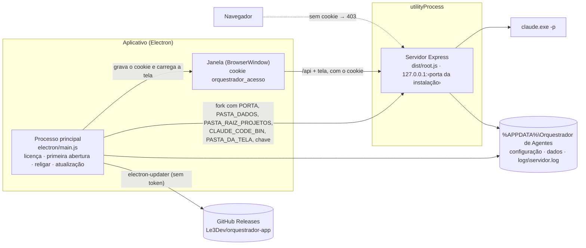
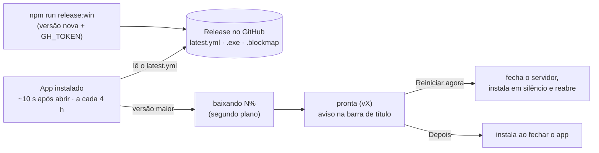
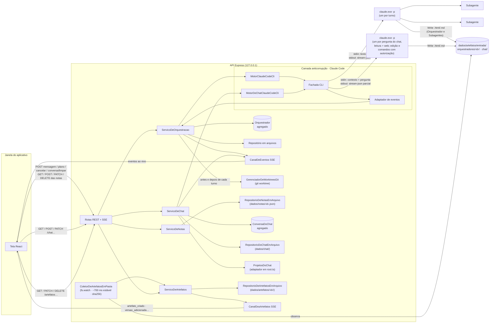
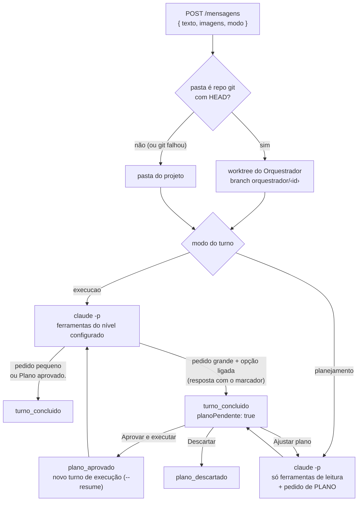

# Orquestrador de Agentes

## Objetivo

Central local para trabalhar com vários agentes do Claude ao mesmo tempo. É um **aplicativo desktop** (Electron, Windows; no Mac e no Linux, rodando pelo código): a tela só abre dentro da janela do aplicativo. Aberto no navegador, o servidor recusa (ver ADR-19).

Você cria **Orquestradores** — um por projeto, por exemplo — e conversa com cada um. A cada pedido, o Orquestrador **coordena**: o trivial (ler poucos arquivos, conferir um estado, um comando curto) ele resolve sozinho; o resto ele divide em subtarefas e entrega a **Subagentes** em paralelo, que leem, editam ou rodam comandos na pasta do projeto. Ele **nunca edita arquivos do projeto**: toda alteração vai para um Subagente (a única exceção são os artefatos, abaixo). A tela mostra cada Subagente ao vivo (atividade, ferramentas, tokens, resultado), o que o próprio Orquestrador está fazendo e, no final, a síntese.

- Vários Orquestradores rodam ao mesmo tempo, cada um na sua pasta: são terminais espalhados num canvas infinito, que você move, redimensiona e organiza. Cada Subagente aparece como um bixinho animado ligado ao terminal, com o ícone da ferramenta que está usando; ao terminar, um envelope leva o relatório pela linha e a borda do terminal pisca. No minimapa, o terminal de quem está trabalhando brilha.
- A conversa tem memória: cada Orquestrador lembra dos pedidos anteriores. **`/clear`** no prompt (ou *Nova conversa* no *⚙*) começa uma conversa do zero; a anterior fica arquivada.
- **Fila de pedidos:** com um pedido rodando, o Enter guarda o próximo numa fila (até 10 por Orquestrador). Ela anda sozinha quando o pedido termina bem e pausa quando ele falha, é cancelado ou deixa um plano para aprovar.
- **Painel de alterações:** um botão na barra do terminal mostra quantos arquivos o Orquestrador deixou por commitar no worktree e abre a lista com o diff de cada um (só leitura).
- **Paleta de comandos (Ctrl+K):** busca ações do canvas, Orquestradores, notas e pedidos, e leva até o escolhido.
- Por Orquestrador você escolhe os modelos e o esforço de raciocínio de cada papel, a quantidade de Subagentes (fixa ou automática com máximo), as permissões e se commit e push por feature estão ligados (cada feature pronta vira um commit com push; desligado por padrão). Não são opções: o Orquestrador sempre faz o trivial sozinho e sempre propõe um plano antes de mudanças grandes (ver ADR-28).
- **Plan Mode:** em vez de executar direto, o Orquestrador pode entregar primeiro um plano, feito só com leitura, que você aprova, ajusta ou descarta. Mesmo sem o Plan Mode, um pedido grande pode voltar como plano para aprovação.
- Em pastas com git, cada pedido roda num **worktree** próprio do Orquestrador, e não na pasta original.
- Dá para cancelar um pedido no meio, e o histórico fica salvo.
- **Bloco de notas:** no mesmo canvas, ao lado dos terminais, você cria notas de texto para observações e coisas para fazer depois. O conteúdo fica salvo no servidor, com salvamento automático. No modo lista, os itens `[ ]` viram caixas de marcar, e uma linha (ou a nota inteira) arrastada até um terminal vira texto no prompt.
- **Chat rápido:** uma caixa no centro, embaixo da tela, para perguntar algo ao Claude sem abrir um terminal: dúvidas rápidas, pesquisas na web, perguntas sobre os projetos e pequenas alterações. Para **editar arquivos e rodar comandos**, ele pede uma **autorização única** na primeira vez, que vale até o próximo `/clear`; commit e push, só quando você pedir. Ele também pode sugerir abrir um Orquestrador num projeto, já com um pedido, e criar ou editar um subagente pronto quando você pedir; a sugestão vira um cartão que só roda quando você clica.
- **Artefatos:** peça a um Orquestrador ou ao chat uma página ou um relatório (*"crie um artefato com um gráfico das vendas por mês"*) e o resultado abre sozinho numa janela do canvas, ao lado do terminal de quem o criou (ou no centro, se veio do chat): uma página HTML interativa, isolada e sem acesso à internet, ou um documento Markdown formatado. Cada vez que o agente regrava o arquivo, nasce uma versão nova (`v1`, `v2`…); dá para ampliar, salvar como arquivo, renomear e apagar. Funciona em qualquer permissão, inclusive *Somente leitura* e Plan Mode (ver ADR-26).
- Modelos disponíveis: **Fable**, Opus, Sonnet e Haiku, tanto nos Orquestradores quanto no chat.

O motor é o próprio **Claude Code em modo headless**, usando o login da sua assinatura — não precisa de API key.

## Como rodar

**Pré-requisito em qualquer modo:** o Claude Code instalado e logado (`claude` funcionando no terminal). Para rodar a partir do código-fonte, também Node 22+.

**Usuário final (instalador):** baixe o `.exe` da última versão em **https://github.com/Le3Dev/orquestrador-app/releases/latest** e instale. O instalador é por usuário, sem pedir administrador, e deixa escolher a pasta. Sem certificado de assinatura, o Windows SmartScreen avisa na primeira instalação (*Mais informações → Executar assim mesmo*). O Claude Code precisa estar instalado e logado (pré-requisito acima). **Por enquanto o app não pede chave de licença:** é a fase de testes (`exigirLicenca: false` em `electron/config.js`; ver ADR-29). Depois de instalado, as **atualizações chegam sozinhas**: o app baixa a versão nova em segundo plano e avisa na barra de título para reiniciar (ver *Guia do usuário*, item 15). A atualização não mexe na configuração nem nos dados (`%APPDATA%\Orquestrador de Agentes`).

**Dia a dia, a partir do código-fonte:** dê dois cliques em **`iniciar-desktop.cmd`**. Na primeira vez ele instala as dependências e gera o build; depois roda `npm run desktop` (`electron .`), que abre a janela do aplicativo. Rodando assim (não empacotado), **não há licença nem atualização automática**. Depois de atualizar o código, rode `npm run build` (o `.cmd` só gera o build quando falta `dist/` ou `web/dist/`).

```bash
npm install
npm --prefix web install
npm run build
npm run desktop
```

**No Mac, a partir do código-fonte:** dê dois cliques em **`iniciar-desktop.command`** (par do `iniciar-desktop.cmd`). Na primeira vez ele instala as dependências; depois refaz o build só do que mudou e roda `npm run desktop`. Como no Windows, pelo código não há licença nem atualização automática. Fechar a janela do Terminal fecha o app. A pasta do app fica em `~/Library/Application Support/Orquestrador de Agentes` (no lugar de `%APPDATA%\Orquestrador de Agentes`), com o mesmo `config.json`, `dados/` e `logs/`. Os ajustes do Mac ficam em `electron/mac.js`, todos atrás de `process.platform === "darwin"`, e não mudam nada no Windows (ver ADR-34):
- menu do app com copiar, colar, desfazer, zoom, Cmd+W e Cmd+Q (no Mac quem faz isso funcionar é o menu);
- as 3 bolinhas nativas no canto esquerdo da barra de título do app, no lugar dos botões ─ ☐ ✕ desenhados;
- o PATH do shell de login (nvm, Homebrew, `~/.local/bin`): aberto pelo Finder ou pelo Dock, o app receberia um PATH mínimo e o Claude Code não acharia o `node`;
- na primeira abertura, o `claude` do PATH no lugar do `claude.exe`;
- sem atualização automática, mesmo empacotado: sem assinatura da Apple ela não instala. Ainda não há instalador para Mac.

**No Linux, a partir do código-fonte:** no terminal, na pasta do projeto, rode **`./iniciar-desktop.sh`** (par do `iniciar-desktop.command`, em bash). Como no Mac, na primeira vez ele instala as dependências; depois refaz o build só do que mudou e roda `npm run desktop`. Pelo código não há licença nem atualização automática, e fechar o terminal fecha o app. A pasta do app fica em `~/.config/Orquestrador de Agentes` (ou em `$XDG_CONFIG_HOME/Orquestrador de Agentes`, se a variável estiver definida), com o mesmo `config.json`, `dados/` e `logs/`. Não há instalador, e dos ajustes do `electron/mac.js` só um vale no Linux: **na primeira abertura o campo do Claude Code já vem preenchido** com o primeiro `claude` do PATH ou, sem ele, com `~/.local/bin/claude` (onde o instalador do Claude Code o põe) ou `/usr/local/bin/claude`. Se não achar, escolha o arquivo na tela (`command -v claude` mostra onde ele está); a pasta `~/.local` é oculta, e no seletor de arquivos Ctrl+L deixa digitar o caminho.

**Primeira abertura:** o aplicativo pede três coisas, guardadas na configuração local dele:
1. a **pasta raiz dos projetos** (os Orquestradores só trabalham dentro dela);
2. o **`claude.exe`** do Claude Code (ele procura sozinho no caminho padrão; dá para escolher outro). No Mac e no Linux, ele já vem preenchido com o `claude` do PATH (em geral `~/.local/bin/claude`; no Linux, também procurado em `~/.local/bin` e `/usr/local/bin` fora do PATH);
3. se encontrar um histórico antigo (`<pasta do app>\dados` ou `%USERPROFILE%\projetos\orquestrador-app\dados`; no Mac e no Linux, `<pasta do app>/dados` ou `~/projetos/orquestrador-app/dados`), oferece **importar**: copia orquestradores, notas e anexos para a pasta nova; o chat rápido antigo fica só para consulta em `dados\chat\historico\conversa-importada\` (a conversa não é retomada; o chat começa uma nova). A origem nunca é apagada, e os worktrees antigos continuam onde estão.

Para trocar depois, use o **⚙** da barra de título do aplicativo (à esquerda de minimizar, maximizar e fechar) ou a ação *Pastas e Claude Code* da paleta (**Ctrl+K**); os dois reabrem essa tela.

**Onde ficam os dados e o log** (a mesma pasta no app instalado e no `npm run desktop`; é a `userData` do Electron, `<appData>/Orquestrador de Agentes`):
- configuração (`config.json`: pasta dos projetos, `claude.exe` e porta): `%APPDATA%\Orquestrador de Agentes\config.json`; no Mac, `~/Library/Application Support/Orquestrador de Agentes/config.json`; no Linux, `~/.config/Orquestrador de Agentes/config.json`;
- dados (histórico, notas, chat, anexos, worktrees novos): `%APPDATA%\Orquestrador de Agentes\dados`; no Mac, `~/Library/Application Support/Orquestrador de Agentes/dados`; no Linux, `~/.config/Orquestrador de Agentes/dados`;
- log do servidor: `%APPDATA%\Orquestrador de Agentes\logs\servidor.log`; no Mac, `~/Library/Application Support/Orquestrador de Agentes/logs/servidor.log`; no Linux, `~/.config/Orquestrador de Agentes/logs/servidor.log`.

No Linux, `~/.config` vale quando `$XDG_CONFIG_HOME` não está definida; definida, a pasta do app fica dentro dela.

Antes, o `npm run desktop` usava `%APPDATA%\orquestrador-agentes-app`. Na primeira abertura com a pasta nova (sem `config.json` nela), o app **copia** de lá o `config.json` e a pasta `dados\` e registra no log; a pasta antiga não é apagada nem alterada, e caches do Chromium, logs e layout antigo não vêm junto.

O aplicativo sobe o servidor sozinho, numa **porta fixa desta instalação** (sorteada na primeira abertura e gravada no `config.json`; se ela estiver ocupada, o app escolhe outra, grava e registra no log), e o **religa se ele cair**. Fechar a janela desliga o servidor e cancela os pedidos em andamento. Ao subir, o servidor encerra os processos do Claude que tenham sobrado da queda anterior; antes, confere a linha de comando de cada um, para nunca derrubar uma sessão do Claude Code sua.

> **Não abra o aplicativo pedindo a uma sessão do Claude Code.** Lá ele roda em segundo plano, e o Claude Code encerra processos em segundo plano quando a memória do computador fica baixa. Foi o que derrubou três orquestradores ao mesmo tempo em 28/10. Use o `.cmd`, o atalho do instalado ou um terminal próprio. Se o servidor cair mesmo assim, a tela mostra o aviso **Servidor desconectado** e reconecta sozinha quando o app o religar.

**Desenvolvimento (no aplicativo):**

```bash
npm run desktop:dev
```

O script (`scripts/desktop-dev.cjs`) compila o backend uma vez, sobe o Vite em http://localhost:5173 (com `/api` repassado à porta 3201) e abre o Electron com `ORQUESTRADOR_URL_DA_TELA=http://localhost:5173` e `PORTA=3201`. Mudanças em `web/` recarregam na janela; mudanças no backend pedem fechar e rodar de novo. Fechar a janela ou Ctrl+C encerra tudo.

**Desenvolvimento no navegador (só com a trava desligada):** o servidor recusa o navegador e nem sobe sem a chave do aplicativo. Para depurar a API e a tela no navegador, ligue `ORQUESTRADOR_PERMITIR_NAVEGADOR=1` (no `.env`, a partir do `.env.example`) e use dois terminais:

```bash
npm run dev       # API em http://localhost:3200 (recarrega ao salvar)
npm run web:dev   # tela em http://localhost:5173 (repassa /api para a 3200)
```

> Evite salvar arquivos do backend com um pedido rodando: no Windows, o `tsx watch` reinicia o servidor sem avisar o processo, e o `claude.exe` em andamento continua até terminar sozinho. O turno aparece como "interrompido" e pode ser reenviado.

**Empacotar:**

```bash
npm run dist:win         # instalador normal, em dist_electron/ (só gera; não publica)
npm run dist:win:teste   # build de teste, em dist_electron_teste/: pula a licença e não se atualiza. NUNCA distribuir
npm run release:win      # gera o instalador normal e PUBLICA a release no GitHub (precisa do GH_TOKEN)
```

O build de teste grava `"buildDeTeste": true` no `package.json` empacotado; serve para os testes de ponta a ponta do instalado.

`dist:win` e `dist:win:teste` rodam o electron-builder com **`--publish never`**: nunca publicam, mesmo com `GH_TOKEN` no ambiente. Só o **`release:win`** (`npm run build && electron-builder --win --publish always`) publica, nas **Releases do GitHub público `Le3Dev/orquestrador-app`** (`build.publish`: provider `github`, owner `Le3Dev`, repo `orquestrador-app`, `releaseType: "release"`). A release leva o instalador `.exe`, o `.blockmap` e o **`latest.yml`**, que é o que os apps instalados leem para saber se há versão nova (ver ADR-29). Os apps baixam sem token (o repositório é público); o token só existe no PC de quem publica.

**Erro de symlink ao empacotar no Windows:** se o `dist:win` (ou o `release:win`) parar com `ERROR: Cannot create symbolic link : O cliente não tem o privilégio necessário. : …\winCodeSign\<número>\darwin\10.12\lib\libcrypto.dylib`, é o electron-builder extraindo a ferramenta `winCodeSign-2.6.0` para o cache (`%LOCALAPPDATA%\electron-builder\Cache\winCodeSign`): o `.7z` dela traz dois symlinks de macOS (`libcrypto.dylib` e `libssl.dylib`), e o Windows só deixa criar symlink com o Modo de Desenvolvedor ligado ou como administrador. Cada tentativa deixa no cache uma pasta numerada e um `<número>.7z`, sem a pasta final `winCodeSign-2.6.0`. Duas saídas, uma vez por máquina:
- ligar o **Modo de Desenvolvedor** do Windows (*Configurações → Sistema → Para desenvolvedores*) e rodar o `dist:win` de novo; ou
- sem administrador, extrair uma vez o `.7z` já baixado (o mais recente da pasta; se não houver nenhum, rode o `dist:win` uma vez para baixar) para a pasta que o electron-builder procura, com o 7-Zip das dependências. No Prompt de Comando, na pasta do projeto (no PowerShell, troque `%LOCALAPPDATA%` por `$env:LOCALAPPDATA`):
  ```bat
  node_modules\7zip-bin\win\x64\7za.exe x -bd -y "%LOCALAPPDATA%\electron-builder\Cache\winCodeSign\<número>.7z" "-o%LOCALAPPDATA%\electron-builder\Cache\winCodeSign\winCodeSign-2.6.0"
  ```
  Os dois erros de symlink em `darwin\10.12\lib` (e o código de saída 2) são esperados: o Windows só usa o resto (`rcedit-x64.exe`, `windows-10\`). Com a pasta `winCodeSign-2.6.0` no cache, o electron-builder não extrai de novo. As pastas numeradas das tentativas podem ficar.

**Publicar uma nova versão** (ver ADR-29):
1. **Suba a versão** no `package.json` (`version`; hoje `0.2.0`): `npm version patch --no-git-tag-version` (correção) ou `npm version minor --no-git-tag-version` (novidade), ou edite o campo à mão. **Sem subir a versão, nenhum app recebe nada:** o app só baixa versão maior que a instalada.
2. **Commit e merge na `main`:** o código publicado deve ser o da `main`. Publique a partir dela, atualizada (`git checkout main` e `git pull`), já com a versão nova.
3. **Token do GitHub:** crie um token *fine-grained* com acesso **só ao repositório `orquestrador-app`** e a permissão **Contents: Read and write**. Defina-o só na sessão do PowerShell:
   ```powershell
   $env:GH_TOKEN = "..."
   ```
   **Nunca commite o token** e nunca o coloque no `.env` nem em outro arquivo do projeto.
4. **Publique:** `npm run release:win`.
5. **Confira** em https://github.com/Le3Dev/orquestrador-app/releases: a release `v<versão>` publicada, com o `.exe`, o `.blockmap` e o `latest.yml`. Os apps instalados pegam a versão nova ao abrir (uns 10 s depois) ou, se já estiverem abertos, em até 4 h.

**Nunca publique o build de teste** (`dist:win:teste`): ele abre sem licença e não deve chegar aos apps instalados.

**Religar a licença:** mude `exigirLicenca` para `true` em `electron/config.js` e publique uma versão nova (passos acima). Todos os apps instalados passam a pedir a chave do Lemon Squeezy na versão nova, então **avise os testadores antes**.

**Ícone do app** (ver ADR-27): o bixinho gota de óculos escuros; fica em `electron/icones/` e é versionado. O `icone.ico` (16, 20, 24, 32, 40, 48, 64, 128 e 256 px) vai na janela e na barra de tarefas do Windows, no `.exe` (`build.win.icon`) e no instalador e desinstalador (`build.nsis.installerIcon`/`uninstallerIcon`); o `icone.png` (512 × 512) vai na janela fora do Windows. Para regenerar depois de mudar o desenho ou as cores em `scripts/gerarIcones.cjs`:

```bash
npm run icones   # grava electron/icones/icone.ico e icone.png
```

**Variáveis de ambiente.** No aplicativo, as do servidor são passadas pelo próprio app; ninguém precisa configurá-las. O `.env` só vale para `npm run dev` / `npm start`.

| Variável | Quem lê | Padrão | Para quê |
|---|---|---|---|
| `PORTA` | servidor e aplicativo | `3200` (o app usa a porta gravada no `config.json`; `desktop:dev` usa `3201`) | Porta da API (escuta só em `127.0.0.1`). No app, definida no ambiente vale por cima da gravada e não é gravada |
| `PASTA_DADOS` | servidor | `dados/` dentro da pasta do app (o app passa `%APPDATA%\Orquestrador de Agentes\dados`) | Histórico dos Orquestradores, notas (`notas/`), chat (`chat/`), artefatos (`artefatos/`), anexos e worktrees |
| `PASTA_RAIZ_PROJETOS` | servidor | pasta acima deste projeto (o app passa a escolhida na primeira abertura) | Raiz dentro da qual os Orquestradores podem trabalhar |
| `CLAUDE_CODE_BIN` | servidor | `%APPDATA%\npm\node_modules\@anthropic-ai\claude-code\bin\claude.exe` (o app passa o escolhido na primeira abertura) | Executável **nativo** do Claude Code (o `claude.cmd` não serve: o app inicia o processo sem shell) |
| `PASTA_DA_TELA` | servidor | `web/dist` do app | Pasta da tela já construída |
| `ORQUESTRADOR_CHAVE_DE_ACESSO` | servidor | — (o app gera uma aleatória a cada abertura) | Chave conferida no cookie `orquestrador_acesso`; sem ela o servidor não sobe |
| `ORQUESTRADOR_PERMITIR_NAVEGADOR` | servidor | desligada | `1` = **só desenvolvimento**: sobe sem chave e aceita o navegador |
| `ORQUESTRADOR_URL_DE_DOWNLOAD` | servidor (opcional) | — (o app passa o `urlDeDownload` do `electron/config.js`: `https://github.com/Le3Dev/orquestrador-app/releases/latest`) | Link para baixar o aplicativo, mostrado na página "roda só no aplicativo" |
| `ORQUESTRADOR_URL_DA_TELA` | aplicativo | — | Carrega a tela desta URL (o Vite, em `desktop:dev`) em vez da servida pelo servidor |
| `ORQUESTRADOR_PASTA_DO_USUARIO` | aplicativo | `%APPDATA%\Orquestrador de Agentes` | Troca a pasta do usuário do app (configuração, dados, log, licença). Só não empacotado ou no build de teste; usada nos testes de ponta a ponta. Com ela, a cópia da pasta antiga não acontece |
| `PORTA_DA_API` | Vite (`web/`) | `3200` | Porta para onde o Vite repassa o `/api` |
| `GH_TOKEN` | electron-builder, só no `npm run release:win` | — | Token *fine-grained* do GitHub (só no repositório `orquestrador-app`, **Contents: Read and write**) para publicar a release. Só na sessão de quem publica (`$env:GH_TOKEN = "..."`); nunca em arquivo do projeto. Os apps instalados não precisam dele (ver ADR-29) |

**Testes e verificações:**

```bash
npm test            # domínio, adaptador do Claude Code (com saídas reais), repositórios, rotas, trava de acesso e electron/*.test.js
npm run typecheck
npm run web:test    # reducer da conversa, fases, nós e layout do canvas, bixinhos, notas e formatação
npm run web:lint
```

Casos de teste sugeridos para a opção **Commit e push por feature** (ver ADR-40, que substitui a regra por pedido do ADR-10):
- **Bloco do pedido:** desligada → "Commits e push são sempre proibidos."; ligada em turno de execução → a frase "Commits e push: por feature…", com um commit por feature, push da branch em seguida, adição dos arquivos um a um (sem `git add -A` nem `git add .`), só um agente commitando quando há subagentes em paralelo, e PR e merge proibidos sem pedido explícito; ligada em turno de Plan Mode → continua "sempre proibidos".
- **Definição dos agentes:** ligada → o `executor` e os subagentes prontos só commitam quando a subtarefa os designa responsáveis pelos commits, com um commit por feature pronta, só com os arquivos dela, push em seguida e PR e merge proibidos; desligada → "Nunca faça commit nem push."
- **Argumentos do `claude -p`:** desligada (ou Plan Mode) → `--disallowedTools` com `git commit`/`git push` para PowerShell e Bash; ligada em execução → `--disallowedTools` só com os padrões de push forçado e `--settings <configuracoes.json>` com `{"attribution":{"commit":"","pr":""}}`; desligada ou Plan Mode → sem `--settings`.
- **Dados antigos:** um `orquestrador.json` sem o campo carrega com `permitirCommitEPush: false`; `POST /orquestradores` sem o campo cria com `false`; `POST /orquestradores` ou `PATCH /configuracao` com valor não booleano devolve 400.
- **Tela:** o toggle "Commit e push por feature" (componente compartilhado `CamposDaConfiguracao`, na criação e no *⚙*) envia `permitirCommitEPush` e mostra o aviso quando o nível de permissão não roda comandos.
- **Branch do worktree:** worktree limpo com commits só na `orquestrador/<id>` → a branch fica e sai o aviso no log; sem commits próprios → `git branch -D`; git falhou na conferência → a branch fica.

Casos de teste do **esforço de raciocínio** (ver ADR-12):
- **Domínio:** sem os campos → `"padrao"` nos dois papéis; `orquestrador.json` antigo → `"padrao"`; `com()` altera só o esforço informado; `turno_iniciado` e `configuracao_alterada` levam os dois esforços.
- **API:** `POST /orquestradores` sem os campos cria com `"padrao"`; aceita os escolhidos; valor fora da lista → 400 (`Esforço do orquestrador inválido.` / `Esforço dos subagentes inválido.`); o GET mostra e o PATCH altera só o informado.
- **Argumentos do `claude -p`:** `"padrao"` → sem `--effort` e sem `effort` no executor; cada papel com o seu nível (`alto` → `--effort high`; `extra_alto` → `"effort": "xhigh"` no executor); `CLAUDE_CODE_EFFORT_LEVEL` herdada sai do ambiente quando algum papel tem esforço escolhido e fica com os dois em `"padrao"`; o esforço nunca vai em `--settings`; `ultracode` no Orquestrador → `--effort ultracode` e `Workflow` em `--tools` e `--allowedTools`, e o executor em `"padrao"` recebe `"effort": "xhigh"`.
- **Tela:** os dois seletores começam em *Padrão (Claude Code)*, com os seis níveis e a ajuda; escolher num papel muda só aquele campo.

Casos de teste do **bloco de notas** (ver ADR-13):
- **Entidade `Nota`:** nasce com "Nova nota", texto vazio e `criadaEm` = `atualizadaEm`; título aparado, texto guardado como veio; renomear/reescrever atualizam `atualizadaEm`, mas com o mesmo conteúdo não contam como alteração; título com exatamente 120 caracteres (depois de aparar) e texto com exatamente 100.000 passam, um a mais é recusado; `reconstituir` devolve exatamente os dados gravados.
- **Repositório em arquivos:** cria `notas/` e começa vazio; um arquivo por nota, que reabre igual; lista por `criadaEm` crescente; devolve cópias (alterar a buscada não muda nada até salvar); arquivo ilegível é ignorado com aviso, sem ser apagado; gravações seguidas da mesma nota terminam com o último conteúdo, sem arquivo pela metade; remover logo depois de salvar não deixa a nota no disco; id que escaparia da pasta é recusado.
- **Rotas:** GET vazio → 200 `[]`; POST sem corpo → 201 com os padrões; PATCH parcial altera só o campo enviado; PATCHes simultâneos terminam com o último aceito no disco; DELETE → 204; PATCH/DELETE de nota inexistente → 404 `Nota não encontrada.`; POST com título vazio/longo, texto longo, campo que não é texto ou corpo que não é objeto → 400 com a mensagem certa e nada gravado; PATCH com um campo inválido → 400 e a nota fica como estava.
- **Layout:** layout antigo sem `notas` vale como sem notas; só as notas corrompidas do layout são descartadas, e sem `minimizada` a nota fica aberta; minimizar deixa só a barra e restaurar volta à altura de antes; a altura gravada é a da nota aberta, mesmo minimizada; "Organizar" põe as notas em colunas de até 4 à direita da grade dos terminais; nota que sumiu do servidor sai do layout ao carregar a lista, e a criada enquanto a lista carregava não sai.
- **Nó da nota (`NoNota`):** digitar e parar dispara um único PATCH, depois da espera, só com o texto; perder o foco salva na hora; erro no PATCH mostra a mensagem e o "tentar de novo"; minimizada, mostra só a barra com o título e a prévia; minimizar e restaurar não perde texto não salvo; clique duplo no título, Enter salva e em branco volta ao anterior; apagar pede confirmação e chama o DELETE (404 também tira do canvas; outro erro mantém a nota com o motivo); digitar numa nota não re-renderiza a outra.

Casos de teste da **delegação sob demanda** (ver ADR-14 e ADR-28):
- **Bloco do pedido:** sempre "Faça você mesmo o trivial: …" com o texto do nível (sem terminal em *leitura*, *edição* e no Plan Mode), a regra de quando delegar e "Você não edita arquivos", na execução e no planejamento; a regra estrita antiga ("Não faça o trabalho você mesmo…") não aparece mais; quantidade fixa → "quando delegar, use exatamente N"; automática → "no máximo N … se um basta, use um".
- **Bloco do pedido — rapidez (ADR-39):** "Comandos curtos são seus, sem subagente" só em *Editar e rodar comandos* fora do Plan Mode (nunca em *leitura*, *edição* nem no planejamento); "commit, push e abrir PR" só entram nela com commit permitido no turno; "uma leva só" e "passe os caminhos e as linhas" vêm sempre, depois da linha dos subagentes e antes das permissões; `model: "sonnet"` só é sugerido com subagentes `opus` ou `fable`, nunca com `sonnet` ou `haiku`.
- **Instruções do Subagente — rapidez (ADR-39):** o `executor` e os subagentes prontos recebem "Leia por trecho" (Grep + Read com offset e limit, README extenso nunca inteiro), "Não refaça a busca do que a subtarefa já informou", "Rode só os testes e verificações do que você alterou" (antes da regra dos servidores) e a "resposta curta … inclusive dos testes", no lugar do antigo "Ao terminar, devolva: o que fez…".
- **Dados e API (ADR-28):** `paraDados`, o GET e os eventos `turno_iniciado`/`configuracao_alterada` não trazem mais `permitirTrabalhoDireto` nem `proporPlanoEmPedidosGrandes`; `orquestrador.json` antigo com os campos (`true`, `false` ou até valor inválido) é lido sem erro e os perde ao salvar de novo; um antigo com os dois em `false` passa a receber o trivial e a regra de pedidos grandes, com o mesmo bloco de um novo; `POST`/`PATCH` que ainda mandam os campos respondem 200/201 e os ignoram (o `PATCH` aplica os outros campos).
- **Tela:** `ferramenta_do_orquestrador` vira linha de atividade ("orquestrador lendo package.json").

Casos de teste do **plano proposto em execução** (ver ADR-15 e ADR-28):
- **`separarPropostaDePlano`:** remove o marcador sozinho na linha, no meio da linha, entre crases e repetido; sem marcador devolve a resposta intacta e `planoProposto: false`.
- **Bloco do pedido:** em todo turno de execução, em qualquer nível, traz "Pedidos grandes…" com "investigue só lendo (você ou subagentes com subtarefas só de leitura)"; no planejamento, nunca; lá, a investigação é "Investigue (você mesmo, se for rápido, ou delegando)".
- **Serviço:** com o marcador na resposta de um turno de execução → `turno_concluido.planoPendente: true` e plano aprovável/descartável; vale também para um orquestrador salvo com a opção antiga desligada; alterar a configuração no meio do turno não muda o resultado; aprovar envia "Plano aprovado. …".
- **Tela:** `CartaoDoPlano` também em turno de execução com plano pendente; linha "plano proposto · aguardando aprovação"; dica "pedido grande? shift+tab para planejar antes" só em execução e com pedido longo (mais de 400 caracteres ou lista de 3+ itens).

Casos de teste do **`/clear`** (ver ADR-16):
- **Domínio:** recusa com turno em andamento; esvazia os turnos, troca o `sessaoId`, volta `sessaoIniciada` a `false` e descarta o plano pendente; o evento informa `turnosAnteriores`, `planoDescartado` e `worktreeComAlteracoes`.
- **Repositório:** copia `eventos.jsonl` e `orquestrador.json` para `historico/conversa-<N+1>/`; o `eventos.jsonl` novo tem só o `conversa_limpa`, com a sequência seguinte; ao reabrir, a conversa nova carrega e o `historico` é ignorado; remover o orquestrador apaga o `historico`.
- **Rota:** 200 com `totalDeTurnos: 0`; 409 durante um pedido; 404 sem orquestrador; sem conversa → 200 sem gravar nada.
- **Tela:** `/clear` (maiúsculas e espaços tolerados) não vira pedido; "/clear algo" vira; Tab completa "/cl"; durante um pedido aparece a dica de indisponível; imagens e Plan Mode continuam no prompt; o separador "— conversa nova iniciada às HH:MM —" aparece; *Nova conversa* no *⚙* pede confirmação e fica desabilitado durante um pedido.

Casos de teste do **chat rápido** (ver ADR-17 e ADR-25):
- **Agregado `ConversaDoChat`:** perguntar cria a pergunta (concluída) e a resposta vazia ("respondendo"); recusa outra pergunta com resposta em andamento (`Já há uma resposta em andamento.`), texto vazio sem imagens e mais de 5 imagens; aceita só imagem; acumula os trechos e ignora trecho sem resposta; `concluir` grava texto, ações, avisos e uso e marca a sessão como iniciada; `falhar` guarda o motivo nos avisos e só marca a sessão com uso informado; a sessão marcada no primeiro sinal do motor continua após cancelar; `limpar` recusa durante a resposta, troca o `sessaoId`, volta `sessaoIniciada` a `false` e esvazia as mensagens; ao reabrir, a resposta "respondendo" vira "falhou" com `interrompida`.
- **`separarAcoesDoApp`:** sem bloco devolve o texto intacto; bloco válido vira ação com a pasta resolvida e sai do texto; vários blocos; projeto em maiúsculas casa com a pasta e devolve o nome real; projeto inexistente, JSON inválido, tipo desconhecido e bloco sem fechamento saem do texto e viram aviso, sem ação; ações imutáveis. `criar_subagente` sai com os campos aparados e `modelo` `herdar` quando ausente ou nulo; `editar_subagente` leva só os campos a trocar (vazio, nulo ou ausente vira `null`); criar sem descrição ou prompt, modelo fora de `herdar`/`opus`/`sonnet`/`haiku`, editar sem nenhum campo a trocar, nome vazio e campo com tipo errado viram aviso de formato inválido; as de subagente não dependem da lista de projetos.
- **`mensagemParaOChat`:** bloco `<contexto-do-app>` com data/hora, pasta raiz, projetos, orquestradores, subagentes prontos (nome, modelo e quando usar, sem o prompt) e o formato exato dos blocos de ação, antes do texto; os exemplos dos três tipos de ação são blocos válidos; a regra dos subagentes (só a pedido, editar com um nome da lista e só os campos que mudam, limites do servidor); listas vazias indicadas; pergunta só com imagem vira "Veja a imagem anexada.".
- **Serviço (motor falso):** fluxo completo (pergunta → trechos e atividade como sinais → `resposta_concluida` com a ação extraída); a segunda pergunta usa `sessaoIniciada: true`; cancelar encerra o motor e grava `resposta_cancelada` com o texto parcial; falha do motor → `resposta_falhou`; os subagentes prontos da porta `SubagentesDoChat` vão ao contexto e as ações de criar e editar saem na `resposta_concluida`; sem a lista (porta com erro), o contexto diz "(nenhum)" e o chat responde; `uso_da_cota` gravado e exposto em `cota`; imagens guardadas em `anexos/chat/` e passadas ao motor; `/clear` arquiva e mantém as preferências; preferências valem na próxima pergunta; boot marca a resposta pendente como interrompida.
- **Repositório:** cria `chat/` e `chat/sessao/`; grava e relê conversa, eventos, preferências e cota; `/clear` copia para `historico/conversa-<N>/`, continua a sequência e mantém `preferencias.json`; arquivo ilegível vira aviso no log e uma cópia `.ilegivel-<ms>` ao lado, sem ser apagado.
- **Rotas:** `GET /chat` inicial; `POST /chat/mensagens` 202, texto parcial no GET, 409 com resposta em andamento, 400 sem texto nem imagem e com formato inválido; `GET /chat/anexos/:arquivo` serve a imagem e devolve 404 para nome inválido; `PATCH /chat/preferencias` 200 e 400 (`Modelo inválido.` / `Esforço inválido.`); `POST /chat/cancelar` 409/202; `POST /chat/limpar` 409/200; SSE com `id:` nos eventos gravados, `event: trecho`/`event: atividade` sem id, e `Last-Event-ID`/`?desde=` respeitados.
- **Tela (`web/`):**
  - *`aplicarEventoDoChat`:* `pergunta_enviada` inclui as duas mensagens e põe o chat respondendo; trechos se concatenam e só a atividade mais recente fica; `resposta_concluida` substitui o texto dos trechos e traz ações, avisos e uso; `resposta_falhou` guarda o motivo e `resposta_cancelada` marca a resposta; `conversa_limpa` esvazia; preferências e cota atualizadas; eventos repetidos ou fora de ordem ignorados pela sequência; o estado carregado substitui o da tela e o último aviso de uma resposta que falhou volta a ser o motivo; `textoParaMostrar` esconde o bloco de ação (aberto, fechado ou com a cerca pela metade durante a resposta) sem mexer em outros blocos de código.
  - *`useChat`:* carrega o estado e assina `?desde=<ultimaSequencia>`; se o navegador abandona a conexão ou o servidor volta, recarrega e assina de novo; falha na carga avisa e tenta de novo.
  - *`ChatRapido`:* Enter envia e limpa o campo (Shift+Enter não); erro do servidor aparece e o texto fica; `/clear` limpa sem virar pergunta e Tab completa; durante a resposta o botão vira cancelar e Esc cancela; desconectado não envia; Esc ociosa oculta a conversa e o indicador avisa resposta nova; falha, cancelamento, avisos e cartões aparecem; cada ação vira o cartão do tipo dela (`CartaoDeAcao` para abrir orquestrador, `CartaoDeSubagente` para criar e editar subagente).
  - *`CartaoDeSubagente`:* criar mostra nome, chip do modelo, quando usar e o prompt recolhido, sem chamar o servidor antes do clique; no clique relê a lista, acrescenta ao fim, grava a lista inteira e mostra *criado ✓*; nome que já existe vira erro no cartão, sem gravar; o 400 do servidor aparece com a mensagem dele e *tentar de novo* grava; editar mostra o antes e o depois só dos campos trocados, troca só eles mantendo a posição e mostra *alterado ✓*; nome que não existe vira erro, sem gravar; falha ao ler a lista vira erro.
  - *`SeletorDeModelo`:* mostra modelo, versão e esforço, com ✓ no escolhido; escolher modelo ou esforço chama o `PATCH`; Esc e clique fora fecham; o rótulo usa a versão da última resposta quando é da mesma família; falha ao gravar avisa.
  - *`CartaoDeAcao`:* nada antes do clique; com Orquestrador na mesma pasta (barras e maiúsculas diferentes) só abre o terminal; sem ele, cria com a configuração padrão e abre; com pedido, envia o pedido e um segundo clique só reabre; erro mostra a mensagem e permite tentar de novo; sem vaga no canvas, não cria nem envia e mostra o aviso do limite; com o Orquestrador da pasta já aberto (canvas cheio), só foca nele.
  - *`CamposDaConfiguracao`:* oferece Fable, Opus, Sonnet e Haiku nos dois seletores e mostra Fable já escolhido. *Canvas:* o chat fica no painel do centro de baixo, sem arrastar nem rolar o canvas. *`modelos`:* versão lida do id do modelo só na mesma família, nome com versão e rótulos dos esforços.
- **Autorização de alterações** (ver ADR-25):
  - *Agregado `ConversaDoChat`:* nasce sem autorização; `autorizarAlteracoes` gera `alteracoes_autorizadas` e, repetido, nada; `revogarAlteracoes` gera `autorizacao_revogada` e, sem autorização, nada; o `/clear` volta a `false`; `concluir` guarda a `autorizacaoPendente`; dados gravados antes, sem os campos, reabrem sem autorização e sem pendência.
  - *Adaptador do Claude Code:* sem autorização, a primeira edição (Edit, Write, NotebookEdit) ou comando (PowerShell, Bash) negado por não estar liberado vira a `autorizacaoPendente` (`editar` com o arquivo, `rodar_comando` com o comando); negação por regra fixa (`.env*`, push forçado) e qualquer negação com o chat já autorizado viram aviso.
  - *Argumentos:* sem autorização, `--allowedTools` só com pesquisa e leitura; com ela, as dez ferramentas; `--disallowedTools` sempre com `.env*` e o push forçado, por último; `--settings` sempre com a atribuição desligada (sem `Co-authored-by`).
  - *`mensagemParaOChat`:* o bloco `<contexto-do-app>` diz se as alterações estão autorizadas e traz a regra de commit e push.
  - *Rotas:* `GET /chat` com `alteracoesAutorizadas`; `PATCH /chat/autorizacao` 200 `{ autorizado }` (também durante uma resposta) e 400 `A autorização deve ser verdadeira ou falsa.`; os dois eventos saem no SSE com sequência.
  - *Tela, `aplicarEventoDoChat`:* o campo vem do GET (sem ele, `false`); `alteracoes_autorizadas` liga, `autorizacao_revogada` desliga e `conversa_limpa` zera; eventos de autorização repetidos ou fora de ordem ignorados pela sequência; `autorizacaoPendente` ausente (no GET, na pergunta ou na conclusão) vale `null`; o pedido que vale é só o da última resposta do Claude (`pedidoDeAutorizacaoAtual`).
  - *Tela, `CartaoDeAutorizacao`:* textos de editar (arquivo) e de rodar comando; *Autorizar até o /clear e continuar* chama o `PATCH` com `true` e depois envia "Autorizado. Continue de onde parou.", nessa ordem, e o cartão some; erro mostra a mensagem e o *tentar de novo*, sem enviar, e continua visível mesmo com o chat já autorizado; *Agora não* esconde sem chamar o servidor; desabilitado durante a resposta ou desconectado; já autorizado, não aparece.
  - *Tela, `ChatRapido`:* o cartão aparece só na última resposta com pendência e sem autorização; o selo *alterações autorizadas* aparece com o `title` e o ✕ chama o `PATCH` com `false`; falha ao revogar aparece no composer e o selo fica; sem autorização não há selo; a atividade descreve edições ("editando src/x.ts…") e comandos ("rodando: npm test…").

Casos de teste do **limite de 20 orquestradores abertos** (ver ADR-18):
- **`cabeOutroTerminal`:** 19 abertos → cabe; 20 → não cabe; 20 abertos e pedido de um já aberto → cabe (só foca); o rascunho conta como aberto; o aviso usa o número da constante.
- **Canvas:** com 20 abertos, *+ Novo ▾ › Orquestrador* mostra o aviso (`alert-warning`, fechável) e não abre o formulário, e o **Ctrl+N** também; reabrir pela lista mostra o aviso e não abre; clicar num já aberto não recusa; fechar um no *✕* faz o aviso sumir, o Orquestrador continua na lista e a vaga volta; com 19 abertos e o formulário aberto, não abre outro.
- **`CartaoDeAcao`:** ver acima (sem vaga não chama `criarOrquestrador` nem `enviarMensagem`).

Casos de teste dos **processos deixados pelos agentes** (ver ADR-38):
- **Árvore (`ArvoreDeProcessos.test.ts`):** lê o JSON do `Get-CimInstance` (lista, objeto único, saída inválida) e o `ps` com grupo e `etime`; `mesmoProcesso` exige pid, criação (folga de 2 s) e linha de comando iguais; segue o ppid a partir do Claude Code; liga ao pai intermediário morto se ele foi visto antes (sem ele, não liga); não segue ppid de PID reaproveitado nem filho mais velho que o pai; não inclui nem atravessa pids protegidos; no Mac/Linux, liga pelo grupo; adota a árvore órfã que cita a pasta do turno, e não adota sem citar a pasta, nascida fora do turno, filha de um terminal do canvas ou com pai vivo.
- **Rastreador (`RastreadorDeProcessosDeixados.test.ts`, máquina falsa):** registra por Orquestrador o servidor que sobreviveu ao turno com o bash do `nohup` morto; remover o Orquestrador encerra só os dele (e o que eles abriram depois); pid reaproveitado (criação diferente) e protegido não são encerrados; o Claude Code de outro turno nunca; sem conseguir listar, nada é encerrado; sem nada registrado, nem lista; quem morreu sozinho sai do registro; removido durante a listagem final, encerra em vez de registrar; grava em disco e a subida seguinte encerra o que ainda for o mesmo processo.
- **Monitor (`MonitorDeMemoria.test.ts`):** soma por dono o Claude Code, os descendentes e os deixados, cada pid uma vez; falha ao medir conta zero.
- **Remoção:** `ServicoDeOrquestracao` chama o `aoRemover` com o id removido (uma falha nele só vai para o log) e não chama quando a remoção é recusada; `ServicoDeTerminais.encerrarDoOrquestrador` encerra só os terminais daquele Orquestrador.
- **Ponta a ponta (manual, Windows):** pedir a um Orquestrador "suba um servidor com `nohup npx http-server &`"; depois do turno, o `processos-deixados-pelos-agentes.json` tem o `node.exe`; excluir o Orquestrador (ou fechar o app) derruba o servidor; derrubar o servidor com `taskkill` e abrir o app de novo também.

Casos de teste do **só no aplicativo** (ver ADR-19):
- **Electron (`electron/*.test.js`):**
  - *configuração local (`configuracaoLocal.test.js`):* detecta o `claude.exe` (`CLAUDE_CODE_BIN` existente primeiro, depois npm, `.local\bin`, `Programs`); sugere `%USERPROFILE%\projetos`; valida pasta e arquivo (vazios, relativos, inexistentes); sem `config.json` → `null` (primeira abertura); grava atomicamente e relê (com a `porta`); normaliza arquivo editado à mão (porta fora de 1–65535 vira `null`); explica arquivo corrompido;
  - *porta da instalação (`escolherPortaDaInstalacao`):* `PORTA` do ambiente vale por cima da gravada (sem testar nem gravar); `PORTA` inválida é recusada; a gravada livre é reaproveitada; a gravada ocupada é trocada por uma sorteada (`origem: "trocada"`, com a anterior); sem porta gravada, sorteia (`"nova"`);
  - *pasta de dados única (`copiarDaPastaAntiga`, com pastas temporárias):* copia `config.json` e `dados/` da antiga e nada mais (nem `Cache`, nem `Local Storage`), deixando a antiga intacta; não faz nada se a nova já tem `config.json`, se a antiga não tem, ou se as duas são a mesma; sem `dados/` na antiga, copia só o `config.json`; não sobrescreve o que já está em `dados/` da nova;
  - *importação do histórico (`importacaoDoHistorico.test.js`):* acha `<pasta do app>\dados` (só não empacotado) e `%USERPROFILE%\projetos\orquestrador-app\dados`; só conta pasta com `orquestradores/` ou `notas/`; ignora o próprio destino; copia `orquestradores/`, `notas/` e `anexos/` como estão; o `chat/` antigo vai para `chat/historico/conversa-importada/` (sem `chat/sessao`) e não vira a conversa atual; não copia `worktrees/` nem `processos-em-execucao.json`; não sobrescreve; nunca apaga nem altera a origem;
  - *processo principal (`main.js`) — sem teste unitário, conferido no ponta a ponta:* com `ORQUESTRADOR_PASTA_DO_USUARIO` apontando para uma pasta temporária com `config.json`, o log mostra `Porta do servidor escolhida para esta instalação: <PORTA>` e `servidor em http://127.0.0.1:<PORTA>`, e a porta fica no `config.json`; fechar e abrir de novo reaproveita a porta e restaura o layout e o zoom do canvas; com a porta gravada ocupada por outro processo, o log mostra `A porta X estava ocupada; o servidor passa a usar a Y` e o `config.json` passa a ter Y; sem cookie, `GET /` dá 403 com a página "roda só no aplicativo" e `GET /api/saude` dá 403 `{ erro }`; dentro da janela, `fetch('/api/saude')` e `fetch('/api/orquestradores')` dão 200; ao fechar, não sobra processo do servidor; com a pasta dos projetos ou o `claude.exe` removidos, abre os Ajustes com o aviso. Vale para `npm run desktop` e para o instalado do build de teste.
- **Servidor (trava e configuração):** sem cookie → 403 (página "roda só no aplicativo" para HTML, `{ erro }` para `/api`); cookie com a chave errada → 403; com a chave → passa; sem chave e sem `ORQUESTRADOR_PERMITIR_NAVEGADOR=1` não sobe; com a variável, aceita o navegador; `PASTA_DA_TELA` e `PASTA_DADOS` absolutas respeitadas.
- **Tela:** no desktop, o *⚙* (Pastas e Claude Code) da barra de título chama `abrirAjustes()` e mostra a mensagem se falhar, e a paleta oferece *Pastas e Claude Code*; sem `window.electron.configuracao`, o ⚙ não aparece. No navegador, o *⚙ Pastas* fica na barra do canvas e só aparece com `window.electron.configuracao`.

Casos de teste da **barra de título e das larguras da janela** (ver ADR-20):
- **`BarraDeTituloDoApp`:** "Orquestrador de Agentes" à esquerda; no centro (`.centro-da-barra-de-titulo`, que continua arrastando a janela), o campo-botão *Buscar ou executar…* (`no-drag`, `aria-label` "Buscar ou executar (Ctrl+K)", `aria-keyshortcuts`, dica `Ctrl+K`), que chama a abertura da paleta; à direita (`.direita-da-barra-de-titulo`) o status (situação e cotas, `no-drag`) e, logo depois dele, o *⚙* (só ícone, `no-drag`, "Pastas e Claude Code"), que chama `abrirAjustes()` e, se falhar, mostra a mensagem (fechável no ✕) descendo da barra, e o grupo "Controles da janela" com Minimizar, Maximizar e Fechar; sem a API dos Ajustes, sem ⚙; no navegador (sem a ponte), só a busca, sem ⚙ nem botões de janela.
- **`ControlesDaJanela`:** fora do desktop não renderiza; minimizar, maximizar e fechar chamam a ponte (`window.electron.janela`); o grupo é `no-drag` e cada botão tem `aria-label` e `title`; abre como "Restaurar" se a janela já estiver maximizada e troca entre Maximizar/Restaurar a cada aviso de `aoMudarMaximizada`; ao sair da tela, cancela a inscrição.
- **`BarraDoCanvas`:**
  - *desktop:* só o `+ Novo ▾` (`aria-haspopup="menu"`, `aria-expanded`), sem título, busca, ⚙, notas, organizar ou botões de janela; rótulos completo, curto e ícone `+ Novo ▾` / `+ Novo ▾` / `+`, com o nome acessível e a dica fixos;
  - *menu (`role="menu"`/`menuitem`):* abre com o foco no primeiro item ("Orquestrador", `Ctrl+N`; "Nota", `Ctrl+Shift+N`, com `aria-keyshortcuts`); ↓ no botão abre no primeiro e ↑ no último; ↑/↓ navegam com volta; Enter escolhe; "Orquestrador" chama `aoCriar` e "Nota", `aoCriarNota`; Esc e clique fora fecham sem escolher e devolvem o foco ao botão; clique dentro do menu não fecha;
  - *navegador:* mostra o título do app, o `+ Novo ▾`, o *Buscar* (só com a paleta; `Buscar (Ctrl+K)` / `Buscar` / `⌕`, abre a paleta) e, com `window.electron.configuracao`, o *⚙ Pastas* (`⚙ Pastas` / `⚙`), que reabre os Ajustes e mostra a mensagem se falhar.
- **`StatusDoCanvas`:** rótulos curtos das cotas (`5h`, `7d`); o resumo mostra o medidor de maior uso e põe o resto (agentes ativos, cada cota, RAM) no balão (`title`); sem cota, memória nem agentes, não há resumo; no painel, o alerta de memória fica abaixo; na barra de título, não.
- **`PopoverDoUso`:** o medidor da cota (em linha, o resumo da janela estreita ou o "cota —" sem dados) abre o popover com `aria-expanded`; mostra cada janela com a barra e "renova em …", as janelas por modelo à parte, o consumo de cada orquestrador (índice, pedidos medidos, parte do total, parcial) e a falha da leitura; sem cota, explica que ela aparece depois do primeiro pedido; fecha com Esc (o foco volta ao medidor), clique fora e no próprio medidor.
- **`rotuloCurtoDaCota`:** "5 horas" → "5h", "7 dias" → "7d", nome sem número fica igual.
- **Canvas:**
  - restaura o zoom e a posição salvos; **Ctrl+0** volta a 100% mantendo o centro (`translate(100px,50px) scale(0.5)` → `translate(200px,100px) scale(1)` com a área 0 × 0 do jsdom); com o foco num campo de texto, Ctrl+0 não mexe no zoom; no navegador o status fica nos painéis do topo, e no desktop só na barra de título, acima do canvas;
  - **Ctrl+N** abre o formulário de novo orquestrador (com 20 abertos, o aviso do limite) e **Ctrl+Shift+N** cria uma nota, os dois impedindo o padrão; com o foco num campo de texto, nada acontece;
  - o *Organizar* é o 4º botão dos controles do canto inferior esquerdo (fora da barra do canvas), põe os terminais nas posições de `organizarComNotas` e fica desabilitado com uma janela só;
  - no desktop, a barra do canvas tem só o `+ Novo ▾`; a busca da barra de título abre a paleta, que oferece *Pastas e Claude Code* (chama `abrirAjustes()`); no navegador, o *Buscar* fica na barra do canvas e a paleta não tem essa ação.
- **Conferência visual (manual, pasta temporária):** janelas de 900×650, 1100×750, 1200×800, 1440×900 e maximizada, com captura da janela inteira: nenhum botão nativo do Windows; ─ ☐ ✕ do app alinhados na barra, com hover cinza (e vermelho no fechar) e foco visível pelo teclado; status à direita sem encostar nos botões e, se não couber, cortado pelo fim (a situação nunca some); linha inferior da barra de ponta a ponta; ícone de "restaurar" com a janela maximizada (pelo botão ou pelo Windows); minimizar, maximizar/restaurar e fechar funcionando; painéis do topo sem sobreposição, minimapa só a partir de 1100 px, chat sem cobrir os controles de zoom nem o minimapa, texto dos terminais nítido em 100%. Com a barra enxuta (atualização do ADR-20), conferir também 1300 e 1500 px: busca centralizada entre o nome e o status (só a lupa abaixo de 1100 px), status com nomes curtos abaixo de 1440 px e só o resumo abaixo de 1280 px, sem encostar no ⚙; o menu `+ Novo ▾` por cima da lista de orquestradores; o vão da barra em volta da busca arrasta a janela e o clique duplo maximiza.

Casos de teste da **economia de tokens** (ver ADR-21):
- **`PredefinicaoDeConfiguracao`:** o catálogo tem só `economico` (rótulo "Modo econômico"); nome desconhecido → `null`; aplicar muda exatamente os cinco campos (Opus/médio, Sonnet/médio, automática até 1) e preserva nível de permissão e commit/push; não mexe no trivial nem no plano, que valem sempre (ADR-28), e um orquestrador salvo com o Modo econômico antigo (plano desligado) continua correspondendo a ele; a configuração de origem não muda; `correspondeA` é verdadeiro logo depois de aplicar, continua verdadeiro mudando só a permissão e fica falso mudando um campo dela (esforço, limite); `paraDados` devolve cópia; predefinição e alterações congeladas.
- **`UsoDeTokens`:** entrada 6, criação de cache 33062, leitura de cache 62885 e saída 383 → índice 49537 (o mesmo número do benchmark) e total 96336; `somar` campo a campo sem alterar as parcelas; `vazio` é neutro; negativo, fracionário, `NaN` e infinito → `dados_invalidos`; imutável.
- **`ConsumoDoTurno`:** total = principal + subagentes; índice vem do total; `paraDados` com parcelas, índice e modelo; `comoParcial` devolve outro objeto; modelo em branco vira `null`; `subagentesMedidos` negativo é recusado.
- **`EsforcoHerdado`:** `deveAvisar` só em `extra_alto`, `maximo` e `ultracode`; origem vazia e `padrao` são recusados.
- **Agregado:** aplicar a predefinição registra `configuracao_alterada` com `predefinicao: "economico"`, e `predefinicaoCorrespondente` vira `null` ao editar um campo dela; `registrarConsumoDoTurno` mantém o consumo de turno concluído, marca como parcial o de turno cancelado ou com falha e recusa turno em andamento ou desconhecido.
- **Serviço (medidor e esforço falsos):** a medição recebe o `sessaoId`, a pasta onde o processo rodou (o worktree, ou a pasta do projeto sem git), o início e o fim do turno; o `consumo_do_turno_medido` vem depois do `turno_concluido`/`turno_falhou`/`turno_cancelado`, parcial nos dois últimos; sem transcrição, nenhum evento; erro do medidor só gera `console.warn`, sem evento, e o próximo pedido roda; aplicar predefinição desconhecida → `dados_invalidos`, orquestrador inexistente → `nao_encontrado`; o esforço herdado usa os modelos atuais e, no Orquestrador, o modelo do último consumo medido; erro na leitura do esforço → `null`.
- **Rotas:** `GET /predefinicoes`; o resumo (lista e detalhe) traz `predefinicaoCorrespondente`; `POST /configuracao/predefinicao` → 200 com as mesmas chaves do `PATCH`, 400 `Predefinição desconhecida.` (nome errado, não texto ou ausente), 404 `Orquestrador não encontrado.`; `GET /orquestradores/:id/esforco-herdado` → 200 com os dois papéis (e 404); `GET /esforco-herdado` → 200 com os modelos e a pasta do formulário, 400 para modelo inválido, pasta ausente, fora da raiz ou inexistente.

Casos de teste da **fila de pedidos** (ver ADR-23):
- **`PedidoNaFila`:** guarda o texto aparado, o modo e o instante de entrada; recusa texto vazio, acima de 50.000 caracteres (aceita no limite) e modo desconhecido; é imutável (o instante devolvido é uma cópia); `paraDados`/`reconstituir` vão e voltam iguais.
- **Agregado:** enfileira na ordem e recusa o 11º (`ErroDeFilaCheia`); retirar mantém a ordem dos outros; retirar ou buscar pedido que não está na fila → `nao_encontrado`; a fila exposta é uma cópia; sobrevive a gravar e reabrir, e um `orquestrador.json` anterior à fila reabre com ela vazia; `/clear` mantém a fila; `proximoDaFilaApos` só devolve o primeiro quando o turno é o último da conversa e terminou concluído sem plano pendente (cancelado, com falha, interrompido, com plano ou com outro turno depois → `null`).
- **Serviço (motor falso):** enfileirar publica `pedido_enfileirado` e grava, e sem turno o pedido fica parado; turno concluído envia o primeiro, com o `pedido_retirado_da_fila` (`enviado`) antes do `turno_iniciado` dele; "enviar agora" sem turno usa o texto e o modo do pedido, e com turno em andamento é recusado e o pedido continua; remover publica `removido`; se o usuário inicia outro turno antes do envio automático, nada sai; erro no envio automático vira aviso no log; o turno interrompido no boot não tira nada da fila; o envio automático não atrapalha a medição do turno que terminou.
- **Rotas:** `POST /fila` → 201 `{ pedidoId }` (sem modo, execução), 409 com a fila cheia, 404 sem orquestrador; `DELETE /fila/:pedidoId` → 204 e 404; `POST /fila/:pedidoId/enviar` → 202 `{ turnoId }`, 409 com turno em andamento (o pedido continua) e 404; a lista e o detalhe trazem `fila` (vazia sem pedidos).
- **Tela (`web/`):**
  - *`aplicarEvento`/`filaDePedidos`:* a fila inicial vem do resumo; `pedido_enfileirado` entra no fim sem mexer no turno nem no log; `pedido_retirado_da_fila` tira o pedido (removido ou enviado); os eventos tiram do resumo defasado o que saiu e acrescentam o que entrou depois, sem repetir; repetidos (reconexão, mesmo pedido de novo) e fora de ordem (sequência antiga, entrada depois da retirada) são ignorados; o `/clear` não esvazia a fila, que passa a vir do resumo, ainda filtrada pelas retiradas.
  - *`PromptDoTerminal`:* com pedido rodando, o Enter chama `aoEnfileirar` e limpa o campo (recusado, o texto fica); com imagens, avisa que elas não entram na fila e não envia nada; sem pedido rodando, envia normalmente; a lista mostra número, primeira linha (texto inteiro no `title`) e o selo *plan mode*; o *✕* remove; *enviar agora* só com a fila pausada e só no primeiro; `/clear` durante um pedido não vai para a fila.
  - *`NoTerminal`:* o Enter durante um pedido chama `api.enfileirarPedido` com o modo do Plan Mode; fila cheia mostra o erro do servidor no terminal e o texto fica; resumo + eventos na lista; *✕* chama `api.removerDaFila`; *enviar agora* chama `api.enviarDaFila` com o primeiro; depois de um `/clear` a fila continua.

Casos de teste do **painel de alterações** (ver ADR-24):
- **`LeitorDeAlteracoesGit` (repositório git de verdade):** lista modificado (com linhas a mais e a menos), adicionado, removido, renomeado (com o caminho anterior) e não rastreado (com linhas contadas, ignorando o `.gitignore`); binário sem contagem nem diff; nomes com acento e espaço; ordem por caminho; diff do modificado, do renomeado, do removido e de arquivo novo; diff grande cortado no fim de uma linha (`truncado`); limite de arquivos com os rastreados primeiro; conta os commits da branch que não estão no HEAD da pasta original (zero quando não dá); diz se a pasta é repositório com HEAD; lança quando o git falha.
- **`ServicoDeAlteracoes`:** sem worktree → `sem_git` ou `sem_worktree` (sem listar arquivos); com worktree → arquivos e commits da branch, `emUso` só com turno rodando; não grava nada no agregado; falha do git → `ErroDeLeituraDasAlteracoes`; o diff só sai para um arquivo que está na lista atual; orquestrador inexistente → `nao_encontrado`.
- **Rotas:** `GET /alteracoes` → 200 com tudo, 404, 500 com mensagem pronta (o motivo vai para o log); `GET /alteracoes/diff?arquivo=` → 200 (inclusive com acento e espaço), 400 sem o arquivo, 404 para arquivo fora da lista ou orquestrador inexistente, 500 quando o git falha.
- **Tela:** o botão mostra a contagem, relê a lista ao abrir e quando o pedido termina (não a cada render), fica esmaecido sem alterações ou sem git, continua abrível só com commits na branch e mostra a falha no `title`; o painel abre como modal fora do canvas, lista situação e linhas, pinta o diff (+, −, @@), avisa diff cortado, binário, pasta sem git, pedido em andamento e commits da branch; Esc, clique fora e *✕* fecham sem o evento chegar ao terminal; o arquivo escolhido sai da seleção quando some da lista.

Casos de teste do **canvas: paleta, notas em lista, bixinhos e entrega**:
- **Paleta (`PaletaDeComandos`, `paletaDeComandos`):** fechada não mostra nada; Ctrl+K abre com o foco na busca, mesmo dentro de um campo de texto, e fecha se já aberta; Ctrl com outra tecla ou com Shift não abre; ↑/↓ navegam com volta; Enter executa e fecha; a busca ignora acentos e maiúsculas e exige todas as palavras; sem resultado, avisa e o Enter não faz nada; Esc e clique fora fecham e devolvem o foco; o controle (a busca da barra de título ou, no navegador, o *Buscar*) abre; *Novo orquestrador* e *Nova nota* trazem os atalhos `Ctrl+N` e `Ctrl+Shift+N`; *Pastas e Claude Code* só entra no desktop, por último entre as ações.
- **Notas (`checklistDaNota`, `NoNota`):** alterna entre editar e lista; `[ ]`/`[x]` (com ou sem `- `) viram caixas de marcar, e marcar reescreve só aquela linha e salva na hora; erro ao salvar o item aparece no rodapé; as alças arrastam a nota inteira ou uma linha (sem o marcador) como pedido, sem mover a nota; nota em branco não arrasta.
- **Nota arrastada para o terminal (`NoTerminal`):** durante o arraste aparece *solte para escrever no prompt…*; ao soltar, o texto entra no prompt (numa linha nova, se já havia texto), o campo ganha o foco e nada é enviado; arquivos continuam com o aviso de anexar imagens.
- **Bixinhos e entrega:** o ícone da ferramenta (`iconeDaFerramenta`: ler, editar, comando, web; desconhecida sem ícone) só aparece executando; executando → concluído faz o envelope percorrer a linha uma vez (não ao montar já concluído, ao falhar, com reduzir movimento ou desconectado); a borda do terminal ganha `janela-terminal-entrega` depois de `DURACAO_DA_ENTREGA_MS` e a perde depois de `DURACAO_DO_PISCAR_MS`, sem re-renderizar a transcrição; não pisca ao abrir com Subagente já concluído, com o histórico antigo reenviado, com falha, desconectado ou com reduzir movimento; fechar o terminal no meio cancela os relógios.
- **Minimapa:** só o terminal do Orquestrador trabalhando ganha o brilho.

Casos de teste dos **artefatos** (ver ADR-26):
- **Domínio:**
  - *`Artefato`:* nasce com o título tirado do nome do arquivo (`-` e `_` viram espaço; sem letras, "Artefato"), a versão 1 e criação = atualização; guarda a origem do Orquestrador; recusa arquivo que não é HTML nem Markdown e nome com pasta; conteúdo novo cria a versão seguinte e atualiza `atualizadoEm`; hash igual ao da última versão não duplica nem muda `atualizadoEm`; voltar a um conteúdo antigo (A → B → A) é versão nova; renomear apara, aceita exatamente 120 caracteres e devolve se mudou; reconstitui exatamente o gravado e recusa versões fora de sequência; a origem recusa id de Orquestrador que escaparia da pasta.
  - *`ServicoDeArtefatos`:* a coleta cria, adiciona versão e ignora conteúdo repetido, publicando os eventos; o mesmo nome em origens diferentes são artefatos diferentes; duas coletas simultâneas do mesmo arquivo não criam dois artefatos; renomear só avisa as telas quando muda; remover apaga o arquivo da entrada e o artefato; artefato ou versão inexistente → `nao_encontrado`.
- **Repositório em arquivos:** cria `artefatos/` e começa vazio; grava `artefato.json` e o `v<N>` de cada versão e reabre igual; acha pelo arquivo e pela origem; lista do atualizado mais recentemente para o mais antigo; devolve cópias; remove a pasta inteira; artefato ilegível é ignorado com aviso no log, sem ser apagado, e a pasta `entrada/` nunca vira artefato; recusa id que escaparia da pasta ou igual a `entrada`.
- **Coletor (pastas temporárias):** `PastaDeEntradaDosArtefatos` identifica a origem pelo caminho (`chat/<arquivo>` e `orquestradores/<id>/<arquivo>`); o coletor cria as pastas que faltam; `.html` novo cria o artefato, outro conteúdo cria a v2 e o mesmo conteúdo não cria versão; gravações em rajada viram uma versão só, com o conteúdo final; ignora `.txt` e subpastas; ignora arquivo acima de 5 MB com aviso claro no log; ao iniciar, coleta o que foi entregue com o servidor desligado e só versiona o que mudou (pelo hash); arquivo apagado antes da coleta é só ignorado; `removerArquivo` não reclama de arquivo que já sumiu. *`montarArtefatos`:* cria a entrada, coleta o que já estava lá e o que chega depois.
- **Rotas:** `GET /artefatos` vazio → 200 `[]`, e com artefatos, ordenado; `GET /artefatos/:id` → 200 e 404; `GET` da versão → conteúdo bruto com o tipo certo, a CSP e o `nosniff`, a versão antiga com o conteúdo dela e o artefato inexistente com o 404 do artefato; `PATCH` apara e devolve o resumo; título vazio, só espaços, longo demais, não texto, ausente ou corpo que não é objeto → 400 `Título inválido.` sem gravar; `PATCH`/`DELETE` de inexistente → 404; `DELETE` → 204 e apaga o artefato, as versões e o arquivo da entrada; o SSE entrega os eventos ao vivo, nomeados e com o resumo.
- **Argumentos e motores do `claude -p`:** a pasta de artefatos vai em `--add-dir` (Orquestrador; chat com ou sem autorização) e é criada antes de o processo iniciar, pelo caminho real (`realpath`, nunca o 8.3); o `agentes.json` leva `Write` e `Edit` no `tools` do `executor` mesmo em *Somente leitura*; no planejamento, mesmo no nível mais permissivo, `--allowedTools` só libera leitura no projeto, mais `Write(<pasta>/**)` e `Edit(<pasta>/**)`; chat sem autorização: pesquisa, leitura e a gravação na pasta de artefatos, e gravar um artefato não vira pedido de autorização; o serviço passa ao motor a pasta do próprio Orquestrador, mesmo com o turno num worktree.
- **Instruções:**
  - *Orquestrador e Subagente:* o bloco `<configuracao-do-pedido>` traz a pasta exata, quando criar, o formato, a regra da versão e a citação na resposta; artefato não é arquivo do projeto, então o Orquestrador pode gravá-lo ou delegar passando o caminho; o "Você não edita arquivos" (ADR-14) continua, com a exceção explícita dos artefatos, na execução e no planejamento; sem pasta de artefatos, o bloco não fala deles; as instruções fixas mantêm o "nunca edite" com a exceção; o Subagente recebe a pasta exata e o formato; em *Somente leitura* (e no planejamento), a permissão diz que a única exceção é gravar artefatos na pasta de artefatos do pedido.
  - *Chat:* a regra 9 das instruções fixas e, no `<contexto-do-app>`, artefatos liberados sem autorização, na pasta exata, com quando criar, formato, versão e citação.
- **Tela (`web/`):**
  - *`apiDosArtefatos`:* renomear manda um `PATCH` só com o título; a recusa traz a mensagem e o status do servidor; `lerVersao` devolve o conteúdo bruto (404 na inexistente); apagar aceita o 204 sem corpo; sem servidor, explica que não conseguiu falar com ele.
  - *`useArtefatos`:* assina os eventos e carrega a lista pelo GET quando a conexão abre; aplica os quatro eventos e numera cada um; ignora evento malformado; o evento que chega com o GET no ar não se perde; conexão abandonada pelo navegador → assina de novo e recarrega; reconexão automática → recarrega; servidor voltando → fecha a conexão antiga e assina de novo; lista que não carrega avisa e tenta de novo; renomear e apagar atualizam a lista (404 no apagar também tira; outro erro sobe); sem `EventSource`, só o GET.
  - *`shared/canvas/artefatos`:* `lugarLivre` e `posicaoParaArtefato`: à direita do terminal da origem com o topo alinhado; à esquerda se a direita estiver ocupada; andando para a direita se os dois lados estiverem; centralizado no ponto dado sem terminal (chat ou Orquestrador fechado); nunca cobre um terminal. `terminalDaOrigem` só com o terminal aberto; abrir não duplica e fechar tira só aquela janela; o layout grava e relê posição e tamanho, e o layout antigo, sem `artefatos`, continua válido; o artefato apagado no servidor sai do canvas e do layout; a loja só avisa quando algo muda e mantém o mesmo objeto do artefato que não mudou.
  - *`NoArtefato`:* HTML num iframe com `sandbox="allow-scripts"` e a meta CSP no começo do `<head>` (sem `<head>`, depois do `<!DOCTYPE>`); Markdown formatado, com rolagem e sem iframe; o `v3 ▾` busca a versão escolhida e mostra a data de cada uma; uma versão nova passa sozinha para ela, com o selo `v4 nova` por um instante; versão inexistente (404) avisa e oferece a atual, e erro de rede permite tentar de novo; clique duplo no título abre o campo, Enter chama o `PATCH`, Esc desiste e a recusa do servidor mostra o motivo; apagar pede confirmação e chama o `DELETE`, e a falha mantém a janela com o motivo; o ✕ só fecha; *salvar como…* baixa a versão num Blob com o nome do arquivo; ampliar abre o modal em tela cheia fora do canvas, e Esc fecha; sem o resumo, avisa (com o motivo, se a lista falhou); um evento de outro artefato não re-renderiza a janela.
  - *Paleta e canvas:* a paleta lista os artefatos depois das notas, com o formato, a origem e se estão no canvas, e escolher um fechado abre a janela; `artefato_criado` de um Orquestrador aberto abre a janela ao lado do terminal, sem cobri-lo; do chat, no centro da vista; `versao_adicionada` com a janela fechada não abre; artefatos não contam no limite de orquestradores abertos; ao carregar, o que sumiu do servidor sai do canvas e do layout; o minimapa pinta os artefatos com a classe `minimapa-artefato`; o *Organizar* põe os artefatos em colunas à direita dos terminais e das notas.
- **Conferência manual (app aberto):** com um Orquestrador em *Somente leitura* e com o chat sem autorização, pedir *"crie um artefato com um gráfico das vendas por mês"*: a janela abre sozinha (ao lado do terminal ou no centro), o gráfico roda, nada externo carrega e não aparece *bloqueado:* na gravação; pedir *"mude as cores do gráfico"* gera a `v2`; *salvar como…*, ampliar, renomear, apagar (o arquivo some de `dados\artefatos\entrada\…`) e reabrir pela paleta funcionam.

Casos de teste do **ícone do app** (ver ADR-27; `electron/icones.test.js`):
- **`gerarPng`:** assinatura PNG, IHDR com largura, altura, 8 bits e RGBA; o IDAT descompactado é cada linha com o filtro 0 e os pixels; RGBA com a quantidade errada de bytes é recusado; o CRC-32 do `IEND` bate com o conhecido.
- **`pixelsDoIcone`:** em 16 px (bixinho gota de óculos escuros), cantos transparentes, corpo laranja em [7, 2], lente escura em [6, 5], brilho claro das lentes em [6, 4] e [6, 10], boca escura em [10, 7], bochecha em [8, 3] e fundo escuro em [8, 0]; sem olhos por baixo dos óculos: as lentes (linhas 5–7, colunas 3–6 e 9–12) e a ponte ([5, 7] e [5, 8]) são escuras, salvo o brilho; o desenho ocupa as linhas 2–13 e as colunas 1–14; em 256 px cada célula é um bloco nítido de 16 × 16 (inclusive o brilho); em 24 px, escala 1 e margem 4; a borda do arredondado tem alpha parcial; tamanho menor que 16 é recusado.
- **`gerarIco`:** cabeçalho com tipo 1 e a quantidade de entradas; o 256 grava 0 na largura e na altura; planes 1, 32 bits e cada offset aponta para o PNG certo; lista vazia e PNG maior que 256 são recusados.
- **Arquivos versionados:** o `icone.ico` tem os 9 tamanhos (inclusive o 256), cada um como PNG; o `icone.png` tem 512 × 512.
- **Conferência manual:** `npm run desktop` mostra o bixinho na janela e na barra de tarefas (não o átomo do Electron); no instalado, também no atalho, no instalador e no desinstalador.

Casos de teste da **atualização automática** (ver ADR-29):
- **Serviço (`electron/atualizacao.test.js`, com um atualizador falso no formato do `autoUpdater` e um agendador falso):**
  - *`proximoEstado`:* verificando → baixando (progresso em inteiro, limitado a 0–100; valor que não é número vira 0) → pronta; sem atualização → `em-dia`; erro na verificação manual vira `erro` com a mensagem, e na automática volta ao estado anterior; `indisponivel` não sai dele, e uma versão já baixada (`pronta`) não regride com uma nova verificação.
  - *`mensagemDoErro`:* sem internet (`net::ERR_INTERNET_DISCONNECTED`, `ENOTFOUND`) → "Sem conexão com o GitHub…"; `ERR_UPDATER_NO_PUBLISHED_VERSIONS` → "Nenhuma versão publicada…"; status 403 → limite de acessos; outro erro → "Não foi possível verificar a atualização: <motivo>".
  - *`criarServicoDeAtualizacao`:* inativo (fora do app instalado) → `indisponivel` com a versão atual, sem verificar, agendar nem instalar; o fluxo completo avisa a tela a cada mudança (o mesmo percentual inteiro não avisa de novo) e, com a versão já baixada, não consulta o GitHub de novo; erro na verificação automática só vai para o log e volta à situação anterior, com a primeira verificação agendada para `ATRASO_DA_PRIMEIRA_VERIFICACAO_MS` e a seguinte para `INTERVALO_ENTRE_VERIFICACOES_MS` (4 h); erro na manual vira `erro` com mensagem clara, um aviso só por falha; erro no download de uma automática também volta à situação anterior; pedir a verificação durante uma automática passa a mostrar o erro; `instalarAgora` fora de `pronta` não faz nada; em `pronta`, roda o `antesDeInstalar` (encerrar o servidor) e chama `quitAndInstall(true, true)` (silencioso, reabrindo), uma vez só; falha ao iniciar a instalação vira `erro` com a versão na mensagem e devolve `false`; `iniciar` agenda uma vez só e `parar` cancela.
- **Tela (`web/`):**
  - *`shared/atualizacao`:* `descreverAtualizacao` traz a versão atual e o resultado de cada situação ("baixando 0.2.1… 45%", "0.2.1 pronta: será instalada ao fechar o app", erro com e sem motivo); fora do instalado, "Atualizações só no app instalado"; sem a versão (o app não respondeu), só o resultado. `percentualDoDownload` arredonda e limita entre 0 e 100 (nulo sem progresso ou com `NaN`); `avisoDosPedidosEmAndamento` concorda com a quantidade.
  - *`useAtualizacao`:* sem a ponte (navegador), estado nulo e verificar e instalar sem efeito; lê o estado ao montar, segue o `aoMudar` e cancela a inscrição ao desmontar; o mesmo estado repetido não troca o objeto; um aviso que chega antes da leitura inicial vale mais que ela; dispensar esconde a `pronta` até o estado mudar de novo; verificar mostra `verificando` na hora e aplica a resposta do app; falhas da ponte viram `erro` (ou `erroAoInstalar`, "Não foi possível reiniciar para instalar: …") sem quebrar; a falha de uma verificação manual não esconde a atualização já pronta.
  - *`AvisoDeAtualizacao`:* sem a ponte, e em `indisponivel`, `em-dia`, `verificando` e `erro`, não desenha nada; `baixando` mostra um indicador discreto (`role="status"`, `no-drag`, sem botões) com o percentual, o medidor e a dica de que instala ao fechar; `pronta` mostra a pílula *Atualização pronta (v0.2.1)* (`no-drag`, `aria-expanded`), que abre o cartão com o foco, e *Reiniciar agora* instala; com pedidos em andamento, avisa quantos serão cancelados e pede *Reiniciar mesmo assim* (*Voltar* desiste); *Depois* esconde a pílula até o estado mudar, e ela volta com o cartão fechado; Esc e clique fora fecham o cartão e a pílula fica; falha ao reiniciar mostra o motivo no cartão.
  - *Barra de título, paleta e canvas:* a pílula fica à direita da barra, antes do status, e recebe os pedidos em andamento; *Procurar atualizações* só entra com a ponte do app, por último entre as ações, com a versão e o resultado no detalhe (fora do instalado, "Atualizações só no app instalado"); escolher verifica sem fechar a paleta, que mostra o resultado (o `atualizar()` relê a lista só com ela aberta); o erro da verificação manual fica só na paleta, sem aviso na barra; com a atualização pronta, reiniciar com Orquestradores trabalhando pede confirmação.
- **Conferência do pacote (manual, depois do `npm run dist:win`):** `dist_electron/` tem o `Orquestrador de Agentes Setup <versão>.exe`, o `.blockmap` e o `latest.yml` (versão, `sha512` e `size` do instalador); `dist_electron\win-unpacked\resources\app-update.yml` tem `provider: github`, `owner: Le3Dev` e `repo: orquestrador-app`, sem `publisherName` (sem ele, o updater não exige assinatura no instalador baixado); o `electron-updater` está dentro do pacote (`npx --no-install @electron/asar list dist_electron\win-unpacked\resources\app.asar | findstr electron-updater`).
- **Ponta a ponta (manual):** instalar uma versão normal mais antiga, publicar uma mais nova e abrir o app: uns 10 s depois aparece o indicador do download e, ao terminar, a pílula; *Reiniciar agora* reabre na versão nova, com a configuração e os dados intactos.

Casos de teste das **instruções personalizadas** (ver ADR-30):
- **Montagem (`InstrucoesPersonalizadas`):** vazio ou só espaços → nenhuma linha no bloco (mensagem idêntica à de antes); só o padrão global → cabeçalho "padrão do usuário"; só as do Orquestrador → "deste orquestrador"; as duas → valem as do Orquestrador, sem somar; texto longo (4.000 passa, 4.001 é recusado com a contagem); quebras de linha, `{{x}}`, `$&`, crases, aspas e emoji chegam intactos; tags `</configuracao-do-pedido>` e `</instrucoes-do-usuario>` escritas no texto são desarmadas (`‹`); apagar as instruções no meio da conversa manda a linha de revogação; o prompt de sistema e o argv nunca levam o texto.
- **Persistência:** o campo reabre igual por Orquestrador, sem misturar; orquestradores salvos antes do campo valem `""`; `preferencias.json` ausente vale vazio e ilegível é renomeado para `preferencias.ilegivel.json`.
- **Serviço:** editar vale no pedido seguinte; um pedido em andamento segue com as instruções com que começou; não vazam entre Orquestradores; `/clear` zera a revogação.
- **Rotas:** POST/PATCH aceitam e devolvem o campo; acima do limite → 400; `GET/PATCH /preferencias`; `POST /previa-do-prompt` mostra o bloco.
- **Tela:** contador e aviso de limite; prévia do prompt final; painel *Instruções gerais* (Salvar só com mudança, Cancelar descarta); chip *instruções* no terminal; resumo com *instruções próprias*.
- **Perfis de instruções (`perfisDeInstrucoesValidos`):** ausente (arquivo antigo) vale lista vazia; nome numa linha, até 40, sem repetir (sem diferenciar maiúsculas); texto normalizado como as instruções, obrigatório e até 4.000; no máximo 20. Na tela, o painel *Instruções gerais* cria, renomeia, edita e apaga; *Aplicar perfil…* (⚙ e criação) copia o texto para as instruções, sem vínculo, e confirma antes de trocar um texto diferente já escrito.

Casos de teste dos **subagentes prontos** (ver ADR-31):
- **Validação (`subagentesProntosValidos`):** ausente vale lista vazia; descrição vira uma linha e o prompt é normalizado; modelo ausente vale `herdar`; recusa nome fora do formato (maiúscula, começando por número), nomes reservados (`executor`, `general-purpose`…), campos vazios, modelo inválido, prompt acima de 4.000, nomes repetidos e mais de 10.
- **Bloco do pedido:** sem prontos, a mensagem é idêntica à de antes; com prontos, lista nome e descrição depois da regra de quantidade, sem o prompt deles; tags na descrição são desarmadas.
- **`agentes.json`:** sem prontos, só o `executor`; cada pronto tem as ferramentas e o esforço do `executor` e não lança outros agentes; `herdar` usa o modelo dos subagentes; no planejamento só leem; seguem a regra de commit e push do turno; o prompt traz as regras do executor com o nome do pronto e a especialidade no fim.
- **Serviço e rotas:** o turno captura a lista no início; `PATCH /preferencias` grava e a prévia lista; inválidos → 400 sem gravar nada.
- **Adaptador e tela:** `subagente_iniciado.papel` vem do `subagent_type` (sem ele, `executor`); o log mostra *instanciou <nome>#…*; o painel lista, adiciona (nome ajustado para minúsculas e hífen), remove e trava em 10.

Casos de teste da **pasta dentro do repositório** (`GerenciadorDeWorktreesGit`, com git de verdade): na raiz do repositório, o turno roda na raiz do worktree; numa subpasta versionada, na mesma subpasta dentro do worktree; numa subpasta não versionada, na própria pasta, sem worktree.

Casos de teste do **Mac** (ver ADR-34):
- **`electron/mac.test.js`:** junta PATHs sem repetir pasta e mantendo a ordem; no Mac, a janela perde o `titleBarOverlay` e ganha as bolinhas em `{ x: 14, y: 11 }` na principal (barra de 36 px) e `{ x: 14, y: 13 }` nas pequenas (faixa de 40 px); o menu tem copiar, colar, recortar, desfazer, selecionar tudo, fechar e sair; acha o primeiro `claude` do PATH sem resolver o link; no Linux também, e sem ele no PATH, o de `~/.local/bin` ou `/usr/local/bin`; no Windows não procura o `claude`; fora do Mac o resto não muda (as opções voltam intactas e o menu é `null`).
- **Tela (`BarraDeTituloDoApp`):** no Mac, a barra reserva 80 px à esquerda para as bolinhas e não desenha ─ ☐ ✕ (o ⚙ fica); no Windows, nada muda.

Casos de teste da **escuta no modo invisível** (ver ADR-38):
- **Electron (`electron/escutaDoModoInvisivel.test.js`):** a origem do pedido é comparada por `processId` + `routingId` do frame principal; no caso válido, responde com a fonte do monitor da janela e `audio: "loopback"` (sem silenciar) e, sem ela, com a primeira tela; recusa com `null` fora do modo invisível, fora do Windows, de outra janela ou de um subframe, sem áudio, com falha no `getSources`, sem fonte de tela e quando o modo foi desligado durante a busca; não responde duas vezes se o callback lançar.
- **Serviço (`ServicoDeEscuta`):** trecho e contexto aparados vão com a instrução fixa; contexto vazio vira nulo; 4.000 caracteres de trecho e 12.000 de contexto passam (um a mais é recusado); a pergunta é limitada a 2.000; falha do classificador vira `falha_do_motor`; o cliente desistir ou o servidor desligar vira `cancelada`; 30 s sem resposta aborta e vira `falha_do_motor`.
- **Classificador (`ClassificadorDePerguntaClaudeCodeCli`):** trecho e contexto entre marcadores, com o aviso de que são dados, e um marcador dentro da fala não fecha o bloco; roda o Haiku com `--effort low`, sem ferramentas, a instrução em arquivo e a mensagem pelo stdin; limite de uso, `result` com erro, saída sem `result` e falha ao iniciar viram motivo legível; sinal abortado resolve como cancelada e apaga a pasta temporária.
- **Rotas:** `POST /escuta/classificar` → 200 com a pergunta ou com `ehPergunta: false`; 400 para corpo inválido; 502 para falha do Claude Code, JSON inválido ou fora do formato; 500 para erro inesperado; o cliente desistir aborta a chamada. `POST /chat/mensagens` aceita `origem: "escuta"` e recusa outra com 400 `Origem da mensagem inválida.`; a mensagem guarda a origem só quando ela existe.
- **Tela (`web/`):**
  - *Lógica pura:* `CortadorDeTrechos` (700 ms de silêncio corta e 650 ms não; no máximo 15 s sem perder amostras; menos de 400 ms de voz é descartado; o limiar acompanha o ruído); `DetectorDePergunta` (interrogação, pedidos em português e inglês, termos técnicos, palavra inteira, alucinações conhecidas nunca são candidatas); `ControleDeDisparos` (19.999 ms recusa e 20.000 ms passa; repetidas com outra pontuação, acento ou parecidas demais são descartadas; só a pendente mais recente fica; recentes esquecidas depois de 10 min); `JanelaDeTranscricao` (2 min e 60 s de contexto); `mensagemDaEscuta` (trecho entre aspas triplas como fala de terceiros, corte do começo do contexto no limite).
  - *`transcritor`:* um pedido por vez no worker; o ditado passa na frente da escuta; a escuta deixa no máximo 2 esperando e o mais antigo é descartado (`TranscricaoDescartada`); idioma automático manda `idioma: null`.
  - *`capturaDoAudio`:* pede tela com áudio, para o vídeo na hora e liga o worklet a 16 kHz mono; sem trilha de áudio, captura recusada e sem `getDisplayMedia` viram mensagens claras; parar desliga tudo.
  - *`sessaoDaEscuta`:* candidata → classificação → envio com o contexto dos 60 s anteriores; com alterações autorizadas, vai para o campo; 409 devolve a pergunta à pendente e não entra em laço; automático desligado só transcreve; aviso da primeira vez antes de capturar; pausar e retomar; sair do modo esquece tudo, e voltar antes de 1 s mantém a captura.
  - *Componentes:* `IndicadorDaEscuta` (rótulo, pausar e retomar, tentar de novo no erro); `FaixaDaEscuta` (últimas linhas, recolher guardado no `localStorage`, chave *Automático*, progresso do download, erro com fechar, última pergunta); `AvisoDaEscuta` (foco no cartão, Esc recusa); `ChatRapido` (selo **escuta** só nas perguntas com origem; o envio da escuta leva o print e `{ origem: "escuta" }`; com alterações autorizadas, a pergunta vai para o campo com a nota, sem apagar um rascunho digitado); `api.perguntarNoChat` só manda `origem` quando há uma, e `api.classificarNaEscuta` devolve a classificação ou um `ErroDaApi` com status e mensagem.
- **Conferência manual (app aberto, Windows):** entrar no modo invisível mostra o aviso e nada é capturado antes de *Começar a escutar*; com um vídeo tocando uma pergunta (*"como inverter uma lista ligada?"*), a transcrição aparece na faixa, em português ou em inglês, e a pergunta chega ao chat com o print e o selo **escuta**; o som do vídeo continua saindo; pausar para a transcrição e retomar volta; com alterações autorizadas, a pergunta vai para o campo; sair do modo (👁 ou Ctrl+Shift+I) desliga a captura em cerca de 1 s; o ditado continua funcionando com a escuta ligada.

Casos de teste dos **servidores e da vigia no Windows** (ver ADR-33 e ADR-36):
- **`regraDosServidores` (`ObjetosDeValor.test.ts`):** `"unix"` devolve exatamente o texto de antes (`nohup`, `/tmp`); `"windows"` traz `Start-Process -WindowStyle Hidden cmd`, o log em `$env:TEMP\servidor-<nome>.log`, `taskkill /PID <PID> /T /F`, a proibição do `-NoNewWindow`, o `curl.exe` e "Não abra o navegador do computador", sem `nohup` nem `/tmp`; `mensagemParaOOrquestrador` e `instrucoesDoSubagente` com `"windows"` levam só a do Windows e, sem a plataforma, só a do unix.
- **`definicaoDosAgentes` (`ArgumentosDoClaudeCode.test.ts`):** com `"windows"`, o `executor` e os subagentes prontos levam a regra do Windows e não a do unix; sem a plataforma, todos levam a do unix.
- **`MotorClaudeCodeCli`:** criado com `"windows"`, o `agentes.json` e a mensagem do Orquestrador levam a regra do Windows; sem a plataforma, a do unix.
- **Rotas (`orquestradoresRoutes.test.ts`):** `POST /previa-do-prompt` mostra a regra da plataforma passada a `criarOrquestradoresRoutes` (`"windows"`), e a do unix sem ela.
- **`DiagnosticadorDoClaudeNoSistema`:** com a lista do `ps`, `processosConhecidos: true`; `listarProcessos` devolvendo `null` (Windows) → `processosConhecidos: false`, CPU 0, sem filhos, e o processo vivo decidido pelo sinal 0; listagem que falha → o sinal 0 ainda vale; sem processo registrado → não vivo.
- **`VigiaDoTurno`, sem lista de processos (Windows):** só avisa: nem aos 30 min trava, a leitura é *suspeito* com "sem saída há 30 min; não dá para ver os processos neste sistema, então o app não encerra o pedido sozinho" e `semRetomadaAutomatica: true`, e há um relógio pendente (continua vigiando); com transcrição crescendo, vira *trabalhando* ("subagentes escrevendo"); com o processo do Claude morto em 2 diagnósticos, trava como no Mac. No `ServicoDeOrquestracao`, esse aviso não encerra nem retoma o turno, mesmo com a autorrecuperação ligada. Na tela (`TranscricaoDoTerminal`), o aviso orienta cancelar (esc) e reenviar mesmo com a autorrecuperação ligada.
- **Conferência manual (Windows):** num Orquestrador com *Editar e rodar comandos*, pedir *"suba o site com npm run dev"*: o comando devolve em poucos segundos com o endereço e o `PID`, a prévia abre, o turno termina e o servidor continua respondendo (`curl.exe`); `taskkill /PID <PID> /T /F` libera a porta.

## Tecnologias

- **Aplicativo desktop:** **Electron 33** (processo principal em `electron/`, servidor em `utilityProcess`), **electron-builder** (instalador NSIS para Windows x64, publicado nas Releases do GitHub) e **electron-updater** (atualização automática do instalado, ver ADR-29). Licença via Lemon Squeezy, só no instalado e hoje desligada (`exigirLicenca: false`, fase de testes).
- **Node 22+ / TypeScript 6** (estrito, `exactOptionalPropertyTypes`), **Express 5**, **zod 4** (validação da API), **vitest**.
- **Tela:** React 19, Vite 6, Tailwind 4, react-markdown com remark-gfm e **React Flow** (`@xyflow/react` 12) para o canvas (ver ADR-8). Tema escuro com a paleta da Anthropic (ver ADR-7). Fontes empacotadas via `@fontsource`, sem CDN: Poppins, Lora e JetBrains Mono.
- **Claude Code 2.1.x** (`claude -p --output-format stream-json`) como motor dos agentes.
- **Tempo real:** Server-Sent Events. **Persistência:** arquivos JSON/JSONL.

## Arquitetura

### Visão geral

**Aplicativo desktop** (ver ADR-19 e ADR-20): o processo principal do Electron sobe o servidor Express num `utilityProcess`, numa porta de `127.0.0.1` fixa por instalação (gravada no `config.json`), com uma chave aleatória por abertura. A janela recebe essa chave num cookie `httpOnly` só da sessão dela; o servidor recusa toda requisição sem o cookie. Um navegador apontado para a mesma porta recebe 403. O processo principal também roda o **serviço de atualização** (abaixo) e só pede a licença com `exigirLicenca: true` no `electron/config.js` (hoje `false`, ver ADR-29).



**Atualização automática** (`electron/atualizacao.js`, ver ADR-29): um serviço do processo principal, testável sem o Electron (`electron/atualizacao.test.js`), que usa o **electron-updater** para buscar versões novas nas Releases do GitHub público `Le3Dev/orquestrador-app`, sem token. Fica ligado **só no app instalado normal**: no `npm run desktop`, no `desktop:dev` e no build de teste, a situação é `indisponivel`.
- **Quando verifica:** uns 10 s depois de abrir a janela principal e, depois, a cada 4 h. Compara a versão do `package.json` instalado com a do `latest.yml` da última release.
- **Download:** com versão maior, baixa sozinho em segundo plano (`autoDownload`), com o progresso indo para a tela.
- **Instalação:** quando o download termina (`pronta`), instala ao fechar o app (`autoInstallOnAppQuit`) ou na hora, com *Reiniciar agora*: o app encerra o servidor (e os pedidos em andamento), instala em silêncio e reabre.
- **Tela:** o estado (`situacao`, `versaoAtual`, `versaoNova`, `progresso`, `mensagemDeErro`) chega pela ponte `window.electron.atualizacao` (ver *Manuais e APIs*), que alimenta o aviso da barra de título e a ação *Procurar atualizações* da paleta.
- **Erros:** os da verificação automática vão só para o log (`logs\servidor.log`, origem `atualizacao`); o da verificação manual (paleta) também aparece na tela.
- **Dados:** a atualização troca só a pasta do programa; `%APPDATA%\Orquestrador de Agentes` (configuração, dados, log) não é tocada.



Dentro do servidor:



Organização por contexto (DDD):

```
src/
  orquestracao/              domínio — linguagem do negócio, sem Express nem Claude Code
    Orquestrador.ts            raiz do agregado (conversa sobre uma pasta)
    Turno.ts, Subagente.ts     internos do agregado
    ConfiguracaoDoOrquestrador, QuantidadeDeSubagentes, PastaDeTrabalho,
    NivelDePermissao, ModeloClaude, EsforcoDeRaciocinio, ModoDoTurno   objetos de valor
    EventoDeOrquestracao.ts    o que acontece (histórico + tela)
    InstrucoesDoOrquestrador.ts  regras de trabalho do Orquestrador e do Subagente
    ServicoDeOrquestracao.ts   casos de uso (stateless)
    MotorDeAgentes.ts, RepositorioDeOrquestradores.ts, ControleDeExecucoes.ts,
    PreparoDeWorktree.ts (GerenciadorDeWorktrees)   portas
  notas/                     domínio do bloco de notas — contexto próprio, sem relação com a orquestração
    Nota.ts                    entidade (título e texto; criar, renomear, reescrever)
    ErroDeNota.ts              dados_invalidos · nao_encontrada
    ServicoDeNotas.ts          casos de uso (stateless; id e relógio injetados)
    RepositorioDeNotas.ts      porta
  modelos/                   modelos de canvas: arranjos salvos para recriar e compartilhar (item 35)
    ModeloDeCanvas.ts          esquema (zod) do modelo, dos itens e do arquivo exportado; limites;
                               semCaminhosNemSegredos (exportar sem pastas, comandos e tokens)
    ErroDeModeloDeCanvas.ts    dados_invalidos · nao_encontrado · limite_atingido
    ServicoDeModelosDeCanvas.ts  casos de uso (stateless): listar, criar, alterar, remover, exportar
    RepositorioDeModelosDeCanvas.ts   porta
  chat/                      domínio do chat rápido — contexto próprio (ver ADR-17)
    ConversaDoChat.ts          raiz do agregado (a conversa única, sessão do Claude Code)
    MensagemDoChat.ts          interno do agregado (pergunta ou resposta)
    AcaoDoApp, PreferenciasDoChat, OrigemDaPergunta   objetos de valor
    EventoDoChat.ts            eventos gravados + sinais passageiros (trecho, atividade)
    ErroDoChat.ts              dados_invalidos · em_andamento · sem_resposta_em_andamento
    InstrucoesDoChat.ts        regras fixas, bloco <contexto-do-app> e separarAcoesDoApp
    ServicoDeChat.ts           casos de uso (stateless)
    MotorDeChat.ts, RepositorioDoChat.ts, ProjetosDoChat.ts, SubagentesDoChat.ts   portas
  prompts/                   melhorar prompt: ServicoDeMelhoriaDePrompt (instrução fixa, validação,
                             limpeza da resposta), ErroDeMelhoriaDePrompt e a porta MotorDeMelhoriaDePrompt
  escuta/                    escuta no modo invisível — contexto próprio (ver ADR-38)
    ServicoDeEscuta.ts         casos de uso (stateless): validar o trecho, classificar com tempo-limite, ler o JSON
    InstrucoesDaEscuta.ts      instrução fixa da classificação
    ErroDeEscuta.ts            dados_invalidos · falha_do_motor · cancelada
    ClassificadorDePergunta.ts porta
  artefatos/                 domínio dos artefatos — contexto próprio (ver ADR-26)
    Artefato.ts                raiz do agregado (página HTML ou documento Markdown, com as versões)
    VersaoDoArtefato, OrigemDoArtefato   objetos de valor (imutáveis)
    EventoDeArtefato.ts        artefato_criado · versao_adicionada · artefato_renomeado · artefato_removido
    ErroDeArtefato.ts          dados_invalidos · nao_encontrado
    ServicoDeArtefatos.ts      casos de uso (stateless): coletar, listar, ler versão, renomear, remover
    RepositorioDeArtefatos.ts, EntradaDeArtefatos.ts   portas
  infraestrutura/
    claudecode/                camada anticorrupção: Fachada (processo), Adaptador
                               (stream-json → eventos do domínio), Argumentos, Motor,
                               ChamadaCurtaDoClaudeCode.ts (núcleo das chamadas curtas: melhoria
                               de prompt e escuta) e ClassificadorDePerguntaClaudeCodeCli.ts
    arquivos/                  repositório JSON/JSONL dos Orquestradores, repositório das
                               notas (um JSON por nota), repositório do chat, listagem de pastas,
                               repositório dos artefatos (uma pasta por artefato) e a pasta de
                               entrada com o coletor (ColetorDeArtefatosEmPasta) e o dos modelos
                               de canvas (RepositorioDeModelosDeCanvasEmArquivo, arquivo único)
    montarArtefatos.ts         composição do contexto de artefatos (repositório, serviço, coletor, rotas)
    sse/, execucoes/           canal de eventos e controle de cancelamento
    sistema/                   worktrees git (Worktrees, GerenciadorDeWorktreesGit),
                               memória e processos do Claude
  controllers/                 REST + SSE, validação (zod), erros → HTTP
                               (orquestradoresRoutes.ts, notasRoutes.ts,
                               chatRoutes.ts com o CanalDoChat, promptsRoutes.ts, escutaRoutes.ts,
                               artefatosRoutes.ts com o CanalDosArtefatos,
                               modelosDeCanvasRoutes.ts)
electron/                      aplicativo desktop (CommonJS): main.js (janelas, servidor no
                               utilityProcess, religar, cookie), preload.js (window.electron),
                               licença, configuração local, primeira abertura, atualização
                               automática (atualizacao.js), modo invisível (mouseDoModoInvisivel.js,
                               capturaDeTela.js) e a escuta (escutaDoModoInvisivel.js); testes *.test.js
web/src/
  paginas/CanvasDeOrquestradores.tsx   canvas (React Flow): nós, linhas, painéis, layout salvo
  componentes/canvas/                  NoTerminal (terminal do Orquestrador), NoRascunho (configuração),
                                       NoBixinho + Bixinho (Subagente em pixel art),
                                       ArestaDoBixinho (linha com a bolinha de troca), NoNota (nota),
                                       NoArtefato (janela do artefato: iframe isolado ou Markdown),
                                       painéis flutuantes
  componentes/chat/                    ChatRapido e a escuta: IndicadorDaEscuta, FaixaDaEscuta, AvisoDaEscuta
  shared/ditado/                       transcritor (fila serial do Whisper; o ditado passa na frente) e o worker
  shared/escuta/                       escuta no modo invisível (ver ADR-38): capturaDoAudio, CortadorDeTrechos (VAD),
                                       JanelaDeTranscricao, DetectorDePergunta, ControleDeDisparos,
                                       mensagemDaEscuta, sessaoDaEscuta (singleton) e useEscuta
  shared/estado/                       aplicarEvento (reducer da conversa + log), faseDoTurno
  shared/canvas/                       nós e linhas a partir das conversas, layout, aparência e desenhos dos bixinhos,
                                       notas.ts (loja das notas, separada do contexto do canvas),
                                       artefatos.ts (loja dos artefatos e onde abrir cada janela)
  shared/api/artefatos.ts              cliente das rotas /artefatos
  shared/hooks/useConversas.ts         um EventSource por terminal aberto
  shared/hooks/useNotas.ts,            notas do canvas (carregar, criar, minimizar, apagar)
    useEdicaoDaNota.ts                 e a edição com salvamento automático
  shared/hooks/useArtefatos.ts         lista e eventos ao vivo dos artefatos (um EventSource)
```

**Bloco de notas** (contexto `notas`, ver ADR-13): o conteúdo de cada nota (título e texto) fica no servidor, um arquivo por nota em `<PASTA_DADOS>/notas/<id>.json` (padrão `dados/notas/`). Posição, tamanho e se está minimizada ficam no layout do navegador, como os terminais (ver ADR-8). O contexto não conversa com a orquestração: tem entidade, serviço, porta e rotas próprias.

**Chat rápido** (contexto `chat`, ver ADR-17): uma conversa única com o Claude, fora dos Orquestradores. Cada pergunta roda um `claude -p` em `<PASTA_DADOS>/chat/sessao/` (o primeiro com `--session-id`, os seguintes com `--resume`), com ferramentas de leitura (Read, Glob, Grep na pasta raiz dos projetos, `.env*` negado) e de web (WebSearch, WebFetch) e, só com a autorização do usuário (até o `/clear`), de edição (Edit, Write, NotebookEdit) e de comando (PowerShell, Bash), direto na pasta dos projetos, sem worktree (ver ADR-25). Pelo stdin vai a pergunta precedida do bloco `<contexto-do-app>` (data, pasta raiz, projetos e orquestradores existentes com o estado de cada um, se as alterações estão autorizadas, a regra de commit e push e o formato das ações). O texto chega aos poucos (`--include-partial-messages`) e vai para a tela como evento SSE passageiro `trecho`, sem entrar no histórico; no fim, o servidor tira da resposta os blocos ` ```acao-do-app `, valida cada um e grava a resposta com as ações. O contexto não importa o agregado `Orquestrador`: projetos e orquestradores chegam pela porta `ProjetosDoChat`, e os subagentes prontos (sem o prompt) pela `SubagentesDoChat`, as duas implementadas em `root.ts`.

**Artefatos** (contexto `artefatos`, ver ADR-26): páginas HTML e documentos Markdown que os agentes entregam para o usuário ver no canvas.
- **Entrega:** cada origem tem uma pasta de entrada: `<PASTA_DADOS>/artefatos/entrada/orquestradores/<id>/` (o Orquestrador e os Subagentes dele, mesmo com o turno num worktree) e `<PASTA_DADOS>/artefatos/entrada/chat/`. O motor cria a pasta antes de iniciar o `claude -p`, passa o caminho real dela (`realpath`) em `--add-dir` e libera a gravação: `Write` e `Edit` existem em todo nível e no Plan Mode e, onde o nível não libera a edição, só valem nessa pasta (`Write(<pasta>/**)`, `Edit(<pasta>/**)` em `--allowedTools`). O bloco de cada mensagem (`<configuracao-do-pedido>` ou `<contexto-do-app>`) diz quando e como gravar: UM arquivo autocontido, `.html` (CSS e JS inline, sem CDN, imagens em data URI) ou `.md`, até 5 MB, com nome curto (vira o título); regravar o mesmo arquivo gera uma versão nova.
- **Coleta** (`ColetorDeArtefatosEmPasta`, atrás da porta `EntradaDeArtefatos`): `fs.watch` recursivo sobre o caminho real da entrada. Cada `.html`/`.htm`/`.md`/`.markdown` no primeiro nível da pasta de uma origem é lido depois de ~700 ms sem mudança, só se o tamanho lido bater com o do disco (senão, ou com o arquivo preso por outro programa, tenta de novo até 10 vezes); acima de 5 MB é ignorado com aviso no log. Ao subir, o servidor varre a entrada inteira (pega o que chegou com ele desligado). O serviço calcula a identidade pela origem + nome do arquivo: arquivo novo vira `artefato_criado`; sha256 diferente do da última versão, `versao_adicionada`; igual, nada.
- **Guarda** (`RepositorioDeArtefatosEmArquivo`): uma pasta por artefato, `<PASTA_DADOS>/artefatos/<id>/`, com `artefato.json` (o agregado) e `v<N>.html`/`v<N>.md` (o conteúdo de cada versão, gravado antes do `artefato.json`, de forma atômica e numa fila por artefato). Apagar remove a pasta e também o arquivo da entrada, senão a próxima varredura o traria de volta.
- **Tela:** as rotas `/artefatos` (lista, detalhe, conteúdo de cada versão, renomear, apagar) e o SSE `/artefatos/eventos`, só ao vivo, sem histórico: ao (re)conectar, a tela relê a lista (`useArtefatos`). Um `artefato_criado` abre a janela (`NoArtefato`) ao lado do terminal de origem, ou no centro, acima do chat, num lugar livre. O HTML roda num `iframe sandbox="allow-scripts"` sem `allow-same-origin`, com uma meta CSP que bloqueia a rede; a rota do conteúdo também responde com a CSP `sandbox`. O Markdown usa o `TextoFormatado`. Posição e tamanho das janelas vão para o layout do navegador (campo `artefatos`, ADR-8).

**Pasta de dados** (`<PASTA_DADOS>`: no aplicativo, `%APPDATA%\Orquestrador de Agentes\dados`; rodando o servidor sozinho, `dados/` na pasta do app; ver ADR-5, ADR-13, ADR-16, ADR-17, ADR-19, ADR-26 e ADR-30):

```
dados/
  orquestradores/<id>/
    orquestrador.json          estado atual do agregado (conversa atual, fila de pedidos e retomada automática pendente)
    eventos.jsonl              eventos da conversa atual, um por linha
    historico/                 conversas anteriores, arquivadas pelo /clear (só consulta; não é carregado)
      conversa-<N>/            <N> = sequência do evento conversa_limpa que a arquivou
        orquestrador.json
        eventos.jsonl
  anexos/<id>/                 imagens enviadas nos pedidos (anexos/chat/: as do chat rápido)
  notas/<id>.json              uma nota por arquivo
  modelos-de-canvas.json       modelos de canvas salvos, numa lista só (ilegível vira modelos-de-canvas.ilegivel.json)
  preferencias.json            instruções gerais, perfis de instruções, subagentes prontos e autorrecuperação (ver ADR-30, ADR-31 e ADR-36)
  chat/
    conversa.json              estado da conversa do chat (gravação atômica)
    eventos.jsonl              eventos da conversa atual, um por linha
    preferencias.json          modelo e esforço do chat (não muda com o /clear)
    historico/conversa-<N>/    conversas anteriores, arquivadas pelo /clear
    sessao/                    pasta onde o claude -p do chat roda
  artefatos/
    <id>/                      um artefato por pasta (ver ADR-26)
      artefato.json            título, formato, origem, nome do arquivo e versões (gravação atômica)
      v<N>.html | v<N>.md      o conteúdo de cada versão
    entrada/                   onde os agentes gravam; o servidor observa e coleta (nunca é um artefato)
      orquestradores/<id>/     artefatos de cada Orquestrador e dos Subagentes dele
      chat/                    artefatos do chat rápido
  worktrees/<8 caracteres>/    worktrees git dos Orquestradores
```

**Ciclo de um pedido:**
1. `POST /mensagens` → o agregado abre um Turno com o **modo** pedido: `execucao` (padrão) ou `planejamento` (recusa se já houver um em andamento). A configuração vigente é **capturada nesse instante** (vai no `turno_iniciado`) e vale até o fim do turno, mesmo que o usuário a altere enquanto ele roda.
2. **Worktree:** se a pasta do projeto for um repositório git com pelo menos um commit, o turno roda num worktree próprio do Orquestrador (ver abaixo). Senão, ou se o git falhar, roda na própria pasta.
3. O motor inicia `claude.exe -p` na pasta do turno (o worktree ou a pasta do projeto). Pelo stdin vai o texto do usuário, precedido do bloco `<configuracao-do-pedido>` (regra de delegação, quantidade de subagentes, permissões vigentes, regra de commit e push, o modo e, em execução, a regra de pedidos grandes). As regras fixas do Orquestrador e a definição do Subagente `executor` vão em arquivos temporários (`instrucoes.txt` e `agentes.json`); com commit e push liberados no turno, vai também um `configuracoes.json`, passado em `--settings` (ver ADR-10).
   - **Delegação** (ver ADR-14 e ADR-28): sempre, o bloco manda o Orquestrador fazer ele mesmo o trivial do nível (ler ou buscar em poucos arquivos, conferir um estado e, só em *Editar e rodar comandos* fora do Plan Mode, um comando curto) e delegar quando houver alteração de arquivos, muitos arquivos ou comandos demorados, ou partes paralelas; em nenhum caso ele edita arquivos. Não há opção para desligar.
     - **Rapidez** (ver ADR-39): em *Editar e rodar comandos* fora do Plan Mode, os comandos curtos são do próprio Orquestrador, sem subagente (git status, diff e log; com commit permitido, também commit, push e abrir PR quando o usuário pedir; e reiniciar o app ou o servidor). Ao delegar, uma leva só: todas as subtarefas independentes na mesma mensagem, com a atualização do README dentro da subtarefa que mais mexe no assunto. Cada pedido a subagente leva os caminhos e as linhas já localizados. Com subagentes `opus` ou `fable`, o bloco permite passar `model: "sonnet"` na ferramenta Agent em subtarefas mecânicas (README, renomear, build ou testes). O Subagente lê por trecho (Grep + Read com offset e limit), não refaz a busca já informada, roda só os testes do que alterou e devolve uma resposta curta.
   - **Pedidos grandes** (ver ADR-15 e ADR-28): em todo turno de `execucao`, o bloco manda o Orquestrador medir o pedido. Grande (mais de cerca de 3 arquivos, contratos, dados ou arquitetura, ambiguidade relevante) → não executa, investiga só lendo (ele mesmo ou Subagentes com subtarefas só de leitura), responde com um PLANO e termina com a linha `<plano-para-aprovacao/>`. Pequeno, ou mensagem que começa com "Plano aprovado." → executa direto. Em `planejamento` essa regra não vai, porque o turno já termina em plano. Não há opção para desligar.
   - **Instruções personalizadas** (ver ADR-30): se o Orquestrador tiver instruções próprias, ou, sem elas, houver *Instruções gerais* (botão na barra do canvas), o bloco termina com elas dentro de `<instrucoes-do-usuario>`. Sem nenhuma, o bloco sai exatamente como antes.
   - **Subagentes prontos** (ver ADR-31): com subagentes prontos (botão *Subagentes* na barra do canvas), o bloco os lista (nome e quando usar) e o `agentes.json` os define ao lado do `executor`, com as mesmas ferramentas e esforço. Sem nenhum, nada muda.
   - **Servidores** (ver ADR-33): com *Editar e rodar comandos*, o bloco e as regras do `executor` mandam subir servidor de desenvolvimento desacoplado (com a saída num log fora do projeto), para o pedido não ficar preso, e não abrir o navegador do computador: o app mostra a página na prévia ao vivo.
   - Em `planejamento`, o Orquestrador e o `executor` recebem só as ferramentas de leitura, qualquer que seja o nível configurado, e o bloco pede um **plano** em vez da execução (ver ADR-9).
   - **Artefatos** (ver ADR-26): em qualquer nível e modo, a pasta de artefatos do Orquestrador vai em `--add-dir`, `Write`/`Edit` entram nas ferramentas (também no `executor`) e, onde o nível não libera a edição, ficam permitidos só nessa pasta. O bloco diz quando e como gravar um artefato.
   - Com **Commit e push por feature** ligada, num turno de `execucao`, o bloco manda commitar e dar push a cada feature pronta (ver ADR-40), e o `claude -p` sai sem o bloqueio de `git commit`/`git push` (ver ADR-10). Desligada, ou em `planejamento`, continua tudo proibido.
   - **Esforço** (ver ADR-12): com esforço escolhido para o Orquestrador, o `claude -p` recebe `--effort <low|medium|high|xhigh|max>` logo depois do `--model`; com esforço escolhido para os Subagentes, a definição do `executor` no `agentes.json` ganha o campo `"effort"`. Em `"padrao"` nada disso é enviado. Se algum dos dois papéis tiver esforço escolhido, a variável `CLAUDE_CODE_EFFORT_LEVEL` herdada do servidor é removida do ambiente do processo, porque ela venceria a escolha.
4. Cada linha `stream-json` vira evento do domínio (`subagente_iniciado`, `progresso_do_subagente`…), gravado em `eventos.jsonl` e publicado por SSE.
   - **Custo do turno** (ver ADR-21): depois do evento de fim (concluído, com falha ou cancelado; não nos "interrompidos" do boot), o serviço chama, em segundo plano, a porta `MedidorDeConsumo` com o `sessaoId`, a pasta onde o processo rodou (worktree ou pasta do projeto), o início e o fim do turno. A implementação (`MedidorDeConsumoPorTranscricoes`) lê as transcrições do Claude Code e recorta pelo horário do turno (linhas com `timestamp` de `início - 2 s` a `fim + 5 s`, deduplicadas por `message.id`; o mesmo recorte vale para os Subagentes). Com resultado, grava `consumo_do_turno_medido` (parcial se o turno não terminou com sucesso); sem transcrição ou com erro, nada é gravado e o turno não é afetado.
5. No `result` final, o Turno é concluído com a resposta e o consumo. O servidor sempre tira da resposta o marcador `<plano-para-aprovacao/>` (`separarPropostaDePlano`). Num turno de `planejamento`, ou num de `execucao` em que o marcador veio, a resposta é um plano, que fica **pendente** (`turno_concluido.planoPendente: true`; só o último turno pode ter plano pendente) até o usuário. Antes do marcador, o servidor também tira da resposta os blocos ` ```pergunta-do-app `, que viram `turno_concluido.perguntas` (ver ADR-35):
   - **aprovar** (`POST /plano/aprovar`): registra `plano_aprovado` e inicia um novo turno de `execucao` na mesma sessão (`--resume`), com as permissões configuradas e a mensagem "Plano aprovado. Execute agora o plano…" (com **Commitar ao final** marcado e o commit liberado, ela também lembra de terminar commitado, pela regra por feature, sem PR nem merge; ver ADR-10);
   - **ajustar:** envia um novo pedido (em `planejamento`, ou em `execucao` pedindo outro plano), que gera outro plano;
   - **descartar** (`POST /plano/descartar`): registra `plano_descartado`.

O primeiro turno usa `--session-id`; os seguintes, `--resume`, o que mantém a memória da conversa.

**Conversa nova (`/clear`, ver ADR-16):** `POST /conversa/limpar` (recusado durante um pedido) arquiva o histórico em `historico/conversa-<N>/`, esvazia os turnos, descarta um plano pendente e gera um `sessaoId` novo. O próximo turno volta a usar `--session-id`, numa sessão do Claude Code sem memória da anterior. Nome, pasta, configuração, worktree e fila de pedidos continuam os mesmos.

**Fila de pedidos (ver ADR-23):** o agregado guarda até 10 `PedidoNaFila` (texto e modo; imagens não entram), gravados no `orquestrador.json`. `POST /fila` enfileira com ou sem turno em andamento (`pedido_enfileirado`). Quando um turno termina, o serviço pergunta ao agregado o próximo (`proximoDaFilaApos`): só sai algo se esse turno ainda é o último da conversa e terminou **concluído sem plano pendente**. Aí o pedido sai (`pedido_retirado_da_fila`, motivo `enviado`) e vira um turno, como uma mensagem. Cancelado, com falha, interrompido ou com plano pendente, a fila **pausa** (sem turno rodando, por exemplo depois de um `/clear`, ela também espera): volta a andar com *enviar agora* (`POST /fila/:pedidoId/enviar`) ou quando um pedido enviado à mão terminar bem. A tela mostra a fila do resumo do servidor corrigida pelos eventos (`filaDePedidos`).

**Itens ligados ao terminal (item 29 do backlog):** no canvas, o usuário puxa uma linha da bolinha à direita de uma nota, prévia ou artefato até o terminal de um Orquestrador. A ligação fica no layout do navegador, no terminal (`terminais[<id>].ligados`, os ids dos nós, na ordem em que foram ligados; layout antigo sem o campo vale como sem itens) e sai sozinha quando o item ou o terminal saem do canvas. No próximo pedido (enviar ou pôr na fila), a tela manda o campo opcional `itensLigados`: a nota com o título e o texto (`conteudo`, cortado em 4.000 caracteres com o aviso do corte), a prévia com o endereço (`url`; sem endereço, fica de fora) e o artefato com o título e o arquivo na pasta de entrada (`caminho`: `chat/<arquivo>` ou `orquestradores/<id>/<arquivo>`, nunca o conteúdo). A rota confere com zod (até 10 itens, título até 200, texto até 4.000, endereço `http(s)://` até 2.000). O serviço troca o `caminho` do artefato pelo caminho no disco (`<PASTA_DADOS>/artefatos/entrada/...`) e descarta um caminho fora desse formato. O motor monta, logo depois de `</configuracao-do-pedido>` e antes do texto do usuário, o bloco:

```text
<itens-ligados>
Itens que o usuário ligou a você no canvas do app, como contexto deste pedido. Use o que servir ao pedido; não precisa comentá-los nem repeti-los na resposta.
- Nota "Ideias"
  Texto:
    comprar café
- Prévia ao vivo "localhost:5173"
  Endereço: http://localhost:5173/
- Artefato "Relatório"
  Arquivo (leia se precisar do conteúdo): <PASTA_DADOS>/artefatos/entrada/orquestradores/<id>/relatorio.html
</itens-ligados>
```

Sem itens, o bloco não aparece e a mensagem é igual à de antes. Na fila, os itens ficam congelados como estavam ao enfileirar (`PedidoNaFila.itensLigados`, gravado no `orquestrador.json` só quando há algum; pedidos antigos, sem o campo, valem como sem itens). O contrato só cresce: clientes que não mandam o campo continuam iguais.



**Worktree por Orquestrador** (`GerenciadorDeWorktreesGit`, atrás da porta `GerenciadorDeWorktrees`):
- **Quando:** antes de cada turno, se a pasta estiver dentro de um repositório git que já tenha HEAD (um `git init` sem commit não serve). Qualquer falha do git faz o turno rodar na pasta normal, sem quebrar o pedido.
- **O que é criado:** `git worktree add -b orquestrador/<id> <caminho> HEAD`, ou seja, uma branch `orquestrador/<id do Orquestrador>` a partir do HEAD atual da pasta. Alterações não commitadas da pasta original não vão para o worktree. Se a branch já existir, ela é reaproveitada; se o worktree já existir no caminho, nada é refeito.
- **Pasta escolhida dentro do repositório:** o worktree é do repositório inteiro, e o turno roda na subpasta equivalente dentro dele (`git rev-parse --show-prefix`). Subpasta não versionada no HEAD: o turno roda na própria pasta, sem worktree.
- **Onde fica:** `<PASTA_DADOS>/worktrees/<8 primeiros caracteres do id>`. O caminho é curto de propósito, para não estourar o `MAX_PATH` do Windows quando os agentes criam `node_modules` lá dentro; a criação e a remoção usam `git -c core.longpaths=true`.
- **No fim do turno:** sem alterações (`git status --porcelain` vazio), o worktree é removido (seguido de `git worktree prune`). A branch `orquestrador/<id>` só é apagada (`git branch -D`) se não tiver commits que não existam em outra ref: o app confere com `git rev-list --count refs/heads/orquestrador/<id> --not --exclude=refs/heads/orquestrador/<id> --all` (outras branches, tags, remotas, stash e HEADs). Se tiver (ex.: um commit feito direto nela, com a opção de commit ligada, ver ADR-10), ou se a conferência falhar, a branch é mantida e o servidor avisa no log do console (`[worktrees] A branch "orquestrador/<id>" tem commits que não estão em nenhuma outra branch; mantida…`). Com alterações, o worktree fica e é marcado como inativo; o próximo turno continua nele.
- **Branches criadas pelo agente** (ex.: `feature/x` via `git checkout -b` dentro do worktree) nunca são apagadas pelo app: os worktrees compartilham as branches com o repositório, então elas aparecem no repositório do projeto.
- **Ao subir o servidor:** os worktrees que sobraram da execução anterior são limpos (análogo aos processos órfãos do Claude), com a mesma regra do fim do turno: pelo git, só os sem alterações são removidos; os com trabalho são preservados. Em `<PASTA_DADOS>/worktrees/`, só são apagadas as pastas órfãs sem `.git` (ex.: `worktree add` pela metade). Uma pasta com `.git` cujo repositório de origem sumiu ou foi movido também é mantida, com um aviso no log (resolva com `git worktree repair` no repositório ou apague a pasta à mão).
- O estado fica no agregado (`worktree: { branch, caminho, ativo }`) e aparece na tela como uma etiqueta com a branch.

**Painel de alterações** (`ServicoDeAlteracoes`, atrás da porta `LeitorDeAlteracoes`, ver ADR-24): só lê o worktree, nunca altera. `GET /alteracoes` devolve o objeto de valor `AlteracoesDoWorktree`: `sem_git` (a pasta não é repositório com HEAD), `sem_worktree` (repositório, mas o último pedido não deixou alterações) ou `com_worktree`, com a branch, se há um pedido rodando nele (`emUso`), quantos commits da branch ainda não estão no HEAD da pasta original e os arquivos não commitados (alterações em relação ao HEAD do worktree mais os não rastreados, até 500). `GET /alteracoes/diff` só monta o diff de um caminho que está, exatamente igual, na lista atual (nunca monta caminho a partir do que veio na URL), cortado em ~200 KB. A implementação (`LeitorDeAlteracoesGit`) roda o git com tempo limite de 15 s; qualquer falha vira 500 com mensagem pronta e o motivo no log.

**Processos dos agentes** (`src/infraestrutura/sistema/`, ver ADR-2 e ADR-38):
- **Claude Code em execução:** cada `claude.exe` iniciado pela `FachadaClaudeCodeCli` vai para o `RegistroDeProcessos` (`<PASTA_DADOS>/processos-em-execucao.json`). Cancelar derruba a árvore (`taskkill /T /F`; no Mac/Linux, o grupo). Ao subir, `encerrarAgentesOrfaos` encerra os que um servidor que caiu deixou rodando, conferindo a sessão na linha de comando.
- **Processos deixados pelos agentes** (`RastreadorDeProcessosDeixados`): o que os comandos de um turno deixam rodando (`nohup npm run dev &`, `Start-Process`, watch, Playwright) sai da árvore do Claude Code quando o shell intermediário termina. O rastreador lista a árvore (`listarArvore`: pid, ppid, criação, nome e linha de comando; no Windows um `Get-CimInstance Win32_Process`, de 1 a 2 s; no Mac/Linux o `ps`, com o grupo) quando chega o `result` (o Claude ainda vivo, no máximo uma vez a cada 10 s), 2 s depois que o Claude sai e a cada 30 s enquanto há turno rodando (5 s no Mac/Linux). Os descendentes (`descendentesVivos`) são ligados pelo ppid, sempre com o filho nascido depois do pai, inclusive pelos pais já mortos vistos numa listagem anterior; no Mac/Linux também pelo grupo do Claude Code; e, se o pai morreu sem ser visto, por **adoção**: árvore nascida durante o turno, de pai morto, em que algum processo cita a pasta do turno (`C:/…` ou `/c/…`), desde que a pasta não seja curta demais (raiz do disco, pasta do usuário) e o pai não seja um shell dos terminais do canvas.
- **Registro:** os sobreviventes vão para `<PASTA_DADOS>/processos-deixados-pelos-agentes.json` (`RegistroDeProcessosDeixados`) com pid, criação, nome, linha de comando e o Orquestrador dono (ou `chat`). Quem morre sozinho sai na listagem seguinte.
- **Encerramento** (`encerrarDoOrquestrador`/`encerrarTodos`): uma listagem nova; só é encerrado o pid que ainda for o **mesmo processo** (mesma criação, com folga de 2 s, e mesma linha de comando), mais os filhos que ele abriu depois; um a um (`taskkill /PID /F`, sem `/T`, que segue ppid de PID reaproveitado; no Mac/Linux, SIGTERM). Nunca: o servidor, o Electron, nenhum `claude.exe` em execução. Sem conseguir listar, nada é encerrado. Acontece ao **excluir o Orquestrador** (porta `aoRemover` do `ServicoDeOrquestracao`, ligada no `root.ts`, que também fecha os terminais do canvas ligados a ele), ao **fechar o app** (`desligar` do `root.ts`, com limite de 5 s) e, como reserva para quando o servidor caiu, na **subida seguinte**, junto do `encerrarAgentesOrfaos` (sem nada registrado, nem lista).
- **Fechar o app:** o `electron/main.js` segura o `before-quit`, esconde as janelas e manda `{ tipo: "desligar" }` ao servidor pelo `postMessage` do `utilityProcess` (no Windows não há SIGTERM, e o `taskkill /F` direto não deixava o `desligar` rodar). O servidor cancela os turnos, fecha os terminais, encerra os processos deixados e sai; se não sair em 8 s, o `taskkill /T /F` de antes entra. Trocar a configuração e instalar uma atualização continuam com o `taskkill` direto: o que sobrar é encerrado na subida seguinte.
- **Quem entra:** os Orquestradores e o chat rápido (que roda comandos). A melhoria de prompt não: roda sem ferramentas e não deixa nada; o processo dela é cancelado ao fechar o app como os outros.
- **Memória** (`MonitorDeMemoria`, a cada 5 s com agente rodando ou processo deixado): `agentesBytes` e `porOrquestrador` somam o `claude.exe`, os descendentes vivos dele na última listagem (pwsh, cmd, conhost, node…) e os processos deixados, cada pid uma vez. No Windows a memória vem de um `tasklist /FO CSV /NH` sem filtro (barato); quais pids somar vem da última listagem da árvore, então um comando aberto há menos de 30 s ainda não conta. O formato de `/api/saude` não mudou.

### Decisões de arquitetura (ADRs)

**ADR-1 — Motor: Claude Code headless, e não Agent SDK ou API.**
- *Contexto:* o usuário tem só a assinatura do Claude (login do Claude Code), sem API key. A política do Agent SDK pede API key para produtos construídos sobre ele.
- *Decisão:* executar o `claude.exe` oficial em modo `-p`, com o login do próprio usuário, na máquina dele. O motor fica atrás da porta `MotorDeAgentes`.
- *Consequências:*
  - funciona sem API key, mas consome a cota da assinatura (exibida na tela);
  - é para uso pessoal e local;
  - para oferecer ao time num servidor, criar um adaptador com o Agent SDK e uma API key, sem mudar o domínio.

**ADR-2 — Um processo por turno, com `--resume`.**
- *Contexto:* a conversa precisa de memória, e o cancelamento precisa ser confiável.
- *Decisão:* cada mensagem inicia um processo novo que retoma a sessão. Cancelar é `taskkill /T /F`, que derruba a árvore inteira, incluindo comandos abertos por Subagentes.
- *Consequências:*
  - não há processo vivo entre turnos para gerenciar;
  - cada turno paga o tempo de partida do Claude Code (poucos segundos);
  - ao retomar uma sessão, o Claude Code mantém o prompt de sistema gravado na criação e ignora um `--append-system-prompt-file` novo (verificado na 2.1.312). Por isso, o que muda entre pedidos (regra de delegação, quantidade, permissões, regra de commit e push, modo do turno e regra de pedidos grandes) vai no início de cada mensagem, num bloco `<configuracao-do-pedido>` que declara substituir "qualquer regra de delegação, quantidade de subagentes ou permissão" mencionada antes, inclusive nas instruções iniciais. `--model`, `--effort`, `--agents` e as permissões por flag valem a cada processo.

**ADR-3 — Permissões por `dontAsk` + lista explícita.**
- *Contexto:* não há ninguém no terminal para aprovar ações.
- *Decisão:* o que não está liberado é negado. `--tools` e `--allowedTools` vêm do nível escolhido:
  - **leitura:** Read, Glob, Grep, WebSearch, WebFetch;
  - **edição:** o anterior + Edit, Write, NotebookEdit;
  - **comandos:** o anterior + PowerShell e Bash.

  *Atualização (ADR-26):* `Write` e `Edit` entram em `--tools` em todos os níveis e no Plan Mode, para os agentes gravarem artefatos. Onde o nível não libera a edição (*leitura* e Plan Mode), `--allowedTools` só os permite na pasta de artefatos do Orquestrador (`Write(<pasta>/**)`, `Edit(<pasta>/**)`), que também vai em `--add-dir`; gravar no projeto continua negado.

  Por padrão, `git commit` e `git push` são negados em todos os níveis por `--disallowedTools` (PowerShell e Bash). A exceção é a opção **Commit e push por feature**: ligada, num turno de execução, esses bloqueios saem, mas o `--disallowedTools` continua negando o push forçado (`--force*`, `-f`/`-fu`, refspec com `+`), e a atribuição Co-authored-by do Claude Code é desligada por um `--settings` só daquele turno (detalhes na ADR-10). `--strict-mcp-config` deixa de fora os MCPs da conta. Num turno de Plan Mode vale sempre a lista de **leitura**, qualquer que seja o nível configurado, com commit e push bloqueados (ver ADR-9).
- *Consequências:*
  - as negações aparecem na tela;
  - as regras valem para a sessão inteira, então não dá para proibir ferramentas só para o Orquestrador. O que ele pode fazer sem delegar, e o "nunca edite arquivos", vêm das instruções (ver ADR-14); a tela mostra cada ferramenta que ele usa como uma linha de atividade no log.

**ADR-4 — SSE em vez de WebSocket.**
- *Contexto:* o fluxo ao vivo é só do servidor para a tela; as ações do usuário são poucas.
- *Decisão:* `EventSource` por Orquestrador; as ações vão por POST.
- *Consequências:* o navegador reconecta sozinho e envia `Last-Event-ID`, e o servidor reenvia só o que faltou. Sem dependência extra.

**ADR-5 — Histórico em arquivos (JSON + JSONL), sem banco.**
- *Contexto:* ferramenta local de uma pessoa.
- *Decisão:* `dados/orquestradores/<id>/orquestrador.json` guarda o estado do agregado, gravado de forma atômica. `eventos.jsonl` é append-only e reproduz a conversa atual na tela. Conversas encerradas pelo `/clear` vão para `historico/conversa-<N>/`, só para consulta (ver ADR-16 e o layout em *Pasta de dados*).
- *Consequências:*
  - zero infraestrutura;
  - no boot, turnos que estavam rodando viram `interrompido`;
  - para vários usuários, trocar o repositório (a porta já existe).

**ADR-6 — Saída do Claude Code isolada numa camada anticorrupção.**
- *Contexto:* o formato `stream-json` evolui por versão e usa termos próprios (`task_id`, `tool_use_id`, `parent_tool_use_id`).
- *Decisão:* `AdaptadorDeEventosDoClaudeCode` traduz para eventos do domínio, testado com saídas reais capturadas (`src/infraestrutura/claudecode/fixtures`).
- *Consequências:* quando o Claude Code mudar o formato, só o adaptador muda.

**ADR-7 — Identidade visual do Claude, e não o Design System Vaccinar.**
- *Contexto:* a tela é um console de agentes do Claude, e o usuário pediu um visual mais técnico com as cores da Anthropic.
- *Decisão:* tema escuro com a paleta da identidade da Anthropic:
  - escuro `#141413`, claro `#faf9f5`;
  - cinzas `#b0aea5` e `#e8e6dc`;
  - acentos laranja `#d97757`, azul `#6a9bcc` e verde `#788c5d`.

  Tipografia: Poppins nos títulos, Lora (serifada, como no claude.ai) nas respostas do Claude e JetBrains Mono nos dados técnicos. Os ícones foram desenhados para esta tela; não há logotipo nem marca da Anthropic.
- *Consequências:*
  - diverge do DS Vaccinar, que segue valendo para os outros sistemas;
  - as cores continuam centralizadas em tokens (`web/src/theme/index.css`), com os mesmos nomes semânticos (`--primary`, `--surface`, `--border`…) e as mesmas classes (`.btn`, `.card`, `.field`, `.alert`);
  - os componentes não têm hexadecimal solto.

**ADR-8 — Canvas com React Flow, e não layout fixo nem uma biblioteca de desenho.**
- *Contexto:* o usuário quer trabalhar como no Excalidraw: vários terminais espalhados, que se movem e se redimensionam, e os Subagentes visíveis como bixinhos ligados ao seu Orquestrador.
- *Decisão:* usar `@xyflow/react` (MIT), que já traz canvas infinito, arrasto, redimensionamento (`NodeResizer`), zoom, minimapa e linhas animadas entre nós.
  - **Nós:** terminais, rascunhos, bixinhos, notas e artefatos são nós próprios em React. Os bixinhos são filhos do terminal (`parentId`) e acompanham quando ele é movido.
  - **Estado ao vivo:** fica num contexto, e os nós guardam só ids. Assim o canvas não é recriado a cada evento do Claude.
  - **Layout:** posições, tamanhos e zoom ficam no `localStorage`, por serem preferência de quem olha. O histórico continua no servidor. O layout é gravado ao soltar o arraste e ao fim do pan/zoom; redimensionar, abrir, fechar e organizar continuam gravando após uma espera de 300 ms (ver ADR-11).
    - **Formato** (chave `orquestrador-agentes:canvas:v1`): `{ "terminais": { "<orquestradorId>": { "x", "y", "largura", "altura" } }, "notas": { "<notaId>": { "x", "y", "largura", "altura", "minimizada" } }, "artefatos": { "<artefatoId>": { "x", "y", "largura", "altura" } }, "viewport": { "x", "y", "zoom" } | null }`.
    - **Artefatos** (*atualização, ADR-26*): o layout ganhou o campo `artefatos`, com as janelas de artefatos abertas no canvas (fechar só tira daqui; o artefato continua no servidor). Layouts gravados antes, sem o campo, valem como nenhum aberto; entradas corrompidas são descartadas; ao carregar a lista do servidor, a janela de um artefato que não existe mais sai do canvas e do layout. O conteúdo não vai para o layout.
    - **Notas:** a `altura` gravada é sempre a da nota aberta; minimizada, ela mostra só a barra (40 px), e restaurar volta a essa altura. Layouts gravados antes das notas, sem o campo `notas`, continuam válidos (valem como sem notas); entradas corrompidas são descartadas, e sem `minimizada` a nota fica aberta. Ao carregar a lista do servidor, a nota que não existe mais sai do canvas e, com isso, do layout. O conteúdo das notas não vai para o layout: fica no servidor (ver ADR-13).
  - **Bixinhos limpos:** o botão *limpar* de cada terminal guarda, na chave `orquestrador-agentes:canvas:v1:bixinhos-limpos`, o id do último pedido e os ids dos Subagentes limpos dele, por Orquestrador. Um pedido novo invalida a lista, a próxima limpeza a substitui e a de um Orquestrador excluído é apagada, então ela não cresce sem limite. Os limpos são filtrados antes de virar nós e linhas do React Flow. As posições dos bixinhos não são salvas (só as dos terminais), então não há posição a apagar.
  - **Bixinhos sem sobreposição:** os bixinhos nunca ficam sobre outro terminal, formulário ou nota: ao soltar um arraste, redimensionar, abrir/criar janelas ou organizar, o grupo que ficou sobreposto vai para o primeiro lugar livre (abaixo, direita, esquerda, acima, ou mais abaixo); grupos sem conflito ficam onde estão. A linha sai do lado do terminal voltado para o bixinho e chega no lado do bixinho voltado para o terminal (ex.: bixinho acima → sai do topo do terminal e chega embaixo do bixinho), acompanhando arrastes e redimensionamentos.
  - **Linhas:** a ligação terminal → bixinho é uma aresta própria, `ArestaDoBixinho` (tipo `"bixinho"`), que desenha a mesma curva Bézier da aresta padrão. Enquanto o Subagente executa, uma bolinha vai e vem entre o terminal e o bixinho por um `<animateMotion>` do SVG (SMIL) sobre a própria curva. O SMIL foi escolhido porque o navegador anima sozinho: não há estado React por quadro nem `requestAnimationFrame`, e o custo é desprezível mesmo com vários bixinhos.
- *Consequências:*
  - o React Flow mostra o crédito "React Flow" no canto, como pede a licença;
  - o pacote da tela ficou maior (~400 kB), irrelevante para um app local;
  - Excalidraw e tldraw foram descartados: são editores de desenho, ruins para hospedar componentes interativos (terminais com prompt), e o tldraw exige licença para uso comercial;
  - o SMIL ignora as regras CSS de animação (como o `animation: none` do `prefers-reduced-motion`). Por isso a bolinha é escondida explicitamente com `prefers-reduced-motion` e também quando o servidor está desconectado.

**ADR-9 — Plan Mode no domínio do app, e não `--permission-mode plan`.**
- *Contexto:*
  - o app roda o `claude -p` headless com `--permission-mode dontAsk` (ADR-1 e ADR-3: só há a assinatura, sem API key, e ninguém no terminal para aprovar);
  - segundo a documentação oficial do Claude Code, em `-p` a ferramenta `ExitPlanMode` só fica disponível com um "permission host": o `canUseTool` do Agent SDK, `--permission-prompt-tool` via MCP ou um hook `PreToolUse`. Sem isso, o modo `plan` nativo não tem como devolver o plano para aprovação;
  - ao retomar a sessão, o prompt de sistema é ignorado (ADR-2), então a instrução de "só planejar" não pode morar nele.
- *Decisão:*
  - o modo é do domínio: cada Turno tem um `ModoDoTurno`, `execucao` (padrão) ou `planejamento`, enviado no `POST /mensagens`;
  - em `planejamento`, a trava é real: `--tools`/`--allowedTools` e o `tools` do Subagente `executor` ficam só com as ferramentas de leitura (Read, Glob, Grep, WebSearch, WebFetch). *Atualização (ADR-26):* `Write` e `Edit` também existem, mas só são permitidos na pasta de artefatos do Orquestrador; no projeto, a trava continua a mesma, e o plano pode vir acompanhado de um artefato (ex.: um diagrama);
  - o bloco `<configuracao-do-pedido>` instrui o Orquestrador a entregar um PLANO, sem executar: objetivo, subtarefas por Subagente com os arquivos envolvidos, ordem, riscos e perguntas em aberto;
  - o plano do último turno fica pendente. Aprovar registra `plano_aprovado` e abre um novo turno de `execucao` na mesma sessão (`--resume`), com as permissões configuradas; descartar registra `plano_descartado`.
- *Consequências:*
  - a segurança vem das ferramentas, e não da obediência ao prompt: mesmo que o modelo tente, não consegue editar nem rodar comandos durante o planejamento;
  - a qualidade e o formato do plano dependem do prompt;
  - planejar e executar custam dois turnos (dois processos e mais cota), mas a execução já parte do contexto do plano, pela mesma sessão;
  - o turno de planejamento e o de execução precisam rodar no mesmo diretório (o mesmo worktree, quando houver) para o `--resume` encontrar a sessão;
  - se um dia houver um motor com o Agent SDK (ADR-1), o `modo` mapeia direto para `permissionMode: "plan"` com `canUseTool`, sem mudar o domínio.

**ADR-10 — Commit e push opcionais, por pedido.** *(A regra "só quando o usuário pedir" foi substituída pelo ADR-40, "por feature"; o texto abaixo fica como registro. A trava técnica, a atribuição e o worktree continuam valendo.)*
- *Contexto:*
  - a política do time permite commit e push só com pedido explícito do usuário, em branch própria (`feature/`, `fix/`, `hotfix/`, `refactor/`), nunca na `main` e sem a linha Co-authored-by;
  - até aqui, commit e push eram sempre proibidos: pelo `--disallowedTools` (ADR-3) e pelo prompt do Orquestrador. Levar as alterações para o projeto era sempre trabalho manual.
- *Decisão:*
  - nova opção na configuração do Orquestrador, `permitirCommitEPush` (**desligada por padrão**; dados antigos sem o campo valem `false`). Como as outras opções, vale por pedido: o `turno_iniciado` leva a cópia da configuração;
  - o bloco `<configuracao-do-pedido>` carrega a regra. Desligada, ou num turno de Plan Mode: "Commits e push são sempre proibidos." Ligada, num turno de execução (regra substituída pelo ADR-40): "Commits e push: permitidos somente quando o usuário pedir explicitamente nesta mensagem. Nunca commitar direto na main; usar branch conforme a política (feature/, fix/, hotfix/, refactor/). Nunca adicionar a linha Co-authored-by.";
  - o prompt de sistema do Orquestrador passa a dizer: "Commits e push seguem a permissão do bloco <configuracao-do-pedido> mais recente; sem o bloco, são proibidos.";
  - a trava técnica só sai quando a opção está ligada e o turno não é de Plan Mode (`ArgumentosDoClaudeCode.ts`):
    - o `--disallowedTools` deixa de bloquear `git commit`/`git push`, mas continua negando o push forçado (`COMANDOS_DE_PUSH_FORCADO`), com os mesmos padrões para `PowerShell(...)` e `Bash(...)`: `git push *--force*` (cobre `--force`, `--force-with-lease` e `--force-if-includes` em qualquer posição depois de `push`), `git push -f*` e `git push * -f*` (`-f`, inclusive `-fu`) e `git push * +*` (refspec com `+`, ex.: `git push origin +main`);
    - a atribuição do Claude Code (o trailer Co-Authored-By nos commits e o "Generated with Claude Code" nos PRs) é desligada: o app grava `{"attribution":{"commit":"","pr":""}}` num `configuracoes.json` temporário do turno (na mesma pasta temporária e no mesmo padrão do `agentes.json`) e passa `--settings <arquivo>` ao `claude -p`. Esse arquivo fica acima das settings do usuário e do projeto e abaixo das gerenciadas pela organização. Desligada, ou em Plan Mode, o arquivo não é gravado e o `--settings` não entra. Não se usa `attribution: false` porque essa forma só existe a partir da v2.1.281, e versões anteriores descartam o arquivo inteiro;
  - no fim do turno, com o worktree limpo, a branch `orquestrador/<id>` só é apagada se não tiver commits que não existam em outra ref; senão, é mantida com aviso no log do console (ver *Worktree por Orquestrador*).
- *Consequências:*
  - o "só quando o usuário pedir" e o "nunca na main" dependem de o modelo seguir a instrução: não há trava técnica para isso, ao contrário do Plan Mode (ADR-9). Por isso a opção nasce desligada;
  - só tem efeito com o nível *Editar e rodar comandos*: sem PowerShell/Bash não há como commitar, e a tela avisa;
  - regras `deny` nas settings do usuário (`~/.claude/settings.json` ou do projeto) prevalecem sobre `--allowedTools`: se elas negarem `git commit`/`git push`, a opção ligada não libera;
  - o bloqueio do push forçado é por padrão de texto: as regras casam o comando como o agente o escreve. Não pegam variações como `git -C <pasta> push --force` (ou `git -c … push -f`), flags curtas combinadas com o `f` no meio (`-uf`), o comando dentro de outro interpretador (`bash -c '…'`, `pwsh -c "…"`) nem dentro de um script. E `git push origin HEAD:main` não é bloqueado: o "nunca na main" depende só da instrução;
  - sessões criadas antes da opção mantêm o prompt de sistema antigo ("sempre proibidos"), porque o `--resume` não troca o prompt (ADR-2). Vale o bloco do pedido, que declara substituir as instruções anteriores;
  - **pendência conhecida — execução de plano aprovado (deixou de existir com o ADR-40):** o bloco exigia que o usuário peça "explicitamente nesta mensagem", e a mensagem automática de aprovação do plano ("Plano aprovado. Execute agora o plano…") não continha esse pedido. Por isso, mesmo com a opção ligada, o Orquestrador podia recusar um commit/push previsto no plano ao executá-lo. Com a regra "por feature" (ADR-40), isso não vale mais. A caixa **Commitar ao final** do cartão do plano (desmarcada por padrão; só aparece com a opção ligada e o nível *Editar e rodar comandos*) ficou como reforço: marcada, o `POST /plano/aprovar` leva `commitarAoFinal: true` e a mensagem de aprovação ganha uma linha (`PEDIDO_DE_COMMIT_AO_FINAL`) pedindo que o trabalho termine commitado na branch do worktree, em Conventional Commits, pela regra por feature, sem abrir PR nem mergear. Se a configuração não libera commit (opção desligada ou nível sem terminal), o servidor ignora o campo;
  - branches e commits criados no worktree ficam no repositório do projeto (os worktrees compartilham as branches), prontos para revisão, PR ou merge. Branches criadas pelo agente (ex.: `feature/x` via `git checkout -b`) nunca são apagadas pelo app.

**ADR-11 — Desempenho do canvas: re-renderizar só o que mudou.**
- *Contexto:* o canvas travava ao arrastar um terminal e com muitos bixinhos. Cada evento do Claude, cada consulta ao servidor e cada quadro do arraste re-renderizavam todos os nós, e o Markdown das respostas era analisado de novo.
- *Decisão* (só na tela, `web/src`; nada no servidor):
  - **Terminal:** `NoTerminal` é só a moldura (redimensionador e âncoras); o conteúdo fica em `JanelaDoTerminal` (`memo`), com callbacks estáveis. `TranscricaoDoTerminal`, `Turno`, `LinhaDoTerminal`, `CartaoDoPlano`, `PromptDoTerminal` e `TextoFormatado` são `memo`, e os plugins/`components` do `react-markdown` são constantes. Arrastar não re-renderiza transcrição nem prompt, e Markdown que não mudou não é re-analisado.
  - **Bixinhos:** `aparenciaDoBixinho` tem cache por id (objeto congelado, até 1.000 entradas). `NoBixinho` só lê o contexto e repassa a `ConteudoDoBixinho` (`memo`); o `NodeToolbar` só existe com o bixinho selecionado; `ArestaDoBixinho` é `memo`. O sprite são dois `<svg>` (sombra e desenho), e o `saltitar` move só o `<svg>` do desenho, no compositor (`will-change`).
  - **CSS:** a linha de um Subagente executando continua tracejada, mas o tracejado não anima; os painéis flutuantes não usam `backdrop-filter` (fundo 96% opaco). Durante o movimento, a classe `.canvas-movendo` põe `will-change` no viewport, no nó arrastado e nos bixinhos, pausa as animações CSS dos nós e esconde a bolinha SMIL.
  - **Estado:** o valor do contexto é estável; `useServidor`, `useOrquestradores` e `useConversas` só trocam a referência quando o conteúdo muda; as arestas são reaproveitadas (`reaproveitarArestas`, `useReaproveitado`); as props do `<ReactFlow>` são estáveis (`ENQUADRAMENTO_AO_ABRIR`, `VIEWPORT_PADRAO`, handlers, MiniMap).
  - **Movimento** (`useMovimentoDoCanvas`): o layout é gravado ao soltar o arraste e no fim do pan/zoom. A classe `.canvas-movendo` vai no contêiner pai do `.react-flow` de `onNodeDragStart` a `onNodeDragStop` (com rede de segurança em `pointerup`/`pointercancel`) e de `onMoveStart` a `onMoveEnd`.
  - **Hooks finos no contexto:** `ProvedorDoCanvas`, `useSeletorDoCanvas`, `useAcoesDoCanvas` e `useConversaDoCanvas`. `useCanvas()` mantém a mesma API.
- *Consequências:*
  - mudanças visuais: o tracejado da linha executando fica parado, os painéis flutuantes perdem o desfoque e, durante o arraste/pan, as animações dos nós pausam e a bolinha some;
  - por causa do `will-change`, o canvas pode ficar um pouco menos nítido enquanto se move; volta ao normal ao soltar;
  - nós novos devem preferir os hooks finos (`useSeletorDoCanvas`, `useAcoesDoCanvas`, `useConversaDoCanvas`) a `useCanvas()`, e componentes pesados devem ser `memo` com props estáveis, para não voltar a re-renderizar tudo.

**ADR-12 — Esforço por `--effort` e `effort` do agente.**
- *Contexto:*
  - antes, o app não definia esforço de raciocínio: valia o que estivesse nas configurações do Claude Code da máquina. Hoje, neste computador, o `~/.claude/settings.json` tem `modelSettings["claude-opus-5-5"].effortLevel = "xhigh"`, então o Orquestrador e os Subagentes rodam em Opus 5.5 com `xhigh` (comprovado nas transcrições). Sem nada salvo, vale o padrão do modelo (`medium` no Opus, Sonnet e Haiku 5.5);
  - o usuário quer escolher o esforço por papel, para equilibrar qualidade, tempo e cota.
- *Decisão:*
  - o domínio ganha o objeto de valor `EsforcoDeRaciocinio` (`padrao`, `baixo`, `medio`, `alto`, `extra_alto`, `maximo`, `ultracode`) e a configuração ganha `esforcoDoOrquestrador` e `esforcoDosSubagentes` (padrão `"padrao"`; dados antigos sem os campos valem `"padrao"`). Vale por pedido, como o resto da configuração: o `turno_iniciado` leva a cópia;
  - a tradução para o Claude Code fica no adaptador (`ArgumentosDoClaudeCode.ts`): `baixo→low`, `medio→medium`, `alto→high`, `extra_alto→xhigh`, `maximo→max`, `ultracode→ultracode`. O Orquestrador recebe `--effort <nível>`; o `executor` recebe o campo `effort` na sua definição em `--agents`. `"padrao"` não envia nada;
  - `ultracode` (xhigh mais workflows dinâmicos) só existe na flag `--effort`: nem a `CLAUDE_CODE_EFFORT_LEVEL`, nem o `effortLevel` dos arquivos, nem o `effort` de agente o aceitam. Vale só para o Orquestrador e o chat; nos Subagentes é recusado (`O esforço "ultracode" vale só para o orquestrador e o chat. Escolha outro esforço para os subagentes.`). Com ele, a ferramenta `Workflow` entra em `--tools` e em `--allowedTools` (no chat, liberada mesmo sem autorização de alterações) e nunca no `tools` do executor; com os Subagentes em `"padrao"`, o executor recebe `"effort": "xhigh"`. O workflow aparece como um Subagente de papel `workflow` (`Workflow: <nome>`), e a chamada mostra o `name` do `meta` do script;
  - quando algum papel tem esforço escolhido, a `CLAUDE_CODE_EFFORT_LEVEL` herdada do servidor sai do ambiente do processo, porque ela venceria a flag e o `effort` do agente. Com os dois em `"padrao"`, o ambiente fica como está;
  - não se usa `effortLevel` num `--settings`: essa chave não aceita `max`, e perde para a flag;
  - o nível não é validado por modelo no domínio: o apelido (`opus`, `sonnet`, `haiku`) resolve para modelos diferentes conforme o provedor, e só o Claude Code sabe o modelo real.
- *Consequências:*
  - **precedência** no Claude Code: `CLAUDE_CODE_EFFORT_LEVEL` > `/effort` > `--effort` > settings (`modelSettings.<modelo>.effortLevel` vence o `effortLevel` de topo; o de topo do `~/.claude/settings.json` é ignorado por Opus, Sonnet e Haiku 5.5+) > padrão do modelo. Para o Subagente, o `effort` da definição vence o nível da sessão, mas não a variável de ambiente;
  - "Padrão (Claude Code)" na tela não é o padrão do modelo: é o que estiver nas configurações do Claude Code da máquina e, sem nada, o padrão do modelo;
  - o `maxEffortLevel` das configurações gerenciadas é um teto: rebaixa o nível escolhido sem avisar;
  - nível não suportado pelo modelo é rebaixado pelo próprio Claude Code para o mais alto suportado até o escolhido (ex.: `xhigh` roda como `high` no Opus 4.6); em modelo sem esforço, não é enviado;
  - a documentação não diz se um Subagente sem `effort` herda o nível da sessão. Com *Padrão* nos Subagentes e esforço escolhido no Orquestrador, os Subagentes podem herdar o nível do Orquestrador;
  - o Orquestrador pode passar `effort` ao lançar um Subagente (Claude Code 2.1.292+), e isso sobrepõe o `effort` da definição do `executor`;
  - mais esforço deixa as respostas mais cuidadosas, porém mais lentas e com mais consumo da cota.

**ADR-13 — Notas: conteúdo no servidor, layout no navegador.**
- *Contexto:* o usuário quer anotar observações e coisas para fazer depois no próprio canvas, ao lado dos terminais. A anotação não pode se perder ao recarregar a página, mas o lugar dela no canvas é preferência de quem olha, como a posição dos terminais (ADR-8). E digitar numa nota não pode deixar o canvas lento (ADR-11).
- *Decisão:*
  - **contexto delimitado próprio**, `notas` (`src/notas/`), sem relação com a orquestração: a entidade `Nota` (título de 1 a 120 caracteres, aparado; texto puro de até 100.000 caracteres, guardado como veio), `ErroDeNota` (`dados_invalidos` → 400, `nao_encontrada` → 404), a porta `RepositorioDeNotas` e o `ServicoDeNotas` (stateless, com id e relógio injetados). `atualizadaEm` só muda quando o conteúdo muda, e um PATCH com algum campo inválido não grava nada;
  - **um arquivo por nota**, `<PASTA_DADOS>/notas/<id>.json` (`RepositorioDeNotasEmArquivo`): gravação atômica (`.tmp` + rename, com novas tentativas em `EPERM`/`EACCES`/`EBUSY`, comuns no Windows com antivírus e indexador) e uma fila de gravação por id: gravações da mesma nota saem na ordem pedida e a última vence; notas diferentes gravam em paralelo. Na abertura, um arquivo ilegível é ignorado com aviso no log (e mantido), e o `.tmp` deixado por uma queda é ignorado;
  - **layout no navegador:** posição, tamanho e "minimizada" ficam no layout do `localStorage`, junto com os terminais (campo `notas`, ver ADR-8). O servidor só guarda o conteúdo;
  - **loja das notas separada do contexto do canvas** (`web/src/shared/canvas/notas.ts`, `ProvedorDasNotas`), por desempenho: o conteúdo confirmado pelo servidor fica numa loja lida com `useSyncExternalStore`, o texto em edição fica no estado do próprio nó (`useEdicaoDaNota`) e os nós do React Flow guardam só o id e o layout. Digitar ou salvar uma nota não re-renderiza o canvas nem as outras notas;
  - **salvamento automático com espera:** 600 ms depois da última tecla e ao perder o foco, num único PATCH só com o que mudou, uma requisição por vez (o que mudar enquanto uma está no ar vai na seguinte).
- *Consequências:*
  - fechar a aba menos de 600 ms depois da última tecla, sem tirar o foco do texto, pode perder os últimos caracteres;
  - não há sincronização entre abas: vale o último salvamento, e outra aba só vê a mudança ao recarregar. Uma nota apagada em outra aba continua nesta até recarregar: editar dá *erro ao salvar* (`Nota não encontrada.`), e apagar só a tira do canvas;
  - o layout é por navegador: em outro navegador as notas aparecem, mas em posições novas;
  - as funções `rota` e `responderErro` foram duplicadas em `notasRoutes.ts` (já existem em `orquestradoresRoutes.ts`): candidatas a extração para um módulo comum dos controllers.

**ADR-14 — Delegação sob demanda: o Orquestrador faz o trivial e nunca edita.**
- *Atualizado pelo ADR-28:* o trivial deixou de ser opção. O campo `permitirTrabalhoDireto` saiu da configuração, da API e dos eventos; o bloco traz sempre o "Faça você mesmo o trivial…/Delegue…/Você não edita arquivos…" e a regra estrita ("Não faça o trabalho você mesmo…") foi removida. Dados antigos com o campo, ligado ou desligado, são lidos e o campo é ignorado. O que abaixo fala da opção (ligada/desligada, "delegação total", "quem quiser o comportamento antigo desliga a opção") é histórico.
- *Atualizado pelo ADR-26:* a única exceção ao "nunca edita arquivos" são os artefatos. Eles não são arquivos do projeto: o Orquestrador pode gravá-los ele mesmo na pasta de artefatos, ou delegar passando o caminho. O bloco diz "Você não edita arquivos: toda alteração no projeto vai para um subagente… A única exceção são os artefatos".
- *Contexto:*
  - cada Subagente tem um custo fixo alto: dezenas de milhares de tokens só para começar (prompt, ferramentas, contexto da tarefa) e alguns segundos de partida, antes de fazer qualquer coisa;
  - a regra antiga ("não leia, edite nem execute nada; delegue tudo") fazia o Orquestrador lançar um Subagente para ler um arquivo ou rodar um `git status`, e a tela tratava o uso direto como desvio ("usou … sem delegar").
- *Decisão:*
  - nova opção na configuração, `permitirTrabalhoDireto` ("Deixar o orquestrador fazer o trivial sozinho"), **ligada por padrão**; dados antigos sem o campo valem `true`. Vale por pedido, como o resto da configuração;
  - a regra mora no bloco `<configuracao-do-pedido>`. Ligada: "Faça você mesmo o trivial: …", com o texto do nível em `TRABALHO_DIRETO_NO_NIVEL` (`NivelDePermissao.ts`): ler ou buscar em poucos arquivos/trechos, conferir um estado e, só em *Editar e rodar comandos* fora do Plan Mode, um comando curto; nos outros níveis e no planejamento, o bloco diz que não há terminal. Em seguida: "Delegue … quando houver alteração de arquivos, quando o trabalho exigir ler muitos arquivos ou rodar comandos demorados, ou quando der para dividir em partes paralelas. Não use subagente para conferir o próprio trabalho." e "Você não edita arquivos". Desligada: volta a regra estrita antiga;
  - o prompt de sistema foi reescrito: o Orquestrador coordena, faz o trivial quando o bloco permitir e nunca edita arquivos. A frase de substituição do bloco foi ampliada para "qualquer regra de delegação, quantidade de subagentes ou permissão mencionada antes";
  - a quantidade de Subagentes passa a valer "quando delegar": fixa → "use exatamente N"; automática → "no máximo N … se um basta, use um";
  - na tela, `ferramenta_do_orquestrador` vira uma linha de atividade comum ("orquestrador lendo package.json"), sem aviso. O resumo da configuração só cita a opção quando desligada ("delegação total").
- *Consequências:*
  - **sem trava técnica para o "não edita":** `--tools`/`--allowedTools` valem para a sessão inteira, Orquestrador e Subagentes juntos (ADR-3). Nos níveis *Ler e editar* e *Editar e rodar comandos* o Orquestrador tem Edit/Write à mão; não editar depende da instrução. Também não há trava para o "trivial": o tamanho do que ele faz sozinho é julgamento do modelo;
  - **o contexto do Orquestrador cresce com o que ele lê:** a sessão é retomada a cada pedido (`--resume`), então o que ele lê fica no contexto e encarece os turnos seguintes. Por isso o bloco limita a "poucos arquivos/trechos"; leituras grandes continuam indo para Subagentes, que descartam o contexto ao terminar;
  - **sessões antigas** mantêm o prompt de sistema da criação ("delegue tudo"), porque o `--resume` não troca o prompt (ADR-2). O comportamento novo depende do bloco, que declara substituir as regras anteriores;
  - com a quantidade fixa, um pedido trivial pode terminar sem nenhum Subagente (antes eram sempre N);
  - quem quiser o comportamento antigo desliga a opção.

**ADR-15 — Plano proposto em turno de execução.**
- *Atualizado pelo ADR-28:* propor plano em pedidos grandes deixou de ser opção. O campo `proporPlanoEmPedidosGrandes` saiu da configuração, da API e dos eventos; em todo turno de `execucao` o bloco traz a regra de pedidos grandes (com "investigue só lendo (você ou subagentes com subtarefas só de leitura)"), e o marcador vira plano pendente em qualquer turno de execução. No `planejamento` nada mudou: a regra não vai. Dados antigos com o campo, ligado ou desligado, são lidos e o campo é ignorado. O que abaixo fala de ligar ou desligar a opção é histórico.
- *Contexto:*
  - o Plan Mode (ADR-9) exige lembrar de apertar Shift+Tab antes de enviar. Pedidos grandes enviados direto em execução saíam alterando muitos arquivos sem revisão;
  - não dá para trocar as ferramentas no meio de um turno: o processo começa com a lista do nível e vai até o fim com ela.
- *Decisão:*
  - nova opção, `proporPlanoEmPedidosGrandes` ("Propor plano antes de mudanças grandes"), **ligada por padrão**; dados antigos sem o campo valem `true`;
  - num turno de `execucao` com a opção ligada, o bloco instrui: pedido grande (mais de cerca de 3 arquivos, mudança de contratos, dados ou arquitetura, ambiguidade relevante) → não executar, investigar só lendo, responder com um PLANO e terminar com a linha `<plano-para-aprovacao/>`; pedido pequeno, ou mensagem que começa com "Plano aprovado." (a mensagem automática de aprovação) → executar direto, sem o marcador;
  - o servidor (`separarPropostaDePlano`, em `InstrucoesDoOrquestrador.ts`) **sempre** remove o marcador da resposta, tolerando espaços, crases e repetição. O turno só fica com plano pendente se a opção estava ligada na configuração **capturada no início do turno** (a do `turno_iniciado`); o `turno_concluido` leva `planoPendente: boolean`;
  - daí em diante o fluxo é o do Plan Mode: o mesmo cartão, com aprovar, ajustar e descartar, na mesma sessão;
  - na tela, o `CartaoDoPlano` aparece também em turno de execução, o log mostra "plano proposto · aguardando aprovação" e, com um pedido longo no prompt em execução (mais de 400 caracteres ou lista de 3+ itens), aparece a dica "pedido grande? shift+tab para planejar antes". A dica não bloqueia nada.
- *Consequências:*
  - **sem trava técnica:** o turno roda com as ferramentas do nível configurado, então "não alterar antes do plano" depende do modelo. **O Shift+Tab continua sendo o plano com trava real** (ADR-9): use-o quando precisar da garantia;
  - "grande" ou "pequeno" é julgamento do modelo: ele pode propor plano para um pedido simples ou executar um grande. Desligar a opção elimina o primeiro caso;
  - por causa da captura no início do turno, ligar ou desligar a opção durante um turno não muda aquele turno. Um marcador que venha com a opção desligada é só removido;
  - a exceção "Plano aprovado." também vale para um texto do usuário que comece assim: a avaliação é pulada;
  - um pedido grande custa dois turnos (proposta e execução), como no Plan Mode;
  - eventos gravados antes do campo não têm `planoPendente`: a tela deduz pelo modo (planejamento → pendente);
  - a pendência de commit e push na execução de plano aprovado (ADR-10) deixou de existir com o ADR-40: a regra "por feature" vale também na execução do plano, e o **Commitar ao final** do cartão do plano a reforça.

**ADR-16 — `/clear` e arquivamento do histórico.**
- *Contexto:*
  - a conversa de um Orquestrador só crescia. Com `--resume`, cada turno recarrega a sessão inteira: conversas longas ficam mais caras, mais lentas e mais perto do limite de contexto;
  - para mudar de assunto, era preciso excluir o Orquestrador (perdendo configuração e histórico) ou criar outro. No Claude Code interativo, isso é o `/clear`.
- *Decisão:*
  - rota `POST /orquestradores/:id/conversa/limpar`: 200 com o resumo (`totalDeTurnos: 0`); 409 durante um pedido ("Cancele o pedido em andamento de "<nome>" antes de limpar a conversa."); 404; sem conversa (nenhum turno e sessão não iniciada) → 200 sem efeito;
  - domínio (`Orquestrador.limparConversa`): esvazia os turnos, gera um `sessaoId` novo e volta `sessaoIniciada` a `false`, então o próximo turno usa `--session-id` com o id novo, numa sessão sem memória da anterior. Um plano pendente é descartado. Nome, pasta, configuração e worktree continuam;
  - evento `conversa_limpa { turnosAnteriores, planoDescartado, worktreeComAlteracoes }`, o primeiro da conversa nova. A **sequência continua** a da anterior (N+1): telas abertas, com `Last-Event-ID` ou `?desde=` antigos, recebem o evento e esvaziam a conversa;
  - repositório (`arquivarConversa`): a memória troca na hora (o histórico passa a ser só o `conversa_limpa`). No disco, numa única tarefa da fila de gravação, nesta ordem: cria `historico/conversa-<N+1>/`; **copia** (não move) `eventos.jsonl` e `orquestrador.json` para lá; grava o `orquestrador.json` novo (atômico); por último, grava o `eventos.jsonl` novo, só com o evento (atômico);
  - na tela: `/clear` sozinho no prompt (maiúsculas e espaços tolerados) é interceptado antes do envio; durante um pedido aparece "/clear — indisponível durante um pedido · esc cancela"; ao digitar `/`, uma dica oferece o comando e o Tab completa; imagens anexadas e Plan Mode continuam no prompt; a conversa ganha o separador "— conversa nova iniciada às HH:MM —". O botão *Nova conversa* no *⚙* faz o mesmo, com confirmação, e fica desabilitado durante um pedido.
- *Consequências:*
  - **riscos de queda, pela ordem de gravação:** queda durante as cópias ou antes do `orquestrador.json` novo → o disco continua com a conversa antiga, que volta ao reiniciar (pode sobrar em `historico` uma `conversa-<N>` incompleta, sobrescrita se o próximo `/clear` cair no mesmo número); queda entre o `orquestrador.json` novo e o `eventos.jsonl` novo → o agregado reabre sem turnos e com a sessão nova, mas o `eventos.jsonl` ainda é o antigo, e a tela volta a mostrar os pedidos anteriores. A conversa já está arquivada, mas um `/clear` logo em seguida não faz nada (sem turnos e com a sessão não iniciada, o servidor trata como conversa vazia); depois do próximo pedido, um `/clear` arquiva e corrige. Se a gravação falhar sem queda, a rota responde 500 com a memória já trocada; reiniciar o servidor volta ao que está no disco;
  - **a sessão antiga do Claude Code não é apagada:** continua em `~/.claude/projects/<pasta codificada>/<sessaoId>.jsonl`. O `sessaoId` antigo não sai na API, só no `orquestrador.json` arquivado; com ele, dá para retomar à mão (`claude --resume <id>` na mesma pasta);
  - o `historico` não é carregado nem aparece na tela: é só para consulta no disco, sem rotação (cresce a cada `/clear`). Excluir o Orquestrador apaga tudo, inclusive o `historico`. As imagens da conversa anterior continuam em `dados/anexos/<id>/`;
  - o worktree não é tocado: as alterações da conversa anterior continuam lá, e a conversa nova parte delas sem saber de onde vieram. O evento avisa (`worktreeComAlteracoes`, `planoDescartado`), e a tela mostra, logo abaixo do separador da conversa nova, um aviso discreto: "a worktree tem alterações da conversa anterior" e/ou "o plano pendente foi descartado" (`avisosDaConversaNova` em `aplicarEvento`, até o próximo `/clear`);
  - a cota exibida no terminal continua: é da assinatura, não da conversa.

**ADR-17 — Chat rápido: contexto próprio, um processo por pergunta e ações confirmadas pelo usuário.**
- *Atualizado pelo ADR-25:* o chat deixou de ser só leitura. Com uma autorização única do usuário, que vale até o `/clear`, ele também edita arquivos e roda comandos; o resto desta decisão continua valendo.
- *Atualizado pelo ADR-26:* mesmo sem autorização, o chat grava artefatos na pasta `<PASTA_DADOS>/artefatos/entrada/chat/` (em `--add-dir`, com `Write`/`Edit` liberados só nela).
- *Contexto:*
  - para uma dúvida rápida, uma pesquisa na web ou uma pergunta sobre um projeto, criar um Orquestrador (pasta, configuração, terminal) é pesado demais;
  - o chat não deve alterar nada: quem altera são os Orquestradores, com permissões e worktree próprios;
  - o usuário quer pedir pelo chat "abra um orquestrador no projeto X para fazer Y", sem que o modelo dispare isso sozinho;
  - o Claude Code ignora instruções novas ao retomar uma sessão (`--resume`), como já visto no ADR-2.
- *Decisão:*
  - **contexto delimitado `chat`**, com agregado próprio (`ConversaDoChat`, uma conversa só, com as `MensagemDoChat`), serviço sem estado, repositório (`dados/chat/`), porta do motor (`MotorDeChat`) e porta `ProjetosDoChat`. O contexto não importa o agregado `Orquestrador`: a lista de projetos e de orquestradores chega pelo adaptador montado em `root.ts`;
  - **núcleo compartilhado** com a orquestração só de objetos de valor e portas genéricas: `ModeloClaude` (agora com `fable`), `EsforcoDeRaciocinio`, `TipoDeImagem` e limites de imagem, `JanelaDaCota`, `Anexo`/`ArmazemDeAnexos` (com a chave `chat`) e `ControleDeExecucoes` (o mesmo controle dos turnos, então desligar o servidor também cancela a resposta do chat);
  - **um `claude -p` por pergunta**, rodando em `dados/chat/sessao/`: a primeira com `--session-id`, as seguintes com `--resume`. A sessão conta como iniciada no primeiro sinal do motor (texto, ferramenta, cota) ou num resultado com consumo, inclusive se a resposta depois falhar ou for cancelada, como a `sessao_iniciada` do Orquestrador;
  - **texto aos poucos** com `--include-partial-messages`: cada delta vai à tela como evento SSE `trecho` (e cada ferramenta como `atividade`), **passageiros**, sem id e fora do `eventos.jsonl`. O servidor acumula o texto parcial na memória, para o `GET /chat` mostrar a resposta em andamento; o texto final chega inteiro em `resposta_concluida`;
  - **ferramentas só de leitura + web**: WebSearch, WebFetch, Read, Glob e Grep, com a pasta raiz dos projetos liberada para leitura e `Read(.env*)` negado (com autorização, também edição e comandos: ver ADR-25);
  - **contexto em cada mensagem**: o bloco `<contexto-do-app>` (data e hora, pasta raiz, projetos, orquestradores e a regra das ações) antecede cada pergunta; as instruções fixas vão em `--append-system-prompt-file`;
  - **ações por bloco** ` ```acao-do-app ` com `{"tipo":"abrir_orquestrador","projeto","orquestrador","pedido","novo","nome"}`; `novo` é opcional (padrão `false`, reaproveita o orquestrador da pasta) e `true` cria outro orquestrador no mesmo projeto. `orquestrador` (opcional) é o nome de um orquestrador da pasta para quem vai o pedido: o servidor confere contra os orquestradores **da mesma pasta** e, se o nome não existe (ou com `novo`), devolve `null` sem descartar a ação. `nome` (opcional) é a função do orquestrador que a ação criar, em 2 a 4 palavras (ex.: "Correção da memória"): sai sem espaços nas pontas, cortado em 60 caracteres (vazio vira `null`); a tela cria com ele (ou, sem ele, com o nome do projeto), acrescentando " 2", " 3"… se já existir na pasta, e o ignora quando reaproveita um existente. O nome não muda branch nem pasta (as duas saem do id). O servidor tira todos os blocos do texto (inclusive malformados), valida com zod, resolve `projeto` → `pasta` pela lista (sem diferenciar maiúsculas) e devolve avisos legíveis para o que não vale. A tela mostra cada ação como cartão e **só executa no clique**;
  - **estado dos orquestradores no contexto**: cada linha de orquestrador no bloco diz se ele está ocioso, trabalhando (há quanto tempo e em quê, com o pedido cortado em 100 caracteres) ou aguardando aprovação do plano, quantos pedidos esperam na fila, a branch do worktree e "alterações sem commit" (aproximado, sem rodar git: um worktree que ficou com o orquestrador parado; durante o turno não se afirma nada). A regra manda um pedido novo e independente para um orquestrador ocioso (pelo nome) ou `"novo":true`, e só para um ocupado quando o pedido depende do trabalho dele, avisando que entra na fila. No clique, o cartão refaz a escolha com a lista do servidor (o indicado, senão um ocioso, senão o mais recente) e, com o escolhido ocupado, oferece **Colocar na fila** (`POST /orquestradores/:id/fila`) ou **Criar outro**;
  - **ações de subagente pronto** (item 27 do backlog), no mesmo bloco: `{"tipo":"criar_subagente","nome","descricao","prompt","modelo"}` e `{"tipo":"editar_subagente","nome","descricao"?,"prompt"?,"modelo"?}`. `modelo` é `herdar`, `opus`, `sonnet` ou `haiku` (os do painel *Subagentes*); ausente vale `herdar` ao criar e "fica como está" ao editar. No editar, só os campos informados mudam (vazio ou `null` também fica como está) e pelo menos um precisa vir. O servidor só confere o formato (o que não vale vira aviso, como sempre); não confere o nome contra a biblioteca. O bloco de contexto lista os subagentes prontos com nome, modelo e quando usar (**sem o prompt**, para não pesar), pela porta `SubagentesDoChat`, e a regra pede para propor criar ou editar só quando o usuário pedir, editando um nome que está na lista e mandando o prompt novo inteiro (o chat não vê o atual). O cartão `CartaoDeSubagente` mostra a prévia (no editar, o antes e o depois dos campos trocados, lendo a biblioteca ao aparecer) e, no clique, relê `GET /preferencias`, aplica a ação (criar com um nome que já existe ou editar um que não existe vira erro no cartão, sem gravar) e grava a lista inteira com `PATCH /preferencias`; o 400 do servidor (`subagentesProntosValidos`: formato do nome, reservados, tamanhos, máximo de 30) aparece no cartão. As mensagens antigas, só com `abrir_orquestrador`, continuam válidas;
  - **perguntas com opções por bloco** ` ```pergunta-do-app `: saem do texto junto com as ações e vão em `resposta_concluida.perguntas` e na mensagem (ver ADR-35);
  - **preferências fora da conversa** (`preferencias.json`, padrão Opus com esforço alto): o `/clear` não as reseta; trocar o modelo ou o esforço vale a partir da próxima pergunta e vira o padrão.
- *Consequências:*
  - cada pergunta consome cota: o processo começa com ~25–35 mil tokens de contexto (prompt de sistema do Claude Code, ferramentas e o bloco de contexto), em grande parte em cache nas seguintes;
  - leva de 2 a 5 s até o primeiro trecho (subir o processo e carregar a sessão);
  - o modelo pode errar o formato da ação: aí ela vira aviso, sem cartão, e o usuário pede de novo;
  - a negação cobre só `.env*`: outros arquivos sensíveis dentro da pasta raiz (chaves, `appsettings.*.json`, credenciais) continuam legíveis pelo chat;
  - a falha de uma resposta aparece nos `avisos` da mensagem (o `GET /chat` não tem um campo de motivo separado; o evento `resposta_falhou` traz o `motivo`; ao carregar o estado, a tela trata o último aviso de uma resposta que falhou como o motivo);
  - a sessão antiga do Claude Code não é apagada no `/clear`, como no ADR-16; o `historico/` do chat cresce sem rotação.

**ADR-18 — Limite de orquestradores abertos, na tela (20; era 4).**
- *Contexto:* cada terminal aberto no canvas mantém conversa e bixinhos ao vivo; muitos abertos pesam na tela e no computador. O limite era 4 enquanto cada terminal abria a sua conexão SSE: o navegador aceita só 6 conexões HTTP/1.1 por servidor, e 4 terminais mais o chat e os artefatos esgotavam esse teto (todo outro pedido da tela ficava parado na fila, e o app parecia travado). Desde que os terminais dividem uma conexão só (`/api/eventos-dos-orquestradores`), o limite passou a 20.
- *Decisão:*
  - contar os **terminais abertos no canvas + o rascunho** de *Novo orquestrador*; abrir um que já está aberto não conta (só foca);
  - a trava fica no **ponto único de abertura** do canvas (`temVagaPara`/`reservarVaga` em `CanvasDeOrquestradores.tsx`, usados por *Novo orquestrador* (o `+ Novo ▾`, o **Ctrl+N** e a paleta) e por `abrirTerminal`, que atende a lista e o chat), com a regra pura `cabeOutroTerminal` e a **constante única** `LIMITE_DE_ORQUESTRADORES_ABERTOS` em `web/src/shared/canvas/limiteDeTerminais.ts`;
  - o **cartão do chat confere a vaga antes de criar** o Orquestrador ou enviar o pedido, e mostra o aviso no próprio cartão.
- *Consequências:*
  - é uma trava só da tela: outra aba do navegador ou uma chamada direta à API (`POST /orquestradores`) passam;
  - fechar um terminal libera a vaga sem perder nada: o Orquestrador e o histórico continuam salvos e voltam pela lista;
  - mudar o limite é trocar uma constante.

**ADR-19 — Só no aplicativo: servidor dentro do Electron e acesso por chave de sessão.**
- *Atualizado pelo ADR-29:* a licença passou a depender também da chave `exigirLicenca` do `electron/config.js` (hoje `false`, fase de testes): o app empacotado normal só pede a chave com ela `true`. O que abaixo diz que o app instalado exige a licença (e a loja do Lemon Squeezy configurada) vale só com a chave ligada. O app instalado normal também passa a se atualizar sozinho pelas Releases do GitHub; o `npm run desktop` e o build de teste, não.
- *Contexto:*
  - o Orquestrador virou um produto desktop (instalador, licença), mas a tela também abria em `http://localhost:3200` em qualquer navegador da máquina, para qualquer um, sem licença;
  - o executável empacotado não subia o servidor: o app reaproveitava o vigia com `spawn(process.execPath, …)`, e no empacotado `process.execPath` é o próprio Electron, não o Node; o `cwd` ficava dentro do `app.asar`; e os caminhos padrão (`dados/`, pasta raiz) eram relativos à pasta de instalação, que não é lugar de gravar dados.
- *Decisão:*
  - o processo principal sobe o servidor com `utilityProcess.fork(<app>/dist/root.js)` (Node embutido no Electron, lendo de dentro do asar) e o **religa se cair**, no lugar do vigia `scripts/manter-no-ar.cjs`; a porta é **fixa por instalação** (ver ADR-20);
  - a cada abertura o app gera uma **chave aleatória**, passa ao servidor (`ORQUESTRADOR_CHAVE_DE_ACESSO`) e grava o cookie `orquestrador_acesso` (`httpOnly`) **só na sessão da janela**; o servidor recusa (403) toda requisição sem o cookie certo e **nem sobe sem chave**, a não ser em desenvolvimento com `ORQUESTRADOR_PERMITIR_NAVEGADOR=1`;
  - dados e log ficam em `userData`, fixado em `%APPDATA%\Orquestrador de Agentes` também fora do empacotado (ver ADR-20): `\dados` e `\logs\servidor.log`; a pasta raiz dos projetos e o `claude.exe` vêm da **primeira abertura**, que também oferece **importar** o histórico antigo **copiando** (nunca move nem apaga): orquestradores, notas e anexos como estão; o chat rápido antigo vai só para consulta em `chat/historico/conversa-importada/`, sem `chat/sessao`, porque o Claude Code guarda a sessão pela pasta de trabalho e ela muda de `<antigo>\chat\sessao` para `<userData>\dados\chat\sessao` (não daria para retomar);
  - se o `config.json` existe mas a pasta dos projetos ou o `claude.exe` não existem mais, o app abre os **Ajustes** com o aviso, em vez de subir o servidor;
  - a **licença** só é pedida no app empacotado normal; `npm run desktop` e o **build de teste** (`"buildDeTeste": true` no `package.json` empacotado, gerado por `npm run dist:win:teste`) pulam;
  - `dist/` e `web/dist/` vão dentro do asar (sem `asarUnpack`); se o `utilityProcess` não carregar do asar, a alternativa é `"asar": false` no `build`.
- *Consequências:*
  - acabou o uso pelo navegador e o `iniciar-orquestrador.cmd`; o atalho do código-fonte é o `iniciar-desktop.cmd`, e o desenvolvimento passa a ser `npm run desktop:dev` (navegador só com a trava desligada);
  - a trava evita o acesso casual pelo navegador, não um atacante na mesma máquina: quem roda código como o usuário consegue ler a memória ou o ambiente do processo;
  - worktrees antigos continuam na pasta antiga (`<dados antigos>\worktrees`); os novos nascem em `%APPDATA%\Orquestrador de Agentes\dados\worktrees`;
  - o app instalado exige a loja do Lemon Squeezy configurada; o build de teste pula a licença e **não pode ser distribuído**;
  - sem certificado de assinatura, o SmartScreen avisa ao instalar e na primeira execução.

**ADR-20 — Barra de título própria, larguras da janela, porta fixa e pasta de dados única.**
- *Contexto:*
  - o texto dos terminais saía borrado: a porta mudava a cada abertura, e o `localStorage` (layout e zoom) é separado por origem, que inclui a porta. O canvas abria sem nada salvo e enquadrava tudo num zoom fracionado (ex.: 87%), que borra o texto;
  - os botões nativos ─ ☐ ✕ do `titleBarOverlay` ficavam por cima do painel de status (canto superior direito do canvas), e a barra da esquerda arrastava a janela e ainda tinha botões de janela próprios;
  - mesmo com a barra própria, o overlay nativo do Windows destoava do tema (botões quadrados, hover do sistema) e a linha inferior da barra parava antes dele;
  - em janela estreita, os painéis do topo (dois blocos absolutos independentes) se sobrepunham;
  - o app instalado usava `%APPDATA%\Orquestrador de Agentes` e o `npm run desktop`, `%APPDATA%\orquestrador-agentes-app` (o nome do `package.json`): dois históricos.
- *Decisão:*
  - **porta fixa por instalação**, no campo `porta` do `config.json`: na primeira abertura, uma porta livre em `127.0.0.1`, gravada; depois, reaproveitada se estiver livre, ou trocada (gravada e registrada no log) se estiver ocupada. `PORTA` no ambiente vale por cima e não é gravada;
  - **zoom nítido:** o enquadramento ao abrir e o *Organizar* nunca passam de 100% (`maxZoom: 1`); **Ctrl+0** volta a 100% mantendo o centro da área do canvas, com a posição arredondada (fora de campos de texto);
  - **barra de título da tela, só no desktop** (`BarraDeTituloDoApp`): faixa de 36 px, de ponta a ponta, com a cor do token `--barra-de-titulo` (igual à `COR_BARRA`). Esquerda: ícone e nome; direita: o status (`StatusDoCanvas`) e, colados a ele, os **botões ─ ☐ ✕ do próprio app** (`ControlesDaJanela`), no estilo dos demais botões (arredondados, ícones finos, hover `--surface-3`, fechar em `--error`). A faixa inteira arrasta a janela (`-webkit-app-region: drag`), e o que tem clique ou balão é `no-drag`;
  - **sem botões nativos na janela principal:** `titleBarStyle: "hidden"` **sem** `titleBarOverlay`. Pela documentação do Electron ([BaseWindowOptions](https://www.electronjs.org/docs/latest/api/structures/base-window-options)), no Windows o `hidden` só liga o Window Controls Overlay quando combinado com `titleBarOverlay`, "otherwise no window controls will be shown"; o [Custom Title Bar](https://www.electronjs.org/docs/latest/tutorial/custom-title-bar) manda marcar a barra própria com `app-region: drag`, e o [Custom Window Interactions](https://www.electronjs.org/docs/latest/tutorial/custom-window-interactions) explica que o `no-drag` devolve os cliques e que menus próprios não devem ficar sobre a área de arraste. Ao contrário de `frame: false`, a janela continua com borda, sombra, redimensionamento pelas bordas e encaixe. Os botões usam o IPC `janela:minimizar|maximizar|fechar|esta-maximizada`; o main avisa `janela:maximizada` (boolean) nos eventos `maximize`/`unmaximize`, e a ponte expõe `janela.aoMudarMaximizada(callback)` (devolve a função que cancela), para o ícone trocar também quando a janela maximiza por duplo clique, Win+↑ ou encaixe. As **janelas de ativação e de primeira abertura/Ajustes** não têm botão de fechar próprio e **mantêm o `titleBarOverlay`** (botões nativos na cor do tema);
  - **painéis do topo num só painel em linha** (esquerda: ações e lista; centro: aviso de conexão; direita: status no navegador, ou o alerta de memória no desktop): eles se acomodam juntos e não colidem;
  - **larguras**, por media query no CSS (sem lógica em JS): ≥ 1280 px tudo completo; 1100–1280 px rótulos curtos (`5h`, `7d`, `+ Novo`, `+ Nota`, `Organizar`, `⚙`); < 1100 px botões só com ícone (dica no `title` e `aria-label`), status só com a situação e um medidor resumido (o de maior uso; o resto no balão) e sem minimapa, o que libera a largura do chat (a folga lateral passa a ser só a dos controles de zoom);
  - **pasta de dados única:** `app.setPath("userData", %APPDATA%\Orquestrador de Agentes)` antes da trava de instância única, empacotado ou não (exceto com `ORQUESTRADOR_PASTA_DO_USUARIO`). Na abertura, se a pasta nova não tem `config.json` e a antiga tem, **copia** `config.json` e `dados/` (nunca apaga nem altera a antiga; caches do Chromium não vêm).
- *Consequências:*
  - o layout e o zoom passam a sobreviver ao fechar e abrir; se a porta gravada estiver ocupada, a troca de porta perde o layout (outra origem), e isso fica no log;
  - na primeira abertura com a pasta única, o layout do canvas recomeça (o antigo estava preso a uma porta que não volta mais), mas orquestradores, notas e histórico vêm na cópia;
  - com escala do Windows fracionada (ex.: 110%), o texto em 100% ainda depende do `devicePixelRatio`; o zoom do canvas deixa de somar outra fração;
  - o app instalado e o `npm run desktop` dividem a pasta e a trava de instância única: não dá para abrir os dois ao mesmo tempo com a mesma pasta;
  - sem o botão maximizar nativo, some o menu de layouts do Windows 11 ao parar o mouse sobre ele; Win+Z, Win+setas, arrastar a janela para as bordas da tela e o duplo clique na barra continuam funcionando;
  - se a tela travar, os botões do app param junto: **Alt+F4** continua fechando a janela, porque é tratado pelo Windows;
  - em janela estreita com muitas cotas, o status é cortado pelo fim (`justify-content: safe flex-end`), nunca pela situação.

**Atualização: barra do canvas enxuta.**
- *Contexto:* a barra do canvas acumulou cinco botões disputando atenção no canto superior esquerdo (*+ Novo orquestrador*, *+ notas*, *Organizar*, *Buscar (Ctrl+K)* e *⚙ Pastas*), dois deles laranja; a busca e os ajustes são do aplicativo, não do canvas, e o *Organizar* é um ajuste de vista, como o zoom.
- *Decisão* (variante "A" do protótipo aprovado):
  - **barra de título:** entre o nome e o status, o campo-botão **Buscar ou executar…** (`Ctrl+K`), centralizado no espaço livre; não é um input, só abre a paleta. Antes de ─ ☐ ✕, o **⚙** (só ícone, "Pastas e Claude Code"), que reabre os Ajustes. Os dois são `no-drag`; o resto da barra continua arrastando a janela e o clique duplo continua maximizando. Uma falha ao abrir os Ajustes desce da barra, à direita, sobre o canvas;
  - **barra do canvas:** só o botão laranja **`+ Novo ▾`**, um botão de menu acessível (`aria-haspopup`/`aria-expanded`, `role="menu"`/`menuitem`; ↑/↓, Enter, Esc e clique fora, com o foco voltando ao botão) com *Orquestrador* (`Ctrl+N`) e *Nota* (`Ctrl+Shift+N`); rótulos `+ Novo ▾` / `+ Novo ▾` / `+`. A lista *orquestradores · N* continua abaixo dela, recolhível;
  - **Organizar:** 4º botão dos controles do canto inferior esquerdo (`ControlButton` do React Flow, ícone de grade), desabilitado com uma janela só; os controles ficam memorizados para não re-renderizar a cada quadro do arraste;
  - **atalhos:** **Ctrl+N** (novo orquestrador, com o limite do ADR-18) e **Ctrl+Shift+N** (nova nota), no mesmo lugar e padrão do Ctrl+0: nada com o foco num campo de texto, e `preventDefault` para o Chromium/Electron não abrir outra janela (o `electron/main.js` não tem menu, `Menu.setApplicationMenu(null)`, nem acelerador com esses atalhos);
  - **paleta:** ganha *Pastas e Claude Code* (só no desktop) e mostra os atalhos de *Novo orquestrador* e *Nova nota*.
- *Consequências:*
  - o status da barra de título divide a largura com a busca e **encurta um passo antes**: nomes curtos das cotas (`5h`, `7d`, sem o "· agentes") abaixo de 1440 px e só o resumo (situação + medidor de maior uso, o resto no balão) abaixo de 1280 px; abaixo de 1100 px a busca fica só com a lupa ⌕. A situação nunca some, e o status nunca encosta no ⚙. No navegador, o status segue as larguras de antes;
  - **no navegador** (sem a ponte do desktop, portanto sem barra de título própria), o *Buscar* e o *⚙ Pastas* continuam na barra do canvas, ao lado do `+ Novo ▾`, para nada ficar inacessível;
  - criar uma nota passou de um clique para dois (menu) ou para o Ctrl+Shift+N.

**ADR-21 — Economia de tokens: predefinição, custo por turno e aviso de esforço.**
- *Atualizado pelo ADR-28:* o Modo econômico deixou de definir o trivial e o plano automático, que agora valem sempre. Ele muda só cinco campos (Opus/médio, Sonnet/médio, automática até 1) e, como qualquer configuração, passa a propor plano em pedidos grandes. Um orquestrador salvo com o Modo econômico antigo continua sendo reconhecido como tal (`predefinicaoCorrespondente`).
- *Contexto:*
  - o benchmark (mesmas tarefas no modo orquestrador e no `claude -p` direto) mostrou que o modo orquestrador gasta de **1,1× a 2,2×** o que o CLI gasta, conforme a tarefa: o Orquestrador, os Subagentes, os Planos automáticos e o contexto repetido entre eles somam;
  - o usuário não via quanto cada pedido custou: o `uso` do `turno_concluido` traz só entrada e saída do processo principal, sem cache e sem os Subagentes;
  - na máquina do usuário, o "Padrão (Claude Code)" do esforço roda o **Opus 5.5 em `xhigh`**, porque está nas configurações do Claude Code. Quem deixa "Padrão" achando que é o nível mais barato paga o mais caro sem saber.
- *Decisão:*
  - **Predefinição como objeto de valor** (`PredefinicaoDeConfiguracao`, contexto `orquestracao`): um conjunto nomeado de `AlteracoesDaConfiguracao` aplicado por `ConfiguracaoDoOrquestrador.com(...)`. A primeira é o **Modo econômico** (`economico`): Opus com esforço médio no Orquestrador, Sonnet com esforço médio nos Subagentes e quantidade automática até 1 (na versão original, também trivial ligado e plano automático desligado; ver a atualização acima). Não mexe em permissão nem em commit/push. Aplicar registra o `configuracao_alterada` de sempre, com `predefinicao: "economico"`; a configuração continua editável campo a campo, e o resumo diz se ela ainda bate com alguma predefinição (`predefinicaoCorrespondente`).
  - **Custo lido das transcrições do Claude Code**, não do `stream-json`: a porta `MedidorDeConsumo` recebe sessão, pasta, início e fim do turno; a implementação lê `<pasta do Claude>/projects/<pasta codificada>/<sessao>.jsonl` e as dos Subagentes (`<sessao>/subagents/`), recorta pelo horário do turno com folga (`início - 2 s` a `fim + 5 s`; a transcrição acumula a conversa toda por causa do `--resume`) e deduplica por `message.id`. O código de leitura foi movido do benchmark para `src/infraestrutura/claudecode/`. O resultado é o objeto de valor `ConsumoDoTurno` (principal, subagentes, quantos foram medidos, parcial, modelo real do principal), com o **mesmo índice do benchmark** (`UsoDeTokens.indiceDeCusto`: entrada + 1,25 × criação de cache + 0,1 × leitura de cache + 5 × saída, arredondado). A medição roda em segundo plano depois do fim do turno e vira o evento `consumo_do_turno_medido`; falha só gera aviso no log.
  - **Esforço herdado lido do ambiente e das configurações do Claude Code**: a porta `EsforcoDaMaquina` diz, para cada papel, o nível que o Claude Code usa quando o app manda "Padrão" com a origem. Precedência (doc oficial do Claude Code): a variável `CLAUDE_CODE_EFFORT_LEVEL` (do processo ou do bloco `env` de um arquivo; `auto`/`unset` = sem nível) > `.claude/settings.local.json` do projeto > `.claude/settings.json` do projeto > `~/.claude/settings.json`; dentro do mesmo arquivo, `modelSettings[<ID do modelo>].effortLevel` vence o `effortLevel` de topo; o `effortLevel` de topo do arquivo do **usuário** não vale para Opus, Sonnet e Haiku 5.5 ou posteriores (nos arquivos do projeto vale para todos); `max` só pela variável (os arquivos não o aceitam). O objeto de valor `EsforcoHerdado` avisa (`deveAvisar`) em `extra_alto`, `maximo` e `ultracode`. O modelo real do Orquestrador vem do último consumo medido; sem ele, o apelido é ligado ao ID do modelo pela tabela de apelidos.
- *Consequências:*
  - o custo é uma **estimativa** que depende do formato interno das transcrições do Claude Code, que não é contrato público: uma atualização pode mudar o formato e a medição passar a não sair (sem quebrar o turno);
  - Subagentes em segundo plano que continuam depois do fim do turno podem ficar fora do recorte (a folga é de 2 s antes do início e 5 s depois do fim);
  - a ligação apelido → ID do modelo é aproximada quando ainda não houve turno medido (ex.: no formulário de criação), e configurações gerenciadas pela organização e `--settings` ficam de fora;
  - o índice é **relativo**: serve para comparar pedidos e configurações, não é preço em dinheiro nem porcentagem da cota da assinatura;
  - o Modo econômico pode piorar o resultado em tarefas grandes (um só Subagente, menos raciocínio). Para elas, volte a configuração ou use o Plan Mode (Shift+Tab). Desde o ADR-28, ele também propõe plano antes de mudanças grandes.

**ADR-23 — Fila de pedidos no agregado, envio automático só em turno concluído.**
- *Contexto:*
  - durante um pedido, o prompt deixava escrever o próximo, mas o Enter não fazia nada: era preciso esperar o fim para enviar. Com pedidos longos, o usuário ficava vigiando o terminal;
  - um turno por vez é regra do agregado (o `--resume` não admite dois processos na mesma sessão), e o servidor recusa (409) uma mensagem com turno em andamento;
  - mandar o próximo pedido depois de um turno que falhou, foi cancelado ou deixou um plano para aprovar pode executar algo que já não faz sentido.
- *Decisão:*
  - **a fila é do agregado `Orquestrador`**, não da tela nem da conversa: lista de até `LIMITE_DA_FILA` (10) objetos de valor `PedidoNaFila` (id, texto aparado de até 50.000 caracteres, `ModoDoTurno`, `enfileiradoEm`), gravada no `orquestrador.json`. O 11º lança `ErroDeFilaCheia` (409). Imagens não entram (a rota recusa com 400). O `/clear` não mexe na fila;
  - eventos `pedido_enfileirado { pedido }` e `pedido_retirado_da_fila { pedidoId, motivo: "removido" | "enviado" }`, sem `turnoId`, no `eventos.jsonl` da conversa atual;
  - **envio automático só depois de turno concluído sem plano pendente** (`proximoDaFilaApos`), e só se ele ainda for o último turno. Cancelado, com falha, interrompido (boot) ou com plano pendente → a fila pausa; o usuário segue com *enviar agora*, que passa pelo mesmo `iniciarTurno` de uma mensagem (409 com turno em andamento, e o pedido continua na fila);
  - o pedido só sai da fila depois que o agregado aceitou o turno, e o `pedido_retirado_da_fila` (`enviado`) é publicado antes do `turno_iniciado`;
  - **na tela**, a fila mostrada é `filaDePedidos(conversa, resumo.fila)`: a `fila` do resumo do servidor (consultado a cada 4 s) menos os pedidos que os eventos já tiraram, mais os que os eventos puseram depois da consulta, sem repetir. O estado inicial vem do resumo porque, depois de um `/clear`, o histórico recomeça só com o `conversa_limpa` e os pedidos de antes não estão mais nos eventos. Por isso o `conversa_limpa` esvazia os enfileirados vindos de eventos (que poderiam ter perdido uma retirada numa reconexão) e mantém os ids retirados (que filtram um resumo defasado). O estado mora em `EstadoDaConversa` (`pedidosEnfileirados`, `pedidosRetirados`), com a mesma regra de sequência dos outros eventos, e a junção é feita na janela do terminal, reaproveitando a lista enquanto o conteúdo não muda (o prompt é `memo`, ADR-11);
  - com um pedido rodando, o Enter do prompt **enfileira** (com o modo, inclusive o Plan Mode); com imagens anexadas, avisa e não envia. A fila **pausada** é: sem pedido rodando e com pedidos à espera.
- *Consequências:*
  - o próximo pedido sai sem o usuário vigiar, mas sem conferir o resultado do anterior: um turno "concluído" com resultado ruim ainda dispara o seguinte;
  - entre o fim de um turno concluído e o início do próximo da fila, o servidor ainda fecha o turno (gravação, worktree), e a tela pode mostrar "fila pausada" com *enviar agora* por um instante. Clicar nesse intervalo é seguro: o envio automático vê que já há outro turno e não manda nada;
  - pedidos na fila não levam imagens; quem precisa de imagem espera o pedido acabar;
  - a fila é por Orquestrador e sobrevive a reiniciar o servidor; o turno interrompido no boot pausa a fila, e os pedidos esperam o usuário;
  - a lista da tela junta dois caminhos (resumo e eventos). Os eventos corrigem na hora o que mudou depois da última consulta, mas um pedido tirado da fila logo antes de um `/clear` pode continuar aparecendo, num terminal aberto em seguida, até a próxima consulta da lista (até 4 s).

**ADR-24 — Painel de alterações só leitura: diff do que não foi commitado no worktree.**
- *Contexto:*
  - em pastas com git, os agentes trabalham num worktree próprio do Orquestrador (`<PASTA_DADOS>/worktrees/…`), longe da pasta do projeto. Para revisar o que eles fizeram, o usuário precisava abrir a pasta do worktree à mão e rodar `git status`/`git diff`;
  - editar, commitar ou descartar pela tela abriria conflito com os agentes (que podem estar rodando no worktree) e com as regras de commit (ADR-10).
- *Decisão:*
  - **só leitura**: nenhuma rota altera o worktree. Contexto `orquestracao`, com o objeto de valor `AlteracoesDoWorktree` (`sem_git`, `sem_worktree`, `com_worktree`; branch, caminho, `emUso`, `commitsNaBranch` e a lista de `ArquivoAlterado` com situação, caminho anterior, linhas a mais e a menos, binário), o `DiffDoArquivo` e a porta `LeitorDeAlteracoes`, implementada com o git (`LeitorDeAlteracoesGit`);
  - a lista é o que **não foi commitado** no worktree: alterações em relação ao HEAD dele mais os não rastreados (respeitando o `.gitignore`), até 500 arquivos. Os commits que a branch tem e a pasta original não, só contados (aviso no painel), não listados;
  - o diff só é montado para um caminho que está, exatamente igual, na lista atual: o caminho da URL nunca vira caminho no disco. Cortado em ~200 KB no fim de uma linha (`truncado`); binário sem diff; git com tempo limite de 15 s;
  - rotas `GET /orquestradores/:id/alteracoes` e `GET /orquestradores/:id/alteracoes/diff?arquivo=`, num controller próprio;
  - na tela, o botão de alterações na barra do terminal (ao lado do *limpar*) lê a lista ao montar, ao abrir e quando um pedido termina — nunca a cada evento do Claude (ADR-11) — e mostra a contagem. O painel é um modal no `document.body`, fora do viewport do React Flow (não escala com o zoom).
- *Consequências:*
  - revisar fica a um clique, mas levar as alterações para o projeto continua manual (ou pelo Orquestrador, com commit e push ligados, ADR-10);
  - com um pedido rodando, a lista é uma foto do instante (o painel avisa) e só é relida ao abrir, ao clicar *atualizar* ou no fim do pedido;
  - sem worktree (pasta sem git), os agentes alteram a pasta direto, e o painel só explica isso;
  - commits já feitos na branch do worktree não aparecem como diff, só como contagem.

**ADR-25 — Chat rápido com alterações autorizadas uma vez até o /clear e commit só a pedido.** Atualiza o ADR-17.
- *Atualizado pelo ADR-26:* sem autorização, `--allowedTools` libera, além de leitura e web, `Write`/`Edit` só na pasta de artefatos do chat (também em `--add-dir`). Gravar um artefato não é negado, então não vira `autorizacaoPendente`; o `<contexto-do-app>` avisa que artefatos não dependem da autorização.
- *Contexto:*
  - o chat rápido era só leitura (ADR-17). Para uma correção pequena ("troque essa frase", "rode os testes"), o usuário precisava abrir um Orquestrador, com pasta, configuração e terminal;
  - pedir confirmação a cada edição ou comando não é possível: o `claude -p` roda headless com `dontAsk` (ADR-1 e ADR-3), sem ninguém no terminal para aprovar;
  - perguntar de novo a cada pergunta cansa; liberar para sempre esquece que o chat pode alterar.
- *Decisão:*
  - **autorização única, guardada na conversa** (`ConversaDoChat.alteracoesAutorizadas`): nasce `false`; `PATCH /chat/autorizacao` liga ou desliga, com os eventos `alteracoes_autorizadas` e `autorizacao_revogada` gravados com sequência (repetir o estado atual não gera evento). O `/clear` volta a `false`. Mudar durante uma resposta vale a partir da próxima pergunta;
  - **a sessão tem sempre as dez ferramentas** (`--tools`): leitura, web, edição (Edit, Write, NotebookEdit) e comandos (PowerShell, Bash). Sem autorização, `--allowedTools` libera só leitura e web, e o `dontAsk` nega o resto. A primeira edição ou comando negado por isso vira a `autorizacaoPendente` da resposta (`{ acao: "editar" | "rodar_comando", detalhe }`); negação por regra fixa vira aviso, porque autorizar não a resolveria;
  - **a tela pede a autorização uma vez**: o cartão na última resposta com pendência. Autorizar grava a autorização e já manda "Autorizado. Continue de onde parou." pelo envio normal do chat. Enquanto vale, o selo *alterações autorizadas* fica ao lado do campo, com ✕ para revogar;
  - **o que muda entre perguntas vai no bloco `<contexto-do-app>`** (se está autorizado, commit e push), que declara substituir as regras anteriores, porque o `--resume` não troca as instruções de sessões criadas antes (ADR-2);
  - **commit e push só a pedido**: só quando o usuário pedir explicitamente na mensagem, numa branch `feature/`, `fix/`, `hotfix/` ou `refactor/`, nunca na `main`, sem push forçado (também em `--disallowedTools`) e sem `Co-authored-by` (`--settings` com a atribuição desligada).
- *Consequências:*
  - **sem worktree:** o chat altera a pasta real do projeto (e a branch em que ela estiver), mesmo com um Orquestrador trabalhando no mesmo projeto. Não há painel de alterações para o chat (ADR-24): revise com o git;
  - **a lista de proibidos dos comandos não é garantia:** `--disallowedTools` casa por texto (`git push --force`…), e um comando escrito de outro jeito (alias, script, outra sintaxe) passa. Com a autorização, o chat roda o que quiser dentro das permissões do usuário do Windows;
  - **o commit só a pedido, a branch da política e o "nunca na main" dependem da instrução**, como no ADR-10: não há trava técnica, só o push forçado bloqueado por texto;
  - a autorização vale para editar **e** rodar comandos ao mesmo tempo, até o `/clear` ou o ✕: não dá para liberar só um dos dois;
  - a resposta que pede autorização para no primeiro bloqueio; o Claude retoma a partir da pergunta "Autorizado. Continue de onde parou.", o que custa mais uma pergunta (e cota);
  - "Agora não" só esconde o cartão nesta tela: recarregar a página mostra de novo o pedido da última resposta.

**ADR-26 — Artefatos locais no canvas, e não os artefatos nativos do claude.ai.** Atualiza os ADR-3, 8, 9, 14, 17 e 25.
- *Contexto:*
  - o usuário quer que o Orquestrador e o chat entreguem resultados visuais (gráfico, relatório, diagrama, protótipo, dashboard) como os artefatos do claude.ai, e não só texto no terminal;
  - os artefatos nativos não servem aqui: são beta, só dos planos Team/Enterprise, exigem login no claude.ai, abrem lá e não dentro do app, e não se sabe como (nem se) se comportam no `claude -p` headless que o app usa (ADR-1);
  - os agentes rodam com `dontAsk` e listas explícitas de ferramentas (ADR-3): em *Somente leitura* e no Plan Mode (ADR-9) eles não gravam nada, o Orquestrador nunca edita arquivos (ADR-14) e o chat sem autorização também não (ADR-25);
  - o HTML escrito por um modelo pode ter scripts: mostrá-lo na janela do app não pode dar acesso à API, ao cookie de acesso (ADR-19), ao `localStorage` nem à internet.
- *Decisão:*
  - **contexto delimitado `artefatos`** (`src/artefatos/`): o agregado `Artefato` (raiz: título, formato `html` ou `markdown`, origem, nome do arquivo e versões), os objetos de valor `VersaoDoArtefato` (número, data, tamanho e sha256) e `OrigemDoArtefato` (`orquestrador` com o id, ou `chat`), o `ServicoDeArtefatos` (stateless), as portas `RepositorioDeArtefatos` e `EntradaDeArtefatos` e os eventos `artefato_criado`, `versao_adicionada`, `artefato_renomeado` e `artefato_removido`, só ao vivo. O contexto não importa nada da orquestração nem do chat: a origem é só o tipo e o id. A composição fica em `montarArtefatos.ts`, ligada no `root.ts`;
  - **pasta de entrada por origem:** `<PASTA_DADOS>/artefatos/entrada/orquestradores/<id>/` e `<PASTA_DADOS>/artefatos/entrada/chat/`. É a do Orquestrador, e não a do worktree: os artefatos sobrevivem ao turno. Os motores criam a pasta antes de iniciar o processo e passam o caminho real em `--add-dir`. O bloco de cada mensagem (`<configuracao-do-pedido>` ou `<contexto-do-app>`, porque o `--resume` não troca as instruções, ADR-2) diz quando e como: UM arquivo autocontido (`.html` com CSS e JS inline, sem CDN, imagens em data URI; ou `.md`), até 5 MB, com nome curto e descritivo (vira o título); para atualizar, regravar o mesmo arquivo; citar o artefato na resposta. O Subagente recebe a pasta nas instruções dele;
  - **coletor** (`ColetorDeArtefatosEmPasta`): `fs.watch` recursivo na entrada; cada `.html`, `.htm`, `.md` ou `.markdown` no primeiro nível da pasta de uma origem é lido depois de ~700 ms sem mudança, e só se o tamanho lido bater com o do disco (o agente pode estar gravando; até 10 novas tentativas, também com o arquivo preso por antivírus ou indexador). Acima de 5 MB, é ignorado com aviso no log. Uma fila por arquivo: os eventos repetidos do Windows não duplicam a coleta. Ao subir, o servidor varre a entrada inteira;
  - **versões por hash:** a identidade na coleta é a origem + o nome do arquivo. Conteúdo com o mesmo sha256 da última versão não muda nada; conteúdo diferente vira a versão seguinte (voltar a um conteúdo antigo, A → B → A, também). Cada versão fica em `artefatos/<id>/v<N>.html|md`, e o agregado em `artefato.json` (gravação atômica, uma fila por artefato, conteúdo antes do agregado). Apagar remove também o arquivo da entrada, senão a próxima varredura o traria de volta;
  - **exibição isolada:** o HTML roda num `iframe sandbox="allow-scripts"` **sem** `allow-same-origin` (origem opaca: sem cookie, `localStorage` nem a API do app, e sem navegar a janela principal), com uma `<meta http-equiv="Content-Security-Policy">` injetada no começo do `<head>`: `default-src 'none'`, só scripts e estilos inline, imagens `data:`/`blob:` e fontes `data:`. A rota do conteúdo também responde com `Content-Security-Policy: sandbox allow-scripts; default-src 'none'; …` e `X-Content-Type-Options: nosniff`. O Markdown usa o `TextoFormatado`, o mesmo das respostas;
  - **gravação liberada por regra de caminho:** `Write` e `Edit` entram em `--tools` em todos os níveis e no Plan Mode (e no `tools` do `executor`). Onde o nível não libera a edição (*Somente leitura*, Plan Mode, chat sem autorização), `--allowedTools` leva só `Write(//c/…/artefatos/entrada/<origem>/**)` e `Edit(…/**)`, no formato de caminho das regras de permissão do Claude Code; com `dontAsk`, gravar fora dessa pasta continua negado;
  - **na tela:** o nó `artefato` (`NoArtefato`) abre sozinho no `artefato_criado`, ao lado do terminal de origem ou no centro da vista, num lugar livre; versões no `vN ▾`, ampliar, salvar como, renomear, apagar e fechar. A lista e os eventos vêm de `useArtefatos`, numa loja separada do contexto do canvas (como as notas, ADR-11 e ADR-13); a posição e o tamanho, do layout do navegador (ADR-8).
- *Consequências:*
  - **exceção às permissões:** em *Somente leitura* e no Plan Mode, o Orquestrador e os Subagentes agora gravam, só na pasta de artefatos, e o Orquestrador, que "nunca edita arquivos" (ADR-14), pode gravar artefatos ele mesmo. A descrição do nível *leitura* (`DESCRICAO_DO_NIVEL`) diz que essa é a única exceção. No projeto, a trava do Plan Mode continua real (ADR-9): a regra de caminho não abre nada fora da pasta. O chat sem autorização também grava artefatos, e isso não vira pedido de autorização (ADR-25);
  - **risco do caminho 8.3:** no Windows, uma pasta com nome curto (ex.: `C:\Users\LEANDR~1.CAN\…`, comum no `TEMP`) quebra duas coisas: o `fs.watch` recursivo aborta o processo do Node inteiro numa assertiva do libuv, sem `catch` possível, e a regra `Write(<pasta>/**)` nunca casa com o caminho real que o Claude Code compara, então a gravação é negada. Por isso o coletor e os motores convertem o caminho com `realpath` antes de usá-lo. Uma mudança que volte a passar o caminho cru pode derrubar o servidor;
  - **o modelo pode não criar o artefato quando deveria:** criar é instrução, não trava. Ele pode responder só com texto, criar um artefato sem precisar ou gravar com outro nome (aí nasce um artefato novo, e não uma versão). Peça explicitamente (*"crie um artefato…"*, *"atualize o artefato X"*);
  - a página não acessa a internet: bibliotecas por CDN, imagens e fontes externas não carregam, e o modelo precisa embutir tudo. Bibliotecas grandes pesam no limite de 5 MB;
  - os eventos não têm histórico nem sequência: ao (re)conectar, a tela relê a lista. As janelas abertas são por navegador, como as notas;
  - os artefatos não contam no limite de 20 orquestradores abertos (ADR-18) e não têm rotação: ficam até serem apagados. Excluir um Orquestrador ou dar `/clear` não apaga os artefatos dele;
  - o *salvar como* baixa a versão vista pelo navegador do app (um Blob), sem rota nova no servidor.

**ADR-27 — Ícone do app: o bixinho gota de óculos escuros em pixel art, gerado por script sem dependências.**
- *Contexto:*
  - sem ícone definido, a janela, a barra de tarefas, o `.exe` e o instalador mostravam o átomo padrão do Electron;
  - o mascote do app já existe na tela: os bixinhos dos Subagentes, em pixel art 16 × 16 (`web/src/shared/canvas/sprites.ts`);
  - a primeira versão usava o bixinho gota feliz, simpático mas parecido com qualquer mascote; os óculos escuros são mais característicos e memoráveis (óculos de pixel são um meme conhecido, o "deal with it"), as lentes formam um bloco escuro forte que continua legível em 16 px, e o personagem combina com a ideia de "deixa comigo" do produto;
  - a rede fica bloqueada no ambiente de trabalho, e uma biblioteca de imagem (ou um editor externo) só para gerar um ícone seria uma dependência a mais para manter.
- *Decisão:*
  - **o ícone é o bixinho `gota` de óculos escuros, laranja**, sobre um quadrado escuro (`#141413`) de cantos arredondados (raio de 22% do lado). As cores repetem os tokens do tema (`--claude-escuro`, `--claude-laranja`, `--claude-claro` no brilho das lentes e a mistura da bochecha). O corpo é uma cópia de `CORPOS.gota`, e a boca (o sorriso) e as bochechas, de `ROSTOS.feliz`; as lentes (dois blocos de 3 × 4 unidos por uma ponte, no lugar dos olhos) e o brilho (um pixel claro no alto de cada lente) são desenho próprio do ícone, não vêm de `sprites.ts`. Tudo sobe 1 linha para ficar centralizado;
  - **`scripts/gerarIcones.cjs`**, só com `fs`, `path` e `zlib` do Node: rasteriza a grade, escreve o PNG à mão (RGBA de 8 bits, filtro 0, CRC-32 próprio) e monta o `.ico`. Os arquivos gerados (`electron/icones/icone.ico` e `icone.png`) são versionados, então o build não depende de rodar o script;
  - **escala inteira**: em cada tamanho, cada célula vira um bloco de ⌊N/16⌋ × ⌊N/16⌋ pixels, centralizado, para o pixel art ficar nítido, sem borrão; só a borda do arredondado tem antialias (4 × 4 amostras por pixel);
  - **`.ico` com PNG embutido** em cada tamanho (16 a 256), formato aceito pelo Windows desde o Vista;
  - no `main.js`, toda janela recebe o `icon` (`.ico` no Windows, `.png` fora dele) e, no Windows, `app.setAppUserModelId(config.appId)` usa o mesmo appId do atalho do electron-builder, para a barra de tarefas agrupar e mostrar o ícone certo.
- *Consequências:*
  - o corpo, a boca e as bochechas ficam em dois lugares (o sprite da tela e a cópia no script): mudar o mascote pede atualizar o script e rodar `npm run icones`; as lentes e o brilho só existem no script;
  - nos tamanhos que não são múltiplos de 16 (20, 24, 40), o desenho fica menor que a imagem, com margem escura, em troca da nitidez;
  - com `setAppUserModelId`, o `npm run desktop` e o app instalado têm a mesma identidade na barra de tarefas e podem aparecer agrupados se abertos juntos;
  - o `.ico` só com PNG não foi conferido no `npm run dist:win` (precisa de rede): se o electron-builder ou o NSIS recusarem algum tamanho, a saída é trocar os tamanhos pequenos por BMP no script.

**ADR-28 — Trivial e plano sempre ligados, sem opção.** Atualiza os ADR-14, 15 e 21.
- *Contexto:*
  - "Deixar o orquestrador fazer o trivial sozinho" (`permitirTrabalhoDireto`, ADR-14) e "Propor plano antes de mudanças grandes" (`proporPlanoEmPedidosGrandes`, ADR-15) eram caixas da configuração, ligadas por padrão, e quase nunca eram desligadas;
  - desligar o trivial só aumentava o custo: cada Subagente custa dezenas de milhares de tokens só para começar, e a "delegação total" lançava um para ler um arquivo ou rodar um `git status`. Desligar o plano deixava pedidos grandes saírem alterando sem revisão;
  - as duas caixas ocupavam a tela, o contrato da API e os testes com ramos que ninguém usava.
- *Decisão:*
  - **regra fixa:** o bloco `<configuracao-do-pedido>` sempre traz "Faça você mesmo o trivial…", "Delegue…" e "Você não edita arquivos…"; a regra estrita "Não faça o trabalho você mesmo… delegue cada subtarefa" foi removida. Em todo turno de `execucao`, o bloco sempre traz "Pedidos grandes…" com "investigue só lendo (você ou subagentes com subtarefas só de leitura)", e o marcador `<plano-para-aprovacao/>` sempre vira plano pendente. No `planejamento` nada muda: sem a regra de pedidos grandes e com "Investigue (você mesmo, se for rápido, ou delegando)";
  - **campos removidos** de `ConfiguracaoDoOrquestrador` (domínio e `paraDados`), das respostas da API, dos eventos `turno_iniciado`/`configuracao_alterada` e do esquema do `POST /orquestradores` e do `PATCH /orquestradores/:id/configuracao`. `propoePlanoEmPedidosGrandes(modo)` passa a depender só do modo (`modo === "execucao"`);
  - **dados antigos ignorados:** `orquestrador.json` com os campos (`true`, `false` ou outro valor) é lido sem erro, os campos são descartados e somem no próximo salvamento. Requisições que ainda os mandam não dão erro: o `z.object` descarta chaves desconhecidas;
  - o Modo econômico (ADR-21) deixa de definir os dois campos;
  - na tela, as duas caixas saem da criação e do *⚙*, e o resumo da configuração deixa de mostrar *delegação total* e *sem plano automático*.
- *Consequências:*
  - o **Modo econômico passa a propor plano em pedidos grandes**: um pedido grande custa dois turnos (proposta e execução), como em qualquer configuração. Quem quer evitar isso manda pedidos menores ou aprova o plano na hora;
  - **quem tinha desligado volta a receber planos** e o trivial: um orquestrador salvo com as duas caixas desligadas passa a receber o mesmo bloco de um novo, já no próximo pedido, sem aviso;
  - **contrato da API menor:** sem os dois campos e sem as duas mensagens de erro (`A opção "Deixar o orquestrador fazer o trivial sozinho"…` / `A opção "Propor plano antes de mudanças grandes"…`). Um cliente que mande valor inválido nesses campos recebe 200/201 em vez de 400;
  - os eventos já gravados no `eventos.jsonl` continuam com os campos na `configuracao` (o histórico não é reescrito); a tela os ignora;
  - não há mais como pedir "delegue tudo": para o Orquestrador não fazer nada sozinho, só pedindo no texto; para garantir plano com trava real, continua o Plan Mode (Shift+Tab, ADR-9).

**ADR-29 — Atualização automática pelo electron-updater com GitHub Releases, e licença desligada na fase de testes.** Atualiza o ADR-19.
- *Contexto:*
  - dois desenvolvedores vão testar e validar o app instalado no dia a dia, enquanto ele continua mudando. Mandar um `.exe` novo a cada correção e pedir para reinstalar à mão é inviável: alguém sempre fica numa versão velha, e o retorno dos testes perde valor;
  - o app não tem certificado de assinatura de código (ADR-19), e o instalador NSIS é por usuário, sem administrador;
  - o repositório `Le3Dev/orquestrador-app` é público: as Releases dele podem ser baixadas sem login nem token;
  - a licença do Lemon Squeezy (ADR-19) atrapalha nessa fase: cada testador precisaria de uma chave, e ainda não há produto à venda.
- *Decisão:*
  - **`electron-updater`** (do mesmo projeto do electron-builder), com **publicação nas Releases do GitHub** (`build.publish`: provider `github`, owner `Le3Dev`, repo `orquestrador-app`, `releaseType: "release"`). O novo `npm run release:win` (`npm run build && electron-builder --win --publish always`) gera o instalador e publica a release com o `latest.yml`; `dist:win` e `dist:win:teste` ganham `--publish never` e nunca publicam. A `version` do `package.json` passa a `0.2.0` e decide quem é mais novo;
  - **GitHub Releases, e não um servidor próprio:** o repositório já existe e é público, o electron-builder publica direto nele e o electron-updater lê de lá sem configuração extra. Não há servidor para manter, pagar ou proteger, nem credencial dentro do app: o token de publicação (`GH_TOKEN`) só existe no PC de quem publica;
  - **serviço próprio, `electron/atualizacao.js`**, testável sem o Electron (`electron/atualizacao.test.js`), ligado só no app instalado normal (não no `npm run desktop`, no `desktop:dev` nem no build de teste). Verifica ~10 s depois de abrir a janela principal, para não disputar a abertura, e a cada 4 h. Expõe um estado único (`situacao`, `versaoAtual`, `versaoNova`, `progresso`, `mensagemDeErro`) pela ponte `window.electron.atualizacao` (canais `atualizacao:obter`, `atualizacao:verificar`, `atualizacao:instalar-agora`, este só aceito da janela principal, e o evento `atualizacao:estado`);
  - **baixa sozinho e só pergunta para reiniciar** (`autoDownload`): baixar em segundo plano não atrapalha ninguém; reiniciar sim, porque derruba o servidor;
  - **o padrão é "Depois"** (`autoInstallOnAppQuit`): sem resposta, a versão nova entra ao fechar o app. *Reiniciar agora* fecha o servidor, instala em silêncio e reabre; com pedidos em andamento, a tela pede confirmação antes, porque reiniciar os cancela;
  - **erros silenciosos na verificação automática** (só no log, origem `atualizacao`): sem internet ou com o GitHub fora do ar, o app não deve incomodar. Na verificação manual (*Procurar atualizações*, Ctrl+K), o erro aparece;
  - **licença por chave no `config.js`** (`exigirLicenca: false`): o app instalado abre sem pedir licença enquanto durar a fase de testes. Religar é mudar para `true` e publicar uma versão nova: a atualização leva a mudança a todos os instalados, sem reinstalar. O `urlDeDownload` passa a ser `https://github.com/Le3Dev/orquestrador-app/releases/latest`.
- *Consequências:*
  - **cada publicação precisa subir a versão** do `package.json`; republicar a mesma versão não chega a ninguém. O passo a passo está em *Como rodar → Publicar uma nova versão*;
  - **sem assinatura**, o SmartScreen avisa na primeira instalação, e antivírus podem desconfiar do instalador baixado ou da instalação silenciosa. A integridade do download é conferida pelo sha512 do `latest.yml`; a confiança na origem fica no HTTPS do GitHub e em quem pode publicar no repositório (o token *fine-grained* só nele, com **Contents: Read and write**);
  - **o código do repositório é público:** qualquer um pode gerar o app a partir dele, inclusive com `exigirLicenca: false` ou sem a verificação. A licença só protege os instalados que vêm das nossas releases. **Antes de vender, decidir:** repositório privado (aí as releases precisam de outro lugar público, porque um token não pode ir dentro do app), um repositório só de releases, ou aceitar o risco;
  - **religar a licença exige avisar os testadores antes:** na primeira abertura da versão com `exigirLicenca: true`, todos os apps instalados passam a pedir a chave do Lemon Squeezy e não abrem sem ela;
  - **os dados ficam entre versões** (`%APPDATA%\Orquestrador de Agentes`: `config.json`, histórico, notas, chat, artefatos, log): a atualização troca só a pasta do programa. Por isso, mudanças de formato nos dados precisam continuar lendo o que as versões anteriores gravaram, como já acontece com os campos novos (ADR-10, 12, 23 e 28);
  - quem está com o app fechado recebe a versão ao abrir (~10 s depois); quem o deixa aberto, em até 4 h. A versão baixada e não instalada entra ao fechar o app;
  - o `npm run desktop`, o `desktop:dev` e o build de teste não se atualizam: para testar a atualização de ponta a ponta, é preciso instalar uma versão normal mais antiga e publicar uma mais nova.

**ADR-30 — Instruções personalizadas no bloco do pedido, com padrão global.**
- *Contexto:*
  - o usuário quer dar regras próprias ao Orquestrador (tom, idioma, convenções do projeto) sem mexer no código, ao criar e depois;
  - o lugar óbvio seria o prompt de sistema, mas o `--resume` ignora um prompt de sistema novo (ADR-2): editar as instruções não teria efeito na conversa em curso. Conferido no Claude Code: com a sessão retomada, a troca no `--append-system-prompt-file` não chega ao modelo.
- *Decisão:*
  - **campo opcional** `instrucoesPersonalizadas` na configuração do Orquestrador (criação e *⚙*), padrão `""`, até **4.000 caracteres** depois de normalizado (quebras `\r\n` viram `\n`, espaços no fim das linhas e linhas em branco repetidas saem, pontas aparadas);
  - **padrão global** `instrucoesPadrao` em `dados/preferencias.json` (painel *Instruções gerais* do canvas). Precedência: as do Orquestrador, se preenchidas, **substituem** o padrão; não somam;
  - **onde entram:** no fim do bloco `<configuracao-do-pedido>` de cada mensagem, dentro de `<instrucoes-do-usuario>`, com um cabeçalho que diz a origem e que elas não ampliam as permissões nem liberam commit e push. São resolvidas no início do turno, como o resto da configuração (ver *Ciclo de um pedido*). O prompt de sistema e o `agentes.json` não mudam;
  - **texto como dado:** as tags do bloco escritas no texto são desarmadas (`<` vira `‹`), para ele não fechar o bloco antes da hora. O texto nunca vai no argv;
  - **só o Orquestrador** recebe: o `executor` segue com as instruções dele;
  - **apagar no meio da conversa:** as instruções antigas continuam no histórico da sessão. O agregado guarda `instrucoesNaConversa`, e o próximo pedido sem instruções leva uma linha dizendo que as anteriores deixaram de valer. Quem nunca usou instruções não recebe essa linha; o `/clear` zera a marca;
  - rotas `GET/PATCH /preferencias` e `POST /previa-do-prompt` (a prévia mostra o prompt de sistema e a mensagem que iriam, sem salvar nada). O resumo ganha `instrucoesAtivas` (`"orquestrador" | "padrao" | null`), que a tela mostra como o chip *instruções* no terminal;
  - na tela, o campo entra no formulário de criação e no *⚙* (`CamposDaConfiguracao`), com contador, ditado por voz (ADR-32) e o link *Pré-visualizar prompt final*.
- *Consequências:*
  - **custo:** o texto vai em **toda** mensagem e fica acumulado no histórico da sessão retomada; por isso o limite é bem menor que o de uma mensagem;
  - **sem trava técnica:** seguir as instruções depende do modelo, como as demais regras do bloco. Uma instrução que contrarie as regras do app (ex.: "faça commit") não muda as ferramentas liberadas (ADR-3), e o cabeçalho diz isso ao modelo;
  - **regras do usuário x regras do app:** o bloco vem antes do pedido e as instruções vêm por último no bloco. Em conflito com as regras do app, o cabeçalho manda seguir as duas, e as permissões continuam valendo;
  - perfis de instruções reutilizáveis ficaram de fora desta versão;
  - **variáveis `{{pasta}}` e `{{nome}}`** (acréscimo posterior): nas instruções do Orquestrador e nas *Instruções gerais*, `{{pasta}}` vira a pasta do turno (o worktree, se houver; senão a pasta de trabalho, a mesma que vai ao motor) e `{{nome}}` o nome do Orquestrador. Espaços dentro das chaves valem (`{{ pasta }}`); outras variáveis (`{{projeto}}`) ficam como estão. A troca é feita em `executar`, depois de preparar o worktree (`aplicarVariaveis`); o texto salvo continua com as variáveis. Na prévia, `POST /previa-do-prompt` aceita `nome` e mostra os valores; sem pasta ou sem nome, aparecem os marcadores `<pasta de trabalho>` e `<nome do orquestrador>`. A prévia mostra a pasta de trabalho, porque o worktree só existe durante o turno.

**ADR-31 — Subagentes prontos: biblioteca global no `agentes.json`.**
- *Contexto:*
  - o usuário quer subagentes fixos, com prompts já prontos (ex.: revisor, testador), que o Orquestrador decida usar quando fizer sentido, em vez de reescrever a especialidade em cada pedido;
  - o `executor` é o único tipo definido no `agentes.json`, e o `agentes.json` é refeito a cada turno (`--agents`): ao contrário do prompt de sistema (ADR-2), um agente novo vale já no pedido seguinte.
- *Decisão:*
  - **biblioteca global** em `dados/preferencias.json` (`subagentesProntos`), editada no painel *Subagentes* do canvas (ou pelos cartões de criar e editar subagente do chat rápido, ver ADR-17). Cada um tem `nome` (letras minúsculas, números e hífen; vira o `subagent_type`), `descricao` (quando usar, uma linha), `prompt` (a especialidade, até 4.000) e `modelo` (`herdar`, que usa o modelo dos subagentes do Orquestrador, ou `opus`, `sonnet`, `haiku`). Até 30; nomes do Claude Code e o `executor` são reservados;
  - **mesmas permissões do executor:** cada pronto vai no `agentes.json` com as ferramentas do turno (só leitura no planejamento), o esforço dos subagentes e as regras do `executor` (pasta, prestação de contas, commit e push do turno), com o nome dele e a especialidade no fim, dentro de `<especialidade-do-usuario>`. Nunca mais permissão que o turno;
  - **quem decide é o Orquestrador:** o bloco do pedido lista nome e descrição (o prompt não vai para ele) e manda preferir o pronto quando a subtarefa combinar; a quantidade de subagentes conta todos juntos. Lista vazia: o bloco e o `agentes.json` ficam exatamente como antes;
  - a lista é capturada no início do turno, como a configuração;
  - o evento `subagente_iniciado` ganha `papel` (o `subagent_type`), e o log do terminal mostra *instanciou contador-de-linhas#…* em vez de sempre *executor*.
- *Consequências:*
  - **todos os Orquestradores** recebem todos os prontos. Escolher quais valem em cada Orquestrador ficou para depois;
  - **sem trava técnica para a escolha:** usar ou não um pronto é julgamento do modelo, guiado pela descrição. Descrições claras ("revisar código alterado procurando bugs") funcionam melhor que genéricas;
  - o prompt do pronto vai como prompt de sistema do subagente, renovado a cada lançamento: editar vale no próximo pedido;
  - o bixinho continua com nome de bicho; só o log mostra o tipo.

**ADR-32 — Ditado por voz com o Whisper rodando no próprio computador.**
- *Contexto:*
  - escrever pedidos longos e instruções cansa; o usuário quer falar e ver o texto no campo;
  - a Web Speech API do navegador manda o áudio para um serviço de fora e não existe em todo lugar; uma API paga pediria chave e mandaria o áudio para fora também.
- *Decisão:*
  - **Whisper local:** `@huggingface/transformers` com o `onnx-community/whisper-small` em `q8` (multilíngue, bom em português), num Web Worker (`web/src/shared/ditado/*`). O modelo, cerca de 250 MB, é baixado do Hugging Face na primeira vez e fica no cache; o runtime do ONNX vem junto com a tela, sem CDN. O áudio nunca sai da máquina;
  - **botão de ditado** (`BotaoDeDitado`) no prompt do terminal e no campo de instruções: clicar grava e clicar de novo transforma em texto, que entra no fim do que já está no campo; Esc, com o botão focado, descarta a gravação;
  - **threads no WebAssembly:** o servidor (`src/root.ts`) e o Vite (`web/vite.config.ts`) mandam `Cross-Origin-Opener-Policy: same-origin` e `Cross-Origin-Embedder-Policy: credentialless`, o que libera o `SharedArrayBuffer` e deixa a transcrição umas 3 vezes mais rápida.
- *Consequências:*
  - a primeira vez demora o download, com o progresso na dica do botão; sem internet nessa hora, o ditado falha e tenta baixar de novo na próxima;
  - o `credentialless` (e não `require-corp`) deixa iframes e recursos de outras origens carregarem sem cabeçalho próprio, como a prévia ao vivo (ADR-33); eles só vêm sem cookies;
  - transcrever usa a CPU do computador por alguns segundos a cada trecho;
  - **economia de memória:** depois de 3 minutos sem ditado nem escuta (nada em andamento nem na fila), o modelo é descarregado da memória da tela; o próximo pedido o recarrega do cache local (sem baixar de novo), o que leva alguns segundos a mais.

**ADR-33 — Prévia ao vivo no canvas, com o servidor local detectado pela saída dos agentes.**
- *Contexto:*
  - quando os agentes fazem um site, o usuário quer ver o resultado ao lado do terminal, acompanhando a recarga do servidor de desenvolvimento, sem trocar de janela;
  - os agentes sobem o servidor com `npm run dev` e afins; com a execução em segundo plano da ferramenta, o pedido ficava preso até o servidor parar; e um `open` do agente abria o navegador do computador, fora do app.
- *Decisão:*
  - **nó *Prévia*** (`NoPrevia.tsx`) no canvas: um navegador com campo de endereço, recarregar, abrir fora e minimizar, ligado ao terminal que o pediu por uma aresta tracejada. Abre pelo botão *+ Prévia* da barra do canvas ou pelo item *Nova prévia* da paleta (Ctrl+K), vazia e com o endereço focado, ou pelo *abrir prévia* da faixa *servidor no ar* (`FaixaDeServidores.tsx`) acima do prompt;
  - **detecção:** `EnderecoLocal.ts` extrai endereços `localhost`, `127.0.0.1`, `0.0.0.0` e `[::1]` com porta; o `AdaptadorDeEventosDoClaudeCode` guarda como candidatos os achados na saída dos comandos, num comando (`open`, `curl`) ou na fala de um agente, e o `MotorClaudeCodeCli` confere (`SondaDeEnderecoLocal.ts`) cada um: todo endereço, inclusive o da saída dos comandos (que pode ser só um valor de configuração num `cat` ou `git diff`), só vira `endereco_local_detectado` depois que a sonda confirma que ele responde;
  - **abertura automática:** quando um servidor acaba de subir, a prévia abre sozinha ao lado do terminal, selecionada, e o canvas enquadra os dois sem dar zoom além do atual. Recarregar a tela não reabre a que o usuário fechou;
  - **regra dos servidores** (com *Editar e rodar comandos*): subir desacoplado, com log fora do projeto, mostrar o começo do log para o endereço aparecer e nunca abrir o navegador do computador (conferir com `curl`). A sintaxe depende da plataforma: `regraDosServidores(plataforma)` em `InstrucoesDoOrquestrador.ts`, com `plataforma` (`"windows"` | `"unix"`) lida de `process.platform` uma vez no `root.ts` e injetada no `MotorClaudeCodeCli` (mensagem do Orquestrador e `agentes.json` dos subagentes, via `definicaoDosAgentes(pedido, plataforma)`) e em `criarOrquestradoresRoutes` (prévia do prompt). Sem ela, vale `"unix"`:
    - *unix* (`REGRA_DOS_SERVIDORES_UNIX`, o texto de antes): `nohup npm run dev > /tmp/servidor-<nome>.log 2>&1 & sleep 4; tail -n 20 …`; para parar, `kill`;
    - *Windows* (`REGRA_DOS_SERVIDORES_WINDOWS`): o Claude Code roda os comandos no PowerShell (`cmd /d /s /c ""chcp.com" 65001 >nul & "pwsh.exe" -NoProfile -NonInteractive -ExecutionPolicy Bypass -Command "…Invoke-Expression -Command $__claudeCodeScript""`, com o script na variável `CLAUDE_CODE_SHELL_LAUNCHER_SCRIPT` e a saída, conforme a versão, em pipe ou num arquivo redirecionado pelo `cmd`), onde o `nohup … &` não existe. A regra manda subir assim, pela ferramenta PowerShell:
      ```powershell
      $log = "$env:TEMP\servidor-<nome>.log"; $p = Start-Process -WindowStyle Hidden cmd -ArgumentList '/c', ('npm run dev > "{0}" 2>&1' -f $log) -PassThru
      $fim = (Get-Date).AddSeconds(30); do { Start-Sleep -Milliseconds 500 } until (((Test-Path $log) -and (Select-String -Path $log -Pattern 'https?://' -Quiet)) -or $p.HasExited -or (Get-Date) -gt $fim)
      Get-Content $log -Tail 20; "PID $($p.Id)"
      ```
      e proíbe `-RedirectStandardOutput`, `-RedirectStandardError` e `-NoNewWindow` (o servidor herda o handle do pipe da ferramenta, que só fecha quando ele para: o pedido fica preso), `Start-Job` e `&` (o servidor morre junto com o shell). O `Start-Process -WindowStyle Hidden` usa o ShellExecute, que não herda handles, e é o `cmd` quem grava o log. O laço espera o endereço (até 30 s) porque o `npm` levou de 1,7 s a mais de 16 s para imprimi-lo. Para parar, `taskkill /PID <PID> /T /F`: o `Stop-Process` só mata o `cmd` e deixa o `node` órfão, ainda na porta. Não abrir o navegador com `start`, `Start-Process` ou `explorer`;
    - *por que (medido imitando o Claude Code no Windows):* a regra antiga no `pwsh` falha e o servidor nunca sobe; no Git Bash devolve em 4–5 s, mas o `$!` não serve para parar; `Start-Process` com `-RedirectStandardOutput` (com `-NoNewWindow` ou `-WindowStyle Hidden`) e `-NoNewWindow` sem redirecionar não fecharam o pipe em 45 s; `run_in_background` fica preso enquanto o servidor vive; `Start-Job` e `&` devolvem, mas derrubam o servidor. A forma adotada devolveu em 1,8–2,0 s com o `pwsh` aberto direto (3 de 3), sobreviveu ao fim do turno e ao `taskkill /T` do Claude depois de o comando devolver, e o `taskkill /PID /T /F` liberou a porta em ~0,3 s. Conferido de novo com o comando extraído da própria regra, aberto pelo `cmd` → `chcp` → `pwsh` com o script na `CLAUDE_CODE_SHELL_LAUNCHER_SCRIPT`: o pipe fechou em 4,7–6,7 s (3 de 3) e, com a saída em arquivo, o `cmd` terminou em 5,1 s; o endereço apareceu na saída, o servidor respondeu depois de o shell terminar e o `taskkill /PID <PID> /T /F` liberou a porta em ~0,5 s, sem sobrar processo. O sintoma real era o servidor no ar e, 5 min depois, a vigia (ADR-36) dando o turno como travado e matando a árvore, com o servidor junto.
- *Consequências:*
  - o servidor continua rodando depois do pedido; para parar, o agente (ou o usuário) mata o processo (no Windows, `taskkill /PID <PID> /T /F`, com o PID impresso na subida). Excluir o Orquestrador ou fechar o app também o encerra (ADR-38);
  - no Windows, cancelar o pedido (ou o turno ser encerrado) **durante** o laço de espera derruba o servidor que estava subindo; depois que o comando devolveu, ele fica no ar;
  - um site que não deixa ser mostrado em iframe (`X-Frame-Options`) não aparece na prévia; *abrir fora* resolve;
  - a prévia não tem o isolamento dos artefatos (ADR-26): o `sandbox` do iframe deixa o site rodar como num navegador (scripts, formulários, a própria origem), porque é o site do usuário.

**ADR-34 — Mac pelo código, sem mudar o Windows.**
- *Contexto:*
  - o dono do fork usa Mac; o app nasceu para Windows (ADR-19, ADR-20 e ADR-29) e, no Mac, sem ajustes, Cmd+C/V não funcionavam, os botões ─ ☐ ✕ desenhados ficavam ao lado das bolinhas nativas e, aberto pelo Finder, o Claude Code não achava o `node`.
- *Decisão:*
  - **tudo em `electron/mac.js`**, atrás de `process.platform === "darwin"`: fora do Mac cada função devolve a entrada (ou `null`) e o `main.js` segue igual. Na tela, a detecção é `rodandoNoMac()` (`shared/ponteDoDesktop.ts`), pela `plataforma` que o preload expõe;
  - **menu nativo** com os papéis do sistema (no Windows o menu continua removido);
  - **bolinhas nativas:** `titleBarStyle: "hidden"` sem `titleBarOverlay` e `trafficLightPosition` centrado na barra de título do app (36 px) e na faixa das janelas pequenas (40 px). A `BarraDeTituloDoApp` não desenha ─ ☐ ✕ e reserva o espaço à esquerda;
  - **PATH do shell de login** carregado ao abrir, antes de subir o servidor (que o herda) e da primeira abertura, que acha o `claude` no PATH;
  - **sem atualização automática no Mac:** o electron-updater não instala sem assinatura da Apple;
  - no ícone, o Dock usa o `icone.png` (no Mac o ícone da janela não vale).
- *Consequências:*
  - o servidor roda no `utilityProcess` do Electron, como no Windows. Antes, o Mac reaproveitava um servidor que já estivesse na porta, e o app chegou a usar um servidor velho; isso saiu;
  - a licença segue a regra do ADR-29: pelo código, nunca é pedida (a antiga `ORQUESTRADOR_SEM_LICENCA` não existe mais);
  - não há instalador para Mac (`build.mac`); empacotar e assinar fica para depois.

**ADR-35 — Perguntas com opções clicáveis por bloco no texto.**
- *Contexto:*
  - o Claude às vezes precisa de uma decisão do usuário entre opções claras (qual banco, qual abordagem). Escrita só no texto, a pergunta obriga o usuário a digitar a escolha;
  - a ferramenta nativa `AskUserQuestion` não existe no modo `-p`: o Claude Code a tira da sessão.
- *Decisão:*
  - **bloco no texto da resposta**, no mesmo padrão do ` ```acao-do-app ` do chat (ADR-16) e do marcador `<plano-para-aprovacao/>` (ADR-15). Módulo próprio: `src/perguntas/PerguntaDoApp.ts` (marca, tipo, esquema zod, `separarPerguntasDoApp` e o texto da regra, `linhasDaRegraDasPerguntas`);
  - **formato do bloco**:
    ```pergunta-do-app
    {"perguntas":[{"pergunta":"Qual banco usar?","opcoes":[{"rotulo":"Postgres","descricao":"já usado no projeto"},"SQLite"],"multipla":false}]}
    ```
    de 1 a 4 perguntas por bloco; de 2 a 6 opções por pergunta; cada opção é um texto ou `{ rotulo, descricao? }`; `multipla` é opcional (padrão `false`). Textos aparados e não vazios; limites: enunciado até 500 caracteres, rótulo até 150, descrição até 500; rótulos repetidos (sem diferenciar maiúsculas) invalidam a pergunta;
  - **tipo entregue à tela**: `PerguntaDoApp = { pergunta: string; opcoes: { rotulo: string; descricao: string | null }[]; multipla: boolean }`;
  - **separação**: o servidor tira todos os blocos do texto, inclusive os malformados e o que não fecha até o fim do texto. A abertura precisa começar a linha (uma menção no meio de uma frase não vira bloco). Perguntas de vários blocos se juntam, no máximo 4 no total; o resto é descartado com aviso. Bloco inválido não gera pergunta;
  - **chat**: a separação acontece junto com a das ações. As perguntas vão em `resposta_concluida.perguntas` e em `perguntas` da mensagem (`DadosDaMensagemDoChat`, também no `GET /chat`); avisos legíveis ("O Claude fez uma pergunta com opções em formato inválido; ela foi ignorada.") vão em `avisos`;
  - **orquestrador**: só a resposta final do Orquestrador é lida, nunca o texto dos Subagentes. As perguntas vão em `turno_concluido.perguntas` e no turno (`perguntas` de cada item de `turnos` no `GET /orquestradores/:id`, que é como a tela as recebe ao recarregar). Convive com o marcador de plano: um plano pode terminar com perguntas. Bloco inválido só é descartado (com aviso no log do servidor), porque o turno não tem avisos;
  - **regra para o modelo** no bloco de contexto de **cada** mensagem (`<contexto-do-app>` no chat, `<configuracao-do-pedido>` no Orquestrador, em qualquer modo e nível), porque o Claude Code não relê as instruções ao retomar a sessão. Ela diz quando usar (decisão entre opções claras), quando não usar (perguntas abertas), para não repetir a pergunta fora do bloco, não incluir "Outro" (a tela já mostra o campo) e que a resposta chega como a próxima mensagem, uma linha por pergunta, no formato `pergunta → escolha`;
  - mensagens, turnos e eventos gravados antes do campo não têm `perguntas`: valem `[]`.
- *Consequências:*
  - o modelo pode errar o formato: a pergunta vira aviso (no chat) ou some (no Orquestrador), e o texto em volta continua;
  - a resposta do usuário é uma mensagem comum, então entra no histórico e na sessão como qualquer pedido;
  - o servidor não guarda se a pergunta já foi respondida: a tela decide (por exemplo, só o último turno ou a última resposta mostram os botões).

**ADR-36 — Autorrecuperação quando o Claude fica em silêncio.**
- *Contexto:*
  - às vezes o processo do Claude Code de um turno para de dar saída e não termina: o turno fica *trabalhando* para sempre e o usuário só percebe horas depois. Em outras vezes o turno cai por limite de uso, API sobrecarregada ou rede, e só precisava ser retomado mais tarde;
  - silêncio não é travamento: um `npm test` longo ou subagentes trabalhando também deixam o Orquestrador calado, e o Claude esperando a API fica com CPU perto de zero.
- *Decisão:*
  - **vigia do turno** (`VigiaDoTurno.ts`), ligada no início de cada turno e desligada no fim. Conta o tempo desde a última linha do processo (o motor chama `aoReceberLinha` no máximo 1x/s) e desde o último evento. Depois de **90 s** sem linha, diagnostica a cada **30 s** pela porta `DiagnosticadorDoClaude` (processo vivo, CPU do Claude, processos filhos com CPU e idade, transcrições crescendo) e publica um **sinal de vida com `diagnostico`**: *trabalhando* (filho com CPU ≥ 2%: "rodando \`npm test\` há 6 min"; transcrições crescendo: "subagentes escrevendo"; CPU do Claude ≥ 2%) ou *suspeito* ("sem saída há 3 min, sem CPU");
  - **travado** quando: (a) 5 min sem linha e 3 diagnósticos seguidos sem sinal de trabalho, sem nenhum comando aberto; (b) o mesmo, com um comando aberto mas sem CPU, só a partir de 15 min (ele pode estar esperando E/S); (c) o processo do Claude sumiu em 2 diagnósticos seguidos (um só pode ser um `ps` que falhou) sem o motor ter terminado;
  - **sem lista de processos (Windows):** lá não há um `ps` barato, e `listarProcessos` devolve `null`; o diagnóstico vem com `processosConhecidos: false` (CPU e filhos zerados não querem dizer "parado"). Aí (a) e (b) não valem: depois dos sinais de trabalho que ainda dá para ver (transcrições crescendo), a vigia só publica *suspeito* ("sem saída há 6 min; não dá para ver os processos neste sistema, então o app não encerra o pedido sozinho", com `semRetomadaAutomatica: true`) e o usuário decide se cancela; nenhuma retomada por silêncio dispara. O (c) continua, porque o processo vivo é visto pelo sinal 0. Mac e Linux não mudam;
  - **por que não há listagem no Windows:** não há um equivalente barato do `ps`. Medido, `Get-CimInstance Win32_PerfFormattedData_PerfProc_Process` aberto do zero levou 3,2–8,1 s com `powershell` e 3,9–4,3 s com `pwsh` (só abrir o `powershell` custa 1,4 s; o `pwsh`, 2,6 s): caro demais para rodar a cada 30 s, por turno em silêncio;
  - travado, a vigia publica `recuperacao_do_turno` etapa `encerrado` e aborta a execução com o motivo `"silencio"` (`ControleDeExecucoes.cancelar(id, motivo)`, que vira o `reason` do `AbortSignal`). O motor resolve uma falha com `causa: "silencio"` e o turno fecha como `turno_falhou`, com o diagnóstico no motivo. O cancelamento do usuário segue `turno_cancelado`;
  - **retomada**: terminado o turno (e já fora do `ControleDeExecucoes`, como o envio da fila), uma falha por `silencio`, `limite_de_uso`, `sobrecarga` ou `rede` publica `aguardando` (com `retomaEm`), espera, publica `retomando` e abre um turno novo **na mesma sessão** (`--resume`), com a mensagem "Você foi interrompido pelo app porque ficou sem dar notícias (ou pela causa). Confira o estado atual da worktree e do que já foi feito, sem desfazer nada, e continue de onde parou. Se a tarefa já estiver concluída, apenas resuma o resultado." O `turno_iniciado` dele traz `retomada: { deTurnoId, tentativa }`. Nada na pasta é tocado; o modo do turno que falhou é mantido;
  - **esperas e limites** (`RecuperacaoDoTurno.ts`): silêncio, 2 tentativas (30 s e 2 min); sobrecarga e rede, 3 (1, 3 e 5 min); limite de uso, até `liberaEm` + 1 min (15 min sem horário), até 3, sem teto de espera. As tentativas contam por Orquestrador e por causa, e zeram quando um turno conclui, quando o app desiste e quando o usuário cancela a retomada. Esgotadas, `desistiu` com o diagnóstico completo (causa, o que se tentou, a última falha): aí é com o usuário. Falha com outra causa não dispara nada;
  - **retomada gravada**: ao agendar, o agregado guarda `retomadaPendente: { deTurnoId, causa, tentativa, retomarEm }` no `orquestrador.json` (campo opcional; arquivos antigos abrem sem ele). Sai quando qualquer turno começa (a própria retomada ou um pedido do usuário), ao cancelar e ao limpar a conversa. Ao subir, depois de marcar os turnos interrompidos, `reagendarRetomadasPendentes` volta a marcá-las com a causa e a tentativa gravadas (a contagem de tentativas volta junto) e publica `aguardando` com "retomada reagendada após o reinício do app; retoma às 14:30". A que venceu durante o reinício sai logo, uma a cada 10 s, para várias não abrirem o Claude juntas. Com a autorrecuperação desligada, só sai, com `cancelada` no log do turno; gravada para um turno que já não é o último, sai sem evento;
  - **cancelamento**: durante a espera, *Cancelar* (`POST /cancelar`, que agora aceita a retomada agendada sem turno em andamento), uma mensagem nova (ou *enviar agora* da fila) e limpar a conversa cancelam a retomada e publicam `cancelada`; excluir o Orquestrador a descarta sem evento;
  - **preferência global** `autorrecuperacao` (`PATCH /preferencias`, ligada por padrão; arquivos antigos sem o campo valem `true`). Desligada, a vigia só publica o diagnóstico e nenhuma falha é retomada.
- *Consequências:*
  - a retomada agendada sobrevive a um reinício do app durante a espera: fica no `orquestrador.json` e é reagendada ao subir. Só o relógio dela e a contagem de tentativas vivem na memória do servidor, e os dois são refeitos a partir do arquivo. Se a gravação falhar, o turno continua como falhou, com o motivo, e o usuário retoma à mão;
  - um comando realmente lento e calado, sem CPU por 15 min, é encerrado no Mac e no Linux; a retomada pede ao Claude para conferir o estado antes de continuar. No Windows, um turno travado de verdade fica *trabalhando* até o usuário cancelar (a tela mostra o aviso com "cancele (esc) e reenvie", mesmo com a autorrecuperação ligada);
  - o sinal de vida com diagnóstico vai com `tokensPensando: 0`; os de raciocínio seguem sem `diagnostico`.

**ADR-37 — Modo invisível: janela transparente que enxerga a tela só quando você pergunta.** Permite perguntar ao Claude sobre o que está na tela (uma prova, um erro, uma página) sem sair do que se está fazendo.
- **A janela não é recriada.** Entrar e sair mexem na janela atual (`setBackgroundColor` transparente, `alwaysOnTop`, `setContentProtection` e `setIgnoreMouseEvents(true, { forward: true })`), então terminais, conversas e estado do canvas continuam intactos. Na tela (`web/`), o canvas, os terminais, os cards, os painéis e a paleta ficam só **escondidos por CSS** (`visibility: hidden`, classe `modo-invisivel` no `<html>` e `canvas-modo-invisivel` na raiz do canvas), sem desmontar nada; **só o chat rápido fica visível**: a barra de título também é escondida (`visibility: hidden` e `pointer-events: none`), para não cobrir as abas do navegador de trás.
- **Cliques atravessam.** Com `ignoreMouseEvents` + `forward`, o processo principal compara a cada 50 ms a posição do cursor com o retângulo do chat rápido (`electron/mouseDoModoInvisivel.js`): sobre o chat a janela recebe os cliques, fora dele eles vão para os apps de trás. Não depende de `mouseenter` da tela, que o encaminhamento do Electron não entrega de forma confiável no Windows.
- **Captura só por pergunta, nunca contínua.** A cada pergunta feita no chat rápido (campo ou cartão de autorização), a tela chama `capturarTela()`, que fotografa o **monitor onde está a janela**, e anexa a imagem à pergunta como as demais (`ImagemParaEnvio`). A foto é um **JPEG reduzido a no máximo 1280 px**. Se a captura falhar, aparece o erro e a pergunta **não** é enviada. A tela ocupa uma das 5 imagens permitidas por mensagem.
- **Onde fica o botão.** O **👁** ("Modo invisível") fica no chat rápido, na linha de baixo do composer (ao lado do seletor de modelo), só no app desktop, e é o mesmo botão que liga e desliga o modo (alternância, `aria-pressed`); o erro de entrar ou sair aparece no próprio chat. A barra de título não tem mais o botão.
- **Indicador permanente.** Não há faixa extra: a única barra visível no modo é a do próprio composer. Enquanto o modo estiver ativo, o **👁** fica no estado ativo (vermelho, com um ponto pulsante) e seu balão diz "Tela sendo vista — clique para voltar ao modo normal (Ctrl+Shift+I)"; clicar nele de novo volta ao modo normal. Com `contentProtection`, a janela do app não aparece em gravações e compartilhamentos de tela.
- **Atalho Ctrl+Shift+I** só sai do modo (não entra nele), de qualquer lugar, mesmo sem clicar na janela. O processo principal avisa cada mudança (`aoMudar`), e todos os componentes acompanham por ele.
- **Plano B.** Se a transparência não funcionar em alguma máquina (fundo preto ou opaco ao entrar), a alternativa é criar a janela principal com `transparent: true` (o que exige reabrir a janela e perde a barra de redimensionamento nativa).
- **Atualização pelo ADR-38.** Antes, a tela era vista só quando o usuário perguntava. Agora a escuta também envia perguntas sozinha, cada uma com um print. A captura da tela continua sendo uma por pergunta, nunca contínua; o que é contínuo é o **áudio** do computador, enquanto o modo está ligado.

**ADR-38 — Escuta no modo invisível: perguntas ouvidas no áudio do computador vão sozinhas ao chat rápido.** Atualiza os ADR-32 e ADR-37.
- *Contexto:*
  - no modo invisível (ADR-37), uma pergunta que se ouve no computador (numa chamada, numa aula, num vídeo) precisava ser digitada à mão, enquanto a conversa seguia;
  - o Chromium só entrega o áudio do sistema pelo `getDisplayMedia`, que normalmente abre um seletor de tela; e o Whisper do ditado (ADR-32) atendia um pedido por vez, em português fixo.
- *Decisão:*
  - **captura loopback pelo processo principal** (`electron/escutaDoModoInvisivel.js`): `session.defaultSession.setDisplayMediaRequestHandler(..., { useSystemPicker: false })` responde ao `getDisplayMedia` com a fonte `screen` do monitor da janela e `audio: "loopback"` (o som continua saindo; `loopbackWithMute` deixaria o usuário sem som), **só** quando três coisas valem ao mesmo tempo: o modo invisível está ativo, a plataforma é Windows e o pedido vem do frame principal da janela principal (comparado por `processId` + `routingId`). Qualquer outro pedido, ou um erro, é recusado com `responder(null)`, e o motivo vai para o log (`[escuta]`). A tela **descarta o vídeo** na hora e passa o áudio por um `AudioContext` a 16 kHz com um `AudioWorklet` inline, num Blob (`capturaDoAudio.ts`);
  - **ponte:** o preload expõe `escutaDisponivel` (`process.platform === "win32"`) e `estaAtivo()`, pelo IPC novo `modo-invisivel:consultar`. O `useModoInvisivel` consulta o estado ao montar: o chat rápido remonta ao alternar entre fixo e flutuante e, antes, "esquecia" o modo;
  - **transcrição contínua com o Whisper do ditado** (`web/src/shared/ditado/transcritor.ts`): o mesmo worker da tela toda, agora com **fila serial** (um pedido por vez, porque pedidos simultâneos disputam a CPU). O ditado passa na frente dos pedidos da escuta que ainda não começaram, e a escuta guarda no máximo 2 esperando; o mais antigo é descartado em silêncio. O **cortador de trechos** (`CortadorDeTrechos.ts`) é um VAD de energia em quadros de 30 ms, com o limiar acompanhando o ruído de fundo: corta depois de 700 ms de silêncio ou aos 15 s e descarta trechos com menos de 400 ms de voz;
  - **idioma detectado à mão** no worker, só na escuta: o transformers.js 4.3.1 não detecta o idioma do Whisper e, sem `language`, força o inglês. Um passo do decodificador, só com `<|startoftranscript|>`, escolhe o token de idioma mais provável; se falhar, vale o português. O ditado continua em português fixo;
  - **detecção em duas etapas:**
    1. a **regra local** (`DetectorDePergunta.ts`) marca como candidato o trecho que termina em `?`, tem uma expressão de pedido (*como faço*, *explique*, *can you*…) ou um termo técnico (*lista ligada*, *two sum*…), e descarta as alucinações conhecidas do Whisper (*Obrigado.*, *Legendas pela comunidade Amara.org*…). Ela prefere deixar passar a mais;
    2. o candidato vai, com os 60 s anteriores como contexto, à rota nova `POST /api/escuta/classificar`, e o **Haiku** (`--effort low`, sem ferramentas, dono `escuta` no registro de processos) responde `{ ehPergunta, pergunta }`, com a pergunta reescrita para ser entendida sozinha. Trecho e contexto vão como dados, entre os marcadores `<trecho>` e `<contexto>`, com o aviso de que não são ordens. A chamada reaproveita o núcleo da melhoria de prompt, extraído para `ChamadaCurtaDoClaudeCode.ts`, com tempo-limite de 30 s. Há uma classificação por vez: um candidato novo substitui o que esperava e, depois de uma falha, o que esperava é descartado;
  - **controle de disparos** (`ControleDeDisparos.ts`, imutável): no mínimo **20 s** entre dois envios; uma pergunta igual ou parecida demais com as dos últimos 10 min é descartada; com o chat ocupado ou dentro do intervalo, a pergunta vira a **pendente única** (só a mais recente fica) e sai quando o chat fica livre e o intervalo vence. Um **409** do servidor (outra resposta em andamento que a tela ainda não viu) devolve a pergunta à pendente, sem contar como enviada; ela sai quando o chat fica livre ou depois de 5 s;
  - **mensagem ao chat** (`mensagemDaEscuta.ts`): a pergunta, o trecho transcrito dos últimos **60 s** entre aspas triplas, rotulado como fala de terceiros só para contexto, e a instrução de resposta (até 8.000 caracteres; corta o começo do contexto). Vai com o print da tela, como uma pergunta digitada no modo invisível, e com `origem: "escuta"`: a mensagem guarda a origem, e a tela mostra o selo **escuta**;
  - **com alterações autorizadas (ADR-25)**, nada sai sozinho: a pergunta vai para o campo de mensagem, com a nota *Pergunta da escuta: confira e aperte Enter*. Ela só troca um campo vazio ou a pergunta anterior da escuta; um rascunho digitado fica, e a pergunta continua na faixa como *última pergunta*;
  - **ciclo de vida:** a escuta liga sozinha ao entrar no modo invisível e, na primeira vez, um aviso pede confirmação antes de capturar. A `sessaoDaEscuta` é um singleton fora do React, para sobreviver à remontagem do chat rápido; por isso a captura só para **1 s** depois de sair do modo, e o áudio desse intervalo é ignorado. O aviso visto e o *Automático* (ligado por padrão) ficam no `localStorage` (`orquestrador.preferenciasDaEscuta`);
  - **escuta também fora do modo invisível:** o botão 🎧 do composer (só no Windows desktop, ao lado do 👁) liga a escuta sem o modo. O clique chama `definirEscutaLigada(true)` na ponte (IPC `escuta:definir-ligada`, aceito só do frame principal da janela principal) e **só depois** marca `escutaManualLigada` na tela, para o `getDisplayMedia` ainda contar como gesto. O processo principal passa a atender o pedido quando o modo está ativo **ou** a escuta manual está ligada (zerada ao recarregar ou fechar a janela); fora do modo, responde igual (fonte `screen` + `loopback`) e a tela descarta o vídeo. Nesse caso o "Automático" começa desligado e o print da tela continua só no modo invisível;
  - **transcrição dentro da conversa:** os trechos finais aparecem como blocos "ouvido" (borda tracejada), intercalados com as mensagens pelo horário, e o que está sendo dito agora aparece no fim, provisório e em itálico. O `/clear` limpa os trechos. A faixa junto do composer ficou só com a chave *Automático*, o progresso do download, o erro e a *última pergunta*;
  - **privacidade:** o áudio nunca vai para o disco nem sai da máquina. O texto transcrito fica só na memória, numa janela de até 2 min, e é esquecido ao sair do modo. Saem da máquina só os trechos candidatos, com o contexto, que vão ao Haiku, e, quando há pergunta, a mensagem e o print que vão ao chat (e ficam no histórico dele, como qualquer pergunta).
- *Consequências:*
  - **CPU:** o Whisper roda sem parar enquanto há fala, e cada trecho passa duas vezes pelo codificador (uma para o idioma, outra para transcrever). Num computador lento, trechos da escuta são descartados, e o ditado mantém a prioridade;
  - **cota:** uma chamada ao Haiku por candidato da regra local, além da resposta do chat a cada pergunta enviada;
  - **só no Windows:** no Mac e no navegador, `escutaDisponivel` é falso e a escuta não aparece;
  - **alucinações do Whisper** em silêncio ou música: o filtro tira as conhecidas e o Haiku descarta o resto, mas uma pergunta ainda pode sair de um trecho mal transcrito;
  - o `getDisplayMedia` exige um **gesto do usuário**: se a captura cair ou não for liberada, ela só volta com um clique (*retomar* no indicador);
  - **atraso de 1 s ao sair:** a captura ainda roda nesse intervalo, mas o áudio é ignorado.

**ADR-38 — Processos deixados pelos agentes são registrados e encerrados ao remover o Orquestrador e ao fechar o app.** Atualiza os ADR-2 e ADR-33.
- *Contexto:*
  - cada `claude.exe` ocupa de 230 a 285 MB, e os comandos que os agentes deixam rodando (servidor de desenvolvimento com `nohup … &`, `Start-Process`, watch, Playwright) somam de 50 a 500 MB cada. Eles saem da árvore do Claude Code quando o shell intermediário termina: o `taskkill /T` do cancelamento não os alcança, e ficavam sem dono depois do turno, mesmo com o Orquestrador excluído ou o app fechado (o Electron matava o servidor com `taskkill /F`, sem dar tempo ao `desligar`);
  - a RAM mostrada na tela contava só o `claude.exe`;
  - no Windows não há forma barata de ler o pai de um processo: o `Get-CimInstance` leva de 1 a 2 s e não pode rodar em intervalo curto.
- *Decisão:*
  - **listar a árvore só em momentos certos**: no `result` (o Claude ainda vivo), logo depois que ele sai e a cada 30 s com turno rodando (5 s no Mac/Linux, onde o `ps` é barato). Pai e filho se ligam pelo ppid com a data de criação, inclusive pelos pais mortos já vistos; no Mac/Linux, também pelo grupo; e quem perdeu o pai sem ser visto é adotado se nasceu durante o turno e a árvore dele cita a pasta do turno;
  - **registro em disco** (`processos-deixados-pelos-agentes.json`), por Orquestrador, com criação e linha de comando para conferir a identidade antes de encerrar (como `ehAgenteDeixadoPorNos` faz com o Claude Code); só se encerra o pid que ainda for o mesmo processo, um a um, nunca o servidor, o Electron nem um `claude.exe` em execução;
  - **quando encerrar**: ao excluir o Orquestrador (porta `aoRemover` do `ServicoDeOrquestracao`, que também fecha os terminais do canvas dele), ao fechar o app (o Electron pede o desligamento por mensagem e espera até 8 s) e na subida seguinte, se o servidor caiu;
  - entram os Orquestradores e o chat rápido; a melhoria de prompt (sem ferramentas) não;
  - **memória**: o monitor soma o `claude.exe`, os descendentes e os processos deixados, com o `tasklist` sem filtro.
- *Consequências:*
  - **fechar o app derruba os servidores de desenvolvimento que os agentes subiram** (e o que mais eles deixaram rodando); para mantê-los, rode-os no seu próprio terminal, fora do app. Excluir o Orquestrador faz o mesmo com os dele;
  - **limitação de detecção:** um processo que nasce e perde o pai entre duas listagens só é achado pela adoção, que exige que alguém da árvore dele cite a pasta do turno (um `python -m http.server` sem caminho, por exemplo, escapa). No chat rápido, a pasta é a da sessão do chat, então a adoção quase nunca vale. No Mac/Linux, quem sai do grupo do Claude Code (`setsid`) também depende da adoção. Quem escapa fica como antes: sem dono até alguém pará-lo;
  - a soma da RAM vê um comando novo só depois da listagem seguinte (até 30 s no Windows); a memória de um pid reaproveitado entre duas listagens pode ser somada por engano até a próxima;
  - cada turno paga duas ou três listagens (1 a 2 s de PowerShell cada, em segundo plano), e fechar o app leva até uns 3 s a mais quando há processos para conferir;
  - trocar a configuração e instalar uma atualização ainda derrubam o servidor na hora: o que os agentes deixaram é encerrado na subida seguinte.

**ADR-39 — Regras de rapidez para o Orquestrador e os Subagentes.** Complementa os ADR-14 e ADR-28.
- *Contexto:* a investigação de 09/11 mediu onde os turnos perdiam tempo:
  - com Opus e esforço extra alto, cerca de 65% da saída é raciocínio, então cada subagente a mais pesa;
  - subagentes lançados só para commit, push ou reiniciar o app levavam ~3 min cada, para comandos de segundos;
  - planos rodavam em 2 levas sequenciais, muitas vezes uma só para atualizar o README;
  - subagentes liam o README inteiro (~80 mil tokens), refaziam buscas que o Orquestrador já tinha feito e chegavam a contextos de 190 a 375 mil tokens.
- *Decisão:*
  - **Orquestrador** (`regrasDeRapidez`, no bloco `<configuracao-do-pedido>`): em *Editar e rodar comandos* fora do Plan Mode, os comandos curtos são dele, sem subagente (git status, diff e log; commit e push de cada feature pronta, quando o commit é permitido no turno, e abrir PR só quando o usuário pede; reiniciar o app ou o servidor seguindo a regra dos servidores); sempre, uma leva só ao delegar, com o README dentro da subtarefa que mais mexe no assunto, e os caminhos e linhas já localizados no pedido a cada subagente; com subagentes `opus` ou `fable`, `model: "sonnet"` permitido nas subtarefas mecânicas. Ficam no bloco porque o Claude Code ignora instruções novas ao retomar a sessão (`--resume`);
  - **Subagente** (`instrucoesDoSubagente`, na definição dos agentes, refeita a cada turno, vale também para os subagentes prontos): ler por trecho com Grep e Read com offset e limit, nunca um README extenso inteiro; não refazer a busca já informada; rodar só os testes do que alterou (build ou suíte completa só se pedido); devolver uma resposta curta, com o resultado dos testes.
- *Consequências:*
  - menos subagentes para tarefas mecânicas, uma leva só por pedido e contextos menores nos subagentes;
  - a permissão de commit continua garantida pelo `--disallowedTools` (ADR-3, ADR-10): a regra só diz quem roda o comando, não libera nada;
  - o `model: "sonnet"` só é sugerido com subagentes Opus ou Fable; com Sonnet ou Haiku não há ganho;
  - fica a cargo do Orquestrador classificar o que é mecânico; uma subtarefa mal classificada pode sair com o modelo mais fraco.

**ADR-40 — Commit e push por feature.** Substitui a regra "por pedido" do ADR-10; a trava técnica e a atribuição do ADR-10 continuam.
- *Contexto:* com o commit só a pedido, o trabalho se acumulava e o usuário pedia um commit no fim, de tudo junto: commits gigantes, misturando features, difíceis de revisar e de desfazer. A mensagem automática de aprovação de um plano também não trazia o "pedido explícito", e o Orquestrador podia recusar o commit previsto (a pendência do ADR-10).
- *Decisão:*
  - com a opção **Commit e push por feature** ligada (`permitirCommitEPush`, mesmo campo e mesmo padrão desligado), num turno de execução, o bloco `<configuracao-do-pedido>` diz: "Commits e push: por feature." Ao terminar cada feature ou correção (testada, com lint e build ok), um commit só dela e push da branch em seguida (`git push -u` no primeiro); os arquivos são adicionados um a um (nunca `git add -A` nem `git add .` às cegas); branch `feature/`, `fix/`, `hotfix/` ou `refactor/` com nome descritivo, nunca a `main`, nunca push forçado, nunca Co-authored-by; mensagem em Conventional Commits, em português; com subagentes em paralelo, só um faz os commits (o Orquestrador ou um subagente designado na subtarefa), uma feature de cada vez; abrir PR e mergear continuam proibidos sem pedido explícito do usuário. Desligada, ou em Plan Mode, "Commits e push são sempre proibidos." (constante `COMMIT_E_PUSH_POR_FEATURE`, em `InstrucoesDoOrquestrador.ts`);
  - o Subagente (`instrucoesDoSubagente`, também para os prontos): só commita quando a subtarefa o designa responsável pelos commits; aí, um commit por feature pronta, só com os arquivos dela, adicionados um a um, push da branch em seguida, branch da política, nunca na `main`, nunca push forçado, nunca Co-authored-by, Conventional Commits em português, PR e merge proibidos. Sem a designação, não commita. Desligada: "Nunca faça commit nem push.";
  - nos comandos curtos do Orquestrador (ADR-39), o commit e o push de cada feature pronta são dele; abrir PR só quando o usuário pede;
  - na tela, o interruptor passa de "Commit e push quando eu pedir" para "Commit e push por feature", com a explicação nova (cada feature pronta vira um commit com push; PR e merge só a pedido; precisa da permissão de rodar comandos);
  - não muda `ArgumentosDoClaudeCode.ts`: o push forçado continua negado e o commit e push seguem liberados só com a opção ligada na execução. O chat rápido não muda: continua "só quando o usuário pedir".
- *Consequências:*
  - o histórico fica em commits pequenos, um por feature, e a branch já sobe para o remoto sem o usuário pedir. Quem não quer isso mantém a opção desligada;
  - o "um por feature", o "só um commita" e o "nunca na main" dependem de o modelo seguir a instrução, como no ADR-10; só o push forçado tem trava técnica, e por texto;
  - a pendência da execução de plano aprovado deixa de existir: a regra "por feature" não exige um pedido na mensagem de aprovação;
  - a regra é genérica: nos repositórios do PIR, o push exige trocar a conta do `gh` antes, e o agente não sabe disso; o push pode falhar por autenticação e o usuário resolve;
  - abrir PR e mergear continuam sendo do usuário.

Detalhes observados no Claude Code 2.1.312 e tratados no adaptador:
- no Windows, a ferramenta de terminal é `PowerShell`;
- `modelUsage` acumula a sessão, então o consumo do turno vem de `model_usage_since_last_result`;
- um Subagente lançado em segundo plano devolve um retorno vazio na hora, e o relatório chega depois, no `task_notification`;
- nesse caso, o processo emite mais de um `result`;
- enquanto raciocina, o Claude Code emite `system/thinking_tokens` (a estimativa de tokens). Eles viram o **sinal de vida**, mandado à tela como evento SSE `sinal`: não entra no histórico nem na sequência. Durante um silêncio, a vigia do turno manda o mesmo sinal com `diagnostico: { situacao: "trabalhando" | "suspeito", resumo, semRetomadaAutomatica? }` (o último, `true` quando o sistema não deixa ver os processos e o app não encerra o turno sozinho; ver ADR-36);
- imagens só entram com `--input-format stream-json`: a mensagem vira uma linha JSON com blocos `text` e `image`;
- a atualização automática do Claude Code troca o `claude.exe`. Durante alguns segundos o arquivo some (`ENOENT`), então o app tenta iniciar de novo até 6 vezes, com 2 s entre as tentativas.

## Manuais e APIs

### Endpoints

Todos sob `/api`. Erros vêm como `{ "erro": "mensagem para o usuário" }`, com os status:
- **400:** dados inválidos;
- **404:** não encontrado;
- **409:** já existe pedido em andamento (inclusive ao excluir, limpar a conversa ou mandar um pedido da fila), não há pedido para cancelar, não há plano pendente para aprovar/descartar (motivo `sem_plano_pendente`), ou a fila de pedidos está cheia;
- **500:** erro inesperado;
- **502:** o Claude Code falhou numa chamada feita pelo próprio servidor (hoje só em `/prompts/melhorar` e `/escuta/classificar`);
- **503:** a chamada foi cancelada pelo desligamento do servidor (idem).

| Método | Rota | Entrada | Resposta |
|---|---|---|---|
| GET | `/saude` | — | `{ ok: true, iniciadoEm, memoria: { totalBytes, livreBytes, servidorBytes, agentesBytes, porOrquestrador } }`. A tela consulta a cada 3 s; um `iniciadoEm` diferente indica que o servidor reiniciou. A memória é medida a cada 5 s; `agentesBytes` e `porOrquestrador` somam o `claude.exe`, os descendentes vivos dele e os processos deixados pelos agentes (ver ADR-38). |
| GET | `/pastas` | — | `{ raiz, pastas: [{ nome, caminho }] }` |
| GET | `/orquestradores` | — | `[ResumoDoOrquestrador]` |
| GET | `/consumo-dos-orquestradores` | — | 200 `[{ id, nome, turnosMedidos, parcial, uso: { entrada, criacaoDeCache, leituraDeCache, saida }, indiceDeCusto }]`: a soma dos `consumo_do_turno_medido` da conversa atual de cada orquestrador (principal e Subagentes juntos), do maior índice para o menor; só entra quem tem turno medido. `parcial`: algum turno somado foi cancelado ou falhou. Usada pelo popover do uso |
| POST | `/orquestradores` | `{ nome, pastaDeTrabalho, modeloDoOrquestrador, modeloDosSubagentes, quantidadeDeSubagentes: { modo: "fixa" \| "automatica", limite: 1–10 }, nivelDePermissao, permitirCommitEPush?: boolean, esforcoDoOrquestrador?, esforcoDosSubagentes?, instrucoesPersonalizadas?: string }` (mesmo esquema de configuração do PATCH; `permitirCommitEPush` ausente vale `false`; esforços ausentes valem `"padrao"`; `instrucoesPersonalizadas` ausente vale `""`; `permitirTrabalhoDireto` e `proporPlanoEmPedidosGrandes`, se mandados, são ignorados, com qualquer valor; ver ADR-28) | 201 + orquestrador com `turnos` (400 se algum campo for inválido, ex.: `permitirCommitEPush` não booleano, esforço fora da lista: `Esforço do orquestrador inválido.` / `Esforço dos subagentes inválido.`) |
| GET | `/orquestradores/:id` | — | orquestrador com `turnos` (resumo de cada Turno e seus Subagentes) |
| PATCH | `/orquestradores/:id` | `{ nome: string }` | 200 + orquestrador com `turnos` (o mesmo corpo do GET), com o nome aparado. Vale também durante um pedido (só muda o que a tela mostra); o mesmo nome não grava nem gera evento. Registra `orquestrador_renomeado`. 400 `Dê um nome ao orquestrador.` (vazio depois de aparar, não texto ou ausente) / `O nome deve ter até 60 caracteres.`; 404 `Orquestrador não encontrado.` |
| PATCH | `/orquestradores/:id/configuracao` | qualquer subconjunto dos campos de configuração, incluindo `permitirCommitEPush?: boolean`, `esforcoDoOrquestrador?`, `esforcoDosSubagentes?` e `instrucoesPersonalizadas?: string` (`""` apaga) (`permitirTrabalhoDireto` e `proporPlanoEmPedidosGrandes`, se mandados, são ignorados e os outros campos são aplicados; ver ADR-28) | 200 + resumo (vale a partir do próximo pedido; um pedido em andamento segue com a configuração com que começou; 400 se algum campo for inválido, com as mesmas mensagens do POST) |
| GET | `/predefinicoes` | — | 200 `[DadosDaPredefinicao]`: `{ nome: "economico", rotulo: "Modo econômico", descricao, configuracao: { modeloDoOrquestrador, esforcoDoOrquestrador, modeloDosSubagentes, esforcoDosSubagentes, quantidadeDeSubagentes } }` (só os campos que a predefinição muda; ver ADR-21 e ADR-28) |
| POST | `/orquestradores/:id/configuracao/predefinicao` | `{ predefinicao: "economico" }` | 200 + resumo (o mesmo corpo do `PATCH /configuracao`, com `predefinicaoCorrespondente: "economico"`). Registra `configuracao_alterada` com `predefinicao`. 400 `Predefinição desconhecida.` (nome fora da lista, não texto ou ausente); 404 `Orquestrador não encontrado.` |
| GET | `/orquestradores/:id/esforco-herdado` | — | 200 `{ orquestrador: EsforcoHerdado \| null, subagentes: EsforcoHerdado \| null }` para os modelos da configuração atual (o do Orquestrador usa o modelo real do último consumo medido, se houver). `null` = nada definido na máquina (ou falha ao ler). 404 `Orquestrador não encontrado.` |
| GET | `/preferencias` | — | `{ instrucoesPadrao, subagentesProntos, perfisDeInstrucoes, autorrecuperacao }` (`""`, `[]`, `[]` e `true` sem preferências gravadas; ver ADR-30, ADR-31 e ADR-36) |
| PATCH | `/preferencias` | `{ instrucoesPadrao?: string, subagentesProntos?: [{ nome, descricao, prompt, modelo?: "herdar" \| "opus" \| "sonnet" \| "haiku" }], perfisDeInstrucoes?: [{ nome, texto }], autorrecuperacao?: boolean }` (`""` apaga as instruções; cada lista troca inteira, `[]` apaga) | 200 + `{ instrucoesPadrao, subagentesProntos, perfisDeInstrucoes, autorrecuperacao }`. Vale a partir do próximo pedido de cada Orquestrador (a autorrecuperação vale já, inclusive no turno em andamento). 400 com a mensagem do campo, ex.: `As instruções gerais devem ter até 4000 caracteres (hoje têm N).`, `O nome "executor" é reservado; escolha outro.`, `Já existe um subagente pronto chamado "revisor".`, `A opção "Autorrecuperação" deve ser verdadeira ou falsa.` |
| POST | `/previa-do-prompt` | `{ configuracao, pastaDeTrabalho?, nome?, modo?: "execucao" \| "planejamento" }` (`configuracao` no esquema do POST, sem nome nem pasta) | `{ instrucoesIniciais, mensagem, origemDasInstrucoes }`: o prompt de sistema da conversa e a mensagem de um pedido de exemplo, com o bloco e as instruções que valeriam, já com `{{pasta}}` e `{{nome}}` trocados pela pasta e pelo `nome` informados (sem eles, marcadores). Não salva nada. |
| GET | `/esforco-herdado` | `?modeloDoOrquestrador=opus&modeloDosSubagentes=sonnet&pasta=<pasta>` (pasta relativa à raiz ou absoluta dentro dela) | 200, mesmo formato acima, para o formulário de criação. 400 `Modelo do orquestrador inválido.` / `Modelo dos subagentes inválido.` / `Escolha a pasta de trabalho.` / pasta fora da raiz / `A pasta "<caminho>" não existe.` |
| POST | `/orquestradores/:id/mensagens` | `{ texto, imagens?: [{ nome, tipoDeMidia: image/png\|jpeg\|gif\|webp, base64 }], modo?: "execucao" \| "planejamento", itensLigados?: [{ tipo: "nota" \| "previa" \| "artefato", titulo, conteudo?, url?, caminho? }] }` (até 5 imagens de 5 MB; `modo` padrão `"execucao"`; `itensLigados` padrão `[]`, ver *Itens ligados ao terminal*) | 202 `{ turnoId }` (400 se `modo` for inválido; 400 `Ligue até 10 itens por pedido.` / `O texto de cada item ligado deve ter até 4000 caracteres.` / `O título de cada item ligado deve ter até 200 caracteres.` / `O endereço do item ligado deve começar com http:// ou https://.` / `Tipo de item ligado inválido.`) |
| POST | `/orquestradores/:id/fila` | `{ texto, modo?: "execucao" \| "planejamento", itensLigados? }` (`modo` padrão `"execucao"`; `imagens`, se vier, tem de ser vazia; `itensLigados` como na mensagem, com as mesmas recusas, guardados como estavam ao enfileirar) | 201 `{ pedidoId }`: o pedido entra no fim da fila, com ou sem turno em andamento, e sai sozinho quando um turno terminar concluído sem plano pendente (ver ADR-23). 400 `Escreva o pedido.` / `O pedido deve ter até 50000 caracteres.` / `Modo do pedido inválido.` / `A fila aceita só texto: envie as imagens quando o orquestrador estiver livre.`; 404 `Orquestrador não encontrado.`; 409 `A fila de "<nome>" está cheia (máximo 10 pedidos).` |
| DELETE | `/orquestradores/:id/fila/:pedidoId` | — | 204 (registra `pedido_retirado_da_fila` com `removido`). 404 `Pedido não encontrado na fila.` / `Orquestrador não encontrado.` |
| POST | `/orquestradores/:id/fila/:pedidoId/enviar` | — | 202 `{ turnoId }`: "enviar agora", o pedido sai da fila (`enviado`) e vira um turno com o texto e o modo dele. 409 `"<nome>" ainda está trabalhando no pedido anterior. Aguarde terminar ou cancele.` (o pedido continua na fila); 404 `Pedido não encontrado na fila.` / `Orquestrador não encontrado.` |
| GET | `/orquestradores/:id/alteracoes` | — | 200 `AlteracoesDoWorktree` (abaixo): o que o Orquestrador deixou por commitar no worktree. Só leitura (ver ADR-24). 404 `Orquestrador não encontrado.`; 500 `Não foi possível ler as alterações do worktree.` (o motivo vai para o log) |
| GET | `/orquestradores/:id/alteracoes/diff` | `?arquivo=<caminho>` (um `caminho` da lista acima, exatamente igual) | 200 `{ caminho, diff, truncado, binario }`: diff unificado, cortado em ~200 KB no fim de uma linha (`truncado: true`); binário vem com `diff: ""`. 400 `Informe o arquivo.`; 404 `Arquivo não está entre as alterações.` / `Orquestrador não encontrado.`; 500 `Não foi possível ler as alterações do worktree.` |
| POST | `/orquestradores/:id/plano/aprovar` | `{ observacoes?: string, commitarAoFinal?: boolean }` | 202 `{ turnoId }` do novo turno de execução (409 `sem_plano_pendente`). `commitarAoFinal` (padrão `false`) pede o commit ao final, pela regra por feature (sem PR nem merge); ignorado se a configuração não libera commit (ADR-10) |
| POST | `/orquestradores/:id/plano/descartar` | — | 204 (409 `sem_plano_pendente`) |
| POST | `/orquestradores/:id/conversa/limpar` | — (sem corpo) | 200 + resumo, com `totalDeTurnos: 0` e `ultimoTurno: null`: a conversa foi arquivada em `historico/conversa-<N>/` e o próximo pedido abre uma sessão nova (ver ADR-16). Sem conversa para limpar, 200 sem efeito. 409 durante um pedido (`Cancele o pedido em andamento de "<nome>" antes de limpar a conversa.`); 404 `Orquestrador não encontrado.` |
| GET | `/orquestradores/:id/anexos/:arquivo` | — | a imagem anexada (para as miniaturas) |
| POST | `/orquestradores/:id/cancelar` | — | 202 `{ cancelando: true }`: cancela o pedido em andamento ou, sem ele, a retomada automática agendada (publica `recuperacao_do_turno` etapa `cancelada`; ver ADR-36). 409 sem nenhum dos dois |
| DELETE | `/orquestradores/:id` | — | 204 (409 se houver pedido em andamento) |
| GET | `/eventos-dos-orquestradores` | `?orquestradores=<id>:<desde>,<id>:<desde>` (última sequência recebida de cada um; até 200) | `text/event-stream` numa conexão só para todos os terminais: histórico desde a sequência informada + eventos novos, cada mensagem como `{ orquestradorId, evento }` (sinais de vida: `event: sinal`, `{ orquestradorId, sinal }`). Uma conexão por terminal esgotava o limite de 6 conexões por servidor do navegador e travava a tela |
| GET | `/notas` | — | 200 `[DadosDaNota]`, por `criadaEm` crescente |
| POST | `/notas` | `{ titulo?: string, texto?: string }` (corpo vazio vale; ausentes: `"Nova nota"` e `""`) | 201 + `DadosDaNota` (400 com as mensagens abaixo) |
| PATCH | `/notas/:id` | `{ titulo?: string, texto?: string }` (só o enviado muda) | 200 + `DadosDaNota`; `atualizadaEm` só muda se o conteúdo mudar. Com algum campo inválido, 400 e nada é gravado (404 `Nota não encontrada.`) |
| DELETE | `/notas/:id` | — | 204 (404 `Nota não encontrada.`) |
| GET | `/modelos-de-canvas` | — | 200 `[DadosDoModeloDeCanvas]`, em ordem de criação |
| POST | `/modelos-de-canvas` | `{ nome, icone, cor, itens: [ItemDoModelo] }` (campos de fora do esquema, como `id`, `worktree` ou a conversa, são descartados) | 201 + `DadosDoModeloDeCanvas`. 400 com a mensagem do campo (abaixo); 409 `Você já tem 50 modelos. Apague um antes de salvar outro.` |
| PATCH | `/modelos-de-canvas/:id` | `{ nome?, icone?, cor? }` (só o enviado muda; os itens não mudam por aqui) | 200 + `DadosDoModeloDeCanvas`; `atualizadoEm` só muda se algo mudar. 400 como no POST; 404 `Modelo não encontrado.` |
| DELETE | `/modelos-de-canvas/:id` | — | 204 (404 `Modelo não encontrado.`) |
| GET | `/modelos-de-canvas/:id/exportar` | `?semCaminhos=0` leva tudo; sem o parâmetro (ou com `1`), sai **sem caminhos, comandos e tokens**: sem `pastaDeTrabalho` dos orquestradores, sem `pasta` e `comando` dos terminais, endereços sem usuário, senha e parâmetros como `token`, `key`, `secret`, `auth`, `code`, e textos (notas, instruções) com chaves e tokens conhecidos (`sk-…`, `ghp_…`, `AKIA…`, JWT, `API_KEY=…`) trocados por `[removido]` | 200 `{ formato: "orquestrador-de-agentes/modelo-de-canvas", versao: 1, exportadoEm, modelo: { nome, icone, cor, itens } }` com `Content-Disposition: attachment; filename="modelo-<nome>.json"`. 404 `Modelo não encontrado.` |
| POST | `/modelos-de-canvas/importacao/conferir` | o conteúdo do arquivo exportado | 200 `{ nome, icone, cor, itens }`: o modelo como seria salvo, para a tela mostrar o resumo. **Não grava nada**: salvar é um `POST /modelos-de-canvas` depois que o usuário confirma. 400 `Este arquivo não é um modelo de canvas do Orquestrador.` / `Versão de modelo de canvas não suportada.` / a mensagem do campo inválido |
| GET | `/chat` | — | `{ sessaoId, situacao: "ocioso" \| "respondendo", alteracoesAutorizadas: boolean, preferencias: { modelo, esforco }, mensagens: [MensagemDoChat], ultimaSequencia, cota: [{ nome, utilizacao, renovaEm, situacao }] \| null }`. A resposta em andamento já traz o texto parcial acumulado; use `ultimaSequencia` no `?desde=` do SSE. `alteracoesAutorizadas`: o chat pode editar arquivos e rodar comandos até o próximo `/clear` (ver ADR-25) |
| GET | `/chat/eventos` | cabeçalho opcional `Last-Event-ID` ou `?desde=` | `text/event-stream`: eventos gravados da conversa atual desde a sequência (sem nenhum dos dois, todos) + novos; `trecho` e `atividade` como eventos nomeados, sem id |
| POST | `/chat/mensagens` | `{ texto: string, imagens?: [{ nome, tipoDeMidia: image/png\|jpeg\|gif\|webp, base64 }], origem?: "escuta" }` (até 5 imagens de 5 MB; texto pode ser vazio se houver imagem; `origem` só nas perguntas que não foram digitadas: `"escuta"` = detectada pela escuta no modo invisível, ver ADR-38) | 202 `{ mensagemId }` — o id da **resposta do Claude**, que recebe os trechos. 409 `Já há uma resposta em andamento.`; 400 `Escreva uma mensagem ou anexe uma imagem.`, `Origem da mensagem inválida.` (qualquer outra origem) e erros de imagem |
| PATCH | `/chat/preferencias` | `{ modelo?, esforco? }` | 200 `{ modelo, esforco }`; vale a partir da próxima pergunta. 400 `Modelo inválido.` / `Esforço inválido.` |
| PATCH | `/chat/autorizacao` | `{ autorizado: boolean }` | 200 `{ autorizado }`: `true` autoriza o chat a editar arquivos e rodar comandos até o próximo `/clear`; `false` revoga. Aceito também durante uma resposta (vale a partir da próxima pergunta); repetir o estado atual não gera evento. Confirmado pelo evento `alteracoes_autorizadas` ou `autorizacao_revogada`. 400 `A autorização deve ser verdadeira ou falsa.` (ver ADR-25) |
| POST | `/chat/cancelar` | — | 202 `{ cancelando: true }`; 409 `Não há resposta em andamento.` |
| POST | `/chat/limpar` | — | 200 `{ totalDeMensagens: 0 }`: arquiva em `dados/chat/historico/conversa-<N>/` e a próxima pergunta abre outra sessão; as preferências ficam. 409 durante uma resposta (`Aguarde a resposta terminar ou cancele antes de limpar a conversa.`) |
| GET | `/chat/anexos/:arquivo` | — | a imagem anexada a uma pergunta (404 `Anexo não encontrado.` para nome inválido ou inexistente) |
| POST | `/prompts/melhorar` | `{ texto: string, onde: "chat" \| "orquestrador", pasta?: string }` (`pasta`: só o nome da pasta do projeto, contexto opcional, usado só com `"orquestrador"`) | 200 `{ texto, uso: { entrada, criacaoDeCache, leituraDeCache, saida }, indiceDeCusto, duracaoMs }`: o pedido reescrito (objetivo, contexto, restrições e critério de pronto, no idioma do pedido), sem aspas nem cerca de código em volta. Uma chamada `claude -p` curta e barata: Haiku com `--effort low`, `--tools ""` (nenhuma ferramenta), sem MCP, sem skills, `--no-session-persistence`, instrução em `--system-prompt-file`, texto pelo stdin, numa pasta temporária e sem CLAUDE.md nem memória (`CLAUDE_CODE_DISABLE_CLAUDE_MDS=1`, `CLAUDE_CODE_DISABLE_AUTO_MEMORY=1`). `indiceDeCusto` é o mesmo índice dos turnos (entrada + 1,25 × criação de cache + 0,1 × leitura de cache + 5 × saída). Não grava nada. 400 `Escreva o pedido para melhorar.` / `O pedido deve ter até 20000 caracteres para ser melhorado.` / `Destino do pedido inválido.` / `Envie o texto do pedido.` / `A pasta deve ser um texto.`; 502 com o motivo do Claude Code (ex.: `Limite de uso da assinatura do Claude atingido; …`, `O Claude Code encerrou sem devolver o pedido melhorado (código N): …`, `O Claude devolveu uma resposta vazia. Tente melhorar o pedido de novo.`); 503 `A melhoria do pedido foi cancelada.` (servidor desligando). Se o cliente fechar a conexão antes do fim, o processo do Claude é encerrado e nada é respondido |
| POST | `/escuta/classificar` | `{ trecho: string, contexto?: string }` (`trecho`: o pedaço da transcrição do áudio que a regra local da tela marcou, até 4.000 caracteres depois de aparar; `contexto`: a transcrição dos 60 s anteriores, até 12.000) | 200 `{ ehPergunta: boolean, pergunta: string \| null }`: se o trecho é uma pergunta ou um pedido a responder e, sendo, a pergunta reescrita para ser entendida sozinha (até 2.000 caracteres; `null` quando não é). A mesma chamada curta do `/prompts/melhorar` (Haiku, `--effort low`, sem ferramentas, sem MCP, sem CLAUDE.md, numa pasta temporária; dono `escuta` no registro de processos), com a instrução fixa da escuta; trecho e contexto vão ao modelo como dados, entre os marcadores `<trecho>` e `<contexto>`. Não grava nada e não envia nada ao chat (ver ADR-38). 400 `Envie o trecho da escuta para classificar.` / `O trecho deve ter até 4000 caracteres para ser classificado.` / `O contexto deve ter até 12000 caracteres.` / `Envie o trecho da escuta.` / `O contexto deve ser um texto.`; 502 com o motivo do Claude Code, `O Claude devolveu uma classificação que não é um JSON válido. Tente de novo.`, `O Claude devolveu uma classificação fora do formato esperado…` ou `A classificação da escuta demorou demais (mais de 30 s).`; 503 `A classificação da escuta foi cancelada.` (servidor desligando); 500 para erro inesperado. Se o cliente fechar a conexão antes do fim, o processo do Claude é encerrado e nada é respondido |
| GET | `/artefatos` | — | 200 `[ResumoDoArtefato]`, do atualizado mais recentemente para o mais antigo (ver ADR-26). Não há `POST`: os artefatos nascem só pela pasta de entrada |
| GET | `/artefatos/:id` | — | 200 `ResumoDoArtefato`; 404 `Artefato não encontrado.` |
| GET | `/artefatos/:id/versoes/:numero` | — | 200 com o conteúdo bruto da versão, `text/html; charset=utf-8` ou `text/markdown; charset=utf-8`, com `Content-Security-Policy: sandbox allow-scripts; default-src 'none'; script-src 'unsafe-inline'; style-src 'unsafe-inline'; img-src data: blob:; font-src data:` e `X-Content-Type-Options: nosniff`. 404 `Artefato não encontrado.` / `Versão não encontrada.` (também para número fora do formato, ex.: `0`, `01`, `abc`) |
| PATCH | `/artefatos/:id` | `{ titulo: string }` | 200 `ResumoDoArtefato`, com o título aparado (o mesmo título não grava nem gera evento). 400 `Título inválido.` (vazio depois de aparar, mais de 120 caracteres, não texto, ausente ou corpo que não é objeto; nada é gravado); 404 `Artefato não encontrado.` |
| DELETE | `/artefatos/:id` | — | 204: apaga o artefato, todas as versões e o arquivo dele na pasta de entrada. 404 `Artefato não encontrado.` |
| GET | `/artefatos/eventos` | — | `text/event-stream` só ao vivo: `retry: 3000`, os eventos nomeados abaixo e o comentário `: ping` a cada 25 s. Sem `id:`, sem histórico e sem `Last-Event-ID`: ao (re)conectar, a tela relê `GET /artefatos` |

Valores aceitos:
- **Modelos:** `fable`, `opus`, `sonnet` ou `haiku`. O Claude Code resolve o apelido para a versão vigente (`fable` = Fable 5.1, aceito desde a v2.1.257). Valem para os orquestradores e para o chat.
- **Níveis de permissão:** `leitura`, `edicao` ou `edicao_e_comandos`.
- **`permitirCommitEPush`:** `true` ou `false` (padrão `false`; orquestradores salvos antes da opção valem `false`). Só tem efeito com `edicao_e_comandos` e fora do Plan Mode (ver ADR-10).
- **`esforcoDoOrquestrador` e `esforcoDosSubagentes`:** `padrao`, `baixo`, `medio`, `alto`, `extra_alto`, `maximo` ou, só no orquestrador, `ultracode` (padrão `"padrao"`; orquestradores salvos antes da opção valem `"padrao"`). `"padrao"` não envia nada ao Claude Code: vale o `settings.json` do Claude Code da máquina ou, sem ele, o padrão do modelo. Os outros viram `low`, `medium`, `high`, `xhigh`, `max` e `ultracode` (ver ADR-12). `ultracode` nos subagentes → 400 com a mensagem do ADR-12.
- **`permitirTrabalhoDireto` e `proporPlanoEmPedidosGrandes`:** não existem mais (ver ADR-28). O Orquestrador sempre faz o trivial sozinho (ADR-14) e sempre propõe plano em pedidos grandes nos turnos de execução (ADR-15). Se um `POST` ou `PATCH` ainda mandar esses campos, com qualquer valor, eles são ignorados, sem erro; `orquestrador.json` antigos que os tenham são lidos normalmente e os perdem no próximo salvamento.
- **`instrucoesPersonalizadas`:** texto livre de até 4.000 caracteres depois de normalizado (padrão `""`; orquestradores salvos antes do campo valem `""`). 400 `As instruções personalizadas devem ter até 4000 caracteres (hoje têm N).` Vazio usa as *Instruções gerais*, se houver (ver ADR-30).

`ResumoDoOrquestrador`:

```json
{
  "id": "…", "nome": "Painel de salas",
  "pastaDeTrabalho": "C:\\Users\\…\\salasdereuniao-painel-app", "nomeDaPasta": "salasdereuniao-painel-app",
  "situacao": "ocioso | trabalhando",
  "configuracao": { "modeloDoOrquestrador": "opus", "modeloDosSubagentes": "sonnet",
                    "quantidadeDeSubagentes": { "modo": "automatica", "limite": 3 }, "nivelDePermissao": "leitura",
                    "permitirCommitEPush": false,
                    "esforcoDoOrquestrador": "alto", "esforcoDosSubagentes": "padrao",
                    "instrucoesPersonalizadas": "" },
  "instrucoesAtivas": "padrao",
  "predefinicaoCorrespondente": null,
  "worktree": { "branch": "orquestrador/…", "caminho": "…\\dados\\worktrees\\1a2b3c4d", "ativo": false },
  "fila": [{ "id": "…", "texto": "agora rode os testes", "modo": "execucao", "enfileiradoEm": "2026-11-05T12:00:00.000Z" }],
  "planoPendente": false,
  "criadoEm": "…", "totalDeTurnos": 2,
  "ultimoTurno": { "texto": "…", "situacao": "concluido", "iniciadoEm": "…" }
}
```

`fila` são os pedidos à espera, na ordem em que vão sair (até 10; vazia sem pedidos), no instante da consulta. O `/clear` não a esvazia. A tela junta com os eventos `pedido_enfileirado` e `pedido_retirado_da_fila` (ver ADR-23).

`planoPendente` diz se o último pedido terminou com um Plano à espera da decisão do usuário; o cartão de ação do chat conta isso como ocupado.

O GET de `/orquestradores/:id` traz a mesma `configuracao`. O servidor sempre devolve todos os campos da configuração, inclusive `permitirCommitEPush`, `esforcoDoOrquestrador` e `esforcoDosSubagentes`, já com o padrão aplicado nos orquestradores salvos antes de cada opção. `permitirTrabalhoDireto` e `proporPlanoEmPedidosGrandes` não vêm mais, nem nos orquestradores salvos com eles (ver ADR-28). `totalDeTurnos` conta só a conversa atual (zera no `/clear`). `instrucoesAtivas` diz de onde viriam as instruções personalizadas no próximo pedido: `"orquestrador"`, `"padrao"` (as *Instruções gerais*) ou `null` (nenhuma; ver ADR-30).

`predefinicaoCorrespondente` é o nome da predefinição cujos campos batem todos com a configuração atual (hoje só `"economico"`), ou `null`. Basta mudar um campo dela para voltar a `null`; mudar a permissão ou o commit/push não conta.

`EsforcoHerdado` (ver ADR-21): `{ "nivel": "extra_alto", "origem": "~/.claude/settings.json", "modelo": "claude-opus-5-5", "deveAvisar": true }`. `nivel` vai de `baixo` a `maximo`; `origem` diz de onde veio (variável de ambiente ou arquivo de configuração); `modelo` é o ID considerado (ou `null`); `deveAvisar` é `true` em `extra_alto`, `maximo` e `ultracode`. Vale só para papéis com esforço *Padrão*: com outro nível escolhido, a tela ignora.

`worktree` é `null` quando não há worktree (pasta sem git ou sem commit, ou o último turno terminou sem alterações); `ativo` é `true` enquanto um turno roda nele.

`AlteracoesDoWorktree` (ver ADR-24):

```json
{ "situacao": "com_worktree", "branch": "orquestrador/…", "caminho": "…\\dados\\worktrees\\1a2b3c4d",
  "emUso": false, "commitsNaBranch": 0,
  "arquivos": [{ "caminho": "src/app.ts", "caminhoAnterior": null, "situacao": "modificado",
                 "adicoes": 12, "remocoes": 3, "binario": false }] }
```

- `situacao`: `sem_git` (a pasta não é repositório git com HEAD; os agentes alteram a pasta direto), `sem_worktree` (repositório, mas o último pedido não deixou alterações) ou `com_worktree`. Nos dois primeiros, `branch` e `caminho` são `null` e `arquivos` vem vazio.
- `emUso`: um pedido está rodando no worktree agora, e a lista pode mudar. `commitsNaBranch`: commits da branch do worktree que ainda não estão no HEAD da pasta original (só contados, não listados).
- `arquivos[]` (até 500, por caminho, com `/`): o que não foi commitado, em relação ao HEAD do worktree, mais os não rastreados (sem o que está no `.gitignore`). `situacao` é `adicionado`, `modificado`, `removido`, `renomeado` (com `caminhoAnterior`) ou `nao_rastreado`; `adicoes`/`remocoes` são `null` quando não dá para contar (binário ou arquivo grande).

`DadosDaNota` (ver ADR-13; posição, tamanho e "minimizada" não vêm daqui, ficam no layout do navegador):

```json
{ "id": "…", "titulo": "Pendências", "texto": "revisar o PR do painel\n…",
  "criadaEm": "2026-10-30T14:00:00.000Z", "atualizadaEm": "2026-10-30T14:05:12.000Z" }
```

Erros 400 das notas:
- `O título da nota deve ter entre 1 e 120 caracteres.` (contado depois de aparar os espaços);
- `A nota pode ter até 100.000 caracteres.`;
- `O título da nota deve ser um texto.` / `O conteúdo da nota deve ser um texto.` (ex.: número ou `null`);
- `Envie os dados da nota.` (corpo que não é um objeto JSON, ex.: uma lista).

`DadosDoModeloDeCanvas` (item 35; o modelo guarda só o que serve para recriar: nunca conversa, eventos, worktree ou id de orquestrador):

```json
{ "id": "…", "nome": "Backend + prévia", "icone": "🚀", "cor": "#d97757",
  "itens": [
    { "tipo": "orquestrador", "x": 0, "y": 0, "largura": 600, "altura": 520, "nome": "API",
      "pastaDeTrabalho": "/Users/…/api", "configuracao": { "modeloDoOrquestrador": "opus", "…": "o esquema do POST /orquestradores" } },
    { "tipo": "nota", "x": 640, "y": 0, "largura": 320, "altura": 280, "titulo": "Como subir", "texto": "…" },
    { "tipo": "previa", "x": 0, "y": 560, "url": "http://localhost:5173" },
    { "tipo": "terminal", "x": 760, "y": 560, "pasta": "/Users/…/api", "comando": "npm run dev" }
  ],
  "criadoEm": "2026-11-09T12:00:00.000Z", "atualizadoEm": "2026-11-09T12:00:00.000Z" }
```

- `x` e `y` são relativos ao canto de cima à esquerda do arranjo (de −100.000 a 100.000); `largura` e `altura` (40 a 5.000 px) são opcionais: sem eles, vale o tamanho padrão da janela.
- Limites: até 50 modelos; de 1 a 30 itens por modelo; nome de 1 a 80 caracteres (aparado); ícone de 1 a 16 caracteres (um emoji); cor `#rrggbb`; nome do orquestrador até 60; título da nota de 1 a 120 e texto até 100.000; instruções com o limite bruto do POST de orquestradores; endereço da prévia vazio ou `http(s)://`, até 2.000; pastas até 1.000; comando até 2.000.
- `pastaDeTrabalho` e `pasta` ausentes ou vazias: a tela pede a pasta ao recriar. `comando` é só guardado e mostrado; recriar nunca o executa nem o digita no terminal.
- **Recriar é da tela**, item a item, pelas rotas de sempre: `POST /orquestradores` (o orquestrador nasce **parado**: nenhum turno, nenhuma mensagem), `POST /notas`, a prévia só no layout e `POST /terminais` (um shell na pasta, sem rodar comando). A falha de um item (ex.: `A pasta "…" não existe.`) aparece na lista do painel e não impede os outros.

Erros 400 dos modelos de canvas (os principais): `Envie os dados do modelo.`, `Dê um nome ao modelo.`, `O nome do modelo deve ter até 80 caracteres.`, `Escolha um ícone para o modelo.`, `A cor do modelo deve estar no formato #rrggbb.`, `O modelo precisa de pelo menos 1 item.`, `Um modelo pode ter até 30 itens.`, `Tipo de item do modelo inválido (use "orquestrador", "nota", "previa" ou "terminal").`, `A posição de cada item deve ser um número.`, `O endereço da prévia deve começar com http:// ou https://.`, e as da configuração do orquestrador e da nota, iguais às das rotas deles.

**Eventos SSE.** Cada evento é um `data:` com JSON `{ tipo, turnoId, sequencia, em, … }`.

| `tipo` | Campos | Quando |
|---|---|---|
| `turno_iniciado` | `texto`, `configuracao` (cópia da vigente no pedido, com `permitirCommitEPush`, `esforcoDoOrquestrador` e `esforcoDosSubagentes`; a tela lê os eventos gravados antes de cada opção com o padrão dela: `false`, `"padrao"`. Eventos gravados antes do ADR-28 podem trazer `permitirTrabalhoDireto` e `proporPlanoEmPedidosGrandes`, que são ignorados), `anexos`, `modo` (`execucao` · `planejamento`), `retomada?: { deTurnoId, tentativa }` (só no turno aberto pelo app para retomar um que travou ou falhou; ver ADR-36) | o usuário enviou uma mensagem, aprovou um plano (turno de execução), um pedido saiu da fila ou o app retomou um turno |
| `sessao_iniciada` | — | o Claude Code abriu (ou retomou) a sessão |
| `texto_do_orquestrador` | `texto` | o Orquestrador escreveu algo |
| `ferramenta_do_orquestrador` | `ferramenta`, `detalhe` | o Orquestrador usou uma ferramenta ele mesmo (o trivial, ver ADR-14); a tela mostra como atividade, ex.: "orquestrador lendo package.json" |
| `tarefas_atualizadas` | `tarefas: [{ texto, situacao }]` (`pendente` · `em_andamento` · `concluida`; na em andamento, o `texto` é o `activeForm`, ex.: "Rodando os testes") | o Orquestrador (não um Subagente) atualizou a lista de tarefas pelo `TodoWrite` do Claude Code; a lista vem inteira e substitui a anterior. Lista vazia ou malformada não vira este evento (segue como `ferramenta_do_orquestrador`). A tela mostra a barra de progresso no pedido em andamento; estimativa de tempo restante e nota de progresso ficaram para depois |
| `subagente_iniciado` | `subagenteId`, `descricao`, `tarefa`, `papel?` | um Subagente foi lançado; `papel` é o tipo (`executor` ou o nome de um subagente pronto, ver ADR-31), ausente nos eventos antigos |
| `progresso_do_subagente` | `subagenteId`, `atividade`, `ultimaFerramenta`, `tokens`, `ferramentasUsadas`, `duracaoMs` | a cada ferramenta usada pelo Subagente |
| `texto_do_subagente` | `subagenteId`, `texto` | o Subagente escreveu algo |
| `subagente_concluido` | `subagenteId`, `situacao` (`concluido` · `falhou` · `cancelado`), `resumo`, `tokens`, `duracaoMs` | o Subagente terminou |
| `resultado_do_subagente` | `subagenteId`, `resultado` | relatório completo do Subagente |
| `endereco_local_detectado` | `url` | um agente subiu (ou citou) um servidor local que respondeu, ex.: `http://localhost:5173`; a tela oferece a prévia ao vivo e a abre sozinha quando o servidor acabou de subir (ver ADR-33) |
| `permissao_negada` | `ferramenta`, `detalhe` | uma ação foi bloqueada pela permissão |
| `uso_da_cota` | `janelas: [{ nome, utilizacao, renovaEm, situacao }]` | uso dos limites da assinatura |
| `turno_concluido` | `resposta` (já sem o marcador `<plano-para-aprovacao/>`), `uso: { duracaoMs, tokensDeEntrada, tokensDeSaida, subagentesLancados }`, `planoPendente: boolean` (`true` num planejamento, ou numa execução em que o Orquestrador propôs um plano com a opção ligada; ausente nos eventos gravados antes do campo, que a tela deduz pelo modo), `perguntas: PerguntaDoApp[]` (blocos ` ```pergunta-do-app ` da resposta final, já fora de `resposta`; ausente nos eventos gravados antes do campo, vale `[]`; ver ADR-35) | fim com sucesso |
| `turno_cancelado` · `turno_falhou` (`motivo`) · `turno_interrompido` | — | outros finais |
| `recuperacao_do_turno` | `etapa` (`encerrado` · `aguardando` · `retomando` · `cancelada` · `desistiu`), `causa` (`silencio` · `limite_de_uso` · `sobrecarga` · `rede`), `tentativa` (1 na primeira), `de` (máximo da causa), `resumo` (texto pronto para o log; em `desistiu`, o diagnóstico completo), `retomaEm` (ISO em `aguardando`, senão `null`) | um passo da autorrecuperação, sempre com o `turnoId` do turno que travou ou falhou (ver ADR-36) |
| `plano_aprovado` | — | o usuário aprovou o plano pendente; em seguida vem o `turno_iniciado` do turno de execução |
| `plano_descartado` | — | o usuário descartou o plano pendente |
| `consumo_do_turno_medido` | `consumo: { principal, subagentes, subagentesMedidos, parcial, indiceDeCusto, modeloDoPrincipal }`; `principal` e `subagentes` são `{ entrada, criacaoDeCache, leituraDeCache, saida }` | depois do fim de um turno (concluído, com falha ou cancelado), quando há transcrição para medir; sempre depois do evento de fim. `parcial: true` em turno que não terminou com sucesso (ver ADR-21) |
| `configuracao_alterada` | `configuracao` (sem `turnoId`; inclui os dois esforços e as opções de trabalho direto e de plano), `predefinicao?` (`"economico"` quando veio de uma predefinição) | a configuração mudou |
| `orquestrador_renomeado` | `nome` (sem `turnoId`; já aparado) | o nome mudou (`PATCH /orquestradores/:id`, clique duplo no nome na barra do terminal). A barra do terminal troca na hora; a Doca e a lista, na próxima consulta |
| `conversa_limpa` | `turnosAnteriores`, `planoDescartado`, `worktreeComAlteracoes` (sem `turnoId`) | a conversa foi limpa (`/clear` ou *Nova conversa*). É o primeiro evento da conversa nova, com a sequência seguinte à da anterior; a tela esvazia os pedidos e mostra o separador "— conversa nova iniciada às HH:MM —", com o aviso da worktree alterada e do plano descartado quando houver. A fila de pedidos continua |
| `pedido_enfileirado` | `pedido: { id, texto, modo, enfileiradoEm }` (sem `turnoId`) | um pedido entrou no fim da fila (`POST /fila`) |
| `pedido_retirado_da_fila` | `pedidoId`, `motivo` (`removido` · `enviado`) (sem `turnoId`) | o pedido saiu da fila: o usuário o tirou, ou ele virou um turno (envio automático ou *enviar agora*) — nesse caso vem logo antes do `turno_iniciado` dele |

`MensagemDoChat`:

```json
{ "id": "…", "papel": "usuario | claude", "texto": "…",
  "imagens": [{ "arquivo": "…png", "nome": "print.png", "tipoDeMidia": "image/png" }],
  "criadaEm": "…", "situacao": "respondendo | concluida | falhou | cancelada",
  "acoes": [{ "tipo": "abrir_orquestrador", "projeto": "painel-app", "pasta": "C:\\…\\painel-app", "pedido": "rodar os testes", "novo": false, "orquestrador": null, "nome": null }],
  "avisos": ["O projeto \"x\" não existe na pasta raiz; a ação foi ignorada."],
  "uso": { "duracaoMs": 4200, "tokensDeEntrada": 31000, "tokensDeSaida": 180, "modeloUsado": "claude-…" },
  "autorizacaoPendente": { "acao": "editar | rodar_comando", "detalhe": "src/x.ts | npm test" },
  "origem": "escuta" }
```

Perguntas do usuário vêm sempre `concluida`, sem ações. Além de `abrir_orquestrador`, uma ação pode ser `{ "tipo": "criar_subagente", "nome", "descricao", "prompt", "modelo" }` ou `{ "tipo": "editar_subagente", "nome", "descricao": null, "prompt": null, "modelo": "opus" }` (nos de editar, `null` é "fica como está"; ver ADR-17). `origem` é opcional: só aparece numa pergunta que não foi digitada (`"escuta"`, detectada pela escuta no modo invisível; ver ADR-38); falta nas digitadas, nas respostas e nas mensagens gravadas antes do campo. Numa resposta que falhou, o motivo está em `avisos` (ex.: `interrompida`, quando o servidor reiniciou no meio). `autorizacaoPendente` é `null`, a menos que a resposta tenha parado porque o chat quis editar um arquivo ou rodar um comando sem autorização (`detalhe` é o arquivo ou o comando); a tela mostra o pedido só na última resposta. Mensagens gravadas antes da autorização não têm o campo: vale `null` (ver ADR-25).

**Eventos SSE do chat** (`/chat/eventos`). Os gravados vêm com `id: <sequencia>` e JSON `{ tipo, sequencia, em, … }`:

| `tipo` | Campos | Quando |
|---|---|---|
| `pergunta_enviada` | `mensagemDoUsuario`, `mensagemDoClaude` (vazia, `respondendo`) | o usuário perguntou |
| `resposta_concluida` | `mensagemId`, `texto` (sem os blocos de ação e de pergunta), `acoes`, `perguntas: PerguntaDoApp[]` (ausente nos eventos gravados antes do campo, vale `[]`; ver ADR-35), `avisos`, `uso`, `autorizacaoPendente` (`{ acao, detalhe }` ou `null`; falta nos eventos gravados antes) | fim com sucesso |
| `resposta_falhou` | `mensagemId`, `motivo`, `uso` (ou `null`) | erro do Claude Code, ou `interrompida` ao reiniciar |
| `resposta_cancelada` | `mensagemId` | Esc / `POST /chat/cancelar` |
| `conversa_limpa` | — | `/clear`; primeiro evento da conversa nova, com a sequência seguinte. A conversa nova começa sem autorização de alterações |
| `preferencias_alteradas` | `preferencias: { modelo, esforco }` | o seletor mudou |
| `uso_da_cota` | `janelas` | uso dos limites da assinatura |
| `alteracoes_autorizadas` | — | `PATCH /chat/autorizacao` com `true` (cartão de autorização): o chat edita e roda comandos até o `/clear` |
| `autorizacao_revogada` | — | `PATCH /chat/autorizacao` com `false` (✕ do selo) |

Passageiros (sem id, fora do histórico): `event: trecho` com `data: { mensagemId, texto }` (pedaço novo do texto) e `event: atividade` com `data: { mensagemId, ferramenta, detalhe }` (ex.: `WebSearch` · `node lts`).

`ResumoDoArtefato` (ver ADR-26; posição e tamanho da janela não vêm daqui, ficam no layout do navegador):

```json
{ "id": "…", "titulo": "vendas por mes", "formato": "html | markdown",
  "origem": { "tipo": "orquestrador | chat", "id": "<id do Orquestrador> | null" },
  "arquivo": "vendas-por-mes.html",
  "criadoEm": "2026-11-05T14:00:00.000Z", "atualizadoEm": "2026-11-05T14:07:30.000Z",
  "versaoAtual": 2,
  "versoes": [{ "numero": 1, "criadaEm": "2026-11-05T14:00:00.000Z", "tamanho": 18432 },
              { "numero": 2, "criadaEm": "2026-11-05T14:07:30.000Z", "tamanho": 19107 }] }
```

- `titulo`: nasce do nome do arquivo, sem a extensão, com `-` e `_` virando espaço (até 120 caracteres; nome sem letras vira "Artefato"); muda pelo `PATCH`.
- `origem.id`: o id do Orquestrador que entregou; `null` quando veio do chat rápido.
- `arquivo`: o nome do arquivo na pasta de entrada; é a chave da coleta (regravá-lo cria uma versão) e o nome sugerido no *salvar como*.
- `versaoAtual`: a mais recente. `versoes` vem da 1 em diante; `tamanho` em bytes. O hash não sai na API.

**Eventos SSE dos artefatos** (`/artefatos/eventos`). Cada um é um `event:` nomeado com `data:` JSON, sem `id:`:

| `event` | `data` | Quando |
|---|---|---|
| `artefato_criado` | `{ artefato: ResumoDoArtefato }` | um arquivo novo foi coletado da pasta de entrada; a tela abre a janela |
| `versao_adicionada` | `{ artefato }` | o mesmo arquivo foi regravado com outro conteúdo (sha256 diferente do da última versão); a janela aberta passa para a versão nova |
| `artefato_renomeado` | `{ artefato }` | `PATCH /artefatos/:id` com um título diferente |
| `artefato_removido` | `{ id }` | `DELETE /artefatos/:id` |

**Ponte do aplicativo: atualização** (`window.electron.atualizacao`, exposta pelo `electron/preload.js`; ver ADR-29). Não é rota HTTP: é IPC entre a tela e o processo principal do Electron, e só existe no desktop.

| Função | Canal IPC | O que faz |
|---|---|---|
| `obter()` | `atualizacao:obter` | devolve o estado atual da atualização |
| `verificar()` | `atualizacao:verificar` | procura versão nova agora (verificação manual: um erro aparece na tela, com `situacao: "erro"`) |
| `instalarAgora()` | `atualizacao:instalar-agora` | *Reiniciar agora*: fecha o servidor, instala em silêncio e reabre. Só aceito da janela principal |
| `aoMudar(callback)` | evento `atualizacao:estado` (do processo principal para a tela) | chama `callback(estado)` a cada mudança do estado |

Estado: `{ situacao, versaoAtual, versaoNova, progresso, mensagemDeErro }`.
- `situacao`: `indisponivel` (não é o app instalado normal: `npm run desktop`, `desktop:dev` ou build de teste), `verificando`, `em-dia`, `baixando`, `pronta` (baixada; instala ao fechar o app ou com *Reiniciar agora*) ou `erro`.
- `versaoAtual`: a versão instalada; `versaoNova`: a encontrada na release; `progresso`: de 0 a 100, durante o download; `mensagemDeErro`: o motivo, em `erro`.

### Guia do usuário

A tela é um **canvas infinito**, como o Excalidraw: cada Orquestrador é uma janela de terminal, e cada Subagente que ele instancia vira um bixinho ligado ao terminal.

**Abrir:** pelo atalho do aplicativo instalado ou pelo `iniciar-desktop.cmd` (ver *Como rodar*). Na primeira abertura, escolha a pasta dos projetos, confirme o `claude.exe` e, se quiser, importe o histórico antigo. Para mudar a pasta dos projetos ou o Claude Code depois, clique no **⚙** da barra de título (à esquerda de minimizar, maximizar e fechar) ou use a ação *Pastas e Claude Code* da paleta (**Ctrl+K**).

**Barra de título:** no topo da janela fica a barra do aplicativo: à esquerda o nome; no meio, o campo **Buscar ou executar…** (`Ctrl+K`), que abre a paleta de comandos (veja *Navegar no canvas*); à direita o status (quem está trabalhando, cotas e RAM) e, logo depois, o **⚙** (pastas e Claude Code: reabre os Ajustes da primeira abertura; se não abrirem, aparece a mensagem logo abaixo da barra, fechável no ✕) e os botões do próprio app: **minimizar**, **maximizar/restaurar** (o ícone muda conforme a janela) e **fechar** (fica vermelho ao passar o mouse). Também dá para usá-los pelo teclado (Tab até eles e Enter). Arraste a janela por qualquer ponto vazio da barra, inclusive em volta da busca; clique duplo maximiza ou restaura; arrastar para as bordas da tela, Win+setas e Win+Z encaixam a janela como em qualquer programa. O menu de layouts que o Windows 11 mostra ao parar o mouse sobre o maximizar nativo não aparece (use Win+Z). Se a tela travar, **Alt+F4** fecha o aplicativo. As janelas de ativação e de primeira abertura/Ajustes continuam com os botões do Windows. Quando há uma versão nova do app, a barra também mostra o aviso da atualização (item 15). **No Mac**, no lugar dos botões ─ ☐ ✕ ficam as 3 bolinhas nativas, no canto esquerdo da barra, e valem os atalhos do sistema (Cmd+W fecha a janela, Cmd+Q fecha o app; ver ADR-34).

**Modo invisível (app desktop):** o botão **👁** do chat rápido (na linha de baixo do composer, ao lado do modelo) deixa a janela transparente e mostra só o chat rápido (a barra de título some); o resto (canvas, terminais, notas) fica escondido e os cliques fora do chat atravessam para os programas de trás. A cada pergunta no chat, o app tira **uma foto da tela** (do monitor onde está a janela) e a envia junto; se a captura falhar, a pergunta não é enviada. No Windows, enquanto o modo está ligado, o app também **escuta o áudio do computador** e manda sozinho ao chat as perguntas que ouvir, cada uma com a foto da tela (item 20). Enquanto o modo está ligado, o próprio **👁** fica vermelho e pulsante (**tela sendo vista**); clique nele de novo para voltar ao modo normal (ou use **Ctrl+Shift+I**, de qualquer lugar). Ver ADR-37 e ADR-38.

**Uso da assinatura:** clique num medidor da cota do status (ou no resumo, na janela estreita) para abrir o popover com cada limite (5 horas, 7 dias e os por modelo, se o Claude mandar), a barra em % e quando renova, e o consumo de cada orquestrador na conversa atual pelo índice de custo (rota `GET /consumo-dos-orquestradores`). Antes do primeiro pedido, ele avisa que a cota aparece depois dele. O nome do plano (Pro, Max) não vem nos dados do Claude Code e não aparece. Fecha com Esc, clique fora ou no próprio medidor.

**Janela estreita:** na barra de título, o status divide a largura com a busca e encurta antes: abaixo de 1440 px as cotas aparecem como *5h* e *7d* (sem o "· agentes"); abaixo de 1280 px, o status mostra só a situação e um medidor resumido (passe o mouse para ver tudo). Abaixo de 1100 px, a busca vira só a lupa **⌕**, o `+ Novo ▾` fica só com o **+** (passe o mouse para ver o nome) e o minimapa some. A situação (quem está trabalhando) nunca some. No navegador, a barra do canvas e o status seguem os passos de 1280 px (rótulos curtos) e 1100 px (só ícones e o resumo). Abrir o endereço do servidor no navegador mostra só o aviso de que o Orquestrador roda no aplicativo.

**Navegar no canvas:**
- arrastar o fundo move o canvas;
- a roda do mouse rola; **Ctrl + roda** dá zoom;
- **Ctrl+0** volta o zoom para 100% sem sair do lugar — é onde o texto dos terminais fica mais nítido (ao abrir e ao *Organizar*, o canvas nunca passa de 100%, mas pode ficar abaixo para caber tudo); o zoom e a posição ficam salvos ao fechar o app;
- os botões no canto inferior esquerdo aproximam, afastam e enquadram tudo; o 4º, com o ícone de grade, é o **Organizar**: põe os terminais lado a lado e, à direita deles, as notas em colunas e, depois delas, os artefatos (fica desabilitado com uma janela só);
- **Ctrl+N** abre o formulário de um orquestrador novo (o mesmo de *+ Novo ▾ › Orquestrador*, respeitando o limite de 20) e **Ctrl+Shift+N** cria uma nota; com o cursor num campo de texto (prompt, nota, chat), os dois não fazem nada;
- **Ctrl+K** (ou o campo *Buscar ou executar…* da barra de título; no navegador, o botão *Buscar* na barra do canvas) abre a **paleta de comandos**, de qualquer lugar, inclusive com o cursor num prompt. Digite parte do nome (acentos e maiúsculas não importam; todas as palavras precisam aparecer) para achar:
  - **ações:** *Novo orquestrador* (Ctrl+N), *Nova nota* (Ctrl+Shift+N), *Organizar* (com mais de uma janela), *Zoom 100%* (Ctrl+0), *Enquadrar tudo* e, no aplicativo, *Pastas e Claude Code* e *Procurar atualizações* (item 15);
  - **orquestradores:** todos, abertos ou não, com a pasta e se estão trabalhando; escolher abre o terminal (respeitando o limite de 20) ou leva até ele;
  - **notas:** pelo título ou pelo texto; escolher centraliza a nota;
  - **artefatos:** todos, abertos ou não, pelo título (ou por "artefato", "html", "md", "pagina"), com o formato, a origem (o Orquestrador ou o chat rápido) e se já estão no canvas; escolher abre a janela, se estiver fechada, e leva até ela (item 14);
  - **pedidos:** o texto dos pedidos das conversas dos terminais abertos, do mais recente ao mais antigo; escolher leva até o terminal.

  **↑/↓** escolhem, **Enter** executa, **Esc** ou um clique fora fecham (o cursor volta para onde estava), e **Ctrl+K** de novo também fecha;
- o minimapa no canto inferior direito mostra onde cada coisa está (as notas e os artefatos têm cor própria; os artefatos, azul-ciano). O terminal de um Orquestrador trabalhando **brilha** no minimapa (contorno laranja que pulsa), para achar quem está ocupado num canvas grande; o pulso para com o reduzir movimento do sistema, durante o arraste e com o servidor desconectado;
- enquanto você arrasta um terminal/bixinho ou move o canvas, as animações dos nós pausam e a bolinha das linhas some (para o movimento ficar leve); tudo volta ao soltar.

1. **Criar um Orquestrador:** clique no botão laranja **`+ Novo ▾`** (canto superior esquerdo) e escolha *Orquestrador*, ou aperte **Ctrl+N** (com o canvas vazio, também há o *+ Novo orquestrador* no meio da tela). No menu, ↑/↓ escolhem, Enter confirma e Esc ou um clique fora fecham. Abre um terminal de configuração: escolha a **pasta** do projeto (o nome é sugerido a partir dela). Depois defina:
   - **Modelos:** o do Orquestrador planeja e sintetiza; o dos Subagentes executa. Opus é o mais capaz; Haiku é rápido e gasta menos cota.
   - **Esforço:** abaixo de cada modelo há uma lista, *Esforço do orquestrador* e *Esforço dos subagentes*, com *Padrão (Claude Code)*, *Baixo*, *Médio*, *Alto*, *Extra alto* e *Máximo*. Cada papel tem o seu.
     - *Padrão (Claude Code)* (o inicial) não força nada: vale o `settings.json` do Claude Code desta máquina ou, sem ele, o padrão do modelo. Neste computador, hoje, isso dá *Extra alto* (`xhigh`) no Opus 5.5, porque está salvo nas configurações do Claude Code.
     - Mais esforço = respostas mais cuidadosas, porém mais lentas e com mais uso de cota, ainda mais com vários Subagentes em paralelo. Para tarefas simples, *Baixo* ou *Médio* nos Subagentes economiza tempo e cota.
     - Se o modelo não suportar o nível, o Claude Code usa o mais alto suportado até ele. Com *Padrão* nos Subagentes e um esforço escolhido no Orquestrador, os Subagentes podem herdar o nível do Orquestrador (ver ADR-12).
     - Quando o esforço não é o padrão, ele aparece no resumo da configuração, ex.: *Opus (esforço alto) → Sonnet (esforço médio) · …*.
   - **Quantidade de subagentes:** vale quando o Orquestrador delega. *Automática* deixa ele decidir, até o máximo (se um basta, usa um). *Fixa* obriga a dividir o trabalho delegado nesse número. Um pedido trivial pode terminar sem nenhum Subagente.
   - **Permissões:** *Somente leitura*, *Ler e editar arquivos* ou *Editar e rodar comandos*. Em qualquer uma, os agentes podem gravar artefatos, só na pasta de artefatos (item 14). Commit e push ficam bloqueados, a menos que você ligue **Commit e push por feature** (desligada por padrão). O toggle aparece aqui, na criação, e depois no *⚙* do terminal; o funcionamento está no item 8.
   - Não há caixa para isso, porque vale sempre (ver ADR-28):
     - **o Orquestrador faz o trivial sozinho:** leituras rápidas, uma checagem ou um comando curto (este só com *Editar e rodar comandos*) ele faz sem lançar Subagente, o que economiza tempo e cota. Alterações de arquivos continuam sempre delegadas (ver ADR-14);
     - **propõe plano antes de mudanças grandes:** fora do Plan Mode, se o pedido for grande (vários arquivos, contratos, dados, arquitetura ou algo ambíguo), o Orquestrador responde com um plano para você aprovar antes de alterar (item 4; ver ADR-15).

   - **Instruções personalizadas (opcional):** regras suas que este Orquestrador segue em todo pedido, ex.: *Responda sempre em português, com tópicos curtos*. Até 4.000 caracteres, com contador e o botão de ditado (item 17). Dá para editar depois no *⚙*, e a mudança vale já no próximo pedido, inclusive na conversa em curso. Vazio, valem as **instruções gerais** (item 16), se houver; as próprias substituem as gerais, não somam. *Pré-visualizar prompt final* mostra o texto que o Orquestrador receberia. Com instruções valendo, o terminal mostra o chip *instruções* (ou *instruções gerais*). Elas não ampliam as permissões (ver ADR-30).

   Em *iniciar orquestrador*, o terminal de configuração vira o terminal do Orquestrador, no mesmo lugar.
2. **Mexer nos terminais:**
   - **mover:** arraste pela barra de título;
   - **redimensionar:** clique no terminal para selecioná-lo e puxe as bordas ou os cantos;
   - **organizar:** o botão *Organizar*, o 4º dos controles do canto inferior esquerdo (ícone de grade, abaixo de aproximar, afastar e enquadrar), coloca todos lado a lado (e, à direita deles, as notas em colunas, item 11, e depois os artefatos, item 14); também está na paleta (Ctrl+K);
   - **fechar:** o *✕* só tira o terminal do canvas; o Orquestrador e o histórico continuam salvos. Para reabrir, clique nele na lista *orquestradores*, no canto superior esquerdo.
   - **limite de 20 abertos:** o canvas mostra no máximo **20 orquestradores abertos** ao mesmo tempo, e o formulário de novo orquestrador conta como um. Tentar abrir o 21º (pelo *+ Novo ▾ › Orquestrador*, pelo Ctrl+N, pela lista, pela paleta ou pelo cartão do chat) mostra, abaixo da barra do canvas, o aviso *"Limite de 20 orquestradores abertos. Feche um dos orquestradores (✕ na barra do terminal) antes de iniciar outro."*. Feche um no *✕* (nada é excluído) e tente de novo; o aviso some sozinho ao liberar a vaga. Clicar num que já está aberto só leva até ele (ver ADR-18).

   O canvas é lembrado neste navegador: posições, tamanhos e zoom (gravados ao soltar o arraste e ao fim do pan/zoom).
   - **Ligar notas, prévias e artefatos a um terminal (item 29):** passe o mouse sobre a nota, a prévia ou o artefato, puxe a bolinha da direita e solte em qualquer ponto do terminal (ele acende enquanto aceita). Uma linha azul cheia passa a ligar os dois, e o terminal mostra, logo acima do prompt, um chip por item ligado (ícone, título curto e **×**). O que está ligado vai como contexto no **próximo pedido** (enviar ou pôr na fila): a nota com o texto (até 4.000 caracteres, na versão já salva), a prévia com o endereço e o artefato com o caminho do arquivo (o Orquestrador lê se precisar). Para desligar, clique no **×** do chip, ou clique na linha e aperte **Delete** ou **Backspace**. Um item pode ser ligado a mais de um terminal; ligar de novo o mesmo não muda nada; até 10 por terminal. Arrastar o terminal leva junto os itens ligados só a ele (um item ligado a dois terminais fica onde está). Fechar ou apagar o item, ou fechar o terminal, desfaz a ligação.
3. **Conversar:** digite no prompt `❯` e aperte **Enter** (Shift+Enter quebra linha). O terminal mostra o log de cada pedido: o que o próprio Orquestrador está fazendo (ex.: *orquestrador lendo package.json*, *orquestrador executando git status*), quando ele instancia cada agente (`⚡`), o que cada bixinho está fazendo, quando termina (`✓`) e, no fim, a resposta. Para continuar o assunto, mande outra mensagem: ele lembra da conversa. O topo do terminal mostra quantos pedidos a conversa já tem (*N pedidos nesta conversa · /clear começa uma nova*).
   - **Conversa nova (`/clear`):** digite `/clear` no prompt e aperte **Enter**. A conversa atual é arquivada no servidor (em `dados/orquestradores/<id>/historico/`), os pedidos saem do terminal e aparece *— conversa nova iniciada às HH:MM —*. O próximo pedido começa sem memória dos anteriores; nome, pasta, configuração e worktree continuam os mesmos. Use quando mudar de assunto ou quando a conversa ficar longa (fica mais cara e lenta).
     - Ao digitar `/`, uma dica mostra o comando, e o **Tab** completa (`/cl` → `/clear`). Só o comando sozinho conta (maiúsculas e espaços não importam): `/clear algo` vai como pedido normal.
     - Durante um pedido, a dica avisa *"/clear — indisponível durante um pedido · esc cancela"*: cancele antes (Esc) ou espere terminar.
     - Imagens já anexadas e o Plan Mode continuam no prompt depois do `/clear`.
     - Um plano pendente é descartado junto. Alterações que estiverem no worktree continuam lá.
     - O mesmo pode ser feito pelo botão *Nova conversa* no *⚙* (item 8).
     - A fila de pedidos (abaixo) continua depois do `/clear`.
   - **Fila de pedidos:** com um pedido rodando, escreva o próximo e aperte **Enter**: ele vai para a **fila** em vez de esperar (o prompt avisa: *enter põe na fila*). O modo vai junto: com o Plan Mode ligado, o pedido entra como planejamento.
     - A fila aparece logo acima do prompt, compacta: o número, a primeira linha do pedido (passe o mouse para ver o texto inteiro), o selo *plan mode* quando for o caso e o **✕** para tirar da fila. O cabeçalho mostra quantos há (máximo 10).
     - **Anda sozinha:** quando o pedido atual termina bem, o primeiro da fila é enviado na hora, como se você o tivesse mandado.
     - **Pausa** quando o pedido atual é cancelado, falha, é interrompido (servidor reiniciado) ou termina com um plano para aprovar: nada sai sozinho, para não executar algo que já não faz sentido. Sem pedido rodando e com itens, aparece **fila pausada** e o botão **enviar agora** no primeiro item. Se preferir, mande outro pedido à mão: quando ele terminar bem, a fila volta a andar.
     - **Imagens não entram na fila:** com imagens anexadas, o Enter durante um pedido só avisa e nada é enviado. Espere o pedido terminar, ou remova as imagens para pôr só o texto na fila.
     - Com a fila cheia (10), o terminal mostra o erro do servidor e o texto fica no prompt.
     - A fila é do Orquestrador: fica salva no servidor, sobrevive a reiniciar o app e ao `/clear`.
   - **Imagens:** cole com **Ctrl+V** no prompt, arraste para o terminal ou use o **📎**. São até 5 imagens (PNG, JPEG, GIF ou WebP, até 5 MB cada), com miniaturas antes de enviar e no histórico; clique numa miniatura para abrir em tamanho real. O Orquestrador vê a imagem, e os subagentes podem abri-la pelo caminho em disco, que ele repassa. Enquanto esperam o envio, as imagens ficam guardadas como arquivo (`Blob`) na tela, com a miniatura por `URL.createObjectURL`; o base64 só é gerado no envio, que continua idêntico (`imagens: [{ nome, tipoDeMidia, base64 }]`).
   - **Quanto falta?** Quando o Orquestrador monta uma lista de tarefas (o `TodoWrite` do Claude Code), o pedido em andamento mostra, acima da fase, a linha **≡** com uma barra discreta, *3 de 7 tarefas* e a tarefa em andamento ao lado. Passe o mouse para ver a lista ou clique para abri-la, com ✓ concluída, ▸ em andamento e ○ pendente. Some quando o pedido termina; sem lista, não aparece. Estimativa de tempo restante e nota de progresso ainda não existem.
   - **Está pensando ou travou?** Enquanto o pedido roda, o terminal mostra a fase e o tempo total. Abaixo, uma linha com **♥**, que pulsa a cada notícia do Claude: *pensando · ~N tokens de raciocínio · último sinal há Xs*. Se o silêncio passar do normal (90 s pensando, 5 min com subagentes executando, já que um build ou teste longo pode demorar), ela vira um **⚠ sem notícias há…** e sugere cancelar (Esc) e reenviar. No Windows, o app não vê os processos que os agentes rodam: o diagnóstico diz *não dá para ver os processos neste sistema, então o app não encerra o pedido sozinho*, a autorrecuperação (ADR-36) não encerra um pedido calado por silêncio, e a decisão de cancelar é sua.
   - **Onde as alterações ficam (pastas com git):** se a pasta do projeto for um repositório git com pelo menos um commit, o pedido roda num **worktree** do Orquestrador, e não na pasta original. Ele parte do último commit (HEAD) da pasta, então alterações ainda não commitadas dela não entram. A barra do terminal e a lista *orquestradores* mostram a branch (`orquestrador/…`), com o caminho no tooltip; a etiqueta fica esmaecida entre pedidos.
     - Se o pedido não alterou nada, o worktree é apagado no fim. A branch `orquestrador/…` também, a menos que tenha commits que não existam em nenhuma outra branch: aí ela é mantida e o servidor avisa no log do console (mescle ou apague à mão quando não precisar mais). Branches criadas pelo agente (ex.: `feature/x`) nunca são apagadas pelo app e aparecem no repositório do projeto.
     - Se alterou, o worktree fica em `dados/worktrees/…` e o próximo pedido continua nele. Com a opção de commit desligada (padrão), o app não faz commit: é você quem revisa e leva as alterações para o projeto. Ligada, você pode pedir o commit (item 8); as branches e commits criados no worktree já aparecem no repositório do projeto. Reiniciar o servidor não apaga um worktree com alterações; ele só é removido quando fica sem alterações (no fim de um pedido ou ao subir o servidor).
     - **Painel de alterações:** o botão de alterações (ícone de arquivo com ±) na barra do terminal, ao lado do *limpar*, mostra quantos arquivos o Orquestrador deixou por commitar no worktree. Clique para abrir o painel: à esquerda, os arquivos (A adicionado, M modificado, D removido, R renomeado, ? não rastreado) com as linhas a mais e a menos; clique num para ver o **diff** à direita (verde o que entrou, vermelho o que saiu). É **só leitura**: nada é alterado, commitado ou descartado por ali.
       - O botão fica esmaecido quando não há o que mostrar (sem alterações, ou pasta sem git); passe o mouse para ver o motivo. A lista é relida ao abrir, ao clicar *atualizar* e quando um pedido termina.
       - Avisos do painel: *Um pedido está rodando: a lista pode mudar.*; commits que a branch já tem e a pasta do projeto não (só contados, não listados); *O diff é grande e foi cortado aqui…* (o resto está no arquivo, dentro do worktree); arquivo binário sem diff; *Esta pasta não é um repositório git…* (os agentes alteram a pasta direto).
       - **Esc**, clique fora ou o **✕** fecham.
4. **Plan Mode (planejar antes de executar):** no prompt, aperte **Shift+Tab** (ou clique no selo abaixo da caixa) para ligar ou desligar. Ligado, o terminal ganha borda azul e o selo *plan mode ligado*.
   - O pedido roda só com ferramentas de leitura, no Orquestrador e nos Subagentes, qualquer que seja a permissão configurada: nada é editado nem executado.
   - No fim, o plano aparece num cartão: objetivo, subtarefas por Subagente (com os arquivos), ordem, riscos e perguntas em aberto.
   - **Aprovar e executar:** inicia um novo pedido na mesma conversa, que executa o plano com as permissões configuradas.
   - **Ajustar plano:** escreva o que mudar e envie; sai um novo plano.
   - **Descartar:** o plano é deixado de lado e nada é executado.
   - Só o pedido mais recente pode ter um plano pendente.
   - Se as permissões do Orquestrador forem *Somente leitura*, a tela avisa: a execução aprovada também só vai poder ler. Para editar, mude no *⚙* antes de aprovar.
   - **Plano sem o Plan Mode:** sempre (item 1; ver ADR-28), um pedido grande enviado em execução também pode voltar como plano: o log mostra *plano proposto · aguardando aprovação* e aparece o mesmo cartão, com *Aprovar e executar*, *Ajustar plano* e *Descartar*. Pedidos pequenos seguem direto.
   - A diferença: no Plan Mode as ferramentas ficam travadas em leitura; no plano automático, o Orquestrador tem as permissões configuradas e "não alterar antes do plano" depende dele seguir a instrução. **Quando precisar da garantia, use o Shift+Tab.**
   - Ao escrever um pedido longo em execução (mais de 400 caracteres ou uma lista com 3 ou mais itens), aparece a dica *pedido grande? shift+tab para planejar antes*. É só um lembrete: Enter envia normalmente.
5. **Os bixinhos:** cada Subagente nasce abaixo do terminal, com nome (ex.: *Pixel #03eb*), aparência própria e uma linha até o Orquestrador.
   - **Trabalhando:** pula, pisca e mostra num balão a atividade atual (ex.: `Reading src\Periodo.ts`). Ao lado, um **ícone da ferramenta** que ele usou por último: lupa (lendo ou buscando), lápis (editando), engrenagem (rodando comando) ou globo (pesquisando na web); passe o mouse para ler. Ferramentas fora dessas não têm ícone. A linha fica laranja e tracejada, e uma **bolinha vai e vem** por ela entre o terminal e o bixinho: é a troca de informação entre o Orquestrador e o Subagente. A bolinha some quando o Subagente termina, e não aparece com a opção de reduzir movimento do sistema ligada nem com o servidor desconectado.
   - **Concluído:** comemora com um pulinho, diz *pronto!* e a linha fica verde. Na hora em que conclui, um **envelope** (o relatório) percorre a linha do bixinho até o terminal, e, quando ele chega, a **borda do terminal pisca** uma vez. Isso só acontece ao vivo: abrir ou recarregar a página com Subagentes já concluídos não repete a entrega, e nada anima com o reduzir movimento do sistema ou com o servidor desconectado. Falhar ou ser cancelado não entrega relatório.
   - **Falhou:** fica tonto e a linha fica vermelha.
   - **Cancelado:** dorme.

   Clique num bixinho para ver a ficha dele: tarefa recebida, cronômetro, tokens e relatório completo. Os bixinhos se movem junto com o terminal, mas também podem ser arrastados. A cada pedido novo, os do pedido anterior saem do canvas; o histórico deles continua no terminal.

   Os bixinhos nunca ficam sobre outro terminal, formulário ou nota: ao soltar um arraste, redimensionar, abrir/criar janelas ou organizar, o grupo que ficou sobreposto vai para o primeiro lugar livre (abaixo, direita, esquerda, acima, ou mais abaixo); grupos sem conflito ficam onde estão.

   **Limpar bixinhos:** com muitos bixinhos acumulados o canvas fica lento. O botão *limpar (N)* na barra do terminal, ao lado do *⚙*, tira do canvas os N bixinhos daquele Orquestrador que não estão executando (concluídos, com falha ou cancelados). Os que trabalham continuam, e os Subagentes que nascerem depois aparecem normalmente. É só visual: nada é apagado no servidor nem no histórico do terminal. A limpeza é lembrada neste navegador, inclusive depois de recarregar a página (F5). Sem bixinho parado, o botão fica desabilitado.
6. **Vários projetos ao mesmo tempo:** crie ou abra quantos terminais quiser e espalhe pelo canvas. Cada um trabalha em paralelo com os seus bixinhos.
7. **Cancelar:** com um pedido rodando, aperte **Esc** no prompt ou clique em *cancelar*. O Orquestrador e todos os Subagentes são encerrados. Se houver pedidos na fila, ela pausa: nada sai sozinho (use *enviar agora*, item 3).
8. **Reconfigurar, começar conversa nova ou excluir:** use o *⚙* na barra do terminal. Mudanças valem a partir do próximo pedido. Excluir apaga o histórico daquele Orquestrador, inclusive as conversas arquivadas.
   - O *⚙* tem os mesmos campos da criação, inclusive os dois seletores de **esforço** (item 1). Orquestradores criados antes dos esforços começam em *Padrão (Claude Code)*. Fazer o trivial sozinho e propor plano em pedidos grandes não aparecem: valem sempre, também nos Orquestradores que tinham essas opções desligadas (ver ADR-28).
   - **Nova conversa:** o mesmo que `/clear` (item 3). Pede confirmação ("Começar uma conversa nova? A conversa atual será arquivada.") e fica desabilitado enquanto há um pedido rodando.
   - **Commit e push por feature** (junto da quantidade de subagentes e das permissões, no *⚙* e na tela de criação; desligada por padrão): ligada, cada feature ou correção pronta (testada, com lint e build ok) vira um commit próprio, só com os arquivos dela, e a branch sobe com push em seguida. O Orquestrador cria ou usa uma branch da política (`feature/`, `fix/`, `hotfix/`, `refactor/`), nunca commita direto na `main`, nunca faz push forçado e nunca põe a linha Co-authored-by. Com subagentes em paralelo, só um faz os commits, uma feature de cada vez. Abrir PR e mergear continuam proibidos até você pedir.
   - **Para outro ritmo:** desligue a opção (volta a proibir commit e push). Para abrir PR ou mergear, peça na mensagem.
   - Precisa da permissão *Editar e rodar comandos*: sem comandos não há como commitar, e a tela avisa quando o nível escolhido não permite. Em Plan Mode, commit e push continuam bloqueados; a regra "por feature" vale na execução do plano aprovado, sem exigir um pedido explícito de commit na mensagem de aprovação. A caixa **Commitar ao final** do cartão do plano (desmarcada por padrão; só aparece com a opção ligada e o nível *Editar e rodar comandos*) reforça o pedido: marcada, a aprovação lembra que o trabalho termine commitado na branch do worktree, pela regra por feature, sem PR nem merge (ver ADR-10).
   - Push forçado (`--force`, `-f`, `+branch`…) continua bloqueado mesmo com a opção ligada.
   - A regra "por feature" e a de nunca usar a `main` vêm das instruções ao modelo, e não de uma trava técnica (ver ADR-40). O push sobe a branch sozinho: revise o histórico antes de abrir o PR. Repositórios do PIR exigem trocar a conta do `gh` antes do push, o que a regra genérica não sabe.
9. **Cota e memória:** a barra de título (no navegador, o canto superior direito) mostra quantos orquestradores e agentes estão trabalhando, o uso dos limites da assinatura (5 horas / 7 dias) e a **RAM livre** do computador, com quanto os agentes estão usando (o Claude Code, os comandos que ele abriu e o que os agentes deixaram rodando, como servidores de desenvolvimento). A barra de título de cada terminal não mostra RAM nem etiqueta de situação, para sobrar espaço aos botões; o terminal com pedido rodando é indicado pela borda que brilha.
   - **Memória baixa** (menos de 1,5 GB ou 10% livres): aparece um alerta amarelo.
   - **Memória crítica** (menos de 0,8 GB ou 5%): o alerta fica vermelho. Espere os pedidos terminarem, feche programas ou use Sonnet/Haiku nos subagentes.

   Vários Subagentes Opus em paralelo consomem a cota rapidamente, e esforço *Extra alto* ou *Máximo* acelera ainda mais. Se ela acabar, o pedido termina com a mensagem do Claude no terminal.

10. **Se o servidor cair:** aparece no topo a faixa vermelha **Servidor desconectado**, com o tempo fora do ar. O aplicativo religa o servidor sozinho; se ele não voltar, feche e abra o Orquestrador de novo (o motivo fica em `%APPDATA%\Orquestrador de Agentes\logs\servidor.log`).
    - O canvas fica cinza e as animações param.
    - Dá para continuar escrevendo nos terminais, mas o envio fica bloqueado.
    - O título da página passa a "⚠ Desconectado".

    Quando o servidor volta, a tela reconecta sozinha e mostra **Servidor reconectado**. Se ele foi reiniciado, os pedidos que rodavam aparecem como interrompidos; é só reenviar.
11. **Bloco de notas:** para anotar observações e coisas para fazer depois, ao lado dos terminais.
    - **Criar:** no **`+ Novo ▾`** (canto superior esquerdo), escolha *Nota*, ou aperte **Ctrl+Shift+N** (fora de um campo de texto). A nota ("Nova nota") abre no centro da tela, já com o cursor no texto. Cada vez cria outra, um pouco deslocada da anterior.
    - **Escrever:** é texto puro. A nota **salva sozinha** um instante (0,6 s) depois que você para de digitar e quando você clica fora dela. O rodapé mostra *salvando…* e depois *salvo*. Se der *erro ao salvar — tentar de novo*, o texto continua na tela: clique na mensagem para tentar outra vez. Antes de fechar a aba logo depois de digitar, clique fora da nota ou espere o *salvo*.
    - **Título:** clique duplo no título para editar. **Enter** confirma, **Esc** desiste; em branco, volta ao título anterior. Até 120 caracteres.
    - **Minimizar e restaurar:** o botão de minimizar na barra deixa só a barra, com o título e a primeira linha do texto; o mesmo botão restaura no tamanho de antes. Minimizada, um **⚠** na barra avisa se algo deu errado (clique para abrir a nota e ver).
    - **Mover:** arraste pela barra de título (o texto não arrasta a nota).
    - **Redimensionar:** clique na nota para selecioná-la e puxe as bordas ou os cantos.
    - **Apagar:** o ícone de lixeira, com confirmação ("Apagar esta nota? Isso não pode ser desfeito."). Apagar remove a nota do servidor: não tem volta.
    - **Organizar:** com notas no canvas, o *Organizar* mantém os terminais na grade de sempre e põe as notas em colunas de até 4, à direita deles (os artefatos vêm depois, em colunas próprias).
    - **Modo lista e checklist:** o botão de lista na barra da nota alterna entre *editar* (o texto puro) e *lista* (linha a linha). Na lista, as linhas no formato de checklist do Markdown, `[ ] comprar café` ou `[x] feito` (com ou sem `- ` antes), viram caixas de marcar: marcar ou desmarcar troca só o `x` daquela linha no texto e salva na hora. O modo vale enquanto a página estiver aberta (recarregar volta para *editar*).
    - **Arrastar para o terminal:** cada linha da lista tem uma alça (seis pontinhos) à esquerda, e a barra da nota tem uma alça para a nota inteira. Arraste até a janela de um terminal: aparece *solte para escrever no prompt — nada é enviado até você apertar enter*. Ao soltar, o texto entra no prompt (numa linha nova, se já houver texto; uma linha de checklist vai sem o `[ ]`), o cursor vai para o campo e **nada é enviado**: revise e aperte Enter (com um pedido rodando, o Enter põe na fila). Nota em branco não arrasta. Arrastar não move a nota nem o canvas.

    O texto das notas fica salvo no servidor (em `dados/notas/`), então volta ao recarregar a página. Posição, tamanho e se está minimizada são lembrados neste navegador, como os terminais. Notas abertas em duas abas não se sincronizam: vale o último salvamento, e a outra aba só vê a mudança ao recarregar.
12. **Chat rápido:** a caixa no centro, embaixo da tela, para perguntar algo ao Claude sem abrir um terminal.
    - **Compacta por padrão:** fica numa linha só (*+* · campo · modelo · *enviar*). Clique nela (ou foque o campo com Tab) e ela expande; volta a uma linha quando sai o foco e não há texto, imagens nem o menu do modelo aberto.
    - **Perguntar:** escreva e aperte **Enter** (Shift+Enter quebra linha). A resposta aparece aos poucos; enquanto o Claude pesquisa, lê, edita ou roda um comando, aparece a atividade (ex.: *pesquisando "node lts"*, *editando src/x.ts*, *rodando: npm test*). O chat lembra da conversa.
    - **Imagens:** cole, arraste ou anexe, como nos terminais (até 5, PNG/JPEG/GIF/WebP, 5 MB cada). Dá para mandar só a imagem.
    - **Cancelar:** **Esc** durante a resposta. O texto que já chegou fica.
    - **`/clear`:** começa uma conversa nova; a anterior fica arquivada em `dados/chat/historico/`. Também desfaz a autorização de alterações. Durante uma resposta, cancele antes.
    - **Modelo e esforço:** o seletor do chat (Fable, Opus, Sonnet, Haiku; esforço de *Padrão* a *Máximo*) vale a partir da próxima pergunta e fica como padrão, mesmo depois do `/clear` ou de reiniciar. O inicial é Opus com esforço alto.
    - **Abrir um orquestrador pelo chat:** peça, por exemplo, *"abra um orquestrador no painel-app para rodar os testes"*. O Claude explica e mostra um **cartão** com o projeto e o pedido. Nada acontece até você clicar no cartão. Se ele citar um projeto que não existe, aparece um aviso no lugar do cartão.
    - **O que o chat pode fazer** (ver ADR-17 e ADR-25):
      - *Sempre:* pesquisar na web (pesquisa e páginas) e ler os arquivos dos projetos da pasta raiz. Arquivos `.env*` são bloqueados, mas outros arquivos com segredos (chaves, credenciais) podem ser lidos se você pedir.
      - *Com autorização:* editar arquivos e rodar comandos nos projetos. Na primeira vez que precisar, o Claude para e a resposta mostra um **cartão**: *"O chat quer editar `src/x.ts`"* ou *"O chat quer rodar `npm test`"*. **Autorizar até o /clear e continuar** libera editar **e** rodar comandos, sem perguntar de novo, até o próximo `/clear`, e já manda o Claude continuar de onde parou. **Agora não** só esconde o cartão (nada é liberado).
      - *Enquanto vale:* ao lado do campo aparece o selo **alterações autorizadas** (passe o mouse para a explicação). O **✕** do selo revoga: a partir da próxima pergunta, o chat volta a pedir. O `/clear` também revoga.
      - *Commit e push:* só quando você pedir explicitamente na mensagem, numa branch da política (`feature/`, `fix/`, `hotfix/` ou `refactor/`), nunca na `main`, sem push forçado e sem a linha `Co-authored-by`.
      - *Riscos:* o chat altera a **pasta real** do projeto, sem worktree (diferente dos Orquestradores) e sem painel de alterações: revise com o git. Os bloqueios de comandos (como o push forçado) casam por texto e não são garantia, e o "commit só quando pedir" depende do modelo seguir a instrução. Para mudanças grandes, prefira um Orquestrador; o próprio chat sugere abrir um.
    - Cada pergunta usa cota da assinatura (dezenas de milhares de tokens de contexto, a maior parte em cache) e leva alguns segundos até o primeiro trecho.
13. **Economizar tokens** (ver ADR-21):
    - **Modo econômico:** na criação e no *⚙*, o botão *Modo econômico* preenche de uma vez: Opus com esforço *Médio* no Orquestrador, Sonnet com esforço *Médio* nos Subagentes, quantidade *Automática* até 1. Permissões e commit/push ficam como estavam. Como em qualquer configuração, o Orquestrador faz o trivial sozinho e propõe plano antes de mudanças grandes (ver ADR-28). Tudo continua editável depois; ao mudar um desses campos, a configuração deixa de ser o Modo econômico (o selo some). Vale a partir do próximo pedido.
      - *Quando usar:* perguntas, leituras, correções pequenas e pedidos do dia a dia, em que o modo orquestrador chegou a gastar o dobro do Claude Code direto.
      - *Risco:* em tarefas grandes (muitos arquivos, refatorações, algo ambíguo), um só Subagente e menos raciocínio podem dar um resultado pior ou mais lento. Para elas, volte a configuração ou use o Plan Mode (Shift+Tab, item 4).
    - **Custo no fim do pedido:** alguns segundos depois que o pedido termina, aparece no terminal a linha *≈ custo do turno · índice …* (com * · parcial* no fim quando for o caso), lida das transcrições do Claude Code:
      - o **índice de custo** é o número principal: tokens convertidos em "tokens de entrada equivalentes" (ler do cache pesa 0,1, escrever no cache 1,25 e gerar resposta 5). Serve para comparar pedidos e configurações: não é preço em reais nem porcentagem da cota;
      - clicando na linha abre a tabela com as linhas **Principal** (o Orquestrador), **Subagentes (n)** (n = quantos foram medidos) e **Total**, e as colunas Entrada, Criação de cache, Leitura de cache, Saída e Índice;
      - é uma **estimativa**: Subagentes em segundo plano que continuam depois do fim podem ficar de fora;
      - **parcial** quer dizer que o pedido foi cancelado ou falhou: o gasto é o que houve até parar;
      - se a linha não aparecer, não havia transcrição para medir (ou a leitura falhou): o pedido não é afetado.
    - **Aviso de esforço herdado:** com o esforço em *Padrão (Claude Code)*, o app não manda nível nenhum e vale o que está configurado no Claude Code desta máquina. Se isso der *Extra alto* ou *Máximo*, o formulário e o *⚙* avisam, com o nível e de onde ele vem (ex.: `~/.claude/settings.json` ou a variável `CLAUDE_CODE_EFFORT_LEVEL`). Para resolver, escolha um nível no seletor de esforço daquele papel (ex.: *Médio*) ou aplique o *Modo econômico*; o aviso some porque o app passa a mandar o nível escolhido.
14. **Artefatos** (ver ADR-26): páginas e documentos que os agentes criam para você ver no canvas, como os artefatos do claude.ai.
    - **Como pedir:** no prompt de um Orquestrador ou no chat rápido, peça o resultado como artefato, por exemplo *"crie um artefato com um gráfico das vendas por mês"*, *"faça um relatório dos testes que falharam como artefato"* ou *"desenhe um diagrama da arquitetura deste projeto"*. Visualizações, relatórios, diagramas, protótipos, dashboards e páginas costumam virar artefato sozinhos; se o Claude responder só com texto, peça de novo dizendo "crie um artefato". Funciona em qualquer permissão, inclusive *Somente leitura* e Plan Mode, e no chat não pede a autorização de alterações: o agente só consegue gravar na pasta de artefatos, nunca no projeto.
    - **Onde aparece:** assim que o agente grava o arquivo, a janela do artefato abre sozinha no canvas: ao lado do terminal do Orquestrador que o criou (à direita ou, sem espaço, à esquerda) ou, se veio do chat (ou o terminal está fechado), no centro da tela, acima do chat. Ela nunca cobre outra janela. A resposta do Claude cita o artefato pelo nome.
    - **O que tem na janela:** um ícone do formato (`</>` página HTML, `M↓` documento Markdown), o título e os botões:
      - **título:** clique duplo para renomear (Enter confirma, Esc desiste; até 120 caracteres). Ele nasce do nome do arquivo (ex.: `vendas-por-mes.html` → *vendas por mes*);
      - **`vN ▾`:** troca de versão (abaixo);
      - **ampliar:** abre em tela cheia, fora do canvas; **Esc**, o ✕ ou um clique fora fecham;
      - **salvar como:** baixa a versão que você está vendo como arquivo (`.html` ou `.md`; numa versão antiga, com `-vN` no nome);
      - **apagar** (lixeira): pede confirmação ("Apagar este artefato? Isso não pode ser desfeito.") e apaga o artefato, todas as versões e o arquivo que o agente gravou. Não tem volta;
      - **✕:** só fecha a janela; o artefato continua salvo. Para reabrir, use a paleta (**Ctrl+K**, grupo *Artefatos*).
      - Mova a janela pela barra e redimensione puxando as bordas (clique nela antes para selecioná-la). Posição e tamanho ficam lembrados neste navegador; o *Organizar* põe os artefatos em colunas à direita dos terminais e das notas.
    - **Versões:** quando o agente regrava o mesmo arquivo (*"agora mude as cores do gráfico"*), nasce uma versão nova; a janela aberta passa sozinha para ela e mostra o selo *v2 nova* por um instante. No **`vN ▾`** aparecem todas, da mais nova para a mais antiga, com data, hora e tamanho; escolher uma antiga mostra aquela versão (o botão fica destacado), e a atual continua na lista. Um arquivo regravado igual não cria versão. Se o agente gravar com outro nome, nasce outro artefato.
    - **Sem internet:** a página roda isolada: os scripts dela funcionam, mas ela não acessa a internet (bibliotecas por CDN, imagens e fontes externas não carregam) nem nada do aplicativo. Por isso o agente embute tudo no próprio arquivo, até 5 MB; se a página aparecer quebrada, peça para ele embutir o que falta.
    - **Onde ficam os arquivos:** em `%APPDATA%\Orquestrador de Agentes\dados\artefatos\`: cada artefato numa pasta `<id>\`, com as versões `v1.html`, `v2.html`… Os agentes gravam em `dados\artefatos\entrada\orquestradores\<id>\` (Orquestradores) e `dados\artefatos\entrada\chat\` (chat); um `.html` ou `.md` copiado à mão para uma delas também vira artefato. Os artefatos ficam até você apagá-los: excluir um Orquestrador ou dar `/clear` não os apaga, e eles não contam no limite de 20 orquestradores abertos.
15. **Atualizações** (ver ADR-29): o app instalado se atualiza sozinho; não precisa baixar nem reinstalar nada.
    - **Sozinho:** uns 10 segundos depois de abrir e, com o app aberto, a cada 4 horas, ele procura uma versão nova. Se houver, baixa em segundo plano, sem atrapalhar o trabalho, e a barra de título mostra **Baixando atualização N%**.
    - **Pronta:** quando o download termina, a barra mostra **Atualização pronta (vX)**. Clique no aviso: um cartão oferece **Reiniciar agora** (o app fecha, instala em silêncio e abre de novo) ou **Depois** (a versão nova é instalada quando você fechar o app e já vem na próxima abertura).
    - **Pedidos em andamento:** reiniciar cancela os pedidos que estiverem rodando, como fechar o app. Se houver algum, o app pede confirmação antes; na dúvida, escolha *Depois* e deixe terminar. Os pedidos cortados voltam como *interrompidos* e podem ser reenviados; a fila de pedidos continua salva.
    - **Procurar agora:** na paleta (**Ctrl+K**), a ação *Procurar atualizações* mostra a versão atual e procura na hora: diz se o app está em dia, começa a baixar a versão nova ou mostra o erro (ex.: sem internet).
    - **Seus dados ficam:** orquestradores, histórico, notas, chat, artefatos e configuração (`%APPDATA%\Orquestrador de Agentes`) não são tocados pela atualização.
    - Erros da busca automática (sem internet, GitHub fora do ar) não aparecem na tela: ficam no log (`logs\servidor.log`, linhas `[atualizacao]`), e o app tenta de novo na próxima verificação.
    - Rodando pelo código-fonte (`iniciar-desktop.cmd`, `npm run desktop`), não há atualização automática: atualize o código e rode `npm run build`.

16. **Instruções gerais e subagentes prontos:** dois botões na barra do canvas abrem o que vale para todos os orquestradores (um painel por vez; *Esc* fecha sem salvar).
    - **Instruções gerais:** usadas por quem não tem instruções próprias (item 1).
    - **Variáveis:** nas instruções gerais e nas de cada orquestrador, `{{pasta}}` vira a pasta em que o pedido roda (o worktree, se houver) e `{{nome}}` o nome do orquestrador, a cada pedido. Ex.: *Rode os testes dentro de {{pasta}} e assine o resumo como {{nome}}.* A prévia do prompt final já mostra os valores (ver ADR-30).
    - **Subagentes** (com a contagem ao lado): à esquerda a lista, à direita o escolhido. *+ Novo subagente* cria um especialista com **Nome** (vira minúsculas com hífen, ex.: *Revisor de Código* → `revisor-de-codigo`), **Modelo** (*Herdar do orquestrador* usa o modelo dos subagentes de cada um), **Quando usar** (uma linha; é por ela que o Orquestrador decide) e **Prompt** (a especialidade). Até 30. *Remover* tira da lista; nada muda até *Salvar*.
    - Todo Orquestrador recebe a lista a partir do próximo pedido e usa um pronto quando a subtarefa combinar com a descrição; senão, usa o executor. O log mostra quem foi lançado, ex.: *instanciou revisor-de-codigo#c204*. Os prontos têm as mesmas permissões, ferramentas e esforço do executor no pedido e contam na quantidade de subagentes (ver ADR-31).
17. **Ditado por voz** (ver ADR-32): o botão do microfone, no prompt do terminal e no campo de instruções, transforma a sua fala em texto.
    - Clique para gravar e clique de novo para virar texto, que entra no fim do que já está escrito; dá para revisar antes de enviar. **Esc**, com o botão focado, descarta a gravação.
    - Tudo roda no seu computador: o áudio não sai dele. Na primeira vez o app baixa o modelo (cerca de 250 MB), com o progresso na dica do botão; depois fica guardado.
    - Para economizar memória, o modelo sai da memória depois de 3 minutos sem ditado; o próximo ditado o carrega de novo do computador e demora alguns segundos a mais.
    - O sistema pede permissão para o microfone na primeira gravação (no Mac, em *Ajustes do Sistema → Privacidade e Segurança → Microfone*).
18. **Prévia ao vivo** (ver ADR-33): um navegador dentro do canvas para ver o site que os agentes estão fazendo.
    - Quando um agente sobe um servidor de desenvolvimento (ex.: `npm run dev`), a prévia abre sozinha ao lado do terminal, ligada a ele por uma linha tracejada, e acompanha a recarga do servidor. A faixa **servidor no ar** acima do prompt mostra os endereços e reabre a prévia em *abrir prévia*.
    - Para abrir à mão, use o botão **+ Prévia** da barra do canvas e digite o endereço (ex.: `localhost:5173`).
    - Na barra da prévia: o endereço (Enter navega), recarregar, abrir no navegador do computador e minimizar. Mova e redimensione como os terminais; fechar no ✕ não para o servidor.
    - Para os agentes subirem o servidor, o Orquestrador precisa de *Editar e rodar comandos*. O servidor continua no ar depois do pedido; peça para pará-lo quando não precisar mais. Excluir o Orquestrador ou fechar o app também o derruba (ver ADR-38).
    - No Windows, o agente sobe o servidor escondido (sem janela), com o log em `%TEMP%\servidor-<nome>.log`, e mostra o **PID** na saída. Para pará-lo à mão: `taskkill /PID <PID> /T /F` (encerrar só o `cmd`, como faz o `Stop-Process`, deixa o `node` no ar). Cancelar o pedido enquanto o servidor ainda está subindo também o derruba.
19. **Terminal no canvas:** um terminal de verdade dentro do canvas, para você mesmo rodar comandos (`git status`, `npm test`, um servidor) sem sair do app.
    - **Abrir:** pelo botão **`+ Terminal`** na barra do canvas (ao lado de **`+ Prévia`**), que pede a pasta pelo navegador de pastas; ou pelo botão **Abrir terminal** na barra de título do cartão de um Orquestrador, que abre na pasta dele (ou no worktree, se houver), ligado ao cartão por uma aresta.
    - **Enviar ao orquestrador:** no terminal aberto a partir de um Orquestrador, esse botão leva a seleção (ou, sem seleção, as últimas 40 linhas) como rascunho no pedido dele, sem enviar.
    - Roda com o **shell do usuário** (no Mac e no Linux, o `$SHELL` como login shell, que carrega o PATH do perfil; no Windows, o PowerShell), com o seu login e sem as variáveis internas do app.
    - Até **6 terminais** abertos ao mesmo tempo. Mova e redimensione como os outros; fechar no ✕ encerra o shell e tudo o que estiver rodando nele. Fechar o app também encerra todos, e excluir um Orquestrador encerra os terminais abertos a partir dele.
    - Por baixo, o servidor usa o `node-pty`. No Mac, o `spawn-helper` dele vem do npm sem permissão de execução (versão 1.1.0) e todo terminal falharia com *posix_spawnp failed*: o `postinstall` (`scripts/permissaoDoPty.cjs`) corrige isso depois de cada `npm install`, e o `dist:mac` roda o mesmo script antes de empacotar. No app empacotado, o `node-pty` fica fora do `app.asar` (`build.asarUnpack`), porque binários não executam lá dentro.
20. **Escuta no modo invisível** (ver ADR-38; só no app desktop, no Windows): com o modo invisível ligado, o app ouve o áudio do computador (uma chamada, uma aula, um vídeo), transcreve no próprio computador e manda sozinho ao chat rápido as perguntas que detectar, com a foto da tela.
    - **Primeira vez:** ao entrar no modo invisível, um aviso no chat explica o que a escuta faz. Nada é capturado antes de **Começar a escutar**; **Agora não** (ou Esc) deixa a escuta pausada só desta vez. Depois disso, ela liga sozinha sempre que você entra no modo e para quando você sai.
    - **Indicador:** ao lado do **👁**, um ponto pulsante com *escutando* (ou *baixando o modelo N%* na primeira vez, cerca de 250 MB, o mesmo modelo do ditado). O botão **❚❚** pausa (nada é transcrito) e o **▶** retoma; com erro, o **↻** tenta de novo.
    - **Faixa da transcrição:** acima do campo, mostra as últimas linhas transcritas, o progresso do download, o erro da escuta (com *fechar*) e a *última pergunta* detectada. O cabeçalho recolhe e abre a faixa; a escolha fica guardada neste computador.
    - **Automático:** a chave na faixa, ligada por padrão. Desligada, a escuta só transcreve: nada é avaliado nem enviado.
    - **Como a pergunta é escolhida:** frases com cara de pergunta (terminam em *?*, pedem algo, citam um termo de programação) vão ao Claude Haiku, que confirma se é mesmo uma pergunta e a reescreve para ser entendida sozinha. A pergunta vai ao chat com os últimos 60 s de transcrição como contexto. Sai no máximo uma a cada 20 s, e repetidas são ignoradas; se o chat estiver respondendo, a mais recente espera a vez.
    - **Selo:** no chat, as perguntas que vieram da escuta têm o selo **escuta**.
    - **Com alterações autorizadas** (item 12): nada é enviado sozinho. A pergunta vai para o campo, com a nota *Pergunta da escuta: confira e aperte Enter*; você revisa, ajusta e envia. Se você estiver digitando algo, o campo não é trocado, e a pergunta fica só na faixa, como *última pergunta*.
    - **Privacidade:** o áudio não é gravado e não sai do computador. Só os últimos 2 min de texto ficam na memória e são esquecidos ao sair do modo. Saem do computador só as frases candidatas (para o Haiku) e as perguntas enviadas ao chat, com o print.
    - Cada frase candidata usa um pouco de cota (uma chamada ao Haiku) e a transcrição usa a CPU enquanto há fala. O ditado (item 17) continua funcionando e passa na frente da escuta.

**Avisos que podem aparecer:**
- *"orquestrador lendo …"*, *"orquestrador executando …"* (no log do terminal): não é erro. O Orquestrador está fazendo um trivial ele mesmo (ver ADR-14). Isso vale sempre e não tem opção para desligar (ver ADR-28); se quiser que ele delegue algo específico, peça no texto do pedido.
- *"plano proposto · aguardando aprovação"*: o pedido foi considerado grande e nada foi alterado ainda (salvo desvio do modelo, ver ADR-15). Aprove, ajuste ou descarte no cartão.
- *"bloqueado: …"*: um agente tentou algo fora do nível escolhido (por exemplo, editar em modo leitura, ou fazer `git commit` com a opção de commit e push desligada ou em Plan Mode).
- *"turno interrompido"*: o servidor reiniciou durante o pedido. Envie de novo.
- *"fila pausada"* (acima do prompt): nenhum pedido está rodando e há pedidos à espera, porque o último foi cancelado, falhou, foi interrompido ou deixou um plano para aprovar. Use *enviar agora* no primeiro, tire os que não fazem mais sentido (✕) ou mande outro pedido (item 3). Logo depois de um pedido terminar bem, o aviso pode aparecer por um instante, até o próximo da fila começar.
- *"A fila de … está cheia (máximo 10 pedidos)."*: espere a fila andar ou tire algum pedido dela.
- *"imagens não entram na fila…"*: o Enter durante um pedido não manda imagens para a fila. Espere o pedido terminar ou remova as imagens.
- Aviso de **esforço herdado** (*Extra alto* ou *Máximo* no *Padrão*): o Claude Code desta máquina vai raciocinar no nível mais caro. Escolha um nível no seletor ou aplique o *Modo econômico* (item 13).
- Custo **parcial**: o pedido foi cancelado ou falhou, e o número mostra só o que foi gasto até ali (item 13).
- *"interrompida"* (numa resposta do chat): o servidor reiniciou enquanto o Claude respondia. Pergunte de novo.
- *"… a ação foi ignorada."* (no chat): o Claude sugeriu abrir um orquestrador num projeto que não existe ou num formato inválido. Peça de novo citando o nome da pasta.
- *"Este artefato não existe mais."* (numa janela de artefato): ele foi apagado (em outra aba, por exemplo). Feche a janela no ✕.
- *"A versão N não existe mais."*: o conteúdo daquela versão sumiu do disco; use *ver a versão atual*. *"Não foi possível carregar a versão N."*: falha ao falar com o servidor; use *tentar de novo*.
- Um artefato maior que 5 MB não aparece: o servidor o ignora e registra o motivo no log (`logs\servidor.log`). Peça ao agente uma página mais leve.
- *"A captura do áudio não foi liberada…"* ou *"…precisa de um clique…"* (na faixa da escuta): o Windows ou o app recusaram a captura (por exemplo, o modo invisível foi desligado no meio). Clique em **↻** ou **▶** no indicador ao lado do 👁; o motivo da recusa fica no log (`logs\servidor.log`, linhas `[escuta]`).
- *"O áudio do computador não veio na captura."* ou *"A captura do áudio do computador terminou…"*: a captura subiu sem som ou parou sozinha. Retome no indicador; se repetir, confira se há um dispositivo de saída de áudio ativo no Windows.
- *"A escuta não conseguiu avaliar a pergunta: …"*: a confirmação pelo Haiku falhou (limite de uso, Claude Code fora do ar, resposta fora do formato ou mais de 30 s). A escuta continua; a próxima frase candidata tenta de novo.
- *"Não foi possível baixar o modelo de voz da escuta…"*: sem internet no primeiro uso; a escuta tenta de novo no próximo trecho.
