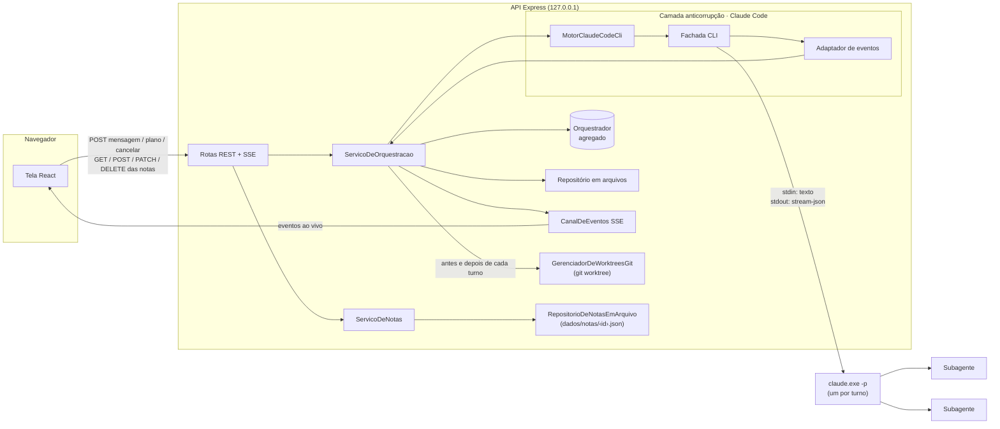
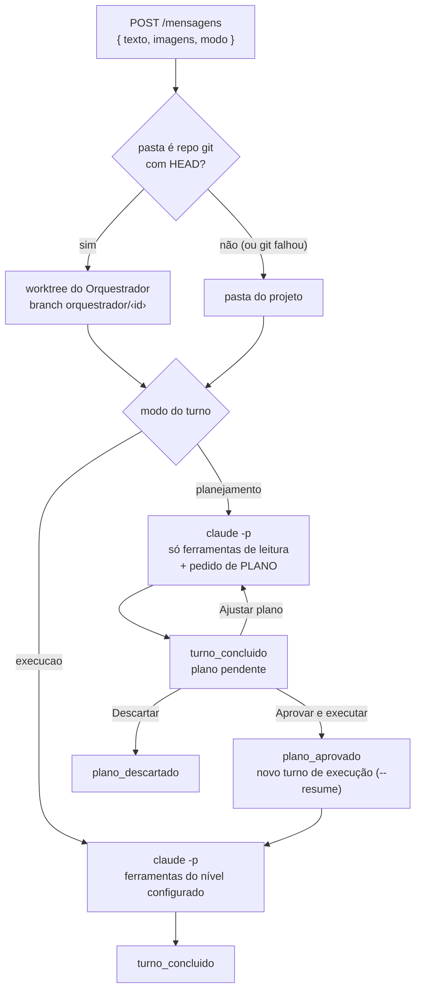

# Orquestrador de Agentes

## Objetivo

Central local para trabalhar com vários agentes do Claude ao mesmo tempo, por uma tela no navegador.

Você cria **Orquestradores** — um por projeto, por exemplo — e conversa com cada um. A cada pedido, o Orquestrador **não executa nada sozinho**: divide o trabalho em subtarefas e lança **Subagentes** em paralelo, que leem, editam ou rodam comandos na pasta do projeto. A tela mostra cada Subagente ao vivo (atividade, ferramentas, tokens, resultado) e, no final, a síntese do Orquestrador.

- Vários Orquestradores rodam ao mesmo tempo, cada um na sua pasta: são terminais espalhados num canvas infinito, que você move, redimensiona e organiza. Cada Subagente aparece como um bixinho animado ligado ao terminal.
- A conversa tem memória: cada Orquestrador lembra dos pedidos anteriores.
- Por Orquestrador você escolhe os modelos e o esforço de raciocínio de cada papel, a quantidade de Subagentes (fixa ou automática com máximo), as permissões e se commit e push são permitidos quando você pedir (desligado por padrão).
- **Plan Mode:** em vez de executar direto, o Orquestrador pode entregar primeiro um plano, feito só com leitura, que você aprova, ajusta ou descarta.
- Em pastas com git, cada pedido roda num **worktree** próprio do Orquestrador, e não na pasta original.
- Dá para cancelar um pedido no meio, e o histórico fica salvo.
- **Bloco de notas:** no mesmo canvas, ao lado dos terminais, você cria notas de texto para observações e coisas para fazer depois. O conteúdo fica salvo no servidor, com salvamento automático.

O motor é o próprio **Claude Code em modo headless**, usando o login da sua assinatura — não precisa de API key.

## Como rodar

**Pré-requisitos:** Node 22+ e o Claude Code instalado e logado (`claude` funcionando no terminal).

```bash
npm install
npm --prefix web install
cp .env.example .env   # opcional: os padrões funcionam neste computador
```

| Variável | Padrão | Para quê |
|---|---|---|
| `PORTA` | `3200` | Porta da API (escuta só em `127.0.0.1`) |
| `PASTA_RAIZ_PROJETOS` | pasta acima deste projeto (caminho relativo é resolvido a partir da pasta do app, não de onde o comando roda) | Raiz dentro da qual os Orquestradores podem trabalhar |
| `CLAUDE_CODE_BIN` | `%APPDATA%\npm\node_modules\@anthropic-ai\claude-code\bin\claude.exe` | Executável **nativo** do Claude Code (o `claude.cmd` não serve: o app inicia o processo sem shell) |
| `PASTA_DADOS` | `dados/` dentro da pasta do app | Histórico dos Orquestradores e as notas do canvas (`notas/`) |

**Desenvolvimento** (dois terminais):

```bash
npm run dev       # API em http://localhost:3200 (recarrega ao salvar)
npm run web:dev   # tela em http://localhost:5173 (repassa /api para a 3200)
```

> Evite salvar arquivos do backend com um pedido rodando: no Windows, o `tsx watch` reinicia o servidor sem avisar o processo, e o `claude.exe` em andamento continua até terminar sozinho. O turno aparece como "interrompido" e pode ser reenviado.

**Uso no dia a dia:** dê dois cliques em **`iniciar-orquestrador.cmd`**. Ele abre uma janela própria com o servidor e, depois de alguns segundos, o navegador em http://localhost:3200. Na primeira vez, também instala as dependências e gera o build. Para desligar, feche a janela ou aperte Ctrl+C nela.

O `.cmd` sobe o servidor por um **vigia** (`scripts/manter-no-ar.cjs`, também em `npm run iniciar`):
- **religa sozinho** quando o servidor sai com erro, esperando 2 s, 4 s, 8 s… até 30 s entre as tentativas;
- **não religa** quando você fecha a janela ou aperta Ctrl+C;
- **desiste** se o servidor cair 5 vezes em 2 minutos, para mostrar o erro em vez de entrar em loop.

Ao subir, o servidor encerra os processos do Claude que tenham sobrado da queda anterior. Antes de encerrar, confere a linha de comando de cada um, para nunca derrubar uma sessão do Claude Code sua.

O equivalente manual, num terminal na pasta do app:

```bash
npm run build
npm start         # http://localhost:3200
```

> **Não suba o servidor pedindo a uma sessão do Claude Code.** Lá ele roda em segundo plano, e o Claude Code encerra processos em segundo plano quando a memória do computador fica baixa. Foi o que derrubou três orquestradores ao mesmo tempo em 28/10. Use o `.cmd` ou um terminal próprio. Se o servidor cair mesmo assim, a tela mostra o aviso **Servidor desconectado** e reconecta sozinha quando ele voltar.

**Testes e verificações:**

```bash
npm test            # domínio, adaptador do Claude Code (com saídas reais), repositórios, rotas das notas
npm run typecheck
npm run web:test    # reducer da conversa, fases, nós e layout do canvas, bixinhos, notas e formatação
npm run web:lint
```

Casos de teste sugeridos para a opção **Permitir commit e push quando eu pedir** (ver ADR-10):
- **Bloco do pedido:** desligada → "Commits e push são sempre proibidos."; ligada em turno de execução → a frase de "permitidos somente quando o usuário pedir explicitamente nesta mensagem…"; ligada em turno de Plan Mode → continua "sempre proibidos".
- **Argumentos do `claude -p`:** desligada (ou Plan Mode) → `--disallowedTools` com `git commit`/`git push` para PowerShell e Bash; ligada em execução → `--disallowedTools` só com os padrões de push forçado e `--settings <configuracoes.json>` com `{"attribution":{"commit":"","pr":""}}`; desligada ou Plan Mode → sem `--settings`.
- **Dados antigos:** um `orquestrador.json` sem o campo carrega com `permitirCommitEPush: false`; `POST /orquestradores` sem o campo cria com `false`; `POST /orquestradores` ou `PATCH /configuracao` com valor não booleano devolve 400.
- **Tela:** o toggle (componente compartilhado `CamposDaConfiguracao`, na criação e no *⚙*) envia `permitirCommitEPush` e mostra o aviso quando o nível de permissão não roda comandos.
- **Branch do worktree:** worktree limpo com commits só na `orquestrador/<id>` → a branch fica e sai o aviso no log; sem commits próprios → `git branch -D`; git falhou na conferência → a branch fica.

Casos de teste do **esforço de raciocínio** (ver ADR-12):
- **Domínio:** sem os campos → `"padrao"` nos dois papéis; `orquestrador.json` antigo → `"padrao"`; `com()` altera só o esforço informado; `turno_iniciado` e `configuracao_alterada` levam os dois esforços.
- **API:** `POST /orquestradores` sem os campos cria com `"padrao"`; aceita os escolhidos; valor fora da lista → 400 (`Esforço do orquestrador inválido.` / `Esforço dos subagentes inválido.`); o GET mostra e o PATCH altera só o informado.
- **Argumentos do `claude -p`:** `"padrao"` → sem `--effort` e sem `effort` no executor; cada papel com o seu nível (`alto` → `--effort high`; `extra_alto` → `"effort": "xhigh"` no executor); `CLAUDE_CODE_EFFORT_LEVEL` herdada sai do ambiente quando algum papel tem esforço escolhido e fica com os dois em `"padrao"`; o esforço nunca vai em `--settings`.
- **Tela:** os dois seletores começam em *Padrão (Claude Code)*, com os seis níveis e a ajuda; escolher num papel muda só aquele campo.

Casos de teste do **bloco de notas** (ver ADR-13):
- **Entidade `Nota`:** nasce com "Nova nota", texto vazio e `criadaEm` = `atualizadaEm`; título aparado, texto guardado como veio; renomear/reescrever atualizam `atualizadaEm`, mas com o mesmo conteúdo não contam como alteração; título com exatamente 120 caracteres (depois de aparar) e texto com exatamente 100.000 passam, um a mais é recusado; `reconstituir` devolve exatamente os dados gravados.
- **Repositório em arquivos:** cria `notas/` e começa vazio; um arquivo por nota, que reabre igual; lista por `criadaEm` crescente; devolve cópias (alterar a buscada não muda nada até salvar); arquivo ilegível é ignorado com aviso, sem ser apagado; gravações seguidas da mesma nota terminam com o último conteúdo, sem arquivo pela metade; remover logo depois de salvar não deixa a nota no disco; id que escaparia da pasta é recusado.
- **Rotas:** GET vazio → 200 `[]`; POST sem corpo → 201 com os padrões; PATCH parcial altera só o campo enviado; PATCHes simultâneos terminam com o último aceito no disco; DELETE → 204; PATCH/DELETE de nota inexistente → 404 `Nota não encontrada.`; POST com título vazio/longo, texto longo, campo que não é texto ou corpo que não é objeto → 400 com a mensagem certa e nada gravado; PATCH com um campo inválido → 400 e a nota fica como estava.
- **Layout:** layout antigo sem `notas` vale como sem notas; só as notas corrompidas do layout são descartadas, e sem `minimizada` a nota fica aberta; minimizar deixa só a barra e restaurar volta à altura de antes; a altura gravada é a da nota aberta, mesmo minimizada; "Organizar" põe as notas em colunas de até 4 à direita da grade dos terminais; nota que sumiu do servidor sai do layout ao carregar a lista, e a criada enquanto a lista carregava não sai.
- **Nó da nota (`NoNota`):** digitar e parar dispara um único PATCH, depois da espera, só com o texto; perder o foco salva na hora; erro no PATCH mostra a mensagem e o "tentar de novo"; minimizada, mostra só a barra com o título e a prévia; minimizar e restaurar não perde texto não salvo; clique duplo no título, Enter salva e em branco volta ao anterior; apagar pede confirmação e chama o DELETE (404 também tira do canvas; outro erro mantém a nota com o motivo); digitar numa nota não re-renderiza a outra.

## Tecnologias

- **Node 22+ / TypeScript 6** (estrito, `exactOptionalPropertyTypes`), **Express 5**, **zod 4** (validação da API), **vitest**.
- **Tela:** React 19, Vite 6, Tailwind 4, react-markdown com remark-gfm e **React Flow** (`@xyflow/react` 12) para o canvas (ver ADR-8). Tema escuro com a paleta da Anthropic (ver ADR-7). Fontes empacotadas via `@fontsource`, sem CDN: Poppins, Lora e JetBrains Mono.
- **Claude Code 2.1.x** (`claude -p --output-format stream-json`) como motor dos agentes.
- **Tempo real:** Server-Sent Events. **Persistência:** arquivos JSON/JSONL.

## Arquitetura

### Visão geral



Organização por contexto (DDD):

```
src/
  orquestracao/              domínio — linguagem do negócio, sem Express nem Claude Code
    Orquestrador.ts            raiz do agregado (conversa sobre uma pasta)
    Turno.ts, Subagente.ts     internos do agregado
    ConfiguracaoDoOrquestrador, QuantidadeDeSubagentes, PastaDeTrabalho,
    NivelDePermissao, ModeloClaude, EsforcoDeRaciocinio, ModoDoTurno   objetos de valor
    EventoDeOrquestracao.ts    o que acontece (histórico + tela)
    InstrucoesDoOrquestrador.ts  regras de trabalho do Orquestrador e do Subagente
    ServicoDeOrquestracao.ts   casos de uso (stateless)
    MotorDeAgentes.ts, RepositorioDeOrquestradores.ts, ControleDeExecucoes.ts,
    PreparoDeWorktree.ts (GerenciadorDeWorktrees)   portas
  notas/                     domínio do bloco de notas — contexto próprio, sem relação com a orquestração
    Nota.ts                    entidade (título e texto; criar, renomear, reescrever)
    ErroDeNota.ts              dados_invalidos · nao_encontrada
    ServicoDeNotas.ts          casos de uso (stateless; id e relógio injetados)
    RepositorioDeNotas.ts      porta
  infraestrutura/
    claudecode/                camada anticorrupção: Fachada (processo), Adaptador
                               (stream-json → eventos do domínio), Argumentos, Motor
    arquivos/                  repositório JSON/JSONL dos Orquestradores, repositório das
                               notas (um JSON por nota) e listagem de pastas
    sse/, execucoes/           canal de eventos e controle de cancelamento
    sistema/                   worktrees git (Worktrees, GerenciadorDeWorktreesGit),
                               memória e processos do Claude
  controllers/                 REST + SSE, validação (zod), erros → HTTP
                               (orquestradoresRoutes.ts, notasRoutes.ts)
web/src/
  paginas/CanvasDeOrquestradores.tsx   canvas (React Flow): nós, linhas, painéis, layout salvo
  componentes/canvas/                  NoTerminal (terminal do Orquestrador), NoRascunho (configuração),
                                       NoBixinho + Bixinho (Subagente em pixel art),
                                       ArestaDoBixinho (linha com a bolinha de troca), NoNota (nota),
                                       painéis flutuantes
  shared/estado/                       aplicarEvento (reducer da conversa + log), faseDoTurno
  shared/canvas/                       nós e linhas a partir das conversas, layout, aparência e desenhos dos bixinhos,
                                       notas.ts (loja das notas, separada do contexto do canvas)
  shared/hooks/useConversas.ts         um EventSource por terminal aberto
  shared/hooks/useNotas.ts,            notas do canvas (carregar, criar, minimizar, apagar)
    useEdicaoDaNota.ts                 e a edição com salvamento automático
```

**Bloco de notas** (contexto `notas`, ver ADR-13): o conteúdo de cada nota (título e texto) fica no servidor, um arquivo por nota em `<PASTA_DADOS>/notas/<id>.json` (padrão `dados/notas/`). Posição, tamanho e se está minimizada ficam no layout do navegador, como os terminais (ver ADR-8). O contexto não conversa com a orquestração: tem entidade, serviço, porta e rotas próprias.

**Ciclo de um pedido:**
1. `POST /mensagens` → o agregado abre um Turno com o **modo** pedido: `execucao` (padrão) ou `planejamento` (recusa se já houver um em andamento).
2. **Worktree:** se a pasta do projeto for um repositório git com pelo menos um commit, o turno roda num worktree próprio do Orquestrador (ver abaixo). Senão, ou se o git falhar, roda na própria pasta.
3. O motor inicia `claude.exe -p` na pasta do turno (o worktree ou a pasta do projeto). Pelo stdin vai o texto do usuário, precedido do bloco `<configuracao-do-pedido>` (quantidade de subagentes, permissões vigentes, regra de commit e push e o modo). As regras fixas do Orquestrador e a definição do Subagente `executor` vão em arquivos temporários (`instrucoes.txt` e `agentes.json`); com commit e push liberados no turno, vai também um `configuracoes.json`, passado em `--settings` (ver ADR-10).
   - Em `planejamento`, o Orquestrador e o `executor` recebem só as ferramentas de leitura, qualquer que seja o nível configurado, e o bloco pede um **plano** em vez da execução (ver ADR-9).
   - Com **Permitir commit e push quando eu pedir** ligada, num turno de `execucao`, o bloco libera commit e push só quando o usuário pedir explicitamente naquela mensagem, e o `claude -p` sai sem o bloqueio de `git commit`/`git push` (ver ADR-10). Desligada, ou em `planejamento`, continua tudo proibido.
   - **Esforço** (ver ADR-12): com esforço escolhido para o Orquestrador, o `claude -p` recebe `--effort <low|medium|high|xhigh|max>` logo depois do `--model`; com esforço escolhido para os Subagentes, a definição do `executor` no `agentes.json` ganha o campo `"effort"`. Em `"padrao"` nada disso é enviado. Se algum dos dois papéis tiver esforço escolhido, a variável `CLAUDE_CODE_EFFORT_LEVEL` herdada do servidor é removida do ambiente do processo, porque ela venceria a escolha.
4. Cada linha `stream-json` vira evento do domínio (`subagente_iniciado`, `progresso_do_subagente`…), gravado em `eventos.jsonl` e publicado por SSE.
5. No `result` final, o Turno é concluído com a resposta e o consumo. Num turno de `planejamento`, a resposta é o plano, que fica **pendente** (só o último turno pode ter plano pendente) até o usuário:
   - **aprovar** (`POST /plano/aprovar`): registra `plano_aprovado` e inicia um novo turno de `execucao` na mesma sessão (`--resume`), com as permissões configuradas;
   - **ajustar:** envia um novo pedido em `planejamento`, que gera outro plano;
   - **descartar** (`POST /plano/descartar`): registra `plano_descartado`.

O primeiro turno usa `--session-id`; os seguintes, `--resume`, o que mantém a memória da conversa.



**Worktree por Orquestrador** (`GerenciadorDeWorktreesGit`, atrás da porta `GerenciadorDeWorktrees`):
- **Quando:** antes de cada turno, se a pasta estiver dentro de um repositório git que já tenha HEAD (um `git init` sem commit não serve). Qualquer falha do git faz o turno rodar na pasta normal, sem quebrar o pedido.
- **O que é criado:** `git worktree add -b orquestrador/<id> <caminho> HEAD`, ou seja, uma branch `orquestrador/<id do Orquestrador>` a partir do HEAD atual da pasta. Alterações não commitadas da pasta original não vão para o worktree. Se a branch já existir, ela é reaproveitada; se o worktree já existir no caminho, nada é refeito.
- **Onde fica:** `<PASTA_DADOS>/worktrees/<8 primeiros caracteres do id>`. O caminho é curto de propósito, para não estourar o `MAX_PATH` do Windows quando os agentes criam `node_modules` lá dentro; a criação e a remoção usam `git -c core.longpaths=true`.
- **No fim do turno:** sem alterações (`git status --porcelain` vazio), o worktree é removido (seguido de `git worktree prune`). A branch `orquestrador/<id>` só é apagada (`git branch -D`) se não tiver commits que não existam em outra ref: o app confere com `git rev-list --count refs/heads/orquestrador/<id> --not --exclude=refs/heads/orquestrador/<id> --all` (outras branches, tags, remotas, stash e HEADs). Se tiver (ex.: um commit feito direto nela, com a opção de commit ligada, ver ADR-10), ou se a conferência falhar, a branch é mantida e o servidor avisa no log do console (`[worktrees] A branch "orquestrador/<id>" tem commits que não estão em nenhuma outra branch; mantida…`). Com alterações, o worktree fica e é marcado como inativo; o próximo turno continua nele.
- **Branches criadas pelo agente** (ex.: `feature/x` via `git checkout -b` dentro do worktree) nunca são apagadas pelo app: os worktrees compartilham as branches com o repositório, então elas aparecem no repositório do projeto.
- **Ao subir o servidor:** os worktrees que sobraram da execução anterior são limpos (análogo aos processos órfãos do Claude), com a mesma regra do fim do turno: pelo git, só os sem alterações são removidos; os com trabalho são preservados. Em `<PASTA_DADOS>/worktrees/`, só são apagadas as pastas órfãs sem `.git` (ex.: `worktree add` pela metade). Uma pasta com `.git` cujo repositório de origem sumiu ou foi movido também é mantida, com um aviso no log (resolva com `git worktree repair` no repositório ou apague a pasta à mão).
- O estado fica no agregado (`worktree: { branch, caminho, ativo }`) e aparece na tela como uma etiqueta com a branch.

### Decisões de arquitetura (ADRs)

**ADR-1 — Motor: Claude Code headless, e não Agent SDK ou API.**
- *Contexto:* o usuário tem só a assinatura do Claude (login do Claude Code), sem API key. A política do Agent SDK pede API key para produtos construídos sobre ele.
- *Decisão:* executar o `claude.exe` oficial em modo `-p`, com o login do próprio usuário, na máquina dele. O motor fica atrás da porta `MotorDeAgentes`.
- *Consequências:*
  - funciona sem API key, mas consome a cota da assinatura (exibida na tela);
  - é para uso pessoal e local;
  - para oferecer ao time num servidor, criar um adaptador com o Agent SDK e uma API key, sem mudar o domínio.

**ADR-2 — Um processo por turno, com `--resume`.**
- *Contexto:* a conversa precisa de memória, e o cancelamento precisa ser confiável.
- *Decisão:* cada mensagem inicia um processo novo que retoma a sessão. Cancelar é `taskkill /T /F`, que derruba a árvore inteira, incluindo comandos abertos por Subagentes.
- *Consequências:*
  - não há processo vivo entre turnos para gerenciar;
  - cada turno paga o tempo de partida do Claude Code (poucos segundos);
  - ao retomar uma sessão, o Claude Code mantém o prompt de sistema gravado na criação e ignora um `--append-system-prompt-file` novo (verificado na 2.1.312). Por isso, o que muda entre pedidos (quantidade, permissões, regra de commit e push e modo do turno) vai no início de cada mensagem, num bloco `<configuracao-do-pedido>` que declara substituir as instruções anteriores. `--model`, `--effort`, `--agents` e as permissões por flag valem a cada processo.

**ADR-3 — Permissões por `dontAsk` + lista explícita.**
- *Contexto:* não há ninguém no terminal para aprovar ações.
- *Decisão:* o que não está liberado é negado. `--tools` e `--allowedTools` vêm do nível escolhido:
  - **leitura:** Read, Glob, Grep, WebSearch, WebFetch;
  - **edição:** o anterior + Edit, Write, NotebookEdit;
  - **comandos:** o anterior + PowerShell e Bash.

  Por padrão, `git commit` e `git push` são negados em todos os níveis por `--disallowedTools` (PowerShell e Bash). A exceção é a opção **Permitir commit e push quando eu pedir**: ligada, num turno de execução, esses bloqueios saem, mas o `--disallowedTools` continua negando o push forçado (`--force*`, `-f`/`-fu`, refspec com `+`), e a atribuição Co-authored-by do Claude Code é desligada por um `--settings` só daquele turno (detalhes na ADR-10). `--strict-mcp-config` deixa de fora os MCPs da conta. Num turno de Plan Mode vale sempre a lista de **leitura**, qualquer que seja o nível configurado, com commit e push bloqueados (ver ADR-9).
- *Consequências:*
  - as negações aparecem na tela;
  - as regras valem para a sessão inteira, então não dá para proibir ferramentas só para o Orquestrador. A regra "só orquestre" vem das instruções, e a tela avisa quando ele usa uma ferramenta diretamente.

**ADR-4 — SSE em vez de WebSocket.**
- *Contexto:* o fluxo ao vivo é só do servidor para a tela; as ações do usuário são poucas.
- *Decisão:* `EventSource` por Orquestrador; as ações vão por POST.
- *Consequências:* o navegador reconecta sozinho e envia `Last-Event-ID`, e o servidor reenvia só o que faltou. Sem dependência extra.

**ADR-5 — Histórico em arquivos (JSON + JSONL), sem banco.**
- *Contexto:* ferramenta local de uma pessoa.
- *Decisão:* `dados/orquestradores/<id>/orquestrador.json` guarda o estado do agregado, gravado de forma atômica. `eventos.jsonl` é append-only e reproduz a conversa na tela.
- *Consequências:*
  - zero infraestrutura;
  - no boot, turnos que estavam rodando viram `interrompido`;
  - para vários usuários, trocar o repositório (a porta já existe).

**ADR-6 — Saída do Claude Code isolada numa camada anticorrupção.**
- *Contexto:* o formato `stream-json` evolui por versão e usa termos próprios (`task_id`, `tool_use_id`, `parent_tool_use_id`).
- *Decisão:* `AdaptadorDeEventosDoClaudeCode` traduz para eventos do domínio, testado com saídas reais capturadas (`src/infraestrutura/claudecode/fixtures`).
- *Consequências:* quando o Claude Code mudar o formato, só o adaptador muda.

**ADR-7 — Identidade visual do Claude, e não o Design System Vaccinar.**
- *Contexto:* a tela é um console de agentes do Claude, e o usuário pediu um visual mais técnico com as cores da Anthropic.
- *Decisão:* tema escuro com a paleta da identidade da Anthropic:
  - escuro `#141413`, claro `#faf9f5`;
  - cinzas `#b0aea5` e `#e8e6dc`;
  - acentos laranja `#d97757`, azul `#6a9bcc` e verde `#788c5d`.

  Tipografia: Poppins nos títulos, Lora (serifada, como no claude.ai) nas respostas do Claude e JetBrains Mono nos dados técnicos. Os ícones foram desenhados para esta tela; não há logotipo nem marca da Anthropic.
- *Consequências:*
  - diverge do DS Vaccinar, que segue valendo para os outros sistemas;
  - as cores continuam centralizadas em tokens (`web/src/theme/index.css`), com os mesmos nomes semânticos (`--primary`, `--surface`, `--border`…) e as mesmas classes (`.btn`, `.card`, `.field`, `.alert`);
  - os componentes não têm hexadecimal solto.

**ADR-8 — Canvas com React Flow, e não layout fixo nem uma biblioteca de desenho.**
- *Contexto:* o usuário quer trabalhar como no Excalidraw: vários terminais espalhados, que se movem e se redimensionam, e os Subagentes visíveis como bixinhos ligados ao seu Orquestrador.
- *Decisão:* usar `@xyflow/react` (MIT), que já traz canvas infinito, arrasto, redimensionamento (`NodeResizer`), zoom, minimapa e linhas animadas entre nós.
  - **Nós:** terminais, rascunhos, bixinhos e notas são nós próprios em React. Os bixinhos são filhos do terminal (`parentId`) e acompanham quando ele é movido.
  - **Estado ao vivo:** fica num contexto, e os nós guardam só ids. Assim o canvas não é recriado a cada evento do Claude.
  - **Layout:** posições, tamanhos e zoom ficam no `localStorage`, por serem preferência de quem olha. O histórico continua no servidor. O layout é gravado ao soltar o arraste e ao fim do pan/zoom; redimensionar, abrir, fechar e organizar continuam gravando após uma espera de 300 ms (ver ADR-11).
    - **Formato** (chave `orquestrador-agentes:canvas:v1`): `{ "terminais": { "<orquestradorId>": { "x", "y", "largura", "altura" } }, "notas": { "<notaId>": { "x", "y", "largura", "altura", "minimizada" } }, "viewport": { "x", "y", "zoom" } | null }`.
    - **Notas:** a `altura` gravada é sempre a da nota aberta; minimizada, ela mostra só a barra (40 px), e restaurar volta a essa altura. Layouts gravados antes das notas, sem o campo `notas`, continuam válidos (valem como sem notas); entradas corrompidas são descartadas, e sem `minimizada` a nota fica aberta. Ao carregar a lista do servidor, a nota que não existe mais sai do canvas e, com isso, do layout. O conteúdo das notas não vai para o layout: fica no servidor (ver ADR-13).
  - **Bixinhos limpos:** o botão *limpar* de cada terminal guarda, na chave `orquestrador-agentes:canvas:v1:bixinhos-limpos`, o id do último pedido e os ids dos Subagentes limpos dele, por Orquestrador. Um pedido novo invalida a lista, a próxima limpeza a substitui e a de um Orquestrador excluído é apagada, então ela não cresce sem limite. Os limpos são filtrados antes de virar nós e linhas do React Flow. As posições dos bixinhos não são salvas (só as dos terminais), então não há posição a apagar.
  - **Linhas:** a ligação terminal → bixinho é uma aresta própria, `ArestaDoBixinho` (tipo `"bixinho"`), que desenha a mesma curva Bézier da aresta padrão. Enquanto o Subagente executa, uma bolinha vai e vem entre o terminal e o bixinho por um `<animateMotion>` do SVG (SMIL) sobre a própria curva. O SMIL foi escolhido porque o navegador anima sozinho: não há estado React por quadro nem `requestAnimationFrame`, e o custo é desprezível mesmo com vários bixinhos.
- *Consequências:*
  - o React Flow mostra o crédito "React Flow" no canto, como pede a licença;
  - o pacote da tela ficou maior (~400 kB), irrelevante para um app local;
  - Excalidraw e tldraw foram descartados: são editores de desenho, ruins para hospedar componentes interativos (terminais com prompt), e o tldraw exige licença para uso comercial;
  - o SMIL ignora as regras CSS de animação (como o `animation: none` do `prefers-reduced-motion`). Por isso a bolinha é escondida explicitamente com `prefers-reduced-motion` e também quando o servidor está desconectado.

**ADR-9 — Plan Mode no domínio do app, e não `--permission-mode plan`.**
- *Contexto:*
  - o app roda o `claude -p` headless com `--permission-mode dontAsk` (ADR-1 e ADR-3: só há a assinatura, sem API key, e ninguém no terminal para aprovar);
  - segundo a documentação oficial do Claude Code, em `-p` a ferramenta `ExitPlanMode` só fica disponível com um "permission host": o `canUseTool` do Agent SDK, `--permission-prompt-tool` via MCP ou um hook `PreToolUse`. Sem isso, o modo `plan` nativo não tem como devolver o plano para aprovação;
  - ao retomar a sessão, o prompt de sistema é ignorado (ADR-2), então a instrução de "só planejar" não pode morar nele.
- *Decisão:*
  - o modo é do domínio: cada Turno tem um `ModoDoTurno`, `execucao` (padrão) ou `planejamento`, enviado no `POST /mensagens`;
  - em `planejamento`, a trava é real: `--tools`/`--allowedTools` e o `tools` do Subagente `executor` ficam só com as ferramentas de leitura (Read, Glob, Grep, WebSearch, WebFetch);
  - o bloco `<configuracao-do-pedido>` instrui o Orquestrador a entregar um PLANO, sem executar: objetivo, subtarefas por Subagente com os arquivos envolvidos, ordem, riscos e perguntas em aberto;
  - o plano do último turno fica pendente. Aprovar registra `plano_aprovado` e abre um novo turno de `execucao` na mesma sessão (`--resume`), com as permissões configuradas; descartar registra `plano_descartado`.
- *Consequências:*
  - a segurança vem das ferramentas, e não da obediência ao prompt: mesmo que o modelo tente, não consegue editar nem rodar comandos durante o planejamento;
  - a qualidade e o formato do plano dependem do prompt;
  - planejar e executar custam dois turnos (dois processos e mais cota), mas a execução já parte do contexto do plano, pela mesma sessão;
  - o turno de planejamento e o de execução precisam rodar no mesmo diretório (o mesmo worktree, quando houver) para o `--resume` encontrar a sessão;
  - se um dia houver um motor com o Agent SDK (ADR-1), o `modo` mapeia direto para `permissionMode: "plan"` com `canUseTool`, sem mudar o domínio.

**ADR-10 — Commit e push opcionais, por pedido.**
- *Contexto:*
  - a política do time permite commit e push só com pedido explícito do usuário, em branch própria (`feature/`, `fix/`, `hotfix/`, `refactor/`), nunca na `main` e sem a linha Co-authored-by;
  - até aqui, commit e push eram sempre proibidos: pelo `--disallowedTools` (ADR-3) e pelo prompt do Orquestrador. Levar as alterações para o projeto era sempre trabalho manual.
- *Decisão:*
  - nova opção na configuração do Orquestrador, `permitirCommitEPush` (**desligada por padrão**; dados antigos sem o campo valem `false`). Como as outras opções, vale por pedido: o `turno_iniciado` leva a cópia da configuração;
  - o bloco `<configuracao-do-pedido>` carrega a regra. Desligada, ou num turno de Plan Mode: "Commits e push são sempre proibidos." Ligada, num turno de execução: "Commits e push: permitidos somente quando o usuário pedir explicitamente nesta mensagem. Nunca commitar direto na main; usar branch conforme a política (feature/, fix/, hotfix/, refactor/). Nunca adicionar a linha Co-authored-by.";
  - o prompt de sistema do Orquestrador passa a dizer: "Commits e push seguem a permissão do bloco <configuracao-do-pedido> mais recente; sem o bloco, são proibidos.";
  - a trava técnica só sai quando a opção está ligada e o turno não é de Plan Mode (`ArgumentosDoClaudeCode.ts`):
    - o `--disallowedTools` deixa de bloquear `git commit`/`git push`, mas continua negando o push forçado (`COMANDOS_DE_PUSH_FORCADO`), com os mesmos padrões para `PowerShell(...)` e `Bash(...)`: `git push *--force*` (cobre `--force`, `--force-with-lease` e `--force-if-includes` em qualquer posição depois de `push`), `git push -f*` e `git push * -f*` (`-f`, inclusive `-fu`) e `git push * +*` (refspec com `+`, ex.: `git push origin +main`);
    - a atribuição do Claude Code (o trailer Co-Authored-By nos commits e o "Generated with Claude Code" nos PRs) é desligada: o app grava `{"attribution":{"commit":"","pr":""}}` num `configuracoes.json` temporário do turno (na mesma pasta temporária e no mesmo padrão do `agentes.json`) e passa `--settings <arquivo>` ao `claude -p`. Esse arquivo fica acima das settings do usuário e do projeto e abaixo das gerenciadas pela organização. Desligada, ou em Plan Mode, o arquivo não é gravado e o `--settings` não entra. Não se usa `attribution: false` porque essa forma só existe a partir da v2.1.281, e versões anteriores descartam o arquivo inteiro;
  - no fim do turno, com o worktree limpo, a branch `orquestrador/<id>` só é apagada se não tiver commits que não existam em outra ref; senão, é mantida com aviso no log do console (ver *Worktree por Orquestrador*).
- *Consequências:*
  - o "só quando o usuário pedir" e o "nunca na main" dependem de o modelo seguir a instrução: não há trava técnica para isso, ao contrário do Plan Mode (ADR-9). Por isso a opção nasce desligada;
  - só tem efeito com o nível *Editar e rodar comandos*: sem PowerShell/Bash não há como commitar, e a tela avisa;
  - regras `deny` nas settings do usuário (`~/.claude/settings.json` ou do projeto) prevalecem sobre `--allowedTools`: se elas negarem `git commit`/`git push`, a opção ligada não libera;
  - o bloqueio do push forçado é por padrão de texto: as regras casam o comando como o agente o escreve. Não pegam variações como `git -C <pasta> push --force` (ou `git -c … push -f`), flags curtas combinadas com o `f` no meio (`-uf`), o comando dentro de outro interpretador (`bash -c '…'`, `pwsh -c "…"`) nem dentro de um script. E `git push origin HEAD:main` não é bloqueado: o "nunca na main" depende só da instrução;
  - sessões criadas antes da opção mantêm o prompt de sistema antigo ("sempre proibidos"), porque o `--resume` não troca o prompt (ADR-2). Vale o bloco do pedido, que declara substituir as instruções anteriores;
  - **pendência conhecida — execução de plano aprovado:** o bloco exige que o usuário peça "explicitamente nesta mensagem", e a mensagem automática de aprovação do plano ("Plano aprovado. Execute agora o plano…") não contém esse pedido. Por isso, mesmo com a opção ligada, o Orquestrador pode recusar um commit/push previsto no plano ao executá-lo;
  - branches e commits criados no worktree ficam no repositório do projeto (os worktrees compartilham as branches), prontos para revisão, PR ou merge. Branches criadas pelo agente (ex.: `feature/x` via `git checkout -b`) nunca são apagadas pelo app.

**ADR-11 — Desempenho do canvas: re-renderizar só o que mudou.**
- *Contexto:* o canvas travava ao arrastar um terminal e com muitos bixinhos. Cada evento do Claude, cada consulta ao servidor e cada quadro do arraste re-renderizavam todos os nós, e o Markdown das respostas era analisado de novo.
- *Decisão* (só na tela, `web/src`; nada no servidor):
  - **Terminal:** `NoTerminal` é só a moldura (redimensionador e âncoras); o conteúdo fica em `JanelaDoTerminal` (`memo`), com callbacks estáveis. `TranscricaoDoTerminal`, `Turno`, `LinhaDoTerminal`, `CartaoDoPlano`, `PromptDoTerminal` e `TextoFormatado` são `memo`, e os plugins/`components` do `react-markdown` são constantes. Arrastar não re-renderiza transcrição nem prompt, e Markdown que não mudou não é re-analisado.
  - **Bixinhos:** `aparenciaDoBixinho` tem cache por id (objeto congelado, até 1.000 entradas). `NoBixinho` só lê o contexto e repassa a `ConteudoDoBixinho` (`memo`); o `NodeToolbar` só existe com o bixinho selecionado; `ArestaDoBixinho` é `memo`. O sprite são dois `<svg>` (sombra e desenho), e o `saltitar` move só o `<svg>` do desenho, no compositor (`will-change`).
  - **CSS:** a linha de um Subagente executando continua tracejada, mas o tracejado não anima; os painéis flutuantes não usam `backdrop-filter` (fundo 96% opaco). Durante o movimento, a classe `.canvas-movendo` põe `will-change` no viewport, no nó arrastado e nos bixinhos, pausa as animações CSS dos nós e esconde a bolinha SMIL.
  - **Estado:** o valor do contexto é estável; `useServidor`, `useOrquestradores` e `useConversas` só trocam a referência quando o conteúdo muda; as arestas são reaproveitadas (`reaproveitarArestas`, `useReaproveitado`); as props do `<ReactFlow>` são estáveis (`ENQUADRAMENTO_AO_ABRIR`, `VIEWPORT_PADRAO`, handlers, MiniMap).
  - **Movimento** (`useMovimentoDoCanvas`): o layout é gravado ao soltar o arraste e no fim do pan/zoom. A classe `.canvas-movendo` vai no contêiner pai do `.react-flow` de `onNodeDragStart` a `onNodeDragStop` (com rede de segurança em `pointerup`/`pointercancel`) e de `onMoveStart` a `onMoveEnd`.
  - **Hooks finos no contexto:** `ProvedorDoCanvas`, `useSeletorDoCanvas`, `useAcoesDoCanvas` e `useConversaDoCanvas`. `useCanvas()` mantém a mesma API.
- *Consequências:*
  - mudanças visuais: o tracejado da linha executando fica parado, os painéis flutuantes perdem o desfoque e, durante o arraste/pan, as animações dos nós pausam e a bolinha some;
  - por causa do `will-change`, o canvas pode ficar um pouco menos nítido enquanto se move; volta ao normal ao soltar;
  - nós novos devem preferir os hooks finos (`useSeletorDoCanvas`, `useAcoesDoCanvas`, `useConversaDoCanvas`) a `useCanvas()`, e componentes pesados devem ser `memo` com props estáveis, para não voltar a re-renderizar tudo.

**ADR-12 — Esforço por `--effort` e `effort` do agente.**
- *Contexto:*
  - antes, o app não definia esforço de raciocínio: valia o que estivesse nas configurações do Claude Code da máquina. Hoje, neste computador, o `~/.claude/settings.json` tem `modelSettings["claude-opus-5-5"].effortLevel = "xhigh"`, então o Orquestrador e os Subagentes rodam em Opus 5.5 com `xhigh` (comprovado nas transcrições). Sem nada salvo, vale o padrão do modelo (`medium` no Opus, Sonnet e Haiku 5.5);
  - o usuário quer escolher o esforço por papel, para equilibrar qualidade, tempo e cota.
- *Decisão:*
  - o domínio ganha o objeto de valor `EsforcoDeRaciocinio` (`padrao`, `baixo`, `medio`, `alto`, `extra_alto`, `maximo`) e a configuração ganha `esforcoDoOrquestrador` e `esforcoDosSubagentes` (padrão `"padrao"`; dados antigos sem os campos valem `"padrao"`). Vale por pedido, como o resto da configuração: o `turno_iniciado` leva a cópia;
  - a tradução para o Claude Code fica no adaptador (`ArgumentosDoClaudeCode.ts`): `baixo→low`, `medio→medium`, `alto→high`, `extra_alto→xhigh`, `maximo→max`. O Orquestrador recebe `--effort <nível>`; o `executor` recebe o campo `effort` na sua definição em `--agents`. `"padrao"` não envia nada;
  - quando algum papel tem esforço escolhido, a `CLAUDE_CODE_EFFORT_LEVEL` herdada do servidor sai do ambiente do processo, porque ela venceria a flag e o `effort` do agente. Com os dois em `"padrao"`, o ambiente fica como está;
  - não se usa `effortLevel` num `--settings`: essa chave não aceita `max`, e perde para a flag;
  - o nível não é validado por modelo no domínio: o apelido (`opus`, `sonnet`, `haiku`) resolve para modelos diferentes conforme o provedor, e só o Claude Code sabe o modelo real.
- *Consequências:*
  - **precedência** no Claude Code: `CLAUDE_CODE_EFFORT_LEVEL` > `/effort` > `--effort` > settings (`modelSettings.<modelo>.effortLevel` vence o `effortLevel` de topo, que o Opus 5.5+ ignora) > padrão do modelo. Para o Subagente, o `effort` da definição vence o nível da sessão, mas não a variável de ambiente;
  - "Padrão (Claude Code)" na tela não é o padrão do modelo: é o que estiver nas configurações do Claude Code da máquina e, sem nada, o padrão do modelo;
  - o `maxEffortLevel` das configurações gerenciadas é um teto: rebaixa o nível escolhido sem avisar;
  - nível não suportado pelo modelo é rebaixado pelo próprio Claude Code para o mais alto suportado até o escolhido (ex.: `xhigh` roda como `high` no Opus 4.6); em modelo sem esforço, não é enviado;
  - a documentação não diz se um Subagente sem `effort` herda o nível da sessão. Com *Padrão* nos Subagentes e esforço escolhido no Orquestrador, os Subagentes podem herdar o nível do Orquestrador;
  - o Orquestrador pode passar `effort` ao lançar um Subagente (Claude Code 2.1.292+), e isso sobrepõe o `effort` da definição do `executor`;
  - mais esforço deixa as respostas mais cuidadosas, porém mais lentas e com mais consumo da cota.

**ADR-13 — Notas: conteúdo no servidor, layout no navegador.**
- *Contexto:* o usuário quer anotar observações e coisas para fazer depois no próprio canvas, ao lado dos terminais. A anotação não pode se perder ao recarregar a página, mas o lugar dela no canvas é preferência de quem olha, como a posição dos terminais (ADR-8). E digitar numa nota não pode deixar o canvas lento (ADR-11).
- *Decisão:*
  - **contexto delimitado próprio**, `notas` (`src/notas/`), sem relação com a orquestração: a entidade `Nota` (título de 1 a 120 caracteres, aparado; texto puro de até 100.000 caracteres, guardado como veio), `ErroDeNota` (`dados_invalidos` → 400, `nao_encontrada` → 404), a porta `RepositorioDeNotas` e o `ServicoDeNotas` (stateless, com id e relógio injetados). `atualizadaEm` só muda quando o conteúdo muda, e um PATCH com algum campo inválido não grava nada;
  - **um arquivo por nota**, `<PASTA_DADOS>/notas/<id>.json` (`RepositorioDeNotasEmArquivo`): gravação atômica (`.tmp` + rename, com novas tentativas em `EPERM`/`EACCES`/`EBUSY`, comuns no Windows com antivírus e indexador) e uma fila de gravação por id: gravações da mesma nota saem na ordem pedida e a última vence; notas diferentes gravam em paralelo. Na abertura, um arquivo ilegível é ignorado com aviso no log (e mantido), e o `.tmp` deixado por uma queda é ignorado;
  - **layout no navegador:** posição, tamanho e "minimizada" ficam no layout do `localStorage`, junto com os terminais (campo `notas`, ver ADR-8). O servidor só guarda o conteúdo;
  - **loja das notas separada do contexto do canvas** (`web/src/shared/canvas/notas.ts`, `ProvedorDasNotas`), por desempenho: o conteúdo confirmado pelo servidor fica numa loja lida com `useSyncExternalStore`, o texto em edição fica no estado do próprio nó (`useEdicaoDaNota`) e os nós do React Flow guardam só o id e o layout. Digitar ou salvar uma nota não re-renderiza o canvas nem as outras notas;
  - **salvamento automático com espera:** 600 ms depois da última tecla e ao perder o foco, num único PATCH só com o que mudou, uma requisição por vez (o que mudar enquanto uma está no ar vai na seguinte).
- *Consequências:*
  - fechar a aba menos de 600 ms depois da última tecla, sem tirar o foco do texto, pode perder os últimos caracteres;
  - não há sincronização entre abas: vale o último salvamento, e outra aba só vê a mudança ao recarregar. Uma nota apagada em outra aba continua nesta até recarregar: editar dá *erro ao salvar* (`Nota não encontrada.`), e apagar só a tira do canvas;
  - o layout é por navegador: em outro navegador as notas aparecem, mas em posições novas;
  - as funções `rota` e `responderErro` foram duplicadas em `notasRoutes.ts` (já existem em `orquestradoresRoutes.ts`): candidatas a extração para um módulo comum dos controllers.

Detalhes observados no Claude Code 2.1.312 e tratados no adaptador:
- no Windows, a ferramenta de terminal é `PowerShell`;
- `modelUsage` acumula a sessão, então o consumo do turno vem de `model_usage_since_last_result`;
- um Subagente lançado em segundo plano devolve um retorno vazio na hora, e o relatório chega depois, no `task_notification`;
- nesse caso, o processo emite mais de um `result`;
- enquanto raciocina, o Claude Code emite `system/thinking_tokens` (a estimativa de tokens). Eles viram o **sinal de vida**, mandado à tela como evento SSE `sinal`: não entra no histórico nem na sequência;
- imagens só entram com `--input-format stream-json`: a mensagem vira uma linha JSON com blocos `text` e `image`;
- a atualização automática do Claude Code troca o `claude.exe`. Durante alguns segundos o arquivo some (`ENOENT`), então o app tenta iniciar de novo até 6 vezes, com 2 s entre as tentativas.

## Manuais e APIs

### Endpoints

Todos sob `/api`. Erros vêm como `{ "erro": "mensagem para o usuário" }`, com os status:
- **400:** dados inválidos;
- **404:** não encontrado;
- **409:** já existe pedido em andamento, não há pedido para cancelar, ou não há plano pendente para aprovar/descartar (motivo `sem_plano_pendente`);
- **500:** erro inesperado.

| Método | Rota | Entrada | Resposta |
|---|---|---|---|
| GET | `/saude` | — | `{ ok: true, iniciadoEm, memoria: { totalBytes, livreBytes, servidorBytes, agentesBytes, porOrquestrador } }`. A tela consulta a cada 3 s; um `iniciadoEm` diferente indica que o servidor reiniciou. A memória é medida a cada 5 s. |
| GET | `/pastas` | — | `{ raiz, pastas: [{ nome, caminho }] }` |
| GET | `/orquestradores` | — | `[ResumoDoOrquestrador]` |
| POST | `/orquestradores` | `{ nome, pastaDeTrabalho, modeloDoOrquestrador, modeloDosSubagentes, quantidadeDeSubagentes: { modo: "fixa" \| "automatica", limite: 1–10 }, nivelDePermissao, permitirCommitEPush?: boolean, esforcoDoOrquestrador?, esforcoDosSubagentes? }` (mesmo esquema de configuração do PATCH; `permitirCommitEPush` ausente vale `false`; esforços ausentes valem `"padrao"`) | 201 + orquestrador com `turnos` (400 se algum campo for inválido, ex.: `permitirCommitEPush` não booleano, ou esforço fora da lista: `Esforço do orquestrador inválido.` / `Esforço dos subagentes inválido.`) |
| GET | `/orquestradores/:id` | — | orquestrador com `turnos` (resumo de cada Turno e seus Subagentes) |
| PATCH | `/orquestradores/:id/configuracao` | qualquer subconjunto dos campos de configuração, incluindo `permitirCommitEPush?: boolean`, `esforcoDoOrquestrador?` e `esforcoDosSubagentes?` | 200 + resumo (vale a partir do próximo pedido; 400 se algum campo for inválido, ex.: `permitirCommitEPush` não booleano, ou esforço fora da lista, com as mesmas mensagens do POST) |
| POST | `/orquestradores/:id/mensagens` | `{ texto, imagens?: [{ nome, tipoDeMidia: image/png\|jpeg\|gif\|webp, base64 }], modo?: "execucao" \| "planejamento" }` (até 5 imagens de 5 MB; `modo` padrão `"execucao"`) | 202 `{ turnoId }` (400 se `modo` for inválido) |
| POST | `/orquestradores/:id/plano/aprovar` | `{ observacoes?: string }` | 202 `{ turnoId }` do novo turno de execução (409 `sem_plano_pendente`) |
| POST | `/orquestradores/:id/plano/descartar` | — | 204 (409 `sem_plano_pendente`) |
| GET | `/orquestradores/:id/anexos/:arquivo` | — | a imagem anexada (para as miniaturas) |
| POST | `/orquestradores/:id/cancelar` | — | 202 `{ cancelando: true }` |
| DELETE | `/orquestradores/:id` | — | 204 (409 se houver pedido em andamento) |
| GET | `/orquestradores/:id/eventos` | cabeçalho opcional `Last-Event-ID` ou `?desde=` (última sequência recebida) | `text/event-stream`: histórico desde a sequência informada + eventos novos |
| GET | `/notas` | — | 200 `[DadosDaNota]`, por `criadaEm` crescente |
| POST | `/notas` | `{ titulo?: string, texto?: string }` (corpo vazio vale; ausentes: `"Nova nota"` e `""`) | 201 + `DadosDaNota` (400 com as mensagens abaixo) |
| PATCH | `/notas/:id` | `{ titulo?: string, texto?: string }` (só o enviado muda) | 200 + `DadosDaNota`; `atualizadaEm` só muda se o conteúdo mudar. Com algum campo inválido, 400 e nada é gravado (404 `Nota não encontrada.`) |
| DELETE | `/notas/:id` | — | 204 (404 `Nota não encontrada.`) |

Valores aceitos:
- **Modelos:** `opus`, `sonnet` ou `haiku`. O Claude Code resolve o apelido para a versão vigente.
- **Níveis de permissão:** `leitura`, `edicao` ou `edicao_e_comandos`.
- **`permitirCommitEPush`:** `true` ou `false` (padrão `false`; orquestradores salvos antes da opção valem `false`). Só tem efeito com `edicao_e_comandos` e fora do Plan Mode (ver ADR-10).
- **`esforcoDoOrquestrador` e `esforcoDosSubagentes`:** `padrao`, `baixo`, `medio`, `alto`, `extra_alto` ou `maximo` (padrão `"padrao"`; orquestradores salvos antes da opção valem `"padrao"`). `"padrao"` não envia nada ao Claude Code: vale o `settings.json` do Claude Code da máquina ou, sem ele, o padrão do modelo. Os outros viram `low`, `medium`, `high`, `xhigh` e `max` (ver ADR-12).

`ResumoDoOrquestrador`:

```json
{
  "id": "…", "nome": "Painel de salas",
  "pastaDeTrabalho": "C:\\Users\\…\\salasdereuniao-painel-app", "nomeDaPasta": "salasdereuniao-painel-app",
  "situacao": "ocioso | trabalhando",
  "configuracao": { "modeloDoOrquestrador": "opus", "modeloDosSubagentes": "sonnet",
                    "quantidadeDeSubagentes": { "modo": "automatica", "limite": 3 }, "nivelDePermissao": "leitura",
                    "permitirCommitEPush": false,
                    "esforcoDoOrquestrador": "alto", "esforcoDosSubagentes": "padrao" },
  "worktree": { "branch": "orquestrador/…", "caminho": "…\\dados\\worktrees\\1a2b3c4d", "ativo": false },
  "criadoEm": "…", "totalDeTurnos": 2,
  "ultimoTurno": { "texto": "…", "situacao": "concluido", "iniciadoEm": "…" }
}
```

O GET de `/orquestradores/:id` traz a mesma `configuracao`, com `permitirCommitEPush`, `esforcoDoOrquestrador` e `esforcoDosSubagentes`.

`worktree` é `null` quando não há worktree (pasta sem git ou sem commit, ou o último turno terminou sem alterações); `ativo` é `true` enquanto um turno roda nele.

`DadosDaNota` (ver ADR-13; posição, tamanho e "minimizada" não vêm daqui, ficam no layout do navegador):

```json
{ "id": "…", "titulo": "Pendências", "texto": "revisar o PR do painel\n…",
  "criadaEm": "2026-10-30T14:00:00.000Z", "atualizadaEm": "2026-10-30T14:05:12.000Z" }
```

Erros 400 das notas:
- `O título da nota deve ter entre 1 e 120 caracteres.` (contado depois de aparar os espaços);
- `A nota pode ter até 100.000 caracteres.`;
- `O título da nota deve ser um texto.` / `O conteúdo da nota deve ser um texto.` (ex.: número ou `null`);
- `Envie os dados da nota.` (corpo que não é um objeto JSON, ex.: uma lista).

**Eventos SSE.** Cada evento é um `data:` com JSON `{ tipo, turnoId, sequencia, em, … }`.

| `tipo` | Campos | Quando |
|---|---|---|
| `turno_iniciado` | `texto`, `configuracao` (cópia da vigente no pedido, com `permitirCommitEPush`, `esforcoDoOrquestrador` e `esforcoDosSubagentes`; a tela lê com `"padrao"` os eventos gravados antes da opção), `anexos`, `modo` (`execucao` · `planejamento`) | o usuário enviou uma mensagem, ou aprovou um plano (turno de execução) |
| `sessao_iniciada` | — | o Claude Code abriu (ou retomou) a sessão |
| `texto_do_orquestrador` | `texto` | o Orquestrador escreveu algo |
| `ferramenta_do_orquestrador` | `ferramenta`, `detalhe` | o Orquestrador usou uma ferramenta em vez de delegar |
| `subagente_iniciado` | `subagenteId`, `descricao`, `tarefa` | um Subagente foi lançado |
| `progresso_do_subagente` | `subagenteId`, `atividade`, `ultimaFerramenta`, `tokens`, `ferramentasUsadas`, `duracaoMs` | a cada ferramenta usada pelo Subagente |
| `texto_do_subagente` | `subagenteId`, `texto` | o Subagente escreveu algo |
| `subagente_concluido` | `subagenteId`, `situacao` (`concluido` · `falhou` · `cancelado`), `resumo`, `tokens`, `duracaoMs` | o Subagente terminou |
| `resultado_do_subagente` | `subagenteId`, `resultado` | relatório completo do Subagente |
| `permissao_negada` | `ferramenta`, `detalhe` | uma ação foi bloqueada pela permissão |
| `uso_da_cota` | `janelas: [{ nome, utilizacao, renovaEm, situacao }]` | uso dos limites da assinatura |
| `turno_concluido` | `resposta`, `uso: { duracaoMs, tokensDeEntrada, tokensDeSaida, subagentesLancados }` | fim com sucesso |
| `turno_cancelado` · `turno_falhou` (`motivo`) · `turno_interrompido` | — | outros finais |
| `plano_aprovado` | — | o usuário aprovou o plano pendente; em seguida vem o `turno_iniciado` do turno de execução |
| `plano_descartado` | — | o usuário descartou o plano pendente |
| `configuracao_alterada` | `configuracao` (sem `turnoId`; inclui os dois esforços) | a configuração mudou |

### Guia do usuário

A tela é um **canvas infinito**, como o Excalidraw: cada Orquestrador é uma janela de terminal, e cada Subagente que ele instancia vira um bixinho ligado ao terminal.

**Navegar no canvas:**
- arrastar o fundo move o canvas;
- a roda do mouse rola; **Ctrl + roda** dá zoom;
- os botões no canto inferior esquerdo aproximam, afastam e enquadram tudo;
- o minimapa no canto inferior direito mostra onde cada coisa está (as notas têm cor própria);
- enquanto você arrasta um terminal/bixinho ou move o canvas, as animações dos nós pausam e a bolinha das linhas some (para o movimento ficar leve); tudo volta ao soltar.

1. **Criar um Orquestrador:** clique em *+ Novo orquestrador*. Abre um terminal de configuração: escolha a **pasta** do projeto (o nome é sugerido a partir dela). Depois defina:
   - **Modelos:** o do Orquestrador planeja e sintetiza; o dos Subagentes executa. Opus é o mais capaz; Haiku é rápido e gasta menos cota.
   - **Esforço:** abaixo de cada modelo há uma lista, *Esforço do orquestrador* e *Esforço dos subagentes*, com *Padrão (Claude Code)*, *Baixo*, *Médio*, *Alto*, *Extra alto* e *Máximo*. Cada papel tem o seu.
     - *Padrão (Claude Code)* (o inicial) não força nada: vale o `settings.json` do Claude Code desta máquina ou, sem ele, o padrão do modelo. Neste computador, hoje, isso dá *Extra alto* (`xhigh`) no Opus 5.5, porque está salvo nas configurações do Claude Code.
     - Mais esforço = respostas mais cuidadosas, porém mais lentas e com mais uso de cota, ainda mais com vários Subagentes em paralelo. Para tarefas simples, *Baixo* ou *Médio* nos Subagentes economiza tempo e cota.
     - Se o modelo não suportar o nível, o Claude Code usa o mais alto suportado até ele. Com *Padrão* nos Subagentes e um esforço escolhido no Orquestrador, os Subagentes podem herdar o nível do Orquestrador (ver ADR-12).
     - Quando o esforço não é o padrão, ele aparece no resumo da configuração, ex.: *Opus (esforço alto) → Sonnet (esforço médio) · …*.
   - **Quantidade de subagentes:** *Automática* deixa o Orquestrador decidir, até o máximo. *Fixa* obriga a dividir o pedido nesse número.
   - **Permissões:** *Somente leitura*, *Ler e editar arquivos* ou *Editar e rodar comandos*. Commit e push ficam bloqueados, a menos que você ligue **Permitir commit e push quando eu pedir** (desligada por padrão). O toggle aparece aqui, na criação, e depois no *⚙* do terminal; o funcionamento está no item 8.

   Em *iniciar orquestrador*, o terminal de configuração vira o terminal do Orquestrador, no mesmo lugar.
2. **Mexer nos terminais:**
   - **mover:** arraste pela barra de título;
   - **redimensionar:** clique no terminal para selecioná-lo e puxe as bordas ou os cantos;
   - **organizar:** o botão *Organizar* coloca todos lado a lado (e as notas em colunas à direita deles, item 11);
   - **fechar:** o *✕* só tira o terminal do canvas; o Orquestrador e o histórico continuam salvos. Para reabrir, clique nele na lista *orquestradores*, no canto superior esquerdo.

   O canvas é lembrado neste navegador: posições, tamanhos e zoom (gravados ao soltar o arraste e ao fim do pan/zoom).
3. **Conversar:** digite no prompt `❯` e aperte **Enter** (Shift+Enter quebra linha). O terminal mostra o log de cada pedido: quando o Orquestrador instancia cada agente (`⚡`), o que cada bixinho está fazendo, quando termina (`✓`) e, no fim, a resposta. Para continuar o assunto, mande outra mensagem: ele lembra da conversa.
   - **Imagens:** cole com **Ctrl+V** no prompt, arraste para o terminal ou use o **📎**. São até 5 imagens (PNG, JPEG, GIF ou WebP, até 5 MB cada), com miniaturas antes de enviar e no histórico; clique numa miniatura para abrir em tamanho real. O Orquestrador vê a imagem, e os subagentes podem abri-la pelo caminho em disco, que ele repassa.
   - **Está pensando ou travou?** Enquanto o pedido roda, o terminal mostra a fase e o tempo total. Abaixo, uma linha com **♥**, que pulsa a cada notícia do Claude: *pensando · ~N tokens de raciocínio · último sinal há Xs*. Se o silêncio passar do normal (90 s pensando, 5 min com subagentes executando, já que um build ou teste longo pode demorar), ela vira um **⚠ sem notícias há…** e sugere cancelar (Esc) e reenviar.
   - **Onde as alterações ficam (pastas com git):** se a pasta do projeto for um repositório git com pelo menos um commit, o pedido roda num **worktree** do Orquestrador, e não na pasta original. Ele parte do último commit (HEAD) da pasta, então alterações ainda não commitadas dela não entram. A barra do terminal e a lista *orquestradores* mostram a branch (`orquestrador/…`), com o caminho no tooltip; a etiqueta fica esmaecida entre pedidos.
     - Se o pedido não alterou nada, o worktree é apagado no fim. A branch `orquestrador/…` também, a menos que tenha commits que não existam em nenhuma outra branch: aí ela é mantida e o servidor avisa no log do console (mescle ou apague à mão quando não precisar mais). Branches criadas pelo agente (ex.: `feature/x`) nunca são apagadas pelo app e aparecem no repositório do projeto.
     - Se alterou, o worktree fica em `dados/worktrees/…` e o próximo pedido continua nele. Com a opção de commit desligada (padrão), o app não faz commit: é você quem revisa e leva as alterações para o projeto. Ligada, você pode pedir o commit (item 8); as branches e commits criados no worktree já aparecem no repositório do projeto. Reiniciar o servidor não apaga um worktree com alterações; ele só é removido quando fica sem alterações (no fim de um pedido ou ao subir o servidor).
4. **Plan Mode (planejar antes de executar):** no prompt, aperte **Shift+Tab** (ou clique no selo abaixo da caixa) para ligar ou desligar. Ligado, o terminal ganha borda azul e o selo *plan mode ligado*.
   - O pedido roda só com ferramentas de leitura, no Orquestrador e nos Subagentes, qualquer que seja a permissão configurada: nada é editado nem executado.
   - No fim, o plano aparece num cartão: objetivo, subtarefas por Subagente (com os arquivos), ordem, riscos e perguntas em aberto.
   - **Aprovar e executar:** inicia um novo pedido na mesma conversa, que executa o plano com as permissões configuradas.
   - **Ajustar plano:** escreva o que mudar e envie; sai um novo plano.
   - **Descartar:** o plano é deixado de lado e nada é executado.
   - Só o pedido mais recente pode ter um plano pendente.
   - Se as permissões do Orquestrador forem *Somente leitura*, a tela avisa: a execução aprovada também só vai poder ler. Para editar, mude no *⚙* antes de aprovar.
5. **Os bixinhos:** cada Subagente nasce abaixo do terminal, com nome (ex.: *Pixel #03eb*), aparência própria e uma linha até o Orquestrador.
   - **Trabalhando:** pula, pisca e mostra num balão a atividade atual (ex.: `Reading src\Periodo.ts`). A linha fica laranja e tracejada, e uma **bolinha vai e vem** por ela entre o terminal e o bixinho: é a troca de informação entre o Orquestrador e o Subagente. A bolinha some quando o Subagente termina, e não aparece com a opção de reduzir movimento do sistema ligada nem com o servidor desconectado.
   - **Concluído:** comemora com um pulinho, diz *pronto!* e a linha fica verde.
   - **Falhou:** fica tonto e a linha fica vermelha.
   - **Cancelado:** dorme.

   Clique num bixinho para ver a ficha dele: tarefa recebida, cronômetro, tokens e relatório completo. Os bixinhos se movem junto com o terminal, mas também podem ser arrastados. A cada pedido novo, os do pedido anterior saem do canvas; o histórico deles continua no terminal.

   **Limpar bixinhos:** com muitos bixinhos acumulados o canvas fica lento. O botão *limpar (N)* na barra do terminal, ao lado do *⚙*, tira do canvas os N bixinhos daquele Orquestrador que não estão executando (concluídos, com falha ou cancelados). Os que trabalham continuam, e os Subagentes que nascerem depois aparecem normalmente. É só visual: nada é apagado no servidor nem no histórico do terminal. A limpeza é lembrada neste navegador, inclusive depois de recarregar a página (F5). Sem bixinho parado, o botão fica desabilitado.
6. **Vários projetos ao mesmo tempo:** crie ou abra quantos terminais quiser e espalhe pelo canvas. Cada um trabalha em paralelo com os seus bixinhos.
7. **Cancelar:** com um pedido rodando, aperte **Esc** no prompt ou clique em *cancelar*. O Orquestrador e todos os Subagentes são encerrados.
8. **Reconfigurar ou excluir:** use o *⚙* na barra do terminal. Mudanças valem a partir do próximo pedido. Excluir apaga o histórico daquele Orquestrador.
   - O *⚙* tem os mesmos campos da criação, inclusive os dois seletores de **esforço** (item 1). Orquestradores criados antes da opção começam em *Padrão (Claude Code)*.
   - **Permitir commit e push quando eu pedir** (junto da quantidade de subagentes e das permissões, no *⚙* e na tela de criação; desligada por padrão): ligada, o Orquestrador pode fazer commit e push, mas só quando você pedir explicitamente na mensagem, sempre numa branch da política (`feature/`, `fix/`, `hotfix/`, `refactor/`), nunca direto na `main` e sem a linha Co-authored-by. Sem o pedido explícito, ele não commita.
   - **Como pedir:** escreva no prompt, por exemplo: *"faça commit na branch feature/exportar-excel com a mensagem 'feat: exportação para Excel' e faça push"*. Só o commit, sem push, também vale: *"faça commit na branch fix/botao-exportar com a mensagem 'fix: correção botão exportar Excel'"*.
   - Precisa da permissão *Editar e rodar comandos*: sem comandos não há como commitar, e a tela avisa quando o nível escolhido não permite. Em Plan Mode, commit e push continuam bloqueados; a permissão vale na execução do plano aprovado. Atenção: a mensagem automática de aprovação não contém um pedido explícito de commit, então o Orquestrador pode recusar o commit/push na execução do plano (pendência conhecida, ver ADR-10).
   - Push forçado (`--force`, `-f`, `+branch`…) continua bloqueado mesmo com a opção ligada.
   - A regra de pedir explicitamente e a de nunca usar a `main` vêm das instruções ao modelo, e não de uma trava técnica (ver ADR-10). Revise o resultado antes de abrir o PR.
9. **Cota e memória:** o canto superior direito mostra quantos orquestradores e agentes estão trabalhando, o uso dos limites da assinatura (5 horas / 7 dias) e a **RAM livre** do computador, com quanto os agentes estão usando. Cada terminal com pedido rodando mostra a RAM do seu processo na barra de título.
   - **Memória baixa** (menos de 1,5 GB ou 10% livres): aparece um alerta amarelo.
   - **Memória crítica** (menos de 0,8 GB ou 5%): o alerta fica vermelho. Espere os pedidos terminarem, feche programas ou use Sonnet/Haiku nos subagentes.

   Vários Subagentes Opus em paralelo consomem a cota rapidamente, e esforço *Extra alto* ou *Máximo* acelera ainda mais. Se ela acabar, o pedido termina com a mensagem do Claude no terminal.

10. **Se o servidor cair:** aparece no topo a faixa vermelha **Servidor desconectado**, com o tempo fora do ar e como subir de novo.
    - O canvas fica cinza e as animações param.
    - Dá para continuar escrevendo nos terminais, mas o envio fica bloqueado.
    - A aba do navegador mostra "⚠ Desconectado".

    Quando o servidor volta, a tela reconecta sozinha e mostra **Servidor reconectado**. Se ele foi reiniciado, os pedidos que rodavam aparecem como interrompidos; é só reenviar.
11. **Bloco de notas:** para anotar observações e coisas para fazer depois, ao lado dos terminais.
    - **Criar:** clique em *+ notas*, ao lado de *+ Novo orquestrador*. A nota ("Nova nota") abre no centro da tela, já com o cursor no texto. Cada clique cria outra, um pouco deslocada da anterior.
    - **Escrever:** é texto puro. A nota **salva sozinha** um instante (0,6 s) depois que você para de digitar e quando você clica fora dela. O rodapé mostra *salvando…* e depois *salvo*. Se der *erro ao salvar — tentar de novo*, o texto continua na tela: clique na mensagem para tentar outra vez. Antes de fechar a aba logo depois de digitar, clique fora da nota ou espere o *salvo*.
    - **Título:** clique duplo no título para editar. **Enter** confirma, **Esc** desiste; em branco, volta ao título anterior. Até 120 caracteres.
    - **Minimizar e restaurar:** o botão de minimizar na barra deixa só a barra, com o título e a primeira linha do texto; o mesmo botão restaura no tamanho de antes. Minimizada, um **⚠** na barra avisa se algo deu errado (clique para abrir a nota e ver).
    - **Mover:** arraste pela barra de título (o texto não arrasta a nota).
    - **Redimensionar:** clique na nota para selecioná-la e puxe as bordas ou os cantos.
    - **Apagar:** o ícone de lixeira, com confirmação ("Apagar esta nota? Isso não pode ser desfeito."). Apagar remove a nota do servidor: não tem volta.
    - **Organizar:** com notas no canvas, o *Organizar* mantém os terminais na grade de sempre e põe as notas em colunas de até 4, à direita deles.

    O texto das notas fica salvo no servidor (em `dados/notas/`), então volta ao recarregar a página. Posição, tamanho e se está minimizada são lembrados neste navegador, como os terminais. Notas abertas em duas abas não se sincronizam: vale o último salvamento, e a outra aba só vê a mudança ao recarregar.

**Avisos que podem aparecer:**
- *"usou … sem delegar"* (no log do terminal): o Orquestrador fez parte do trabalho em vez de delegar. O resultado vale, só não foi paralelizado.
- *"bloqueado: …"*: um agente tentou algo fora do nível escolhido (por exemplo, editar em modo leitura, ou fazer `git commit` com a opção de commit e push desligada ou em Plan Mode).
- *"turno interrompido"*: o servidor reiniciou durante o pedido. Envie de novo.
