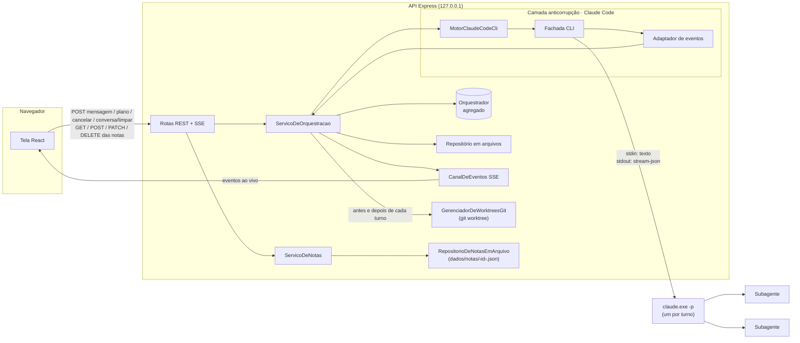
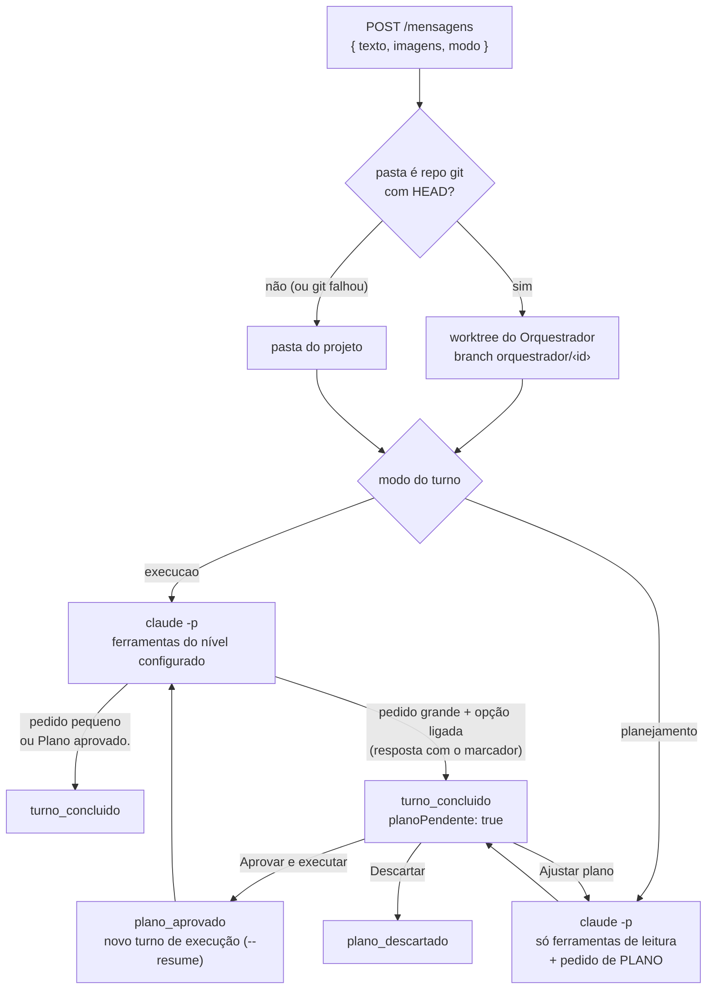

# Orquestrador de Agentes

## Objetivo

Central local para trabalhar com vários agentes do Claude ao mesmo tempo, por uma tela no navegador.

Você cria **Orquestradores** — um por projeto, por exemplo — e conversa com cada um. A cada pedido, o Orquestrador **coordena**: o trivial (ler poucos arquivos, conferir um estado, um comando curto) ele resolve sozinho; o resto ele divide em subtarefas e entrega a **Subagentes** em paralelo, que leem, editam ou rodam comandos na pasta do projeto. Ele **nunca edita arquivos**: toda alteração vai para um Subagente. A tela mostra cada Subagente ao vivo (atividade, ferramentas, tokens, resultado), o que o próprio Orquestrador está fazendo e, no final, a síntese.

- Vários Orquestradores rodam ao mesmo tempo, cada um na sua pasta: são terminais espalhados num canvas infinito, que você move, redimensiona e organiza. Cada Subagente aparece como um bixinho animado ligado ao terminal.
- A conversa tem memória: cada Orquestrador lembra dos pedidos anteriores. **`/clear`** no prompt (ou *Nova conversa* no *⚙*) começa uma conversa do zero; a anterior fica arquivada.
- Por Orquestrador você escolhe os modelos e o esforço de raciocínio de cada papel, a quantidade de Subagentes (fixa ou automática com máximo), as permissões, se commit e push são permitidos quando você pedir (desligado por padrão), se o Orquestrador pode fazer o trivial sozinho (ligado por padrão) e se ele propõe um plano antes de mudanças grandes (ligado por padrão).
- **Plan Mode:** em vez de executar direto, o Orquestrador pode entregar primeiro um plano, feito só com leitura, que você aprova, ajusta ou descarta. Mesmo sem o Plan Mode, um pedido grande pode voltar como plano para aprovação.
- Em pastas com git, cada pedido roda num **worktree** próprio do Orquestrador, e não na pasta original.
- Dá para cancelar um pedido no meio, e o histórico fica salvo.
- **Bloco de notas:** no mesmo canvas, ao lado dos terminais, você cria notas de texto para observações e coisas para fazer depois. O conteúdo fica salvo no servidor, com salvamento automático.

O motor é o próprio **Claude Code em modo headless**, usando o login da sua assinatura — não precisa de API key.

## Como rodar

**Pré-requisitos:** Node 22+ e o Claude Code instalado e logado (`claude` funcionando no terminal).

```bash
npm install
npm --prefix web install
cp .env.example .env   # opcional: os padrões funcionam neste computador
```

| Variável | Padrão | Para quê |
|---|---|---|
| `PORTA` | `3200` | Porta da API (escuta só em `127.0.0.1`) |
| `PASTA_RAIZ_PROJETOS` | pasta acima deste projeto (caminho relativo é resolvido a partir da pasta do app, não de onde o comando roda) | Onde o navegador de pastas da criação começa (atalho *Projetos*). Os Orquestradores podem trabalhar em qualquer pasta do computador (ver ADR-19) |
| `CLAUDE_CODE_BIN` | `%APPDATA%\npm\node_modules\@anthropic-ai\claude-code\bin\claude.exe` | Executável **nativo** do Claude Code (o `claude.cmd` não serve: o app inicia o processo sem shell) |
| `PASTA_DADOS` | `dados/` dentro da pasta do app | Histórico dos Orquestradores e as notas do canvas (`notas/`) |

**Desenvolvimento** (dois terminais):

```bash
npm run dev       # API em http://localhost:3200 (recarrega ao salvar)
npm run web:dev   # tela em http://localhost:5173 (repassa /api para a 3200)
```

> Evite salvar arquivos do backend com um pedido rodando: no Windows, o `tsx watch` reinicia o servidor sem avisar o processo, e o `claude.exe` em andamento continua até terminar sozinho. O turno aparece como "interrompido" e pode ser reenviado.

**Uso no dia a dia:** dê dois cliques em **`iniciar-orquestrador.cmd`**. Ele abre uma janela própria com o servidor e, depois de alguns segundos, o navegador em http://localhost:3200. Na primeira vez, também instala as dependências e gera o build. Para desligar, feche a janela ou aperte Ctrl+C nela.

O `.cmd` sobe o servidor por um **vigia** (`scripts/manter-no-ar.cjs`, também em `npm run iniciar`):
- **religa sozinho** quando o servidor sai com erro, esperando 2 s, 4 s, 8 s… até 30 s entre as tentativas;
- **não religa** quando você fecha a janela ou aperta Ctrl+C;
- **desiste** se o servidor cair 5 vezes em 2 minutos, para mostrar o erro em vez de entrar em loop.

Ao subir, o servidor encerra os processos do Claude que tenham sobrado da queda anterior. Antes de encerrar, confere a linha de comando de cada um, para nunca derrubar uma sessão do Claude Code sua.

**App desktop no Mac:** dê dois cliques em **`iniciar-desktop.command`** (par do `iniciar-desktop.cmd` do Windows). Ele carrega o PATH do seu shell (nvm, Homebrew), refaz o build só do que mudou e abre o app em Electron sem pedir licença, porque roda pelo código (`ORQUESTRADOR_SEM_LICENCA=1`; o app empacotado continua pedindo a chave). Fechar a janela do Terminal fecha o app. Os ajustes do Mac ficam em `electron/mac.js` e não mudam nada no Windows:
- menu do app com copiar, colar, desfazer, zoom, Cmd+W e Cmd+Q;
- as 3 bolinhas nativas dentro da barra do canvas, no lugar dos botões de janela desenhados;
- o servidor roda no Node do sistema (22+), não no Node 20 do Electron;
- se já houver um servidor do Orquestrador na porta (a versão no navegador), o app usa esse e não o desliga ao fechar.

O equivalente manual, num terminal na pasta do app:

```bash
npm run build
npm start         # http://localhost:3200
```

> **Não suba o servidor pedindo a uma sessão do Claude Code.** Lá ele roda em segundo plano, e o Claude Code encerra processos em segundo plano quando a memória do computador fica baixa. Foi o que derrubou três orquestradores ao mesmo tempo em 28/10. Use o `.cmd` ou um terminal próprio. Se o servidor cair mesmo assim, a tela mostra o aviso **Servidor desconectado** e reconecta sozinha quando ele voltar.

**Testes e verificações:**

```bash
npm test            # domínio, adaptador do Claude Code (com saídas reais), repositórios, rotas das notas
npm run typecheck
npm run web:test    # reducer da conversa, fases, nós e layout do canvas, bixinhos, notas e formatação
npm run web:lint
```

Casos de teste sugeridos para a opção **Permitir commit e push quando eu pedir** (ver ADR-10):
- **Bloco do pedido:** desligada → "Commits e push são sempre proibidos."; ligada em turno de execução → a frase de "permitidos somente quando o usuário pedir explicitamente nesta mensagem…"; ligada em turno de Plan Mode → continua "sempre proibidos".
- **Argumentos do `claude -p`:** desligada (ou Plan Mode) → `--disallowedTools` com `git commit`/`git push` para PowerShell e Bash; ligada em execução → `--disallowedTools` só com os padrões de push forçado e `--settings <configuracoes.json>` com `{"attribution":{"commit":"","pr":""}}`; desligada ou Plan Mode → sem `--settings`.
- **Dados antigos:** um `orquestrador.json` sem o campo carrega com `permitirCommitEPush: false`; `POST /orquestradores` sem o campo cria com `false`; `POST /orquestradores` ou `PATCH /configuracao` com valor não booleano devolve 400.
- **Tela:** o toggle (componente compartilhado `CamposDaConfiguracao`, na criação e no *⚙*) envia `permitirCommitEPush` e mostra o aviso quando o nível de permissão não roda comandos.
- **Branch do worktree:** worktree limpo com commits só na `orquestrador/<id>` → a branch fica e sai o aviso no log; sem commits próprios → `git branch -D`; git falhou na conferência → a branch fica.

Casos de teste do **esforço de raciocínio** (ver ADR-12):
- **Domínio:** sem os campos → `"padrao"` nos dois papéis; `orquestrador.json` antigo → `"padrao"`; `com()` altera só o esforço informado; `turno_iniciado` e `configuracao_alterada` levam os dois esforços.
- **API:** `POST /orquestradores` sem os campos cria com `"padrao"`; aceita os escolhidos; valor fora da lista → 400 (`Esforço do orquestrador inválido.` / `Esforço dos subagentes inválido.`); o GET mostra e o PATCH altera só o informado.
- **Argumentos do `claude -p`:** `"padrao"` → sem `--effort` e sem `effort` no executor; cada papel com o seu nível (`alto` → `--effort high`; `extra_alto` → `"effort": "xhigh"` no executor); `CLAUDE_CODE_EFFORT_LEVEL` herdada sai do ambiente quando algum papel tem esforço escolhido e fica com os dois em `"padrao"`; o esforço nunca vai em `--settings`.
- **Tela:** os dois seletores começam em *Padrão (Claude Code)*, com os seis níveis e a ajuda; escolher num papel muda só aquele campo.

Casos de teste do **bloco de notas** (ver ADR-13):
- **Entidade `Nota`:** nasce com "Nova nota", texto vazio e `criadaEm` = `atualizadaEm`; título aparado, texto guardado como veio; renomear/reescrever atualizam `atualizadaEm`, mas com o mesmo conteúdo não contam como alteração; título com exatamente 120 caracteres (depois de aparar) e texto com exatamente 100.000 passam, um a mais é recusado; `reconstituir` devolve exatamente os dados gravados.
- **Repositório em arquivos:** cria `notas/` e começa vazio; um arquivo por nota, que reabre igual; lista por `criadaEm` crescente; devolve cópias (alterar a buscada não muda nada até salvar); arquivo ilegível é ignorado com aviso, sem ser apagado; gravações seguidas da mesma nota terminam com o último conteúdo, sem arquivo pela metade; remover logo depois de salvar não deixa a nota no disco; id que escaparia da pasta é recusado.
- **Rotas:** GET vazio → 200 `[]`; POST sem corpo → 201 com os padrões; PATCH parcial altera só o campo enviado; PATCHes simultâneos terminam com o último aceito no disco; DELETE → 204; PATCH/DELETE de nota inexistente → 404 `Nota não encontrada.`; POST com título vazio/longo, texto longo, campo que não é texto ou corpo que não é objeto → 400 com a mensagem certa e nada gravado; PATCH com um campo inválido → 400 e a nota fica como estava.
- **Layout:** layout antigo sem `notas` vale como sem notas; só as notas corrompidas do layout são descartadas, e sem `minimizada` a nota fica aberta; minimizar deixa só a barra e restaurar volta à altura de antes; a altura gravada é a da nota aberta, mesmo minimizada; "Organizar" põe as notas em colunas de até 4 à direita da grade dos terminais; nota que sumiu do servidor sai do layout ao carregar a lista, e a criada enquanto a lista carregava não sai.
- **Nó da nota (`NoNota`):** digitar e parar dispara um único PATCH, depois da espera, só com o texto; perder o foco salva na hora; erro no PATCH mostra a mensagem e o "tentar de novo"; minimizada, mostra só a barra com o título e a prévia; minimizar e restaurar não perde texto não salvo; clique duplo no título, Enter salva e em branco volta ao anterior; apagar pede confirmação e chama o DELETE (404 também tira do canvas; outro erro mantém a nota com o motivo); digitar numa nota não re-renderiza a outra.

Casos de teste da **delegação sob demanda** (ver ADR-14):
- **Bloco do pedido:** ligada → "Faça você mesmo o trivial: …" com o texto do nível (sem terminal em *leitura*, *edição* e no Plan Mode), a regra de quando delegar e "Você não edita arquivos"; desligada → a regra estrita ("Não faça o trabalho você mesmo…"); quantidade fixa → "quando delegar, use exatamente N"; automática → "no máximo N … se um basta, use um".
- **Dados e API:** `orquestrador.json` antigo e `POST` sem o campo → `true`; valor não booleano no `POST`/`PATCH` → 400; o resumo sempre traz o campo.
- **Tela:** o checkbox vai no PATCH; `ferramenta_do_orquestrador` vira linha de atividade ("orquestrador lendo package.json"); o resumo da configuração cita "delegação total" só com a opção desligada.

Casos de teste do **plano proposto em execução** (ver ADR-15):
- **`separarPropostaDePlano`:** remove o marcador sozinho na linha, no meio da linha, entre crases e repetido; sem marcador devolve a resposta intacta e `planoProposto: false`.
- **Serviço:** com a opção ligada no início do turno e o marcador na resposta → `turno_concluido.planoPendente: true` e plano aprovável/descartável; opção desligada (ou desligada antes do turno começar) → marcador removido e `planoPendente: false`; alterar a configuração no meio do turno não muda o resultado; aprovar envia "Plano aprovado. …".
- **Tela:** `CartaoDoPlano` também em turno de execução com plano pendente; linha "plano proposto · aguardando aprovação"; dica "pedido grande? shift+tab para planejar antes" só em execução e com pedido longo (mais de 400 caracteres ou lista de 3+ itens).

Casos de teste do **`/clear`** (ver ADR-16):
- **Domínio:** recusa com turno em andamento; esvazia os turnos, troca o `sessaoId`, volta `sessaoIniciada` a `false` e descarta o plano pendente; o evento informa `turnosAnteriores`, `planoDescartado` e `worktreeComAlteracoes`.
- **Repositório:** copia `eventos.jsonl` e `orquestrador.json` para `historico/conversa-<N+1>/`; o `eventos.jsonl` novo tem só o `conversa_limpa`, com a sequência seguinte; ao reabrir, a conversa nova carrega e o `historico` é ignorado; remover o orquestrador apaga o `historico`.
- **Rota:** 200 com `totalDeTurnos: 0`; 409 durante um pedido; 404 sem orquestrador; sem conversa → 200 sem gravar nada.
- **Tela:** `/clear` (maiúsculas e espaços tolerados) não vira pedido; "/clear algo" vira; Tab completa "/cl"; durante um pedido aparece a dica de indisponível; imagens e Plan Mode continuam no prompt; o separador "— conversa nova iniciada às HH:MM —" aparece; *Nova conversa* no *⚙* pede confirmação e fica desabilitado durante um pedido.

Casos de teste das **instruções personalizadas** (ver ADR-17):
- **Montagem (`InstrucoesPersonalizadas`):** vazio ou só espaços → nenhuma linha no bloco (mensagem idêntica à de antes); só o padrão global → cabeçalho "padrão do usuário"; só as do Orquestrador → "deste orquestrador"; as duas → valem as do Orquestrador, sem somar; texto longo (4.000 passa, 4.001 é recusado com a contagem); quebras de linha, `{{x}}`, `$&`, crases, aspas e emoji chegam intactos; tags `</configuracao-do-pedido>` e `</instrucoes-do-usuario>` escritas no texto são desarmadas (`‹`); apagar as instruções no meio da conversa manda a linha de revogação; o prompt de sistema e o argv nunca levam o texto.
- **Persistência:** o campo reabre igual por Orquestrador, sem misturar; orquestradores salvos antes do campo valem `""`; `preferencias.json` ausente vale vazio e ilegível é renomeado para `preferencias.ilegivel.json`.
- **Serviço:** editar vale no pedido seguinte; um pedido em andamento segue com as instruções com que começou; não vazam entre Orquestradores; `/clear` zera a revogação.
- **Rotas:** POST/PATCH aceitam e devolvem o campo; acima do limite → 400; `GET/PATCH /preferencias`; `POST /previa-do-prompt` mostra o bloco.
- **Tela:** contador e aviso de limite; prévia do prompt final; painel *Instruções gerais* (Salvar só com mudança, Cancelar descarta); chip *instruções* no terminal; resumo com *instruções próprias*.

Casos de teste dos **subagentes prontos** (ver ADR-18):
- **Validação (`subagentesProntosValidos`):** ausente vale lista vazia; descrição vira uma linha e o prompt é normalizado; modelo ausente vale `herdar`; recusa nome fora do formato (maiúscula, começando por número), nomes reservados (`executor`, `general-purpose`…), campos vazios, modelo inválido, prompt acima de 4.000, nomes repetidos e mais de 10.
- **Bloco do pedido:** sem prontos, a mensagem é idêntica à de antes; com prontos, lista nome e descrição depois da regra de quantidade, sem o prompt deles; tags na descrição são desarmadas.
- **`agentes.json`:** sem prontos, só o `executor`; cada pronto tem as ferramentas e o esforço do `executor` e não lança outros agentes; `herdar` usa o modelo dos subagentes; no planejamento só leem; seguem a regra de commit e push do turno; o prompt traz as regras do executor com o nome do pronto e a especialidade no fim.
- **Serviço e rotas:** o turno captura a lista no início; `PATCH /preferencias` grava e a prévia lista; inválidos → 400 sem gravar nada.
- **Adaptador e tela:** `subagente_iniciado.papel` vem do `subagent_type` (sem ele, `executor`); o log mostra *instanciou <nome>#…*; o painel lista, adiciona (nome ajustado para minúsculas e hífen), remove e trava em 10.

Casos de teste da **escolha de qualquer pasta** (ver ADR-19):
- **`PastaDeTrabalho`:** aceita caminho absoluto fora da pasta dos projetos; relativo parte dela; vazio é recusado.
- **`ExploradorDePastas`:** sem caminho abre a pasta dos projetos; abre pasta de fora; esconde ocultas, `node_modules` e `$…`; ignora arquivos; mostra links e junctions para pastas e esconde os quebrados; `acima` é `null` na raiz do disco; inexistente ou arquivo → `A pasta "…" não existe.`; unidades só no Windows, consultadas uma vez a cada 30 s, e a que não responde em 1 s fica de fora; no Windows, `D:` sozinho vira `D:\`.
- **Worktree em subpasta (`GerenciadorDeWorktreesGit`, com git de verdade):** na raiz do repositório, o turno roda na raiz do worktree; numa subpasta versionada, na mesma subpasta dentro do worktree; numa subpasta não versionada, na própria pasta, sem worktree.
- **Rotas:** `GET /pastas` com e sem `caminho`, inexistente → 400, dois `caminho` → 400; `POST /orquestradores` cria fora da pasta dos projetos e continua recusando pasta inexistente; a prévia aceita pasta de fora.
- **Tela (`NavegadorDePastas`):** abre sem escolher; entrar numa subpasta, subir e atalhos só navegam; *Usar “nome”* escolhe a pasta aberta; ↑ desabilitado na raiz do disco; Enter no caminho abre sem enviar o formulário; caminho inválido mostra o erro e mantém a pasta; apagar o caminho e sair do campo volta à pasta aberta; espera o servidor voltar; resposta atrasada de um Enter antigo é descartada; a carga inicial não apaga o que já foi digitado; falha na carga inicial oferece *Tentar de novo*.

Casos de teste da **janela do sistema e da criação** (ver ADR-20):
- **`SeletorDePastaNativo`:** o comando de cada sistema (`osascript` com a pasta inicial como argumento, PowerShell com `-STA` e a pasta por variável de ambiente, `zenity`), nenhum em outros sistemas; a saída perde BOM, quebra de linha e barra final (mantém `/` e `C:\`); cancelar devolve `null`; código de erro e programa ausente viram *indisponível*; o sinal e o tempo máximo fecham a janela.
- **Rota `POST /pastas/escolher`:** devolve o caminho escolhido, `null` ao cancelar; abre na pasta dos projetos ou na pasta `inicial` que existe; 403 fora da própria máquina; 409 com uma janela já aberta; 503 `indisponivel` sem janela no sistema.
- **Tela (`EscolhaDePasta`):** a janela abre na recente mais nova e devolve a pasta; enquanto ela está aberta, a tela explica onde procurar e *cancelar* fecha a janela; cancelar na janela volta ao início sem erro; 503 abre o navegador daqui com o aviso; uma recente escolhe com um clique; sem recentes, a seção some; *ou procurar a pasta aqui dentro* e *‹ voltar*; descartar o rascunho fecha a janela aberta.
- **Tela (`NoRascunho`):** mostra tudo numa tela só, já com os padrões, e o rodapé diz por que ainda não dá para começar (sem pasta, sem nome, instruções acima do limite ou servidor fora); recentes sem repetir, a mais nova primeiro; o nome vem da pasta, e um nome editado à mão (e diferente do da pasta) não é trocado; os chips de esforço e de quantidade abrem um menu (um por vez, fecha com Esc e clique fora) e o × volta ao padrão; *Começar em nome* cria com o que foi escolhido, com o trivial e o plano sempre ligados.

## Tecnologias

- **Node 22+ / TypeScript 6** (estrito, `exactOptionalPropertyTypes`), **Express 5**, **zod 4** (validação da API), **vitest**.
- **Tela:** React 19, Vite 6, Tailwind 4, react-markdown com remark-gfm e **React Flow** (`@xyflow/react` 12) para o canvas (ver ADR-8). Tema escuro com a paleta da Anthropic (ver ADR-7). Fontes empacotadas via `@fontsource`, sem CDN: Poppins, Lora e JetBrains Mono.
- **Claude Code 2.1.x** (`claude -p --output-format stream-json`) como motor dos agentes.
- **Tempo real:** Server-Sent Events. **Persistência:** arquivos JSON/JSONL.

## Arquitetura

### Visão geral



Organização por contexto (DDD):

```
src/
  orquestracao/              domínio — linguagem do negócio, sem Express nem Claude Code
    Orquestrador.ts            raiz do agregado (conversa sobre uma pasta)
    Turno.ts, Subagente.ts     internos do agregado
    ConfiguracaoDoOrquestrador, QuantidadeDeSubagentes, PastaDeTrabalho,
    NivelDePermissao, ModeloClaude, EsforcoDeRaciocinio, ModoDoTurno   objetos de valor
    EventoDeOrquestracao.ts    o que acontece (histórico + tela)
    InstrucoesDoOrquestrador.ts  regras de trabalho do Orquestrador e do Subagente
    ServicoDeOrquestracao.ts   casos de uso (stateless)
    MotorDeAgentes.ts, RepositorioDeOrquestradores.ts, ControleDeExecucoes.ts,
    PreparoDeWorktree.ts (GerenciadorDeWorktrees)   portas
  notas/                     domínio do bloco de notas — contexto próprio, sem relação com a orquestração
    Nota.ts                    entidade (título e texto; criar, renomear, reescrever)
    ErroDeNota.ts              dados_invalidos · nao_encontrada
    ServicoDeNotas.ts          casos de uso (stateless; id e relógio injetados)
    RepositorioDeNotas.ts      porta
  infraestrutura/
    claudecode/                camada anticorrupção: Fachada (processo), Adaptador
                               (stream-json → eventos do domínio), Argumentos, Motor
    arquivos/                  repositório JSON/JSONL dos Orquestradores, repositório das
                               notas (um JSON por nota) e listagem de pastas
    sse/, execucoes/           canal de eventos e controle de cancelamento
    sistema/                   worktrees git (Worktrees, GerenciadorDeWorktreesGit),
                               memória e processos do Claude
  controllers/                 REST + SSE, validação (zod), erros → HTTP
                               (orquestradoresRoutes.ts, notasRoutes.ts)
web/src/
  paginas/CanvasDeOrquestradores.tsx   canvas (React Flow): nós, linhas, painéis, layout salvo
  componentes/canvas/                  NoTerminal (terminal do Orquestrador), NoRascunho (configuração),
                                       NoBixinho + Bixinho (Subagente em pixel art),
                                       ArestaDoBixinho (linha com a bolinha de troca), NoNota (nota),
                                       painéis flutuantes
  shared/estado/                       aplicarEvento (reducer da conversa + log), faseDoTurno
  shared/canvas/                       nós e linhas a partir das conversas, layout, aparência e desenhos dos bixinhos,
                                       notas.ts (loja das notas, separada do contexto do canvas)
  shared/hooks/useConversas.ts         um EventSource por terminal aberto
  shared/hooks/useNotas.ts,            notas do canvas (carregar, criar, minimizar, apagar)
    useEdicaoDaNota.ts                 e a edição com salvamento automático
```

**Bloco de notas** (contexto `notas`, ver ADR-13): o conteúdo de cada nota (título e texto) fica no servidor, um arquivo por nota em `<PASTA_DADOS>/notas/<id>.json` (padrão `dados/notas/`). Posição, tamanho e se está minimizada ficam no layout do navegador, como os terminais (ver ADR-8). O contexto não conversa com a orquestração: tem entidade, serviço, porta e rotas próprias.

**Pasta de dados** (`<PASTA_DADOS>`, padrão `dados/`; ver ADR-5, ADR-13, ADR-16 e ADR-17):

```
dados/
  orquestradores/<id>/
    orquestrador.json          estado atual do agregado (conversa atual)
    eventos.jsonl              eventos da conversa atual, um por linha
    historico/                 conversas anteriores, arquivadas pelo /clear (só consulta; não é carregado)
      conversa-<N>/            <N> = sequência do evento conversa_limpa que a arquivou
        orquestrador.json
        eventos.jsonl
  anexos/<id>/                 imagens enviadas nos pedidos
  notas/<id>.json              uma nota por arquivo
  preferencias.json            preferências globais: instruções gerais e subagentes prontos (ver ADR-17 e ADR-18)
  worktrees/<8 caracteres>/    worktrees git dos Orquestradores
```

**Ciclo de um pedido:**
1. `POST /mensagens` → o agregado abre um Turno com o **modo** pedido: `execucao` (padrão) ou `planejamento` (recusa se já houver um em andamento). A configuração vigente é **capturada nesse instante** (vai no `turno_iniciado`) e vale até o fim do turno, mesmo que o usuário a altere enquanto ele roda.
2. **Worktree:** se a pasta do projeto for um repositório git com pelo menos um commit, o turno roda num worktree próprio do Orquestrador (ver abaixo). Senão, ou se o git falhar, roda na própria pasta.
3. O motor inicia `claude.exe -p` na pasta do turno (o worktree ou a pasta do projeto). Pelo stdin vai o texto do usuário, precedido do bloco `<configuracao-do-pedido>` (regra de delegação, quantidade de subagentes, permissões vigentes, regra de commit e push, o modo e, em execução, a regra de pedidos grandes). As regras fixas do Orquestrador e a definição do Subagente `executor` vão em arquivos temporários (`instrucoes.txt` e `agentes.json`); com commit e push liberados no turno, vai também um `configuracoes.json`, passado em `--settings` (ver ADR-10).
   - **Delegação** (ver ADR-14): com **Deixar o orquestrador fazer o trivial sozinho** ligada (padrão), o bloco manda o Orquestrador fazer ele mesmo o trivial do nível (ler ou buscar em poucos arquivos, conferir um estado e, só em *Mudar arquivos e rodar comandos* fora do Plan Mode, um comando curto) e delegar quando houver alteração de arquivos, muitos arquivos ou comandos demorados, ou partes paralelas; em nenhum caso ele edita arquivos. Desligada, vale a regra estrita: delegar tudo.
   - **Pedidos grandes** (ver ADR-15): com **Propor plano antes de mudanças grandes** ligada (padrão), num turno de `execucao`, o bloco manda o Orquestrador medir o pedido. Grande (mais de cerca de 3 arquivos, contratos, dados ou arquitetura, ambiguidade relevante) → não executa, investiga só lendo, responde com um PLANO e termina com a linha `<plano-para-aprovacao/>`. Pequeno, ou mensagem que começa com "Plano aprovado." → executa direto.
   - Em `planejamento`, o Orquestrador e o `executor` recebem só as ferramentas de leitura, qualquer que seja o nível configurado, e o bloco pede um **plano** em vez da execução (ver ADR-9).
   - Com **Permitir commit e push quando eu pedir** ligada, num turno de `execucao`, o bloco libera commit e push só quando o usuário pedir explicitamente naquela mensagem, e o `claude -p` sai sem o bloqueio de `git commit`/`git push` (ver ADR-10). Desligada, ou em `planejamento`, continua tudo proibido.
   - **Instruções personalizadas** (ver ADR-17): se o Orquestrador tiver instruções próprias, ou, sem elas, houver *Instruções gerais* (botão na barra do canvas), o bloco termina com elas dentro de `<instrucoes-do-usuario>`. Sem nenhuma, o bloco sai exatamente como antes.
   - **Subagentes prontos** (ver ADR-18): com subagentes prontos (botão *Subagentes* na barra do canvas), o bloco os lista (nome e quando usar) e o `agentes.json` os define ao lado do `executor`, com as mesmas ferramentas e esforço. Sem nenhum, nada muda.
   - **Esforço** (ver ADR-12): com esforço escolhido para o Orquestrador, o `claude -p` recebe `--effort <low|medium|high|xhigh|max>` logo depois do `--model`; com esforço escolhido para os Subagentes, a definição do `executor` no `agentes.json` ganha o campo `"effort"`. Em `"padrao"` nada disso é enviado. Se algum dos dois papéis tiver esforço escolhido, a variável `CLAUDE_CODE_EFFORT_LEVEL` herdada do servidor é removida do ambiente do processo, porque ela venceria a escolha.
4. Cada linha `stream-json` vira evento do domínio (`subagente_iniciado`, `progresso_do_subagente`…), gravado em `eventos.jsonl` e publicado por SSE.
5. No `result` final, o Turno é concluído com a resposta e o consumo. O servidor sempre tira da resposta o marcador `<plano-para-aprovacao/>` (`separarPropostaDePlano`). Num turno de `planejamento`, ou num de `execucao` em que o marcador veio e a opção de propor plano estava ligada no início do turno, a resposta é um plano, que fica **pendente** (`turno_concluido.planoPendente: true`; só o último turno pode ter plano pendente) até o usuário:
   - **aprovar** (`POST /plano/aprovar`): registra `plano_aprovado` e inicia um novo turno de `execucao` na mesma sessão (`--resume`), com as permissões configuradas e a mensagem "Plano aprovado. Execute agora o plano…";
   - **ajustar:** envia um novo pedido (em `planejamento`, ou em `execucao` pedindo outro plano), que gera outro plano;
   - **descartar** (`POST /plano/descartar`): registra `plano_descartado`.

O primeiro turno usa `--session-id`; os seguintes, `--resume`, o que mantém a memória da conversa.

**Conversa nova (`/clear`, ver ADR-16):** `POST /conversa/limpar` (recusado durante um pedido) arquiva o histórico em `historico/conversa-<N>/`, esvazia os turnos, descarta um plano pendente e gera um `sessaoId` novo. O próximo turno volta a usar `--session-id`, numa sessão do Claude Code sem memória da anterior. Nome, pasta, configuração e worktree continuam os mesmos.



**Worktree por Orquestrador** (`GerenciadorDeWorktreesGit`, atrás da porta `GerenciadorDeWorktrees`):
- **Quando:** antes de cada turno, se a pasta estiver dentro de um repositório git que já tenha HEAD (um `git init` sem commit não serve). Qualquer falha do git faz o turno rodar na pasta normal, sem quebrar o pedido.
- **O que é criado:** `git worktree add -b orquestrador/<id> <caminho> HEAD`, ou seja, uma branch `orquestrador/<id do Orquestrador>` a partir do HEAD atual da pasta. Alterações não commitadas da pasta original não vão para o worktree. Se a branch já existir, ela é reaproveitada; se o worktree já existir no caminho, nada é refeito.
- **Pasta escolhida dentro do repositório** (ver ADR-19): o worktree é do repositório inteiro, e o turno roda na subpasta equivalente dentro dele (`git rev-parse --show-prefix`). Subpasta não versionada no HEAD: o turno roda na própria pasta, sem worktree.
- **Onde fica:** `<PASTA_DADOS>/worktrees/<8 primeiros caracteres do id>`. O caminho é curto de propósito, para não estourar o `MAX_PATH` do Windows quando os agentes criam `node_modules` lá dentro; a criação e a remoção usam `git -c core.longpaths=true`.
- **No fim do turno:** sem alterações (`git status --porcelain` vazio), o worktree é removido (seguido de `git worktree prune`). A branch `orquestrador/<id>` só é apagada (`git branch -D`) se não tiver commits que não existam em outra ref: o app confere com `git rev-list --count refs/heads/orquestrador/<id> --not --exclude=refs/heads/orquestrador/<id> --all` (outras branches, tags, remotas, stash e HEADs). Se tiver (ex.: um commit feito direto nela, com a opção de commit ligada, ver ADR-10), ou se a conferência falhar, a branch é mantida e o servidor avisa no log do console (`[worktrees] A branch "orquestrador/<id>" tem commits que não estão em nenhuma outra branch; mantida…`). Com alterações, o worktree fica e é marcado como inativo; o próximo turno continua nele.
- **Branches criadas pelo agente** (ex.: `feature/x` via `git checkout -b` dentro do worktree) nunca são apagadas pelo app: os worktrees compartilham as branches com o repositório, então elas aparecem no repositório do projeto.
- **Ao subir o servidor:** os worktrees que sobraram da execução anterior são limpos (análogo aos processos órfãos do Claude), com a mesma regra do fim do turno: pelo git, só os sem alterações são removidos; os com trabalho são preservados. Em `<PASTA_DADOS>/worktrees/`, só são apagadas as pastas órfãs sem `.git` (ex.: `worktree add` pela metade). Uma pasta com `.git` cujo repositório de origem sumiu ou foi movido também é mantida, com um aviso no log (resolva com `git worktree repair` no repositório ou apague a pasta à mão).
- O estado fica no agregado (`worktree: { branch, caminho, ativo }`) e aparece na tela como uma etiqueta com a branch.

### Decisões de arquitetura (ADRs)

**ADR-1 — Motor: Claude Code headless, e não Agent SDK ou API.**
- *Contexto:* o usuário tem só a assinatura do Claude (login do Claude Code), sem API key. A política do Agent SDK pede API key para produtos construídos sobre ele.
- *Decisão:* executar o `claude.exe` oficial em modo `-p`, com o login do próprio usuário, na máquina dele. O motor fica atrás da porta `MotorDeAgentes`.
- *Consequências:*
  - funciona sem API key, mas consome a cota da assinatura (exibida na tela);
  - é para uso pessoal e local;
  - para oferecer ao time num servidor, criar um adaptador com o Agent SDK e uma API key, sem mudar o domínio.

**ADR-2 — Um processo por turno, com `--resume`.**
- *Contexto:* a conversa precisa de memória, e o cancelamento precisa ser confiável.
- *Decisão:* cada mensagem inicia um processo novo que retoma a sessão. Cancelar é `taskkill /T /F`, que derruba a árvore inteira, incluindo comandos abertos por Subagentes.
- *Consequências:*
  - não há processo vivo entre turnos para gerenciar;
  - cada turno paga o tempo de partida do Claude Code (poucos segundos);
  - ao retomar uma sessão, o Claude Code mantém o prompt de sistema gravado na criação e ignora um `--append-system-prompt-file` novo (verificado na 2.1.312). Por isso, o que muda entre pedidos (regra de delegação, quantidade, permissões, regra de commit e push, modo do turno e regra de pedidos grandes) vai no início de cada mensagem, num bloco `<configuracao-do-pedido>` que declara substituir "qualquer regra de delegação, quantidade de subagentes ou permissão" mencionada antes, inclusive nas instruções iniciais. `--model`, `--effort`, `--agents` e as permissões por flag valem a cada processo.

**ADR-3 — Permissões por `dontAsk` + lista explícita.**
- *Contexto:* não há ninguém no terminal para aprovar ações.
- *Decisão:* o que não está liberado é negado. `--tools` e `--allowedTools` vêm do nível escolhido:
  - **leitura:** Read, Glob, Grep, WebSearch, WebFetch;
  - **edição:** o anterior + Edit, Write, NotebookEdit;
  - **comandos:** o anterior + PowerShell e Bash.

  Por padrão, `git commit` e `git push` são negados em todos os níveis por `--disallowedTools` (PowerShell e Bash). A exceção é a opção **Permitir commit e push quando eu pedir**: ligada, num turno de execução, esses bloqueios saem, mas o `--disallowedTools` continua negando o push forçado (`--force*`, `-f`/`-fu`, refspec com `+`), e a atribuição Co-authored-by do Claude Code é desligada por um `--settings` só daquele turno (detalhes na ADR-10). `--strict-mcp-config` deixa de fora os MCPs da conta. Num turno de Plan Mode vale sempre a lista de **leitura**, qualquer que seja o nível configurado, com commit e push bloqueados (ver ADR-9).
- *Consequências:*
  - as negações aparecem na tela;
  - as regras valem para a sessão inteira, então não dá para proibir ferramentas só para o Orquestrador. O que ele pode fazer sem delegar, e o "nunca edite arquivos", vêm das instruções (ver ADR-14); a tela mostra cada ferramenta que ele usa como uma linha de atividade no log.

**ADR-4 — SSE em vez de WebSocket.**
- *Contexto:* o fluxo ao vivo é só do servidor para a tela; as ações do usuário são poucas.
- *Decisão:* `EventSource` por Orquestrador; as ações vão por POST.
- *Consequências:* o navegador reconecta sozinho e envia `Last-Event-ID`, e o servidor reenvia só o que faltou. Sem dependência extra.

**ADR-5 — Histórico em arquivos (JSON + JSONL), sem banco.**
- *Contexto:* ferramenta local de uma pessoa.
- *Decisão:* `dados/orquestradores/<id>/orquestrador.json` guarda o estado do agregado, gravado de forma atômica. `eventos.jsonl` é append-only e reproduz a conversa atual na tela. Conversas encerradas pelo `/clear` vão para `historico/conversa-<N>/`, só para consulta (ver ADR-16 e o layout em *Pasta de dados*).
- *Consequências:*
  - zero infraestrutura;
  - no boot, turnos que estavam rodando viram `interrompido`;
  - para vários usuários, trocar o repositório (a porta já existe).

**ADR-6 — Saída do Claude Code isolada numa camada anticorrupção.**
- *Contexto:* o formato `stream-json` evolui por versão e usa termos próprios (`task_id`, `tool_use_id`, `parent_tool_use_id`).
- *Decisão:* `AdaptadorDeEventosDoClaudeCode` traduz para eventos do domínio, testado com saídas reais capturadas (`src/infraestrutura/claudecode/fixtures`).
- *Consequências:* quando o Claude Code mudar o formato, só o adaptador muda.

**ADR-7 — Identidade visual do Claude, e não o Design System Vaccinar.**
- *Contexto:* a tela é um console de agentes do Claude, e o usuário pediu um visual mais técnico com as cores da Anthropic.
- *Decisão:* tema escuro com a paleta da identidade da Anthropic:
  - escuro `#141413`, claro `#faf9f5`;
  - cinzas `#b0aea5` e `#e8e6dc`;
  - acentos laranja `#d97757`, azul `#6a9bcc` e verde `#788c5d`.

  Tipografia: Poppins nos títulos, Lora (serifada, como no claude.ai) nas respostas do Claude e JetBrains Mono nos dados técnicos. Os ícones foram desenhados para esta tela; não há logotipo nem marca da Anthropic.
- *Consequências:*
  - diverge do DS Vaccinar, que segue valendo para os outros sistemas;
  - as cores continuam centralizadas em tokens (`web/src/theme/index.css`), com os mesmos nomes semânticos (`--primary`, `--surface`, `--border`…) e as mesmas classes (`.btn`, `.card`, `.field`, `.alert`);
  - os componentes não têm hexadecimal solto.

**ADR-8 — Canvas com React Flow, e não layout fixo nem uma biblioteca de desenho.**
- *Contexto:* o usuário quer trabalhar como no Excalidraw: vários terminais espalhados, que se movem e se redimensionam, e os Subagentes visíveis como bixinhos ligados ao seu Orquestrador.
- *Decisão:* usar `@xyflow/react` (MIT), que já traz canvas infinito, arrasto, redimensionamento (`NodeResizer`), zoom, minimapa e linhas animadas entre nós.
  - **Nós:** terminais, rascunhos, bixinhos e notas são nós próprios em React. Os bixinhos são filhos do terminal (`parentId`) e acompanham quando ele é movido.
  - **Estado ao vivo:** fica num contexto, e os nós guardam só ids. Assim o canvas não é recriado a cada evento do Claude.
  - **Layout:** posições, tamanhos e zoom ficam no `localStorage`, por serem preferência de quem olha. O histórico continua no servidor. O layout é gravado ao soltar o arraste e ao fim do pan/zoom; redimensionar, abrir, fechar e organizar continuam gravando após uma espera de 300 ms (ver ADR-11).
    - **Formato** (chave `orquestrador-agentes:canvas:v1`): `{ "terminais": { "<orquestradorId>": { "x", "y", "largura", "altura" } }, "notas": { "<notaId>": { "x", "y", "largura", "altura", "minimizada" } }, "viewport": { "x", "y", "zoom" } | null }`.
    - **Notas:** a `altura` gravada é sempre a da nota aberta; minimizada, ela mostra só a barra (40 px), e restaurar volta a essa altura. Layouts gravados antes das notas, sem o campo `notas`, continuam válidos (valem como sem notas); entradas corrompidas são descartadas, e sem `minimizada` a nota fica aberta. Ao carregar a lista do servidor, a nota que não existe mais sai do canvas e, com isso, do layout. O conteúdo das notas não vai para o layout: fica no servidor (ver ADR-13).
  - **Bixinhos limpos:** o botão *limpar* de cada terminal guarda, na chave `orquestrador-agentes:canvas:v1:bixinhos-limpos`, o id do último pedido e os ids dos Subagentes limpos dele, por Orquestrador. Um pedido novo invalida a lista, a próxima limpeza a substitui e a de um Orquestrador excluído é apagada, então ela não cresce sem limite. Os limpos são filtrados antes de virar nós e linhas do React Flow. As posições dos bixinhos não são salvas (só as dos terminais), então não há posição a apagar.
  - **Bixinhos sem sobreposição:** os bixinhos nunca ficam sobre outro terminal, formulário ou nota: ao soltar um arraste, redimensionar, abrir/criar janelas ou organizar, o grupo que ficou sobreposto vai para o primeiro lugar livre (abaixo, direita, esquerda, acima, ou mais abaixo); grupos sem conflito ficam onde estão. A linha sai do lado do terminal voltado para o bixinho e chega no lado do bixinho voltado para o terminal (ex.: bixinho acima → sai do topo do terminal e chega embaixo do bixinho), acompanhando arrastes e redimensionamentos.
  - **Linhas:** a ligação terminal → bixinho é uma aresta própria, `ArestaDoBixinho` (tipo `"bixinho"`), que desenha a mesma curva Bézier da aresta padrão. Enquanto o Subagente executa, uma bolinha vai e vem entre o terminal e o bixinho por um `<animateMotion>` do SVG (SMIL) sobre a própria curva. O SMIL foi escolhido porque o navegador anima sozinho: não há estado React por quadro nem `requestAnimationFrame`, e o custo é desprezível mesmo com vários bixinhos.
- *Consequências:*
  - o React Flow mostra o crédito "React Flow" no canto, como pede a licença;
  - o pacote da tela ficou maior (~400 kB), irrelevante para um app local;
  - Excalidraw e tldraw foram descartados: são editores de desenho, ruins para hospedar componentes interativos (terminais com prompt), e o tldraw exige licença para uso comercial;
  - o SMIL ignora as regras CSS de animação (como o `animation: none` do `prefers-reduced-motion`). Por isso a bolinha é escondida explicitamente com `prefers-reduced-motion` e também quando o servidor está desconectado.

**ADR-9 — Plan Mode no domínio do app, e não `--permission-mode plan`.**
- *Contexto:*
  - o app roda o `claude -p` headless com `--permission-mode dontAsk` (ADR-1 e ADR-3: só há a assinatura, sem API key, e ninguém no terminal para aprovar);
  - segundo a documentação oficial do Claude Code, em `-p` a ferramenta `ExitPlanMode` só fica disponível com um "permission host": o `canUseTool` do Agent SDK, `--permission-prompt-tool` via MCP ou um hook `PreToolUse`. Sem isso, o modo `plan` nativo não tem como devolver o plano para aprovação;
  - ao retomar a sessão, o prompt de sistema é ignorado (ADR-2), então a instrução de "só planejar" não pode morar nele.
- *Decisão:*
  - o modo é do domínio: cada Turno tem um `ModoDoTurno`, `execucao` (padrão) ou `planejamento`, enviado no `POST /mensagens`;
  - em `planejamento`, a trava é real: `--tools`/`--allowedTools` e o `tools` do Subagente `executor` ficam só com as ferramentas de leitura (Read, Glob, Grep, WebSearch, WebFetch);
  - o bloco `<configuracao-do-pedido>` instrui o Orquestrador a entregar um PLANO, sem executar: objetivo, subtarefas por Subagente com os arquivos envolvidos, ordem, riscos e perguntas em aberto;
  - o plano do último turno fica pendente. Aprovar registra `plano_aprovado` e abre um novo turno de `execucao` na mesma sessão (`--resume`), com as permissões configuradas; descartar registra `plano_descartado`.
- *Consequências:*
  - a segurança vem das ferramentas, e não da obediência ao prompt: mesmo que o modelo tente, não consegue editar nem rodar comandos durante o planejamento;
  - a qualidade e o formato do plano dependem do prompt;
  - planejar e executar custam dois turnos (dois processos e mais cota), mas a execução já parte do contexto do plano, pela mesma sessão;
  - o turno de planejamento e o de execução precisam rodar no mesmo diretório (o mesmo worktree, quando houver) para o `--resume` encontrar a sessão;
  - se um dia houver um motor com o Agent SDK (ADR-1), o `modo` mapeia direto para `permissionMode: "plan"` com `canUseTool`, sem mudar o domínio.

**ADR-10 — Commit e push opcionais, por pedido.**
- *Contexto:*
  - a política do time permite commit e push só com pedido explícito do usuário, em branch própria (`feature/`, `fix/`, `hotfix/`, `refactor/`), nunca na `main` e sem a linha Co-authored-by;
  - até aqui, commit e push eram sempre proibidos: pelo `--disallowedTools` (ADR-3) e pelo prompt do Orquestrador. Levar as alterações para o projeto era sempre trabalho manual.
- *Decisão:*
  - nova opção na configuração do Orquestrador, `permitirCommitEPush` (**desligada por padrão**; dados antigos sem o campo valem `false`). Como as outras opções, vale por pedido: o `turno_iniciado` leva a cópia da configuração;
  - o bloco `<configuracao-do-pedido>` carrega a regra. Desligada, ou num turno de Plan Mode: "Commits e push são sempre proibidos." Ligada, num turno de execução: "Commits e push: permitidos somente quando o usuário pedir explicitamente nesta mensagem. Nunca commitar direto na main; usar branch conforme a política (feature/, fix/, hotfix/, refactor/). Nunca adicionar a linha Co-authored-by.";
  - o prompt de sistema do Orquestrador passa a dizer: "Commits e push seguem a permissão do bloco <configuracao-do-pedido> mais recente; sem o bloco, são proibidos.";
  - a trava técnica só sai quando a opção está ligada e o turno não é de Plan Mode (`ArgumentosDoClaudeCode.ts`):
    - o `--disallowedTools` deixa de bloquear `git commit`/`git push`, mas continua negando o push forçado (`COMANDOS_DE_PUSH_FORCADO`), com os mesmos padrões para `PowerShell(...)` e `Bash(...)`: `git push *--force*` (cobre `--force`, `--force-with-lease` e `--force-if-includes` em qualquer posição depois de `push`), `git push -f*` e `git push * -f*` (`-f`, inclusive `-fu`) e `git push * +*` (refspec com `+`, ex.: `git push origin +main`);
    - a atribuição do Claude Code (o trailer Co-Authored-By nos commits e o "Generated with Claude Code" nos PRs) é desligada: o app grava `{"attribution":{"commit":"","pr":""}}` num `configuracoes.json` temporário do turno (na mesma pasta temporária e no mesmo padrão do `agentes.json`) e passa `--settings <arquivo>` ao `claude -p`. Esse arquivo fica acima das settings do usuário e do projeto e abaixo das gerenciadas pela organização. Desligada, ou em Plan Mode, o arquivo não é gravado e o `--settings` não entra. Não se usa `attribution: false` porque essa forma só existe a partir da v2.1.281, e versões anteriores descartam o arquivo inteiro;
  - no fim do turno, com o worktree limpo, a branch `orquestrador/<id>` só é apagada se não tiver commits que não existam em outra ref; senão, é mantida com aviso no log do console (ver *Worktree por Orquestrador*).
- *Consequências:*
  - o "só quando o usuário pedir" e o "nunca na main" dependem de o modelo seguir a instrução: não há trava técnica para isso, ao contrário do Plan Mode (ADR-9). Por isso a opção nasce desligada;
  - só tem efeito com o nível *Mudar arquivos e rodar comandos*: sem PowerShell/Bash não há como commitar, e a tela avisa;
  - regras `deny` nas settings do usuário (`~/.claude/settings.json` ou do projeto) prevalecem sobre `--allowedTools`: se elas negarem `git commit`/`git push`, a opção ligada não libera;
  - o bloqueio do push forçado é por padrão de texto: as regras casam o comando como o agente o escreve. Não pegam variações como `git -C <pasta> push --force` (ou `git -c … push -f`), flags curtas combinadas com o `f` no meio (`-uf`), o comando dentro de outro interpretador (`bash -c '…'`, `pwsh -c "…"`) nem dentro de um script. E `git push origin HEAD:main` não é bloqueado: o "nunca na main" depende só da instrução;
  - sessões criadas antes da opção mantêm o prompt de sistema antigo ("sempre proibidos"), porque o `--resume` não troca o prompt (ADR-2). Vale o bloco do pedido, que declara substituir as instruções anteriores;
  - **pendência conhecida — execução de plano aprovado:** o bloco exige que o usuário peça "explicitamente nesta mensagem", e a mensagem automática de aprovação do plano ("Plano aprovado. Execute agora o plano…") não contém esse pedido. Por isso, mesmo com a opção ligada, o Orquestrador pode recusar um commit/push previsto no plano ao executá-lo;
  - branches e commits criados no worktree ficam no repositório do projeto (os worktrees compartilham as branches), prontos para revisão, PR ou merge. Branches criadas pelo agente (ex.: `feature/x` via `git checkout -b`) nunca são apagadas pelo app.

**ADR-11 — Desempenho do canvas: re-renderizar só o que mudou.**
- *Contexto:* o canvas travava ao arrastar um terminal e com muitos bixinhos. Cada evento do Claude, cada consulta ao servidor e cada quadro do arraste re-renderizavam todos os nós, e o Markdown das respostas era analisado de novo.
- *Decisão* (só na tela, `web/src`; nada no servidor):
  - **Terminal:** `NoTerminal` é só a moldura (redimensionador e âncoras); o conteúdo fica em `JanelaDoTerminal` (`memo`), com callbacks estáveis. `TranscricaoDoTerminal`, `Turno`, `LinhaDoTerminal`, `CartaoDoPlano`, `PromptDoTerminal` e `TextoFormatado` são `memo`, e os plugins/`components` do `react-markdown` são constantes. Arrastar não re-renderiza transcrição nem prompt, e Markdown que não mudou não é re-analisado.
  - **Bixinhos:** `aparenciaDoBixinho` tem cache por id (objeto congelado, até 1.000 entradas). `NoBixinho` só lê o contexto e repassa a `ConteudoDoBixinho` (`memo`); o `NodeToolbar` só existe com o bixinho selecionado; `ArestaDoBixinho` é `memo`. O sprite são dois `<svg>` (sombra e desenho), e o `saltitar` move só o `<svg>` do desenho, no compositor (`will-change`).
  - **CSS:** a linha de um Subagente executando continua tracejada, mas o tracejado não anima; os painéis flutuantes não usam `backdrop-filter` (fundo 96% opaco). Durante o movimento, a classe `.canvas-movendo` põe `will-change` no viewport, no nó arrastado e nos bixinhos, pausa as animações CSS dos nós e esconde a bolinha SMIL.
  - **Estado:** o valor do contexto é estável; `useServidor`, `useOrquestradores` e `useConversas` só trocam a referência quando o conteúdo muda; as arestas são reaproveitadas (`reaproveitarArestas`, `useReaproveitado`); as props do `<ReactFlow>` são estáveis (`ENQUADRAMENTO_AO_ABRIR`, `VIEWPORT_PADRAO`, handlers, MiniMap).
  - **Movimento** (`useMovimentoDoCanvas`): o layout é gravado ao soltar o arraste e no fim do pan/zoom. A classe `.canvas-movendo` vai no contêiner pai do `.react-flow` de `onNodeDragStart` a `onNodeDragStop` (com rede de segurança em `pointerup`/`pointercancel`) e de `onMoveStart` a `onMoveEnd`.
  - **Hooks finos no contexto:** `ProvedorDoCanvas`, `useSeletorDoCanvas`, `useAcoesDoCanvas` e `useConversaDoCanvas`. `useCanvas()` mantém a mesma API.
- *Consequências:*
  - mudanças visuais: o tracejado da linha executando fica parado, os painéis flutuantes perdem o desfoque e, durante o arraste/pan, as animações dos nós pausam e a bolinha some;
  - por causa do `will-change`, o canvas pode ficar um pouco menos nítido enquanto se move; volta ao normal ao soltar;
  - nós novos devem preferir os hooks finos (`useSeletorDoCanvas`, `useAcoesDoCanvas`, `useConversaDoCanvas`) a `useCanvas()`, e componentes pesados devem ser `memo` com props estáveis, para não voltar a re-renderizar tudo.

**ADR-12 — Esforço por `--effort` e `effort` do agente.**
- *Contexto:*
  - antes, o app não definia esforço de raciocínio: valia o que estivesse nas configurações do Claude Code da máquina. Hoje, neste computador, o `~/.claude/settings.json` tem `modelSettings["claude-opus-5-5"].effortLevel = "xhigh"`, então o Orquestrador e os Subagentes rodam em Opus 5.5 com `xhigh` (comprovado nas transcrições). Sem nada salvo, vale o padrão do modelo (`medium` no Opus, Sonnet e Haiku 5.5);
  - o usuário quer escolher o esforço por papel, para equilibrar qualidade, tempo e cota.
- *Decisão:*
  - o domínio ganha o objeto de valor `EsforcoDeRaciocinio` (`padrao`, `baixo`, `medio`, `alto`, `extra_alto`, `maximo`) e a configuração ganha `esforcoDoOrquestrador` e `esforcoDosSubagentes` (padrão `"padrao"`; dados antigos sem os campos valem `"padrao"`). Vale por pedido, como o resto da configuração: o `turno_iniciado` leva a cópia;
  - a tradução para o Claude Code fica no adaptador (`ArgumentosDoClaudeCode.ts`): `baixo→low`, `medio→medium`, `alto→high`, `extra_alto→xhigh`, `maximo→max`. O Orquestrador recebe `--effort <nível>`; o `executor` recebe o campo `effort` na sua definição em `--agents`. `"padrao"` não envia nada;
  - quando algum papel tem esforço escolhido, a `CLAUDE_CODE_EFFORT_LEVEL` herdada do servidor sai do ambiente do processo, porque ela venceria a flag e o `effort` do agente. Com os dois em `"padrao"`, o ambiente fica como está;
  - não se usa `effortLevel` num `--settings`: essa chave não aceita `max`, e perde para a flag;
  - o nível não é validado por modelo no domínio: o apelido (`opus`, `sonnet`, `haiku`) resolve para modelos diferentes conforme o provedor, e só o Claude Code sabe o modelo real.
- *Consequências:*
  - **precedência** no Claude Code: `CLAUDE_CODE_EFFORT_LEVEL` > `/effort` > `--effort` > settings (`modelSettings.<modelo>.effortLevel` vence o `effortLevel` de topo, que o Opus 5.5+ ignora) > padrão do modelo. Para o Subagente, o `effort` da definição vence o nível da sessão, mas não a variável de ambiente;
  - "Padrão (Claude Code)" na tela não é o padrão do modelo: é o que estiver nas configurações do Claude Code da máquina e, sem nada, o padrão do modelo;
  - o `maxEffortLevel` das configurações gerenciadas é um teto: rebaixa o nível escolhido sem avisar;
  - nível não suportado pelo modelo é rebaixado pelo próprio Claude Code para o mais alto suportado até o escolhido (ex.: `xhigh` roda como `high` no Opus 4.6); em modelo sem esforço, não é enviado;
  - a documentação não diz se um Subagente sem `effort` herda o nível da sessão. Com *Padrão* nos Subagentes e esforço escolhido no Orquestrador, os Subagentes podem herdar o nível do Orquestrador;
  - o Orquestrador pode passar `effort` ao lançar um Subagente (Claude Code 2.1.292+), e isso sobrepõe o `effort` da definição do `executor`;
  - mais esforço deixa as respostas mais cuidadosas, porém mais lentas e com mais consumo da cota.

**ADR-13 — Notas: conteúdo no servidor, layout no navegador.**
- *Contexto:* o usuário quer anotar observações e coisas para fazer depois no próprio canvas, ao lado dos terminais. A anotação não pode se perder ao recarregar a página, mas o lugar dela no canvas é preferência de quem olha, como a posição dos terminais (ADR-8). E digitar numa nota não pode deixar o canvas lento (ADR-11).
- *Decisão:*
  - **contexto delimitado próprio**, `notas` (`src/notas/`), sem relação com a orquestração: a entidade `Nota` (título de 1 a 120 caracteres, aparado; texto puro de até 100.000 caracteres, guardado como veio), `ErroDeNota` (`dados_invalidos` → 400, `nao_encontrada` → 404), a porta `RepositorioDeNotas` e o `ServicoDeNotas` (stateless, com id e relógio injetados). `atualizadaEm` só muda quando o conteúdo muda, e um PATCH com algum campo inválido não grava nada;
  - **um arquivo por nota**, `<PASTA_DADOS>/notas/<id>.json` (`RepositorioDeNotasEmArquivo`): gravação atômica (`.tmp` + rename, com novas tentativas em `EPERM`/`EACCES`/`EBUSY`, comuns no Windows com antivírus e indexador) e uma fila de gravação por id: gravações da mesma nota saem na ordem pedida e a última vence; notas diferentes gravam em paralelo. Na abertura, um arquivo ilegível é ignorado com aviso no log (e mantido), e o `.tmp` deixado por uma queda é ignorado;
  - **layout no navegador:** posição, tamanho e "minimizada" ficam no layout do `localStorage`, junto com os terminais (campo `notas`, ver ADR-8). O servidor só guarda o conteúdo;
  - **loja das notas separada do contexto do canvas** (`web/src/shared/canvas/notas.ts`, `ProvedorDasNotas`), por desempenho: o conteúdo confirmado pelo servidor fica numa loja lida com `useSyncExternalStore`, o texto em edição fica no estado do próprio nó (`useEdicaoDaNota`) e os nós do React Flow guardam só o id e o layout. Digitar ou salvar uma nota não re-renderiza o canvas nem as outras notas;
  - **salvamento automático com espera:** 600 ms depois da última tecla e ao perder o foco, num único PATCH só com o que mudou, uma requisição por vez (o que mudar enquanto uma está no ar vai na seguinte).
- *Consequências:*
  - fechar a aba menos de 600 ms depois da última tecla, sem tirar o foco do texto, pode perder os últimos caracteres;
  - não há sincronização entre abas: vale o último salvamento, e outra aba só vê a mudança ao recarregar. Uma nota apagada em outra aba continua nesta até recarregar: editar dá *erro ao salvar* (`Nota não encontrada.`), e apagar só a tira do canvas;
  - o layout é por navegador: em outro navegador as notas aparecem, mas em posições novas;
  - as funções `rota` e `responderErro` foram duplicadas em `notasRoutes.ts` (já existem em `orquestradoresRoutes.ts`): candidatas a extração para um módulo comum dos controllers.

**ADR-14 — Delegação sob demanda: o Orquestrador faz o trivial e nunca edita.**
- *Contexto:*
  - cada Subagente tem um custo fixo alto: dezenas de milhares de tokens só para começar (prompt, ferramentas, contexto da tarefa) e alguns segundos de partida, antes de fazer qualquer coisa;
  - a regra antiga ("não leia, edite nem execute nada; delegue tudo") fazia o Orquestrador lançar um Subagente para ler um arquivo ou rodar um `git status`, e a tela tratava o uso direto como desvio ("usou … sem delegar").
- *Decisão:*
  - nova opção na configuração, `permitirTrabalhoDireto` ("Deixar o orquestrador fazer o trivial sozinho"), **ligada por padrão**; dados antigos sem o campo valem `true`. Vale por pedido, como o resto da configuração;
  - a regra mora no bloco `<configuracao-do-pedido>`. Ligada: "Faça você mesmo o trivial: …", com o texto do nível em `TRABALHO_DIRETO_NO_NIVEL` (`NivelDePermissao.ts`): ler ou buscar em poucos arquivos/trechos, conferir um estado e, só em *Mudar arquivos e rodar comandos* fora do Plan Mode, um comando curto; nos outros níveis e no planejamento, o bloco diz que não há terminal. Em seguida: "Delegue … quando houver alteração de arquivos, quando o trabalho exigir ler muitos arquivos ou rodar comandos demorados, ou quando der para dividir em partes paralelas. Não use subagente para conferir o próprio trabalho." e "Você não edita arquivos". Desligada: volta a regra estrita antiga;
  - o prompt de sistema foi reescrito: o Orquestrador coordena, faz o trivial quando o bloco permitir e nunca edita arquivos. A frase de substituição do bloco foi ampliada para "qualquer regra de delegação, quantidade de subagentes ou permissão mencionada antes";
  - a quantidade de Subagentes passa a valer "quando delegar": fixa → "use exatamente N"; automática → "no máximo N … se um basta, use um";
  - na tela, `ferramenta_do_orquestrador` vira uma linha de atividade comum ("orquestrador lendo package.json"), sem aviso. O resumo da configuração só cita a opção quando desligada ("delegação total").
- *Consequências:*
  - **sem trava técnica para o "não edita":** `--tools`/`--allowedTools` valem para a sessão inteira, Orquestrador e Subagentes juntos (ADR-3). Nos níveis *Mudar arquivos* e *Mudar arquivos e rodar comandos* o Orquestrador tem Edit/Write à mão; não editar depende da instrução. Também não há trava para o "trivial": o tamanho do que ele faz sozinho é julgamento do modelo;
  - **o contexto do Orquestrador cresce com o que ele lê:** a sessão é retomada a cada pedido (`--resume`), então o que ele lê fica no contexto e encarece os turnos seguintes. Por isso o bloco limita a "poucos arquivos/trechos"; leituras grandes continuam indo para Subagentes, que descartam o contexto ao terminar;
  - **sessões antigas** mantêm o prompt de sistema da criação ("delegue tudo"), porque o `--resume` não troca o prompt (ADR-2). O comportamento novo depende do bloco, que declara substituir as regras anteriores;
  - com a quantidade fixa, um pedido trivial pode terminar sem nenhum Subagente (antes eram sempre N);
  - quem quiser o comportamento antigo desliga a opção.

**ADR-15 — Plano proposto em turno de execução.**
- *Contexto:*
  - o Plan Mode (ADR-9) exige lembrar de apertar Shift+Tab antes de enviar. Pedidos grandes enviados direto em execução saíam alterando muitos arquivos sem revisão;
  - não dá para trocar as ferramentas no meio de um turno: o processo começa com a lista do nível e vai até o fim com ela.
- *Decisão:*
  - nova opção, `proporPlanoEmPedidosGrandes` ("Propor plano antes de mudanças grandes"), **ligada por padrão**; dados antigos sem o campo valem `true`;
  - num turno de `execucao` com a opção ligada, o bloco instrui: pedido grande (mais de cerca de 3 arquivos, mudança de contratos, dados ou arquitetura, ambiguidade relevante) → não executar, investigar só lendo, responder com um PLANO e terminar com a linha `<plano-para-aprovacao/>`; pedido pequeno, ou mensagem que começa com "Plano aprovado." (a mensagem automática de aprovação) → executar direto, sem o marcador;
  - o servidor (`separarPropostaDePlano`, em `InstrucoesDoOrquestrador.ts`) **sempre** remove o marcador da resposta, tolerando espaços, crases e repetição. O turno só fica com plano pendente se a opção estava ligada na configuração **capturada no início do turno** (a do `turno_iniciado`); o `turno_concluido` leva `planoPendente: boolean`;
  - daí em diante o fluxo é o do Plan Mode: o mesmo cartão, com aprovar, ajustar e descartar, na mesma sessão;
  - na tela, o `CartaoDoPlano` aparece também em turno de execução, o log mostra "plano proposto · aguardando aprovação" e, com um pedido longo no prompt em execução (mais de 400 caracteres ou lista de 3+ itens), aparece a dica "pedido grande? shift+tab para planejar antes". A dica não bloqueia nada.
- *Consequências:*
  - **sem trava técnica:** o turno roda com as ferramentas do nível configurado, então "não alterar antes do plano" depende do modelo. **O Shift+Tab continua sendo o plano com trava real** (ADR-9): use-o quando precisar da garantia;
  - "grande" ou "pequeno" é julgamento do modelo: ele pode propor plano para um pedido simples ou executar um grande. Desligar a opção elimina o primeiro caso;
  - por causa da captura no início do turno, ligar ou desligar a opção durante um turno não muda aquele turno. Um marcador que venha com a opção desligada é só removido;
  - a exceção "Plano aprovado." também vale para um texto do usuário que comece assim: a avaliação é pulada;
  - um pedido grande custa dois turnos (proposta e execução), como no Plan Mode;
  - eventos gravados antes do campo não têm `planoPendente`: a tela deduz pelo modo (planejamento → pendente);
  - a pendência de commit e push na execução de plano aprovado (ADR-10) vale também aqui.

**ADR-16 — `/clear` e arquivamento do histórico.**
- *Contexto:*
  - a conversa de um Orquestrador só crescia. Com `--resume`, cada turno recarrega a sessão inteira: conversas longas ficam mais caras, mais lentas e mais perto do limite de contexto;
  - para mudar de assunto, era preciso excluir o Orquestrador (perdendo configuração e histórico) ou criar outro. No Claude Code interativo, isso é o `/clear`.
- *Decisão:*
  - rota `POST /orquestradores/:id/conversa/limpar`: 200 com o resumo (`totalDeTurnos: 0`); 409 durante um pedido ("Cancele o pedido em andamento de "<nome>" antes de limpar a conversa."); 404; sem conversa (nenhum turno e sessão não iniciada) → 200 sem efeito;
  - domínio (`Orquestrador.limparConversa`): esvazia os turnos, gera um `sessaoId` novo e volta `sessaoIniciada` a `false`, então o próximo turno usa `--session-id` com o id novo, numa sessão sem memória da anterior. Um plano pendente é descartado. Nome, pasta, configuração e worktree continuam;
  - evento `conversa_limpa { turnosAnteriores, planoDescartado, worktreeComAlteracoes }`, o primeiro da conversa nova. A **sequência continua** a da anterior (N+1): telas abertas, com `Last-Event-ID` ou `?desde=` antigos, recebem o evento e esvaziam a conversa;
  - repositório (`arquivarConversa`): a memória troca na hora (o histórico passa a ser só o `conversa_limpa`). No disco, numa única tarefa da fila de gravação, nesta ordem: cria `historico/conversa-<N+1>/`; **copia** (não move) `eventos.jsonl` e `orquestrador.json` para lá; grava o `orquestrador.json` novo (atômico); por último, grava o `eventos.jsonl` novo, só com o evento (atômico);
  - na tela: `/clear` sozinho no prompt (maiúsculas e espaços tolerados) é interceptado antes do envio; durante um pedido aparece "/clear — indisponível durante um pedido · esc cancela"; ao digitar `/`, uma dica oferece o comando e o Tab completa; imagens anexadas e Plan Mode continuam no prompt; a conversa ganha o separador "— conversa nova iniciada às HH:MM —". O botão *Nova conversa* no *⚙* faz o mesmo, com confirmação, e fica desabilitado durante um pedido.
- *Consequências:*
  - **riscos de queda, pela ordem de gravação:** queda durante as cópias ou antes do `orquestrador.json` novo → o disco continua com a conversa antiga, que volta ao reiniciar (pode sobrar em `historico` uma `conversa-<N>` incompleta, sobrescrita se o próximo `/clear` cair no mesmo número); queda entre o `orquestrador.json` novo e o `eventos.jsonl` novo → o agregado reabre sem turnos e com a sessão nova, mas o `eventos.jsonl` ainda é o antigo, e a tela volta a mostrar os pedidos anteriores. A conversa já está arquivada, mas um `/clear` logo em seguida não faz nada (sem turnos e com a sessão não iniciada, o servidor trata como conversa vazia); depois do próximo pedido, um `/clear` arquiva e corrige. Se a gravação falhar sem queda, a rota responde 500 com a memória já trocada; reiniciar o servidor volta ao que está no disco;
  - **a sessão antiga do Claude Code não é apagada:** continua em `~/.claude/projects/<pasta codificada>/<sessaoId>.jsonl`. O `sessaoId` antigo não sai na API, só no `orquestrador.json` arquivado; com ele, dá para retomar à mão (`claude --resume <id>` na mesma pasta);
  - o `historico` não é carregado nem aparece na tela: é só para consulta no disco, sem rotação (cresce a cada `/clear`). Excluir o Orquestrador apaga tudo, inclusive o `historico`. As imagens da conversa anterior continuam em `dados/anexos/<id>/`;
  - o worktree não é tocado: as alterações da conversa anterior continuam lá, e a conversa nova parte delas sem saber de onde vieram. O evento avisa (`worktreeComAlteracoes`), mas a tela ainda não mostra esse aviso nem o `planoDescartado`;
  - a cota exibida no terminal continua: é da assinatura, não da conversa.

**ADR-17 — Instruções personalizadas no bloco do pedido, com padrão global.**
- *Contexto:*
  - o usuário quer dar regras próprias ao Orquestrador (tom, idioma, convenções do projeto) sem mexer no código, ao criar e depois;
  - o lugar óbvio seria o prompt de sistema, mas o `--resume` ignora um prompt de sistema novo (ADR-2): editar as instruções não teria efeito na conversa em curso. Conferido no Claude Code: com a sessão retomada, a troca no `--append-system-prompt-file` não chega ao modelo.
- *Decisão:*
  - **campo opcional** `instrucoesPersonalizadas` na configuração do Orquestrador (criação e *⚙*), padrão `""`, até **4.000 caracteres** depois de normalizado (quebras `\r\n` viram `\n`, espaços no fim das linhas e linhas em branco repetidas saem, pontas aparadas);
  - **padrão global** `instrucoesPadrao` em `dados/preferencias.json` (painel *Instruções gerais* do canvas; antes se chamava *Preferências*). Precedência: as do Orquestrador, se preenchidas, **substituem** o padrão; não somam;
  - **onde entram:** no fim do bloco `<configuracao-do-pedido>` de cada mensagem, dentro de `<instrucoes-do-usuario>`, com um cabeçalho que diz a origem e que elas não ampliam as permissões nem liberam commit e push. São resolvidas no início do turno, como o resto da configuração (ver *Ciclo de um pedido*). O prompt de sistema e o `agentes.json` não mudam;
  - **texto como dado:** as tags do bloco escritas no texto são desarmadas (`<` vira `‹`), para ele não fechar o bloco antes da hora. O texto nunca vai no argv;
  - **só o Orquestrador** recebe: o `executor` segue com as instruções dele;
  - **apagar no meio da conversa:** as instruções antigas continuam no histórico da sessão. O agregado guarda `instrucoesNaConversa`, e o próximo pedido sem instruções leva uma linha dizendo que as anteriores deixaram de valer. Quem nunca usou instruções não recebe essa linha; o `/clear` zera a marca;
  - rotas `GET/PATCH /preferencias` e `POST /previa-do-prompt` (a prévia mostra o prompt de sistema e a mensagem que iriam, sem salvar nada). O resumo ganha `instrucoesAtivas` (`"orquestrador" | "padrao" | null`), que a tela mostra como o chip *instruções* no terminal.
- *Consequências:*
  - **custo:** o texto vai em **toda** mensagem e fica acumulado no histórico da sessão retomada; por isso o limite é bem menor que o de uma mensagem;
  - **sem trava técnica:** seguir as instruções depende do modelo, como as demais regras do bloco. Uma instrução que contrarie as regras do app (ex.: "faça commit") não muda as ferramentas liberadas (ADR-3), e o cabeçalho diz isso ao modelo;
  - **regras do usuário x regras do app:** o bloco vem antes do pedido e as instruções vêm por último no bloco. Em conflito com as regras do app, o cabeçalho manda seguir as duas, e as permissões continuam valendo;
  - perfis de instruções reutilizáveis e variáveis (`{{pasta}}`) ficaram de fora desta versão.

**ADR-18 — Subagentes prontos: biblioteca global no `agentes.json`.**
- *Contexto:*
  - o usuário quer subagentes fixos, com prompts já prontos (ex.: revisor, testador), que o Orquestrador decida usar quando fizer sentido, em vez de reescrever a especialidade em cada pedido;
  - o `executor` é o único tipo definido no `agentes.json`, e o `agentes.json` é refeito a cada turno (`--agents`): ao contrário do prompt de sistema (ADR-2), um agente novo vale já no pedido seguinte.
- *Decisão:*
  - **biblioteca global** em `dados/preferencias.json` (`subagentesProntos`), editada no painel *Subagentes* do canvas (antes, dentro de *Preferências*). Cada um tem `nome` (letras minúsculas, números e hífen; vira o `subagent_type`), `descricao` (quando usar, uma linha), `prompt` (a especialidade, até 4.000) e `modelo` (`herdar`, que usa o modelo dos subagentes do Orquestrador, ou `opus`, `sonnet`, `haiku`). Até 10; nomes do Claude Code e o `executor` são reservados;
  - **mesmas permissões do executor:** cada pronto vai no `agentes.json` com as ferramentas do turno (só leitura no planejamento), o esforço dos subagentes e as regras do `executor` (pasta, prestação de contas, commit e push do turno), com o nome dele e a especialidade no fim, dentro de `<especialidade-do-usuario>`. Nunca mais permissão que o turno;
  - **quem decide é o Orquestrador:** o bloco do pedido lista nome e descrição (o prompt não vai para ele) e manda preferir o pronto quando a subtarefa combinar; a quantidade de subagentes conta todos juntos. Lista vazia: o bloco e o `agentes.json` ficam exatamente como antes;
  - a lista é capturada no início do turno, como a configuração;
  - o evento `subagente_iniciado` ganha `papel` (o `subagent_type`), e o log do terminal mostra *instanciou contador-de-linhas#…* em vez de sempre *executor*.
- *Consequências:*
  - **todos os Orquestradores** recebem todos os prontos. Escolher quais valem em cada Orquestrador ficou para depois;
  - **sem trava técnica para a escolha:** usar ou não um pronto é julgamento do modelo, guiado pela descrição. Descrições claras ("revisar código alterado procurando bugs") funcionam melhor que genéricas;
  - o prompt do pronto vai como prompt de sistema do subagente, renovado a cada lançamento: editar vale no próximo pedido;
  - o bixinho continua com nome de bicho; só o log mostra o tipo.

**ADR-19 — Pasta de trabalho: qualquer pasta do computador.**
- *Contexto:*
  - a criação só oferecia as pastas de primeiro nível dentro de `PASTA_RAIZ_PROJETOS` (ou a própria raiz), e o servidor recusava qualquer caminho fora dela. A trava existia para um caminho digitado errado (`..\..\Windows`) não virar área de trabalho dos agentes;
  - o usuário quer escolher qualquer pasta: uma subpasta de um projeto, um projeto em outro disco ou fora da pasta dos projetos.
- *Decisão:*
  - `PastaDeTrabalho.resolver(base, caminho)` aceita qualquer caminho; relativo parte da pasta dos projetos. A rota continua conferindo que a pasta existe;
  - **navegador de pastas na tela** (revisto no ADR-20, que pôs a janela do sistema na frente), e não o seletor nativo do sistema: o navegador não entrega o caminho de uma pasta escolhida no diálogo do sistema, e abrir um diálogo pelo servidor dependeria do sistema operacional (PowerShell no Windows, `osascript` no macOS). `GET /pastas?caminho=` lista as subpastas de qualquer pasta, com a pasta acima e atalhos;
  - `PASTA_RAIZ_PROJETOS` vira só o ponto de partida do navegador (atalho *Projetos*);
  - a escolha continua explícita: o navegador abre na pasta dos projetos sem escolher nada (no ADR-20, navegar só navega, e quem escolhe é *Usar “nome”*).
- *Consequências:*
  - a proteção contra erro de digitação agora é ver a pasta antes de escolher, e não uma trava. Uma pasta ampla (a pasta pessoal ou a raiz do disco) é aceita: com *Mudar arquivos e rodar comandos*, os agentes podem mexer em tudo dentro dela;
  - pastas ocultas não aparecem na lista, mas dá para abrir digitando o caminho;
  - **subpasta de um repositório git:** o worktree (ver *Worktree por Orquestrador*) é sempre do repositório inteiro; o turno roda na subpasta equivalente dentro dele (`git rev-parse --show-prefix`). Se a subpasta não estiver versionada no HEAD, ela não existe no worktree, e o turno roda na própria pasta, sem worktree;
  - orquestradores já criados não mudam.

**ADR-20 — Criação em passos, com a janela de pasta do sistema.**
- *Contexto:*
  - o navegador de pastas do ADR-19 funcionava, mas a criação pedia tudo de uma vez: pasta, nome, modelos, esforços, subagentes, permissões e opções. Quem abria não sabia por onde começar, e escolher uma pasta navegando nas subpastas era menos natural que a janela que todo programa usa.
- *Decisão:*
  - a criação segue a linha de raciocínio de quem cria: **1. em qual pasta**, **2. o que o Claude pode fazer nela**, e *começar em nome*. O passo 2 só aparece depois da pasta. Modelos, esforços, subagentes e opções vêm no padrão, resumidos numa linha, e abrem em *ajustar*. A permissão fica à vista porque é a decisão de risco. **Substituído:** os dois passos e o *ajustar* deram lugar a uma tela só, com tudo à vista e já no padrão (pasta, permissão em botões, modelo e esforço do Orquestrador, modelo, esforço e quantidade dos Subagentes, commit e push, instruções). Os esforços e a quantidade são chips que abrem um menu. *Fazer o trivial sozinho* e *propor plano* não aparecem na criação: vão ligados e mudam no *⚙*. A janela do sistema, as recentes e o nome que vem da pasta continuam como abaixo;
  - **janela do sistema pelo servidor:** `POST /pastas/escolher` abre a janela nativa (`osascript` no macOS, `FolderBrowserDialog` por PowerShell `-STA` no Windows, `zenity` no Linux) e devolve o caminho. O servidor só escuta em `127.0.0.1` e a rota recusa (403) quem não é da própria máquina; só uma janela por vez (409); fechar a requisição (cancelar na tela, descartar o rascunho) ou 5 minutos sem resposta fecham a janela;
  - a pasta inicial vai como argumento ou variável de ambiente, nunca dentro do texto do script;
  - **recentes**: as pastas dos orquestradores existentes, sem repetir, a mais nova primeiro (até 5), escolhem com um clique;
  - o navegador do ADR-19 fica de reserva (*ou procurar a pasta aqui dentro*) e abre sozinho quando não há janela no sistema (503 `indisponivel`, ex.: Linux sem `zenity`). Nele, clicar numa pasta só entra; *Usar “nome”* escolhe;
  - o nome do orquestrador vem da pasta e é editável no cartão da pasta; um nome editado à mão não é trocado ao trocar de pasta;
  - as permissões ganharam nomes pelo resultado: *Só olhar e responder*, *Mudar arquivos*, *Mudar arquivos e rodar comandos*.
- *Consequências:*
  - a janela abre na máquina do servidor, o que é o caso deste app (local). Se ela abrir atrás do navegador, a tela avisa onde procurar;
  - o caminho do Windows (PowerShell) foi escrito sem um Windows para testar de ponta a ponta; os testes cobrem o comando montado, não a janela real;
  - o navegador interno continua sendo a forma de abrir pastas ocultas (digitando o caminho).

Detalhes observados no Claude Code 2.1.312 e tratados no adaptador:
- no Windows, a ferramenta de terminal é `PowerShell`;
- `modelUsage` acumula a sessão, então o consumo do turno vem de `model_usage_since_last_result`;
- um Subagente lançado em segundo plano devolve um retorno vazio na hora, e o relatório chega depois, no `task_notification`;
- nesse caso, o processo emite mais de um `result`;
- enquanto raciocina, o Claude Code emite `system/thinking_tokens` (a estimativa de tokens). Eles viram o **sinal de vida**, mandado à tela como evento SSE `sinal`: não entra no histórico nem na sequência;
- imagens só entram com `--input-format stream-json`: a mensagem vira uma linha JSON com blocos `text` e `image`;
- a atualização automática do Claude Code troca o `claude.exe`. Durante alguns segundos o arquivo some (`ENOENT`), então o app tenta iniciar de novo até 6 vezes, com 2 s entre as tentativas.

## Manuais e APIs

### Endpoints

Todos sob `/api`. Erros vêm como `{ "erro": "mensagem para o usuário" }`, com os status:
- **400:** dados inválidos;
- **403:** pedido de fora da própria máquina (só `POST /pastas/escolher`);
- **404:** não encontrado;
- **409:** já existe pedido em andamento (inclusive ao excluir ou limpar a conversa), não há pedido para cancelar, ou não há plano pendente para aprovar/descartar (motivo `sem_plano_pendente`);
- **500:** erro inesperado;
- **503:** sem janela de escolher pasta no sistema (só `POST /pastas/escolher`).

| Método | Rota | Entrada | Resposta |
|---|---|---|---|
| GET | `/saude` | — | `{ ok: true, iniciadoEm, memoria: { totalBytes, livreBytes, servidorBytes, agentesBytes, porOrquestrador } }`. A tela consulta a cada 3 s; um `iniciadoEm` diferente indica que o servidor reiniciou. A memória é medida a cada 5 s. |
| GET | `/pastas?caminho=` | `caminho` opcional: qualquer pasta do computador (relativo parte da pasta dos projetos); sem ele, a pasta dos projetos | `{ raiz, atual, acima, pastas: [{ nome, caminho }], atalhos: [{ nome, caminho }] }`: `acima` é `null` na raiz do disco; ocultas (`.`), `node_modules` e pastas de sistema do Windows (`$…`, `System Volume Information`) ficam de fora; `atalhos` traz *Projetos*, *Pasta pessoal* e, no Windows, as unidades. unidades consultadas em paralelo, com 1 s de limite cada, e guardadas por 30 s; links e junctions para pastas aparecem. 400 `A pasta "…" não existe.`, `Sem permissão para abrir a pasta "…".`, `Não foi possível abrir a pasta "…".` (outras falhas de leitura) ou `Informe um único caminho.` (`caminho` repetido) (ver ADR-19) |
| POST | `/pastas/escolher` | `{ inicial?: string }`: pasta em que a janela abre (se não existir, abre na pasta dos projetos) | `{ caminho }` com a pasta escolhida na janela de escolher pasta do sistema, ou `{ caminho: null }` se a pessoa cancelou (ou 5 min sem resposta). A resposta só chega quando a janela fecha; fechar a requisição fecha a janela. 403 fora da própria máquina; 409 `A janela de escolher pasta já está aberta. Escolha ou cancele nela.`; 503 `{ erro, indisponivel: true }` sem janela no sistema (ver ADR-20) |
| GET | `/orquestradores` | — | `[ResumoDoOrquestrador]` |
| POST | `/orquestradores` | `{ nome, pastaDeTrabalho, modeloDoOrquestrador, modeloDosSubagentes, quantidadeDeSubagentes: { modo: "fixa" \| "automatica", limite: 1–10 }, nivelDePermissao, permitirCommitEPush?: boolean, esforcoDoOrquestrador?, esforcoDosSubagentes?, permitirTrabalhoDireto?: boolean, proporPlanoEmPedidosGrandes?: boolean, instrucoesPersonalizadas?: string }` (mesmo esquema de configuração do PATCH; `permitirCommitEPush` ausente vale `false`; esforços ausentes valem `"padrao"`; `permitirTrabalhoDireto` e `proporPlanoEmPedidosGrandes` ausentes valem `true`; `instrucoesPersonalizadas` ausente vale `""`) | 201 + orquestrador com `turnos` (400 se algum campo for inválido, ex.: `permitirCommitEPush` não booleano, esforço fora da lista: `Esforço do orquestrador inválido.` / `Esforço dos subagentes inválido.`, ou as opções novas não booleanas: `A opção "Deixar o orquestrador fazer o trivial sozinho" deve ser verdadeira ou falsa.` / `A opção "Propor plano antes de mudanças grandes" deve ser verdadeira ou falsa.`) |
| GET | `/orquestradores/:id` | — | orquestrador com `turnos` (resumo de cada Turno e seus Subagentes) |
| PATCH | `/orquestradores/:id/configuracao` | qualquer subconjunto dos campos de configuração, incluindo `permitirCommitEPush?: boolean`, `esforcoDoOrquestrador?`, `esforcoDosSubagentes?`, `permitirTrabalhoDireto?: boolean`, `proporPlanoEmPedidosGrandes?: boolean` e `instrucoesPersonalizadas?: string` (`""` apaga) | 200 + resumo (vale a partir do próximo pedido; um pedido em andamento segue com a configuração com que começou; 400 se algum campo for inválido, com as mesmas mensagens do POST) |
| POST | `/orquestradores/:id/mensagens` | `{ texto, imagens?: [{ nome, tipoDeMidia: image/png\|jpeg\|gif\|webp, base64 }], modo?: "execucao" \| "planejamento" }` (até 5 imagens de 5 MB; `modo` padrão `"execucao"`) | 202 `{ turnoId }` (400 se `modo` for inválido) |
| POST | `/orquestradores/:id/plano/aprovar` | `{ observacoes?: string }` | 202 `{ turnoId }` do novo turno de execução (409 `sem_plano_pendente`) |
| POST | `/orquestradores/:id/plano/descartar` | — | 204 (409 `sem_plano_pendente`) |
| POST | `/orquestradores/:id/conversa/limpar` | — (sem corpo) | 200 + resumo, com `totalDeTurnos: 0` e `ultimoTurno: null`: a conversa foi arquivada em `historico/conversa-<N>/` e o próximo pedido abre uma sessão nova (ver ADR-16). Sem conversa para limpar, 200 sem efeito. 409 durante um pedido (`Cancele o pedido em andamento de "<nome>" antes de limpar a conversa.`); 404 `Orquestrador não encontrado.` |
| GET | `/orquestradores/:id/anexos/:arquivo` | — | a imagem anexada (para as miniaturas) |
| POST | `/orquestradores/:id/cancelar` | — | 202 `{ cancelando: true }` |
| DELETE | `/orquestradores/:id` | — | 204 (409 se houver pedido em andamento) |
| GET | `/orquestradores/:id/eventos` | cabeçalho opcional `Last-Event-ID` ou `?desde=` (última sequência recebida) | `text/event-stream`: histórico desde a sequência informada + eventos novos |
| GET | `/preferencias` | — | `{ instrucoesPadrao, subagentesProntos }` (`""` e `[]` sem preferências gravadas; ver ADR-17 e ADR-18) |
| PATCH | `/preferencias` | `{ instrucoesPadrao?: string, subagentesProntos?: [{ nome, descricao, prompt, modelo?: "herdar" \| "opus" \| "sonnet" \| "haiku" }] }` (`""` apaga as instruções; a lista troca inteira, `[]` apaga) | 200 + `{ instrucoesPadrao, subagentesProntos }`. Vale a partir do próximo pedido de cada Orquestrador. 400 com a mensagem do campo, ex.: `As instruções gerais devem ter até 4000 caracteres (hoje têm N).`, `O nome "executor" é reservado; escolha outro.`, `Já existe um subagente pronto chamado "revisor".` |
| POST | `/previa-do-prompt` | `{ configuracao, pastaDeTrabalho?, modo?: "execucao" \| "planejamento" }` (`configuracao` no esquema do POST, sem nome nem pasta) | `{ instrucoesIniciais, mensagem, origemDasInstrucoes }`: o prompt de sistema da conversa e a mensagem de um pedido de exemplo, com o bloco e as instruções que valeriam. Não salva nada. |
| GET | `/notas` | — | 200 `[DadosDaNota]`, por `criadaEm` crescente |
| POST | `/notas` | `{ titulo?: string, texto?: string }` (corpo vazio vale; ausentes: `"Nova nota"` e `""`) | 201 + `DadosDaNota` (400 com as mensagens abaixo) |
| PATCH | `/notas/:id` | `{ titulo?: string, texto?: string }` (só o enviado muda) | 200 + `DadosDaNota`; `atualizadaEm` só muda se o conteúdo mudar. Com algum campo inválido, 400 e nada é gravado (404 `Nota não encontrada.`) |
| DELETE | `/notas/:id` | — | 204 (404 `Nota não encontrada.`) |

Valores aceitos:
- **Modelos:** `opus`, `sonnet` ou `haiku`. O Claude Code resolve o apelido para a versão vigente.
- **Níveis de permissão:** `leitura`, `edicao` ou `edicao_e_comandos`.
- **`permitirCommitEPush`:** `true` ou `false` (padrão `false`; orquestradores salvos antes da opção valem `false`). Só tem efeito com `edicao_e_comandos` e fora do Plan Mode (ver ADR-10).
- **`esforcoDoOrquestrador` e `esforcoDosSubagentes`:** `padrao`, `baixo`, `medio`, `alto`, `extra_alto` ou `maximo` (padrão `"padrao"`; orquestradores salvos antes da opção valem `"padrao"`). `"padrao"` não envia nada ao Claude Code: vale o `settings.json` do Claude Code da máquina ou, sem ele, o padrão do modelo. Os outros viram `low`, `medium`, `high`, `xhigh` e `max` (ver ADR-12).
- **`permitirTrabalhoDireto`:** `true` ou `false` (padrão `true`; orquestradores salvos antes da opção valem `true`). Ligada, o Orquestrador faz o trivial sozinho e delega o resto; desligada, delega tudo. Em nenhum caso ele edita arquivos (ver ADR-14).
- **`proporPlanoEmPedidosGrandes`:** `true` ou `false` (padrão `true`; orquestradores salvos antes da opção valem `true`). Só tem efeito em turnos de execução (ver ADR-15).
- **`instrucoesPersonalizadas`:** texto livre de até 4.000 caracteres depois de normalizado (padrão `""`; orquestradores salvos antes do campo valem `""`). 400 `As instruções personalizadas devem ter até 4000 caracteres (hoje têm N).` Vazio usa as *Instruções gerais*, se houver (ver ADR-17).

`ResumoDoOrquestrador`:

```json
{
  "id": "…", "nome": "Painel de salas",
  "pastaDeTrabalho": "C:\\Users\\…\\salasdereuniao-painel-app", "nomeDaPasta": "salasdereuniao-painel-app",
  "situacao": "ocioso | trabalhando",
  "configuracao": { "modeloDoOrquestrador": "opus", "modeloDosSubagentes": "sonnet",
                    "quantidadeDeSubagentes": { "modo": "automatica", "limite": 3 }, "nivelDePermissao": "leitura",
                    "permitirCommitEPush": false,
                    "esforcoDoOrquestrador": "alto", "esforcoDosSubagentes": "padrao",
                    "permitirTrabalhoDireto": true, "proporPlanoEmPedidosGrandes": true,
                    "instrucoesPersonalizadas": "" },
  "instrucoesAtivas": "padrao",
  "worktree": { "branch": "orquestrador/…", "caminho": "…\\dados\\worktrees\\1a2b3c4d", "ativo": false },
  "criadoEm": "…", "totalDeTurnos": 2,
  "ultimoTurno": { "texto": "…", "situacao": "concluido", "iniciadoEm": "…" }
}
```

O GET de `/orquestradores/:id` traz a mesma `configuracao`. O servidor sempre devolve todos os campos da configuração, inclusive `permitirCommitEPush`, `esforcoDoOrquestrador`, `esforcoDosSubagentes`, `permitirTrabalhoDireto` e `proporPlanoEmPedidosGrandes`, já com o padrão aplicado nos orquestradores salvos antes de cada opção. `totalDeTurnos` conta só a conversa atual (zera no `/clear`). `instrucoesAtivas` diz de onde viriam as instruções personalizadas no próximo pedido: `"orquestrador"`, `"padrao"` (as *Instruções gerais*) ou `null` (nenhuma; ver ADR-17).

`worktree` é `null` quando não há worktree (pasta sem git ou sem commit, ou o último turno terminou sem alterações); `ativo` é `true` enquanto um turno roda nele.

`DadosDaNota` (ver ADR-13; posição, tamanho e "minimizada" não vêm daqui, ficam no layout do navegador):

```json
{ "id": "…", "titulo": "Pendências", "texto": "revisar o PR do painel\n…",
  "criadaEm": "2026-10-30T14:00:00.000Z", "atualizadaEm": "2026-10-30T14:05:12.000Z" }
```

Erros 400 das notas:
- `O título da nota deve ter entre 1 e 120 caracteres.` (contado depois de aparar os espaços);
- `A nota pode ter até 100.000 caracteres.`;
- `O título da nota deve ser um texto.` / `O conteúdo da nota deve ser um texto.` (ex.: número ou `null`);
- `Envie os dados da nota.` (corpo que não é um objeto JSON, ex.: uma lista).

**Eventos SSE.** Cada evento é um `data:` com JSON `{ tipo, turnoId, sequencia, em, … }`.

| `tipo` | Campos | Quando |
|---|---|---|
| `turno_iniciado` | `texto`, `configuracao` (cópia da vigente no pedido, com `permitirCommitEPush`, `esforcoDoOrquestrador`, `esforcoDosSubagentes`, `permitirTrabalhoDireto` e `proporPlanoEmPedidosGrandes`; a tela lê os eventos gravados antes de cada opção com o padrão dela: `false`, `"padrao"`, `true`), `anexos`, `modo` (`execucao` · `planejamento`) | o usuário enviou uma mensagem, ou aprovou um plano (turno de execução) |
| `sessao_iniciada` | — | o Claude Code abriu (ou retomou) a sessão |
| `texto_do_orquestrador` | `texto` | o Orquestrador escreveu algo |
| `ferramenta_do_orquestrador` | `ferramenta`, `detalhe` | o Orquestrador usou uma ferramenta ele mesmo (o trivial, ver ADR-14); a tela mostra como atividade, ex.: "orquestrador lendo package.json" |
| `subagente_iniciado` | `subagenteId`, `descricao`, `tarefa`, `papel?` | um Subagente foi lançado; `papel` é o tipo (`executor` ou o nome de um subagente pronto, ver ADR-18), ausente nos eventos antigos |
| `progresso_do_subagente` | `subagenteId`, `atividade`, `ultimaFerramenta`, `tokens`, `ferramentasUsadas`, `duracaoMs` | a cada ferramenta usada pelo Subagente |
| `texto_do_subagente` | `subagenteId`, `texto` | o Subagente escreveu algo |
| `subagente_concluido` | `subagenteId`, `situacao` (`concluido` · `falhou` · `cancelado`), `resumo`, `tokens`, `duracaoMs` | o Subagente terminou |
| `resultado_do_subagente` | `subagenteId`, `resultado` | relatório completo do Subagente |
| `permissao_negada` | `ferramenta`, `detalhe` | uma ação foi bloqueada pela permissão |
| `uso_da_cota` | `janelas: [{ nome, utilizacao, renovaEm, situacao }]` | uso dos limites da assinatura |
| `turno_concluido` | `resposta` (já sem o marcador `<plano-para-aprovacao/>`), `uso: { duracaoMs, tokensDeEntrada, tokensDeSaida, subagentesLancados }`, `planoPendente: boolean` (`true` num planejamento, ou numa execução em que o Orquestrador propôs um plano com a opção ligada; ausente nos eventos gravados antes do campo, que a tela deduz pelo modo) | fim com sucesso |
| `turno_cancelado` · `turno_falhou` (`motivo`) · `turno_interrompido` | — | outros finais |
| `plano_aprovado` | — | o usuário aprovou o plano pendente; em seguida vem o `turno_iniciado` do turno de execução |
| `plano_descartado` | — | o usuário descartou o plano pendente |
| `configuracao_alterada` | `configuracao` (sem `turnoId`; inclui os dois esforços e as opções de trabalho direto e de plano) | a configuração mudou |
| `conversa_limpa` | `turnosAnteriores`, `planoDescartado`, `worktreeComAlteracoes` (sem `turnoId`) | a conversa foi limpa (`/clear` ou *Nova conversa*). É o primeiro evento da conversa nova, com a sequência seguinte à da anterior; a tela esvazia os pedidos e mostra o separador "— conversa nova iniciada às HH:MM —" |

### Guia do usuário

A tela é um **canvas infinito**, como o Excalidraw: cada Orquestrador é uma janela de terminal, e cada Subagente que ele instancia vira um bixinho ligado ao terminal.

**Navegar no canvas:**
- arrastar o fundo move o canvas;
- a roda do mouse rola; **Ctrl + roda** dá zoom;
- os botões no canto inferior esquerdo aproximam, afastam e enquadram tudo;
- o minimapa no canto inferior direito mostra onde cada coisa está (as notas têm cor própria);
- enquanto você arrasta um terminal/bixinho ou move o canvas, as animações dos nós pausam e a bolinha das linhas some (para o movimento ficar leve); tudo volta ao soltar.

1. **Criar um Orquestrador:** clique em *+ Novo orquestrador*. Abre um terminal de criação com tudo numa tela só, já num padrão bom (cada campo tem um ⓘ que explica):
   - **Pasta de trabalho:** qualquer pasta do computador. *Escolher pasta do projeto…* abre a janela de escolher pasta do próprio sistema (Finder no macOS, a do Windows, ou `zenity` no Linux). Se ela não aparecer na frente, procure na barra de tarefas ou no Dock; *cancelar* fecha a janela. Abaixo ficam as **recentes** (as pastas dos orquestradores que já existem), que escolhem com um clique. *ou procurar a pasta aqui dentro* abre um navegador na própria tela: clicar numa pasta entra nela, ↑ sobe, os atalhos (*Projetos*, *Pasta pessoal* e, no Windows, as unidades) pulam, um caminho colado abre com Enter, e *Usar “nome”* escolhe a pasta aberta. Sem janela no sistema, o navegador abre sozinho. Escolhida a pasta, o cartão mostra o nome do orquestrador (vem da pasta; clique para editar) e *trocar*.
   - **Permissão:** três botões, com *Só olhar e responder* marcado. Vale para o Orquestrador e para os Subagentes.
   - **Orquestrador** e **Subagentes:** o modelo de cada um, com o esforço num chip ao lado; nos Subagentes, outro chip diz quantos (*até 3 por vez*). Um chip fora do padrão fica laranja, e o × volta ao padrão. O rodapé resume a escolha numa linha (ex.: *Só olhar e responder, Opus (esforço automático) com até 3 subagentes Opus.*).
   - **Modelos:** o do Orquestrador planeja e sintetiza; o dos Subagentes executa. Opus é o mais capaz; Haiku é rápido e gasta menos cota.
   - **Esforço:** o chip ao lado de cada modelo abre a lista, com *Automático* (o padrão do Claude Code), *Baixo*, *Médio*, *Alto*, *Extra alto* e *Máximo*. Cada papel tem o seu.
     - *Automático* (o inicial) não força nada: vale o `settings.json` do Claude Code desta máquina ou, sem ele, o padrão do modelo. Neste computador, hoje, isso dá *Extra alto* (`xhigh`) no Opus 5.5, porque está salvo nas configurações do Claude Code.
     - Mais esforço = respostas mais cuidadosas, porém mais lentas e com mais uso de cota, ainda mais com vários Subagentes em paralelo. Para tarefas simples, *Baixo* ou *Médio* nos Subagentes economiza tempo e cota.
     - Se o modelo não suportar o nível, o Claude Code usa o mais alto suportado até ele. Com *Automático* nos Subagentes e um esforço escolhido no Orquestrador, os Subagentes podem herdar o nível do Orquestrador (ver ADR-12).
     - Quando o esforço não é o padrão, ele aparece no resumo da configuração, ex.: *Opus (esforço alto) com até 3 subagentes Sonnet (esforço médio).*
   - **Quantidade de subagentes:** vale quando o Orquestrador delega. *Ele decide* deixa ele escolher, até o máximo (se um basta, usa um). *Sempre* obriga a dividir o trabalho delegado nesse número. Um pedido trivial pode terminar sem nenhum Subagente.
   - **Commit e push:** ficam bloqueados, a menos que você ligue **Commit e push quando eu pedir** (desligado por padrão; só vale com *Mudar arquivos e rodar comandos*, e a tela avisa). O interruptor aparece aqui, em *Opções*, e depois no *⚙* do terminal, onde também dá para trocar a permissão; o funcionamento está no item 8.
   - **Deixar o orquestrador fazer o trivial sozinho** (sempre ligada na criação; muda no *⚙*): leituras rápidas, uma checagem ou um comando curto (este só com *Mudar arquivos e rodar comandos*) ele faz sem lançar Subagente, o que economiza tempo e cota. Alterações de arquivos continuam sempre delegadas. Desligada, ele delega tudo, como antes; o resumo da configuração mostra *delegação total* (ver ADR-14).
   - **Propor plano antes de mudanças grandes** (sempre ligada na criação; muda no *⚙*): fora do Plan Mode, se o pedido for grande (vários arquivos, contratos, dados, arquitetura ou algo ambíguo), o Orquestrador responde com um plano para você aprovar antes de alterar (item 4). Desligada, ele executa direto; o resumo mostra *sem plano automático* (ver ADR-15).

   - **Instruções personalizadas (opcional):** regras suas que este Orquestrador segue em todo pedido, ex.: *Responda sempre em português, com tópicos curtos*. Até 4.000 caracteres, com contador. Dá para editar depois no *⚙*, e a mudança vale já no próximo pedido, inclusive na conversa em curso. Vazio, valem as **instruções gerais** do botão *Instruções gerais* (barra do canvas), se houver; as próprias substituem as gerais, não somam. *Pré-visualizar prompt final* mostra o texto que o Orquestrador receberia. Com instruções valendo, o terminal mostra o chip *instruções* (ou *instruções gerais*). Elas não ampliam as permissões (ver ADR-17).

   Em *começar em nome* (ou Enter), o terminal de criação vira o terminal do Orquestrador, no mesmo lugar. Enquanto falta algo, o rodapé diz o quê e o botão fica desligado (ex.: *Escolha uma pasta para começar.* ou *Encurte as instruções para começar.*).
2. **Mexer nos terminais:**
   - **mover:** arraste pela barra de título;
   - **redimensionar:** clique no terminal para selecioná-lo e puxe as bordas ou os cantos;
   - **organizar:** o botão *Organizar* coloca todos lado a lado (e as notas em colunas à direita deles, item 11);
   - **fechar:** o *✕* só tira o terminal do canvas; o Orquestrador e o histórico continuam salvos. Para reabrir, clique nele na lista *orquestradores*, no canto superior esquerdo.

   O canvas é lembrado neste navegador: posições, tamanhos e zoom (gravados ao soltar o arraste e ao fim do pan/zoom).
3. **Conversar:** digite no prompt `❯` e aperte **Enter** (Shift+Enter quebra linha). O terminal mostra o log de cada pedido: o que o próprio Orquestrador está fazendo (ex.: *orquestrador lendo package.json*, *orquestrador executando git status*), quando ele instancia cada agente (`⚡`), o que cada bixinho está fazendo, quando termina (`✓`) e, no fim, a resposta. Para continuar o assunto, mande outra mensagem: ele lembra da conversa. O topo do terminal mostra quantos pedidos a conversa já tem (*N pedidos nesta conversa · /clear começa uma nova*).
   - **Conversa nova (`/clear`):** digite `/clear` no prompt e aperte **Enter**. A conversa atual é arquivada no servidor (em `dados/orquestradores/<id>/historico/`), os pedidos saem do terminal e aparece *— conversa nova iniciada às HH:MM —*. O próximo pedido começa sem memória dos anteriores; nome, pasta, configuração e worktree continuam os mesmos. Use quando mudar de assunto ou quando a conversa ficar longa (fica mais cara e lenta).
     - Ao digitar `/`, uma dica mostra o comando, e o **Tab** completa (`/cl` → `/clear`). Só o comando sozinho conta (maiúsculas e espaços não importam): `/clear algo` vai como pedido normal.
     - Durante um pedido, a dica avisa *"/clear — indisponível durante um pedido · esc cancela"*: cancele antes (Esc) ou espere terminar.
     - Imagens já anexadas e o Plan Mode continuam no prompt depois do `/clear`.
     - Um plano pendente é descartado junto. Alterações que estiverem no worktree continuam lá.
     - O mesmo pode ser feito pelo botão *Nova conversa* no *⚙* (item 8).
   - **Imagens:** cole com **Ctrl+V** no prompt, arraste para o terminal ou use o **📎**. São até 5 imagens (PNG, JPEG, GIF ou WebP, até 5 MB cada), com miniaturas antes de enviar e no histórico; clique numa miniatura para abrir em tamanho real. O Orquestrador vê a imagem, e os subagentes podem abri-la pelo caminho em disco, que ele repassa.
   - **Está pensando ou travou?** Enquanto o pedido roda, o terminal mostra a fase e o tempo total. Abaixo, uma linha com **♥**, que pulsa a cada notícia do Claude: *pensando · ~N tokens de raciocínio · último sinal há Xs*. Se o silêncio passar do normal (90 s pensando, 5 min com subagentes executando, já que um build ou teste longo pode demorar), ela vira um **⚠ sem notícias há…** e sugere cancelar (Esc) e reenviar.
   - **Onde as alterações ficam (pastas com git):** se a pasta do projeto for um repositório git com pelo menos um commit, o pedido roda num **worktree** do Orquestrador, e não na pasta original. Ele parte do último commit (HEAD) da pasta, então alterações ainda não commitadas dela não entram. A barra do terminal e a lista *orquestradores* mostram a branch (`orquestrador/…`), com o caminho no tooltip; a etiqueta fica esmaecida entre pedidos.
     - Se o pedido não alterou nada, o worktree é apagado no fim. A branch `orquestrador/…` também, a menos que tenha commits que não existam em nenhuma outra branch: aí ela é mantida e o servidor avisa no log do console (mescle ou apague à mão quando não precisar mais). Branches criadas pelo agente (ex.: `feature/x`) nunca são apagadas pelo app e aparecem no repositório do projeto.
     - Se alterou, o worktree fica em `dados/worktrees/…` e o próximo pedido continua nele. Com a opção de commit desligada (padrão), o app não faz commit: é você quem revisa e leva as alterações para o projeto. Ligada, você pode pedir o commit (item 8); as branches e commits criados no worktree já aparecem no repositório do projeto. Reiniciar o servidor não apaga um worktree com alterações; ele só é removido quando fica sem alterações (no fim de um pedido ou ao subir o servidor).
4. **Plan Mode (planejar antes de executar):** no prompt, aperte **Shift+Tab** (ou clique no selo abaixo da caixa) para ligar ou desligar. Ligado, o terminal ganha borda azul e o selo *plan mode ligado*.
   - O pedido roda só com ferramentas de leitura, no Orquestrador e nos Subagentes, qualquer que seja a permissão configurada: nada é editado nem executado.
   - No fim, o plano aparece num cartão: objetivo, subtarefas por Subagente (com os arquivos), ordem, riscos e perguntas em aberto.
   - **Aprovar e executar:** inicia um novo pedido na mesma conversa, que executa o plano com as permissões configuradas.
   - **Ajustar plano:** escreva o que mudar e envie; sai um novo plano.
   - **Descartar:** o plano é deixado de lado e nada é executado.
   - Só o pedido mais recente pode ter um plano pendente.
   - Se as permissões do Orquestrador forem *Só olhar e responder*, a tela avisa: a execução aprovada também só vai poder ler. Para editar, mude no *⚙* antes de aprovar.
   - **Plano sem o Plan Mode:** com **Propor plano antes de mudanças grandes** ligada (padrão, item 1), um pedido grande enviado em execução também pode voltar como plano: o log mostra *plano proposto · aguardando aprovação* e aparece o mesmo cartão, com *Aprovar e executar*, *Ajustar plano* e *Descartar*. Pedidos pequenos seguem direto.
   - A diferença: no Plan Mode as ferramentas ficam travadas em leitura; no plano automático, o Orquestrador tem as permissões configuradas e "não alterar antes do plano" depende dele seguir a instrução. **Quando precisar da garantia, use o Shift+Tab.**
   - Ao escrever um pedido longo em execução (mais de 400 caracteres ou uma lista com 3 ou mais itens), aparece a dica *pedido grande? shift+tab para planejar antes*. É só um lembrete: Enter envia normalmente.
5. **Os bixinhos:** cada Subagente nasce abaixo do terminal, com nome (ex.: *Pixel #03eb*), aparência própria e uma linha até o Orquestrador.
   - **Trabalhando:** pula, pisca e mostra num balão a atividade atual (ex.: `Reading src\Periodo.ts`). A linha fica laranja e tracejada, e uma **bolinha vai e vem** por ela entre o terminal e o bixinho: é a troca de informação entre o Orquestrador e o Subagente. A bolinha some quando o Subagente termina, e não aparece com a opção de reduzir movimento do sistema ligada nem com o servidor desconectado.
   - **Concluído:** comemora com um pulinho, diz *pronto!* e a linha fica verde.
   - **Falhou:** fica tonto e a linha fica vermelha.
   - **Cancelado:** dorme.

   Clique num bixinho para ver a ficha dele: tarefa recebida, cronômetro, tokens e relatório completo. Os bixinhos se movem junto com o terminal, mas também podem ser arrastados. A cada pedido novo, os do pedido anterior saem do canvas; o histórico deles continua no terminal.

   Os bixinhos nunca ficam sobre outro terminal, formulário ou nota: ao soltar um arraste, redimensionar, abrir/criar janelas ou organizar, o grupo que ficou sobreposto vai para o primeiro lugar livre (abaixo, direita, esquerda, acima, ou mais abaixo); grupos sem conflito ficam onde estão.

   **Limpar bixinhos:** com muitos bixinhos acumulados o canvas fica lento. O botão *limpar (N)* na barra do terminal, ao lado do *⚙*, tira do canvas os N bixinhos daquele Orquestrador que não estão executando (concluídos, com falha ou cancelados). Os que trabalham continuam, e os Subagentes que nascerem depois aparecem normalmente. É só visual: nada é apagado no servidor nem no histórico do terminal. A limpeza é lembrada neste navegador, inclusive depois de recarregar a página (F5). Sem bixinho parado, o botão fica desabilitado.
6. **Vários projetos ao mesmo tempo:** crie ou abra quantos terminais quiser e espalhe pelo canvas. Cada um trabalha em paralelo com os seus bixinhos.
7. **Cancelar:** com um pedido rodando, aperte **Esc** no prompt ou clique em *cancelar*. O Orquestrador e todos os Subagentes são encerrados.
8. **Reconfigurar, começar conversa nova ou excluir:** use o *⚙* na barra do terminal. Mudanças valem a partir do próximo pedido. Excluir apaga o histórico daquele Orquestrador, inclusive as conversas arquivadas.
   - O *⚙* tem os mesmos campos da criação, inclusive os dois seletores de **esforço** e as opções **Deixar o orquestrador fazer o trivial sozinho** e **Propor plano antes de mudanças grandes** (item 1). Orquestradores criados antes das opções começam em *Padrão (Claude Code)* nos esforços e com as duas opções ligadas.
   - **Nova conversa:** o mesmo que `/clear` (item 3). Pede confirmação ("Começar uma conversa nova? A conversa atual será arquivada.") e fica desabilitado enquanto há um pedido rodando.
   - **Permitir commit e push quando eu pedir** (junto da quantidade de subagentes e das permissões, no *⚙* e na tela de criação; desligada por padrão): ligada, o Orquestrador pode fazer commit e push, mas só quando você pedir explicitamente na mensagem, sempre numa branch da política (`feature/`, `fix/`, `hotfix/`, `refactor/`), nunca direto na `main` e sem a linha Co-authored-by. Sem o pedido explícito, ele não commita.
   - **Como pedir:** escreva no prompt, por exemplo: *"faça commit na branch feature/exportar-excel com a mensagem 'feat: exportação para Excel' e faça push"*. Só o commit, sem push, também vale: *"faça commit na branch fix/botao-exportar com a mensagem 'fix: correção botão exportar Excel'"*.
   - Precisa da permissão *Mudar arquivos e rodar comandos*: sem comandos não há como commitar, e a tela avisa quando o nível escolhido não permite. Em Plan Mode, commit e push continuam bloqueados; a permissão vale na execução do plano aprovado. Atenção: a mensagem automática de aprovação não contém um pedido explícito de commit, então o Orquestrador pode recusar o commit/push na execução do plano (pendência conhecida, ver ADR-10).
   - Push forçado (`--force`, `-f`, `+branch`…) continua bloqueado mesmo com a opção ligada.
   - A regra de pedir explicitamente e a de nunca usar a `main` vêm das instruções ao modelo, e não de uma trava técnica (ver ADR-10). Revise o resultado antes de abrir o PR.
9. **Cota e memória:** o canto superior direito mostra quantos orquestradores e agentes estão trabalhando, o uso dos limites da assinatura (5 horas / 7 dias) e a **RAM livre** do computador, com quanto os agentes estão usando. Cada terminal com pedido rodando mostra a RAM do seu processo na barra de título.
   - **Memória baixa** (menos de 1,5 GB ou 10% livres): aparece um alerta amarelo.
   - **Memória crítica** (menos de 0,8 GB ou 5%): o alerta fica vermelho. Espere os pedidos terminarem, feche programas ou use Sonnet/Haiku nos subagentes.

   Vários Subagentes Opus em paralelo consomem a cota rapidamente, e esforço *Extra alto* ou *Máximo* acelera ainda mais. Se ela acabar, o pedido termina com a mensagem do Claude no terminal.

10. **Se o servidor cair:** aparece no topo a faixa vermelha **Servidor desconectado**, com o tempo fora do ar e como subir de novo.
    - O canvas fica cinza e as animações param.
    - Dá para continuar escrevendo nos terminais, mas o envio fica bloqueado.
    - A aba do navegador mostra "⚠ Desconectado".

    Quando o servidor volta, a tela reconecta sozinha e mostra **Servidor reconectado**. Se ele foi reiniciado, os pedidos que rodavam aparecem como interrompidos; é só reenviar.
11. **Bloco de notas:** para anotar observações e coisas para fazer depois, ao lado dos terminais.
    - **Criar:** clique em *+ notas*, ao lado de *+ Novo orquestrador*. A nota ("Nova nota") abre no centro da tela, já com o cursor no texto. Cada clique cria outra, um pouco deslocada da anterior.
    - **Escrever:** é texto puro. A nota **salva sozinha** um instante (0,6 s) depois que você para de digitar e quando você clica fora dela. O rodapé mostra *salvando…* e depois *salvo*. Se der *erro ao salvar — tentar de novo*, o texto continua na tela: clique na mensagem para tentar outra vez. Antes de fechar a aba logo depois de digitar, clique fora da nota ou espere o *salvo*.
    - **Título:** clique duplo no título para editar. **Enter** confirma, **Esc** desiste; em branco, volta ao título anterior. Até 120 caracteres.
    - **Minimizar e restaurar:** o botão de minimizar na barra deixa só a barra, com o título e a primeira linha do texto; o mesmo botão restaura no tamanho de antes. Minimizada, um **⚠** na barra avisa se algo deu errado (clique para abrir a nota e ver).
    - **Mover:** arraste pela barra de título (o texto não arrasta a nota).
    - **Redimensionar:** clique na nota para selecioná-la e puxe as bordas ou os cantos.
    - **Apagar:** o ícone de lixeira, com confirmação ("Apagar esta nota? Isso não pode ser desfeito."). Apagar remove a nota do servidor: não tem volta.
    - **Organizar:** com notas no canvas, o *Organizar* mantém os terminais na grade de sempre e põe as notas em colunas de até 4, à direita deles.

    O texto das notas fica salvo no servidor (em `dados/notas/`), então volta ao recarregar a página. Posição, tamanho e se está minimizada são lembrados neste navegador, como os terminais. Notas abertas em duas abas não se sincronizam: vale o último salvamento, e a outra aba só vê a mudança ao recarregar.
12. **Instruções gerais e subagentes prontos:** dois botões na barra do canvas abrem o que vale para todos os orquestradores (um painel por vez; *Esc* fecha sem salvar).
    - **Instruções gerais:** usadas por quem não tem instruções próprias (item 1).
    - **Subagentes** (com a contagem ao lado): à esquerda a lista, à direita o escolhido. *+ Novo subagente* cria um especialista com **Nome** (vira minúsculas com hífen, ex.: *Revisor de Código* → `revisor-de-codigo`), **Modelo** (*Herdar do orquestrador* usa o modelo dos subagentes de cada um), **Quando usar** (uma linha; é por ela que o Orquestrador decide) e **Prompt** (a especialidade). Até 10. *Remover* tira da lista; nada muda até *Salvar*.
    - Todo Orquestrador recebe a lista a partir do próximo pedido e usa um pronto quando a subtarefa combinar com a descrição; senão, usa o executor. O log mostra quem foi lançado, ex.: *instanciou revisor-de-codigo#c204*. Os prontos têm as mesmas permissões, ferramentas e esforço do executor no pedido e contam na quantidade de subagentes (ver ADR-18).

**Avisos que podem aparecer:**
- *"orquestrador lendo …"*, *"orquestrador executando …"* (no log do terminal): não é erro. O Orquestrador está fazendo um trivial ele mesmo (ver ADR-14). Se preferir que ele delegue tudo, desligue **Deixar o orquestrador fazer o trivial sozinho** no *⚙*.
- *"plano proposto · aguardando aprovação"*: o pedido foi considerado grande e nada foi alterado ainda (salvo desvio do modelo, ver ADR-15). Aprove, ajuste ou descarte no cartão.
- *"bloqueado: …"*: um agente tentou algo fora do nível escolhido (por exemplo, editar em modo leitura, ou fazer `git commit` com a opção de commit e push desligada ou em Plan Mode).
- *"turno interrompido"*: o servidor reiniciou durante o pedido. Envie de novo.
