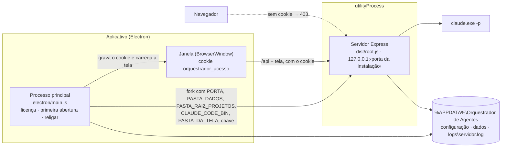
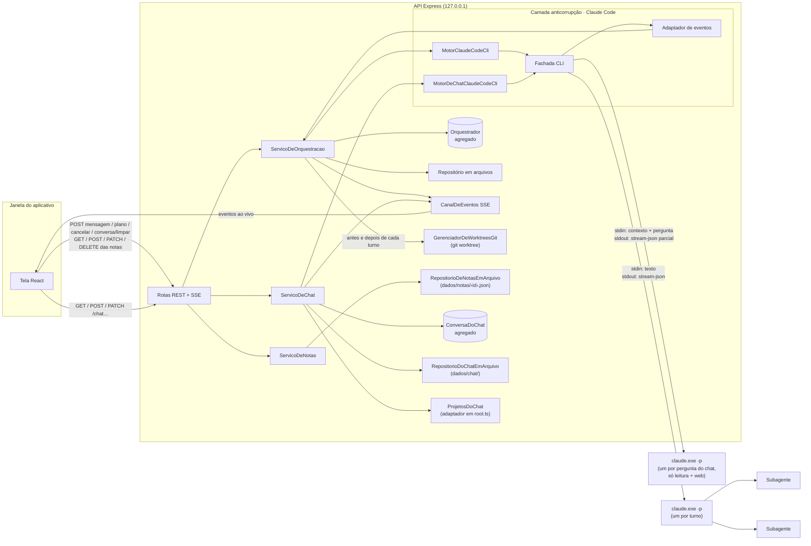
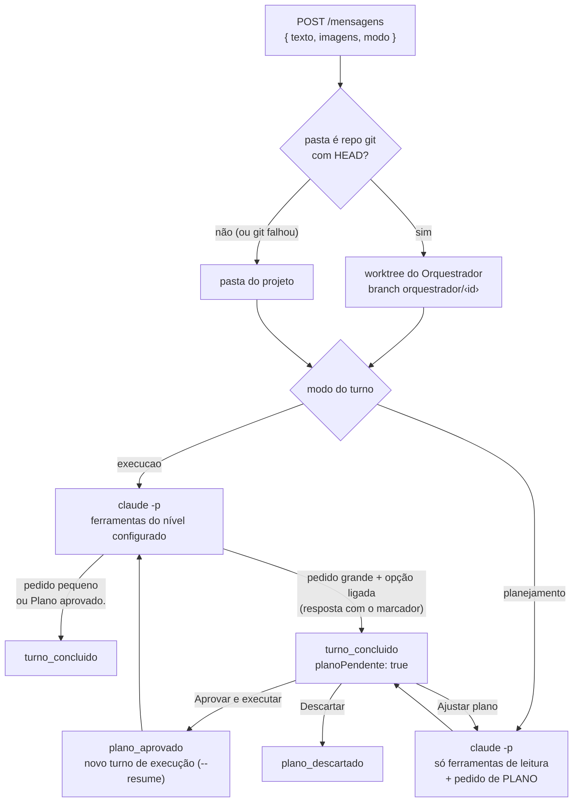

# Orquestrador de Agentes

## Objetivo

Central local para trabalhar com vários agentes do Claude ao mesmo tempo. É um **aplicativo desktop** (Electron, Windows): a tela só abre dentro da janela do aplicativo. Aberto no navegador, o servidor recusa (ver ADR-19).

Você cria **Orquestradores** — um por projeto, por exemplo — e conversa com cada um. A cada pedido, o Orquestrador **coordena**: o trivial (ler poucos arquivos, conferir um estado, um comando curto) ele resolve sozinho; o resto ele divide em subtarefas e entrega a **Subagentes** em paralelo, que leem, editam ou rodam comandos na pasta do projeto. Ele **nunca edita arquivos**: toda alteração vai para um Subagente. A tela mostra cada Subagente ao vivo (atividade, ferramentas, tokens, resultado), o que o próprio Orquestrador está fazendo e, no final, a síntese.

- Vários Orquestradores rodam ao mesmo tempo, cada um na sua pasta: são terminais espalhados num canvas infinito, que você move, redimensiona e organiza. Cada Subagente aparece como um bixinho animado ligado ao terminal.
- A conversa tem memória: cada Orquestrador lembra dos pedidos anteriores. **`/clear`** no prompt (ou *Nova conversa* no *⚙*) começa uma conversa do zero; a anterior fica arquivada.
- Por Orquestrador você escolhe os modelos e o esforço de raciocínio de cada papel, a quantidade de Subagentes (fixa ou automática com máximo), as permissões, se commit e push são permitidos quando você pedir (desligado por padrão), se o Orquestrador pode fazer o trivial sozinho (ligado por padrão) e se ele propõe um plano antes de mudanças grandes (ligado por padrão).
- **Plan Mode:** em vez de executar direto, o Orquestrador pode entregar primeiro um plano, feito só com leitura, que você aprova, ajusta ou descarta. Mesmo sem o Plan Mode, um pedido grande pode voltar como plano para aprovação.
- Em pastas com git, cada pedido roda num **worktree** próprio do Orquestrador, e não na pasta original.
- Dá para cancelar um pedido no meio, e o histórico fica salvo.
- **Bloco de notas:** no mesmo canvas, ao lado dos terminais, você cria notas de texto para observações e coisas para fazer depois. O conteúdo fica salvo no servidor, com salvamento automático.
- **Chat rápido:** uma caixa no centro, embaixo da tela, para perguntar algo ao Claude sem abrir um terminal: dúvidas rápidas, pesquisas na web ou perguntas sobre os projetos (ele só lê, nunca altera). Ele também pode sugerir abrir um Orquestrador num projeto, já com um pedido; a sugestão vira um cartão que só roda quando você clica.
- Modelos disponíveis: **Fable**, Opus, Sonnet e Haiku, tanto nos Orquestradores quanto no chat.

O motor é o próprio **Claude Code em modo headless**, usando o login da sua assinatura — não precisa de API key.

## Como rodar

**Pré-requisito em qualquer modo:** o Claude Code instalado e logado (`claude` funcionando no terminal). Para rodar a partir do código-fonte, também Node 22+.

**Usuário final (instalador):** instale o `.exe` gerado por `npm run dist:win` (sai em `dist_electron/`). O instalador é por usuário, sem pedir administrador, e deixa escolher a pasta. Sem certificado de assinatura, o Windows SmartScreen avisa na primeira execução (*Mais informações → Executar assim mesmo*). O app instalado pede a **chave de licença** (Lemon Squeezy) antes de abrir.

**Dia a dia, a partir do código-fonte:** dê dois cliques em **`iniciar-desktop.cmd`**. Na primeira vez ele instala as dependências e gera o build; depois roda `npm run desktop` (`electron .`), que abre a janela do aplicativo. Rodando assim (não empacotado), **não há licença**. Depois de atualizar o código, rode `npm run build` (o `.cmd` só gera o build quando falta `dist/` ou `web/dist/`).

```bash
npm install
npm --prefix web install
npm run build
npm run desktop
```

**Primeira abertura:** o aplicativo pede três coisas, guardadas na configuração local dele:
1. a **pasta raiz dos projetos** (os Orquestradores só trabalham dentro dela);
2. o **`claude.exe`** do Claude Code (ele procura sozinho no caminho padrão; dá para escolher outro);
3. se encontrar um histórico antigo (`<pasta do app>\dados` ou `%USERPROFILE%\projetos\orquestrador-app\dados`), oferece **importar**: copia orquestradores, notas e anexos para a pasta nova; o chat rápido antigo fica só para consulta em `dados\chat\historico\conversa-importada\` (a conversa não é retomada; o chat começa uma nova). A origem nunca é apagada, e os worktrees antigos continuam onde estão.

Para trocar depois, use o botão **⚙ Pastas** na barra do canvas, que reabre essa tela.

**Onde ficam os dados e o log** (a mesma pasta no app instalado e no `npm run desktop`):
- configuração (`config.json`: pasta dos projetos, `claude.exe` e porta): `%APPDATA%\Orquestrador de Agentes\config.json`;
- dados (histórico, notas, chat, anexos, worktrees novos): `%APPDATA%\Orquestrador de Agentes\dados`;
- log do servidor: `%APPDATA%\Orquestrador de Agentes\logs\servidor.log`.

Antes, o `npm run desktop` usava `%APPDATA%\orquestrador-agentes-app`. Na primeira abertura com a pasta nova (sem `config.json` nela), o app **copia** de lá o `config.json` e a pasta `dados\` e registra no log; a pasta antiga não é apagada nem alterada, e caches do Chromium, logs e layout antigo não vêm junto.

O aplicativo sobe o servidor sozinho, numa **porta fixa desta instalação** (sorteada na primeira abertura e gravada no `config.json`; se ela estiver ocupada, o app escolhe outra, grava e registra no log), e o **religa se ele cair**. Fechar a janela desliga o servidor e cancela os pedidos em andamento. Ao subir, o servidor encerra os processos do Claude que tenham sobrado da queda anterior; antes, confere a linha de comando de cada um, para nunca derrubar uma sessão do Claude Code sua.

> **Não abra o aplicativo pedindo a uma sessão do Claude Code.** Lá ele roda em segundo plano, e o Claude Code encerra processos em segundo plano quando a memória do computador fica baixa. Foi o que derrubou três orquestradores ao mesmo tempo em 28/10. Use o `.cmd`, o atalho do instalado ou um terminal próprio. Se o servidor cair mesmo assim, a tela mostra o aviso **Servidor desconectado** e reconecta sozinha quando o app o religar.

**Desenvolvimento (no aplicativo):**

```bash
npm run desktop:dev
```

O script (`scripts/desktop-dev.cjs`) compila o backend uma vez, sobe o Vite em http://localhost:5173 (com `/api` repassado à porta 3201) e abre o Electron com `ORQUESTRADOR_URL_DA_TELA=http://localhost:5173` e `PORTA=3201`. Mudanças em `web/` recarregam na janela; mudanças no backend pedem fechar e rodar de novo. Fechar a janela ou Ctrl+C encerra tudo.

**Desenvolvimento no navegador (só com a trava desligada):** o servidor recusa o navegador e nem sobe sem a chave do aplicativo. Para depurar a API e a tela no navegador, ligue `ORQUESTRADOR_PERMITIR_NAVEGADOR=1` (no `.env`, a partir do `.env.example`) e use dois terminais:

```bash
npm run dev       # API em http://localhost:3200 (recarrega ao salvar)
npm run web:dev   # tela em http://localhost:5173 (repassa /api para a 3200)
```

> Evite salvar arquivos do backend com um pedido rodando: no Windows, o `tsx watch` reinicia o servidor sem avisar o processo, e o `claude.exe` em andamento continua até terminar sozinho. O turno aparece como "interrompido" e pode ser reenviado.

**Empacotar:**

```bash
npm run dist:win         # instalador normal, em dist_electron/
npm run dist:win:teste   # build de teste, em dist_electron_teste/: pula a licença. NUNCA distribuir
```

O build de teste grava `"buildDeTeste": true` no `package.json` empacotado; serve para os testes de ponta a ponta do instalado.

**Variáveis de ambiente.** No aplicativo, as do servidor são passadas pelo próprio app; ninguém precisa configurá-las. O `.env` só vale para `npm run dev` / `npm start`.

| Variável | Quem lê | Padrão | Para quê |
|---|---|---|---|
| `PORTA` | servidor e aplicativo | `3200` (o app usa a porta gravada no `config.json`; `desktop:dev` usa `3201`) | Porta da API (escuta só em `127.0.0.1`). No app, definida no ambiente vale por cima da gravada e não é gravada |
| `PASTA_DADOS` | servidor | `dados/` dentro da pasta do app (o app passa `%APPDATA%\Orquestrador de Agentes\dados`) | Histórico dos Orquestradores, notas (`notas/`), chat (`chat/`), anexos e worktrees |
| `PASTA_RAIZ_PROJETOS` | servidor | pasta acima deste projeto (o app passa a escolhida na primeira abertura) | Raiz dentro da qual os Orquestradores podem trabalhar |
| `CLAUDE_CODE_BIN` | servidor | `%APPDATA%\npm\node_modules\@anthropic-ai\claude-code\bin\claude.exe` (o app passa o escolhido na primeira abertura) | Executável **nativo** do Claude Code (o `claude.cmd` não serve: o app inicia o processo sem shell) |
| `PASTA_DA_TELA` | servidor | `web/dist` do app | Pasta da tela já construída |
| `ORQUESTRADOR_CHAVE_DE_ACESSO` | servidor | — (o app gera uma aleatória a cada abertura) | Chave conferida no cookie `orquestrador_acesso`; sem ela o servidor não sobe |
| `ORQUESTRADOR_PERMITIR_NAVEGADOR` | servidor | desligada | `1` = **só desenvolvimento**: sobe sem chave e aceita o navegador |
| `ORQUESTRADOR_URL_DE_DOWNLOAD` | servidor (opcional) | — | Link para baixar o aplicativo, mostrado na página "roda só no aplicativo" |
| `ORQUESTRADOR_URL_DA_TELA` | aplicativo | — | Carrega a tela desta URL (o Vite, em `desktop:dev`) em vez da servida pelo servidor |
| `ORQUESTRADOR_PASTA_DO_USUARIO` | aplicativo | `%APPDATA%\Orquestrador de Agentes` | Troca a pasta do usuário do app (configuração, dados, log, licença). Só não empacotado ou no build de teste; usada nos testes de ponta a ponta. Com ela, a cópia da pasta antiga não acontece |
| `PORTA_DA_API` | Vite (`web/`) | `3200` | Porta para onde o Vite repassa o `/api` |

**Testes e verificações:**

```bash
npm test            # domínio, adaptador do Claude Code (com saídas reais), repositórios, rotas, trava de acesso e electron/*.test.js
npm run typecheck
npm run web:test    # reducer da conversa, fases, nós e layout do canvas, bixinhos, notas e formatação
npm run web:lint
```

Casos de teste sugeridos para a opção **Permitir commit e push quando eu pedir** (ver ADR-10):
- **Bloco do pedido:** desligada → "Commits e push são sempre proibidos."; ligada em turno de execução → a frase de "permitidos somente quando o usuário pedir explicitamente nesta mensagem…"; ligada em turno de Plan Mode → continua "sempre proibidos".
- **Argumentos do `claude -p`:** desligada (ou Plan Mode) → `--disallowedTools` com `git commit`/`git push` para PowerShell e Bash; ligada em execução → `--disallowedTools` só com os padrões de push forçado e `--settings <configuracoes.json>` com `{"attribution":{"commit":"","pr":""}}`; desligada ou Plan Mode → sem `--settings`.
- **Dados antigos:** um `orquestrador.json` sem o campo carrega com `permitirCommitEPush: false`; `POST /orquestradores` sem o campo cria com `false`; `POST /orquestradores` ou `PATCH /configuracao` com valor não booleano devolve 400.
- **Tela:** o toggle (componente compartilhado `CamposDaConfiguracao`, na criação e no *⚙*) envia `permitirCommitEPush` e mostra o aviso quando o nível de permissão não roda comandos.
- **Branch do worktree:** worktree limpo com commits só na `orquestrador/<id>` → a branch fica e sai o aviso no log; sem commits próprios → `git branch -D`; git falhou na conferência → a branch fica.

Casos de teste do **esforço de raciocínio** (ver ADR-12):
- **Domínio:** sem os campos → `"padrao"` nos dois papéis; `orquestrador.json` antigo → `"padrao"`; `com()` altera só o esforço informado; `turno_iniciado` e `configuracao_alterada` levam os dois esforços.
- **API:** `POST /orquestradores` sem os campos cria com `"padrao"`; aceita os escolhidos; valor fora da lista → 400 (`Esforço do orquestrador inválido.` / `Esforço dos subagentes inválido.`); o GET mostra e o PATCH altera só o informado.
- **Argumentos do `claude -p`:** `"padrao"` → sem `--effort` e sem `effort` no executor; cada papel com o seu nível (`alto` → `--effort high`; `extra_alto` → `"effort": "xhigh"` no executor); `CLAUDE_CODE_EFFORT_LEVEL` herdada sai do ambiente quando algum papel tem esforço escolhido e fica com os dois em `"padrao"`; o esforço nunca vai em `--settings`.
- **Tela:** os dois seletores começam em *Padrão (Claude Code)*, com os seis níveis e a ajuda; escolher num papel muda só aquele campo.

Casos de teste do **bloco de notas** (ver ADR-13):
- **Entidade `Nota`:** nasce com "Nova nota", texto vazio e `criadaEm` = `atualizadaEm`; título aparado, texto guardado como veio; renomear/reescrever atualizam `atualizadaEm`, mas com o mesmo conteúdo não contam como alteração; título com exatamente 120 caracteres (depois de aparar) e texto com exatamente 100.000 passam, um a mais é recusado; `reconstituir` devolve exatamente os dados gravados.
- **Repositório em arquivos:** cria `notas/` e começa vazio; um arquivo por nota, que reabre igual; lista por `criadaEm` crescente; devolve cópias (alterar a buscada não muda nada até salvar); arquivo ilegível é ignorado com aviso, sem ser apagado; gravações seguidas da mesma nota terminam com o último conteúdo, sem arquivo pela metade; remover logo depois de salvar não deixa a nota no disco; id que escaparia da pasta é recusado.
- **Rotas:** GET vazio → 200 `[]`; POST sem corpo → 201 com os padrões; PATCH parcial altera só o campo enviado; PATCHes simultâneos terminam com o último aceito no disco; DELETE → 204; PATCH/DELETE de nota inexistente → 404 `Nota não encontrada.`; POST com título vazio/longo, texto longo, campo que não é texto ou corpo que não é objeto → 400 com a mensagem certa e nada gravado; PATCH com um campo inválido → 400 e a nota fica como estava.
- **Layout:** layout antigo sem `notas` vale como sem notas; só as notas corrompidas do layout são descartadas, e sem `minimizada` a nota fica aberta; minimizar deixa só a barra e restaurar volta à altura de antes; a altura gravada é a da nota aberta, mesmo minimizada; "Organizar" põe as notas em colunas de até 4 à direita da grade dos terminais; nota que sumiu do servidor sai do layout ao carregar a lista, e a criada enquanto a lista carregava não sai.
- **Nó da nota (`NoNota`):** digitar e parar dispara um único PATCH, depois da espera, só com o texto; perder o foco salva na hora; erro no PATCH mostra a mensagem e o "tentar de novo"; minimizada, mostra só a barra com o título e a prévia; minimizar e restaurar não perde texto não salvo; clique duplo no título, Enter salva e em branco volta ao anterior; apagar pede confirmação e chama o DELETE (404 também tira do canvas; outro erro mantém a nota com o motivo); digitar numa nota não re-renderiza a outra.

Casos de teste da **delegação sob demanda** (ver ADR-14):
- **Bloco do pedido:** ligada → "Faça você mesmo o trivial: …" com o texto do nível (sem terminal em *leitura*, *edição* e no Plan Mode), a regra de quando delegar e "Você não edita arquivos"; desligada → a regra estrita ("Não faça o trabalho você mesmo…"); quantidade fixa → "quando delegar, use exatamente N"; automática → "no máximo N … se um basta, use um".
- **Dados e API:** `orquestrador.json` antigo e `POST` sem o campo → `true`; valor não booleano no `POST`/`PATCH` → 400; o resumo sempre traz o campo.
- **Tela:** o checkbox vai no PATCH; `ferramenta_do_orquestrador` vira linha de atividade ("orquestrador lendo package.json"); o resumo da configuração cita "delegação total" só com a opção desligada.

Casos de teste do **plano proposto em execução** (ver ADR-15):
- **`separarPropostaDePlano`:** remove o marcador sozinho na linha, no meio da linha, entre crases e repetido; sem marcador devolve a resposta intacta e `planoProposto: false`.
- **Serviço:** com a opção ligada no início do turno e o marcador na resposta → `turno_concluido.planoPendente: true` e plano aprovável/descartável; opção desligada (ou desligada antes do turno começar) → marcador removido e `planoPendente: false`; alterar a configuração no meio do turno não muda o resultado; aprovar envia "Plano aprovado. …".
- **Tela:** `CartaoDoPlano` também em turno de execução com plano pendente; linha "plano proposto · aguardando aprovação"; dica "pedido grande? shift+tab para planejar antes" só em execução e com pedido longo (mais de 400 caracteres ou lista de 3+ itens).

Casos de teste do **`/clear`** (ver ADR-16):
- **Domínio:** recusa com turno em andamento; esvazia os turnos, troca o `sessaoId`, volta `sessaoIniciada` a `false` e descarta o plano pendente; o evento informa `turnosAnteriores`, `planoDescartado` e `worktreeComAlteracoes`.
- **Repositório:** copia `eventos.jsonl` e `orquestrador.json` para `historico/conversa-<N+1>/`; o `eventos.jsonl` novo tem só o `conversa_limpa`, com a sequência seguinte; ao reabrir, a conversa nova carrega e o `historico` é ignorado; remover o orquestrador apaga o `historico`.
- **Rota:** 200 com `totalDeTurnos: 0`; 409 durante um pedido; 404 sem orquestrador; sem conversa → 200 sem gravar nada.
- **Tela:** `/clear` (maiúsculas e espaços tolerados) não vira pedido; "/clear algo" vira; Tab completa "/cl"; durante um pedido aparece a dica de indisponível; imagens e Plan Mode continuam no prompt; o separador "— conversa nova iniciada às HH:MM —" aparece; *Nova conversa* no *⚙* pede confirmação e fica desabilitado durante um pedido.

Casos de teste do **chat rápido** (ver ADR-17):
- **Agregado `ConversaDoChat`:** perguntar cria a pergunta (concluída) e a resposta vazia ("respondendo"); recusa outra pergunta com resposta em andamento (`Já há uma resposta em andamento.`), texto vazio sem imagens e mais de 5 imagens; aceita só imagem; acumula os trechos e ignora trecho sem resposta; `concluir` grava texto, ações, avisos e uso e marca a sessão como iniciada; `falhar` guarda o motivo nos avisos e só marca a sessão com uso informado; a sessão marcada no primeiro sinal do motor continua após cancelar; `limpar` recusa durante a resposta, troca o `sessaoId`, volta `sessaoIniciada` a `false` e esvazia as mensagens; ao reabrir, a resposta "respondendo" vira "falhou" com `interrompida`.
- **`separarAcoesDoApp`:** sem bloco devolve o texto intacto; bloco válido vira ação com a pasta resolvida e sai do texto; vários blocos; projeto em maiúsculas casa com a pasta e devolve o nome real; projeto inexistente, JSON inválido, tipo desconhecido e bloco sem fechamento saem do texto e viram aviso, sem ação; ações imutáveis.
- **`mensagemParaOChat`:** bloco `<contexto-do-app>` com data/hora, pasta raiz, projetos, orquestradores e o formato exato do bloco de ação, antes do texto; listas vazias indicadas; pergunta só com imagem vira "Veja a imagem anexada.".
- **Serviço (motor falso):** fluxo completo (pergunta → trechos e atividade como sinais → `resposta_concluida` com a ação extraída); a segunda pergunta usa `sessaoIniciada: true`; cancelar encerra o motor e grava `resposta_cancelada` com o texto parcial; falha do motor → `resposta_falhou`; `uso_da_cota` gravado e exposto em `cota`; imagens guardadas em `anexos/chat/` e passadas ao motor; `/clear` arquiva e mantém as preferências; preferências valem na próxima pergunta; boot marca a resposta pendente como interrompida.
- **Repositório:** cria `chat/` e `chat/sessao/`; grava e relê conversa, eventos, preferências e cota; `/clear` copia para `historico/conversa-<N>/`, continua a sequência e mantém `preferencias.json`; arquivo ilegível vira aviso no log e uma cópia `.ilegivel-<ms>` ao lado, sem ser apagado.
- **Rotas:** `GET /chat` inicial; `POST /chat/mensagens` 202, texto parcial no GET, 409 com resposta em andamento, 400 sem texto nem imagem e com formato inválido; `GET /chat/anexos/:arquivo` serve a imagem e devolve 404 para nome inválido; `PATCH /chat/preferencias` 200 e 400 (`Modelo inválido.` / `Esforço inválido.`); `POST /chat/cancelar` 409/202; `POST /chat/limpar` 409/200; SSE com `id:` nos eventos gravados, `event: trecho`/`event: atividade` sem id, e `Last-Event-ID`/`?desde=` respeitados.
- **Tela (`web/`):**
  - *`aplicarEventoDoChat`:* `pergunta_enviada` inclui as duas mensagens e põe o chat respondendo; trechos se concatenam e só a atividade mais recente fica; `resposta_concluida` substitui o texto dos trechos e traz ações, avisos e uso; `resposta_falhou` guarda o motivo e `resposta_cancelada` marca a resposta; `conversa_limpa` esvazia; preferências e cota atualizadas; eventos repetidos ou fora de ordem ignorados pela sequência; o estado carregado substitui o da tela e o último aviso de uma resposta que falhou volta a ser o motivo; `textoParaMostrar` esconde o bloco de ação (aberto, fechado ou com a cerca pela metade durante a resposta) sem mexer em outros blocos de código.
  - *`useChat`:* carrega o estado e assina `?desde=<ultimaSequencia>`; se o navegador abandona a conexão ou o servidor volta, recarrega e assina de novo; falha na carga avisa e tenta de novo.
  - *`ChatRapido`:* Enter envia e limpa o campo (Shift+Enter não); erro do servidor aparece e o texto fica; `/clear` limpa sem virar pergunta e Tab completa; durante a resposta o botão vira cancelar e Esc cancela; desconectado não envia; Esc ociosa oculta a conversa e o indicador avisa resposta nova; falha, cancelamento, avisos e cartões aparecem.
  - *`SeletorDeModelo`:* mostra modelo, versão e esforço, com ✓ no escolhido; escolher modelo ou esforço chama o `PATCH`; Esc e clique fora fecham; o rótulo usa a versão da última resposta quando é da mesma família; falha ao gravar avisa.
  - *`CartaoDeAcao`:* nada antes do clique; com Orquestrador na mesma pasta (barras e maiúsculas diferentes) só abre o terminal; sem ele, cria com a configuração padrão e abre; com pedido, envia o pedido e um segundo clique só reabre; erro mostra a mensagem e permite tentar de novo; sem vaga no canvas, não cria nem envia e mostra o aviso do limite; com o Orquestrador da pasta já aberto (canvas cheio), só foca nele.
  - *`CamposDaConfiguracao`:* oferece Fable, Opus, Sonnet e Haiku nos dois seletores e mostra Fable já escolhido. *Canvas:* o chat fica no painel do centro de baixo, sem arrastar nem rolar o canvas. *`modelos`:* versão lida do id do modelo só na mesma família, nome com versão e rótulos dos esforços.

Casos de teste do **limite de 4 orquestradores abertos** (ver ADR-18):
- **`cabeOutroTerminal`:** 3 abertos → cabe; 4 → não cabe; 4 abertos e pedido de um já aberto → cabe (só foca); o rascunho conta como aberto; o aviso usa o número da constante.
- **Canvas:** com 4 abertos, *+ Novo orquestrador* mostra o aviso (`alert-warning`, fechável) e não abre o formulário; reabrir pela lista mostra o aviso e não abre; clicar num já aberto não recusa; fechar um no *✕* faz o aviso sumir, o Orquestrador continua na lista e a vaga volta; com 3 abertos e o formulário aberto, não abre outro.
- **`CartaoDeAcao`:** ver acima (sem vaga não chama `criarOrquestrador` nem `enviarMensagem`).

Casos de teste do **só no aplicativo** (ver ADR-19):
- **Electron (`electron/*.test.js`):**
  - *configuração local (`configuracaoLocal.test.js`):* detecta o `claude.exe` (`CLAUDE_CODE_BIN` existente primeiro, depois npm, `.local\bin`, `Programs`); sugere `%USERPROFILE%\projetos`; valida pasta e arquivo (vazios, relativos, inexistentes); sem `config.json` → `null` (primeira abertura); grava atomicamente e relê (com a `porta`); normaliza arquivo editado à mão (porta fora de 1–65535 vira `null`); explica arquivo corrompido;
  - *porta da instalação (`escolherPortaDaInstalacao`):* `PORTA` do ambiente vale por cima da gravada (sem testar nem gravar); `PORTA` inválida é recusada; a gravada livre é reaproveitada; a gravada ocupada é trocada por uma sorteada (`origem: "trocada"`, com a anterior); sem porta gravada, sorteia (`"nova"`);
  - *pasta de dados única (`copiarDaPastaAntiga`, com pastas temporárias):* copia `config.json` e `dados/` da antiga e nada mais (nem `Cache`, nem `Local Storage`), deixando a antiga intacta; não faz nada se a nova já tem `config.json`, se a antiga não tem, ou se as duas são a mesma; sem `dados/` na antiga, copia só o `config.json`; não sobrescreve o que já está em `dados/` da nova;
  - *importação do histórico (`importacaoDoHistorico.test.js`):* acha `<pasta do app>\dados` (só não empacotado) e `%USERPROFILE%\projetos\orquestrador-app\dados`; só conta pasta com `orquestradores/` ou `notas/`; ignora o próprio destino; copia `orquestradores/`, `notas/` e `anexos/` como estão; o `chat/` antigo vai para `chat/historico/conversa-importada/` (sem `chat/sessao`) e não vira a conversa atual; não copia `worktrees/` nem `processos-em-execucao.json`; não sobrescreve; nunca apaga nem altera a origem;
  - *processo principal (`main.js`) — sem teste unitário, conferido no ponta a ponta:* com `ORQUESTRADOR_PASTA_DO_USUARIO` apontando para uma pasta temporária com `config.json`, o log mostra `Porta do servidor escolhida para esta instalação: <PORTA>` e `servidor em http://127.0.0.1:<PORTA>`, e a porta fica no `config.json`; fechar e abrir de novo reaproveita a porta e restaura o layout e o zoom do canvas; com a porta gravada ocupada por outro processo, o log mostra `A porta X estava ocupada; o servidor passa a usar a Y` e o `config.json` passa a ter Y; sem cookie, `GET /` dá 403 com a página "roda só no aplicativo" e `GET /api/saude` dá 403 `{ erro }`; dentro da janela, `fetch('/api/saude')` e `fetch('/api/orquestradores')` dão 200; ao fechar, não sobra processo do servidor; com a pasta dos projetos ou o `claude.exe` removidos, abre os Ajustes com o aviso. Vale para `npm run desktop` e para o instalado do build de teste.
- **Servidor (trava e configuração):** sem cookie → 403 (página "roda só no aplicativo" para HTML, `{ erro }` para `/api`); cookie com a chave errada → 403; com a chave → passa; sem chave e sem `ORQUESTRADOR_PERMITIR_NAVEGADOR=1` não sobe; com a variável, aceita o navegador; `PASTA_DA_TELA` e `PASTA_DADOS` absolutas respeitadas.
- **Tela:** o botão *⚙ Pastas* só aparece com `window.electron.configuracao`, chama `abrirAjustes()` e mostra a mensagem se falhar; no navegador não aparece.

Casos de teste da **barra de título e das larguras da janela** (ver ADR-20):
- **`BarraDeTituloDoApp`:** "Orquestrador de Agentes" à esquerda; à direita (`.direita-da-barra-de-titulo`) o status (situação e cotas, `no-drag`) e, logo depois dele, o grupo "Controles da janela" com Minimizar, Maximizar e Fechar; no navegador (sem a ponte), nenhum botão de janela.
- **`ControlesDaJanela`:** fora do desktop não renderiza; minimizar, maximizar e fechar chamam a ponte (`window.electron.janela`); o grupo é `no-drag` e cada botão tem `aria-label` e `title`; abre como "Restaurar" se a janela já estiver maximizada e troca entre Maximizar/Restaurar a cada aviso de `aoMudarMaximizada`; ao sair da tela, cancela a inscrição.
- **`BarraDoCanvas`:** cada botão traz os rótulos completo, curto e ícone (`+ Novo orquestrador` / `+ Novo` / `+`, `+ notas` / `+ Nota` / `✎`, `Organizar` / `▦`, `⚙ Pastas` / `⚙`), com o nome acessível e a dica fixos; no navegador mostra o título do app; no desktop não repete o título nem desenha minimizar/maximizar/fechar.
- **`StatusDoCanvas`:** rótulos curtos das cotas (`5h`, `7d`); o resumo mostra o medidor de maior uso e põe o resto (agentes ativos, cada cota, RAM) no balão (`title`); sem cota, memória nem agentes, não há resumo; no painel, o alerta de memória fica abaixo; na barra de título, não.
- **`rotuloCurtoDaCota`:** "5 horas" → "5h", "7 dias" → "7d", nome sem número fica igual.
- **Canvas:** restaura o zoom e a posição salvos; **Ctrl+0** volta a 100% mantendo o centro (`translate(100px,50px) scale(0.5)` → `translate(200px,100px) scale(1)` com a área 0 × 0 do jsdom); com o foco num campo de texto, Ctrl+0 não mexe no zoom; no navegador o status fica nos painéis do topo, e no desktop só na barra de título, acima do canvas.
- **Conferência visual (manual, pasta temporária):** janelas de 900×650, 1100×750, 1200×800, 1440×900 e maximizada, com captura da janela inteira: nenhum botão nativo do Windows; ─ ☐ ✕ do app alinhados na barra, com hover cinza (e vermelho no fechar) e foco visível pelo teclado; status à direita sem encostar nos botões e, se não couber, cortado pelo fim (a situação nunca some); linha inferior da barra de ponta a ponta; ícone de "restaurar" com a janela maximizada (pelo botão ou pelo Windows); minimizar, maximizar/restaurar e fechar funcionando; painéis do topo sem sobreposição, minimapa só a partir de 1100 px, chat sem cobrir os controles de zoom nem o minimapa, texto dos terminais nítido em 100%.

Casos de teste da **economia de tokens** (ver ADR-21):
- **`PredefinicaoDeConfiguracao`:** o catálogo tem só `economico` (rótulo "Modo econômico"); nome desconhecido → `null`; aplicar muda exatamente os sete campos (Opus/médio, Sonnet/médio, automática até 1, trivial ligado, plano automático desligado) e preserva nível de permissão e commit/push; a configuração de origem não muda; `correspondeA` é verdadeiro logo depois de aplicar, continua verdadeiro mudando só a permissão e fica falso mudando um campo dela (esforço, limite); `paraDados` devolve cópia; predefinição e alterações congeladas.
- **`UsoDeTokens`:** entrada 6, criação de cache 33062, leitura de cache 62885 e saída 383 → índice 49537 (o mesmo número do benchmark) e total 96336; `somar` campo a campo sem alterar as parcelas; `vazio` é neutro; negativo, fracionário, `NaN` e infinito → `dados_invalidos`; imutável.
- **`ConsumoDoTurno`:** total = principal + subagentes; índice vem do total; `paraDados` com parcelas, índice e modelo; `comoParcial` devolve outro objeto; modelo em branco vira `null`; `subagentesMedidos` negativo é recusado.
- **`EsforcoHerdado`:** `deveAvisar` só em `extra_alto` e `maximo`; origem vazia e `padrao` são recusados.
- **Agregado:** aplicar a predefinição registra `configuracao_alterada` com `predefinicao: "economico"`, e `predefinicaoCorrespondente` vira `null` ao editar um campo dela; `registrarConsumoDoTurno` mantém o consumo de turno concluído, marca como parcial o de turno cancelado ou com falha e recusa turno em andamento ou desconhecido.
- **Serviço (medidor e esforço falsos):** a medição recebe o `sessaoId`, a pasta onde o processo rodou (o worktree, ou a pasta do projeto sem git), o início e o fim do turno; o `consumo_do_turno_medido` vem depois do `turno_concluido`/`turno_falhou`/`turno_cancelado`, parcial nos dois últimos; sem transcrição, nenhum evento; erro do medidor só gera `console.warn`, sem evento, e o próximo pedido roda; aplicar predefinição desconhecida → `dados_invalidos`, orquestrador inexistente → `nao_encontrado`; o esforço herdado usa os modelos atuais e, no Orquestrador, o modelo do último consumo medido; erro na leitura do esforço → `null`.
- **Rotas:** `GET /predefinicoes`; o resumo (lista e detalhe) traz `predefinicaoCorrespondente`; `POST /configuracao/predefinicao` → 200 com as mesmas chaves do `PATCH`, 400 `Predefinição desconhecida.` (nome errado, não texto ou ausente), 404 `Orquestrador não encontrado.`; `GET /orquestradores/:id/esforco-herdado` → 200 com os dois papéis (e 404); `GET /esforco-herdado` → 200 com os modelos e a pasta do formulário, 400 para modelo inválido, pasta ausente, fora da raiz ou inexistente.

## Tecnologias

- **Aplicativo desktop:** **Electron 33** (processo principal em `electron/`, servidor em `utilityProcess`) e **electron-builder** (instalador NSIS para Windows x64). Licença via Lemon Squeezy, só no instalado.
- **Node 22+ / TypeScript 6** (estrito, `exactOptionalPropertyTypes`), **Express 5**, **zod 4** (validação da API), **vitest**.
- **Tela:** React 19, Vite 6, Tailwind 4, react-markdown com remark-gfm e **React Flow** (`@xyflow/react` 12) para o canvas (ver ADR-8). Tema escuro com a paleta da Anthropic (ver ADR-7). Fontes empacotadas via `@fontsource`, sem CDN: Poppins, Lora e JetBrains Mono.
- **Claude Code 2.1.x** (`claude -p --output-format stream-json`) como motor dos agentes.
- **Tempo real:** Server-Sent Events. **Persistência:** arquivos JSON/JSONL.

## Arquitetura

### Visão geral

**Aplicativo desktop** (ver ADR-19 e ADR-20): o processo principal do Electron sobe o servidor Express num `utilityProcess`, numa porta de `127.0.0.1` fixa por instalação (gravada no `config.json`), com uma chave aleatória por abertura. A janela recebe essa chave num cookie `httpOnly` só da sessão dela; o servidor recusa toda requisição sem o cookie. Um navegador apontado para a mesma porta recebe 403.



Dentro do servidor:



Organização por contexto (DDD):

```
src/
  orquestracao/              domínio — linguagem do negócio, sem Express nem Claude Code
    Orquestrador.ts            raiz do agregado (conversa sobre uma pasta)
    Turno.ts, Subagente.ts     internos do agregado
    ConfiguracaoDoOrquestrador, QuantidadeDeSubagentes, PastaDeTrabalho,
    NivelDePermissao, ModeloClaude, EsforcoDeRaciocinio, ModoDoTurno   objetos de valor
    EventoDeOrquestracao.ts    o que acontece (histórico + tela)
    InstrucoesDoOrquestrador.ts  regras de trabalho do Orquestrador e do Subagente
    ServicoDeOrquestracao.ts   casos de uso (stateless)
    MotorDeAgentes.ts, RepositorioDeOrquestradores.ts, ControleDeExecucoes.ts,
    PreparoDeWorktree.ts (GerenciadorDeWorktrees)   portas
  notas/                     domínio do bloco de notas — contexto próprio, sem relação com a orquestração
    Nota.ts                    entidade (título e texto; criar, renomear, reescrever)
    ErroDeNota.ts              dados_invalidos · nao_encontrada
    ServicoDeNotas.ts          casos de uso (stateless; id e relógio injetados)
    RepositorioDeNotas.ts      porta
  chat/                      domínio do chat rápido — contexto próprio (ver ADR-17)
    ConversaDoChat.ts          raiz do agregado (a conversa única, sessão do Claude Code)
    MensagemDoChat.ts          interno do agregado (pergunta ou resposta)
    AcaoDoApp, PreferenciasDoChat   objetos de valor
    EventoDoChat.ts            eventos gravados + sinais passageiros (trecho, atividade)
    ErroDoChat.ts              dados_invalidos · em_andamento · sem_resposta_em_andamento
    InstrucoesDoChat.ts        regras fixas, bloco <contexto-do-app> e separarAcoesDoApp
    ServicoDeChat.ts           casos de uso (stateless)
    MotorDeChat.ts, RepositorioDoChat.ts, ProjetosDoChat.ts   portas
  infraestrutura/
    claudecode/                camada anticorrupção: Fachada (processo), Adaptador
                               (stream-json → eventos do domínio), Argumentos, Motor
    arquivos/                  repositório JSON/JSONL dos Orquestradores, repositório das
                               notas (um JSON por nota), repositório do chat e listagem de pastas
    sse/, execucoes/           canal de eventos e controle de cancelamento
    sistema/                   worktrees git (Worktrees, GerenciadorDeWorktreesGit),
                               memória e processos do Claude
  controllers/                 REST + SSE, validação (zod), erros → HTTP
                               (orquestradoresRoutes.ts, notasRoutes.ts,
                               chatRoutes.ts com o CanalDoChat)
electron/                      aplicativo desktop (CommonJS): main.js (janelas, servidor no
                               utilityProcess, religar, cookie), preload.js (window.electron),
                               licença, configuração local e primeira abertura; testes *.test.js
web/src/
  paginas/CanvasDeOrquestradores.tsx   canvas (React Flow): nós, linhas, painéis, layout salvo
  componentes/canvas/                  NoTerminal (terminal do Orquestrador), NoRascunho (configuração),
                                       NoBixinho + Bixinho (Subagente em pixel art),
                                       ArestaDoBixinho (linha com a bolinha de troca), NoNota (nota),
                                       painéis flutuantes
  shared/estado/                       aplicarEvento (reducer da conversa + log), faseDoTurno
  shared/canvas/                       nós e linhas a partir das conversas, layout, aparência e desenhos dos bixinhos,
                                       notas.ts (loja das notas, separada do contexto do canvas)
  shared/hooks/useConversas.ts         um EventSource por terminal aberto
  shared/hooks/useNotas.ts,            notas do canvas (carregar, criar, minimizar, apagar)
    useEdicaoDaNota.ts                 e a edição com salvamento automático
```

**Bloco de notas** (contexto `notas`, ver ADR-13): o conteúdo de cada nota (título e texto) fica no servidor, um arquivo por nota em `<PASTA_DADOS>/notas/<id>.json` (padrão `dados/notas/`). Posição, tamanho e se está minimizada ficam no layout do navegador, como os terminais (ver ADR-8). O contexto não conversa com a orquestração: tem entidade, serviço, porta e rotas próprias.

**Chat rápido** (contexto `chat`, ver ADR-17): uma conversa única com o Claude, fora dos Orquestradores. Cada pergunta roda um `claude -p` em `<PASTA_DADOS>/chat/sessao/` (o primeiro com `--session-id`, os seguintes com `--resume`), com ferramentas só de leitura (Read, Glob, Grep na pasta raiz dos projetos, `.env*` negado) e de web (WebSearch, WebFetch). Pelo stdin vai a pergunta precedida do bloco `<contexto-do-app>` (data, pasta raiz, projetos e orquestradores existentes, e o formato das ações). O texto chega aos poucos (`--include-partial-messages`) e vai para a tela como evento SSE passageiro `trecho`, sem entrar no histórico; no fim, o servidor tira da resposta os blocos ` ```acao-do-app `, valida cada um e grava a resposta com as ações. O contexto não importa o agregado `Orquestrador`: projetos e orquestradores chegam pela porta `ProjetosDoChat`, implementada em `root.ts`.

**Pasta de dados** (`<PASTA_DADOS>`: no aplicativo, `%APPDATA%\Orquestrador de Agentes\dados`; rodando o servidor sozinho, `dados/` na pasta do app; ver ADR-5, ADR-13, ADR-16, ADR-17 e ADR-19):

```
dados/
  orquestradores/<id>/
    orquestrador.json          estado atual do agregado (conversa atual)
    eventos.jsonl              eventos da conversa atual, um por linha
    historico/                 conversas anteriores, arquivadas pelo /clear (só consulta; não é carregado)
      conversa-<N>/            <N> = sequência do evento conversa_limpa que a arquivou
        orquestrador.json
        eventos.jsonl
  anexos/<id>/                 imagens enviadas nos pedidos (anexos/chat/: as do chat rápido)
  notas/<id>.json              uma nota por arquivo
  chat/
    conversa.json              estado da conversa do chat (gravação atômica)
    eventos.jsonl              eventos da conversa atual, um por linha
    preferencias.json          modelo e esforço do chat (não muda com o /clear)
    historico/conversa-<N>/    conversas anteriores, arquivadas pelo /clear
    sessao/                    pasta onde o claude -p do chat roda
  worktrees/<8 caracteres>/    worktrees git dos Orquestradores
```

**Ciclo de um pedido:**
1. `POST /mensagens` → o agregado abre um Turno com o **modo** pedido: `execucao` (padrão) ou `planejamento` (recusa se já houver um em andamento). A configuração vigente é **capturada nesse instante** (vai no `turno_iniciado`) e vale até o fim do turno, mesmo que o usuário a altere enquanto ele roda.
2. **Worktree:** se a pasta do projeto for um repositório git com pelo menos um commit, o turno roda num worktree próprio do Orquestrador (ver abaixo). Senão, ou se o git falhar, roda na própria pasta.
3. O motor inicia `claude.exe -p` na pasta do turno (o worktree ou a pasta do projeto). Pelo stdin vai o texto do usuário, precedido do bloco `<configuracao-do-pedido>` (regra de delegação, quantidade de subagentes, permissões vigentes, regra de commit e push, o modo e, em execução, a regra de pedidos grandes). As regras fixas do Orquestrador e a definição do Subagente `executor` vão em arquivos temporários (`instrucoes.txt` e `agentes.json`); com commit e push liberados no turno, vai também um `configuracoes.json`, passado em `--settings` (ver ADR-10).
   - **Delegação** (ver ADR-14): com **Deixar o orquestrador fazer o trivial sozinho** ligada (padrão), o bloco manda o Orquestrador fazer ele mesmo o trivial do nível (ler ou buscar em poucos arquivos, conferir um estado e, só em *Editar e rodar comandos* fora do Plan Mode, um comando curto) e delegar quando houver alteração de arquivos, muitos arquivos ou comandos demorados, ou partes paralelas; em nenhum caso ele edita arquivos. Desligada, vale a regra estrita: delegar tudo.
   - **Pedidos grandes** (ver ADR-15): com **Propor plano antes de mudanças grandes** ligada (padrão), num turno de `execucao`, o bloco manda o Orquestrador medir o pedido. Grande (mais de cerca de 3 arquivos, contratos, dados ou arquitetura, ambiguidade relevante) → não executa, investiga só lendo, responde com um PLANO e termina com a linha `<plano-para-aprovacao/>`. Pequeno, ou mensagem que começa com "Plano aprovado." → executa direto.
   - Em `planejamento`, o Orquestrador e o `executor` recebem só as ferramentas de leitura, qualquer que seja o nível configurado, e o bloco pede um **plano** em vez da execução (ver ADR-9).
   - Com **Permitir commit e push quando eu pedir** ligada, num turno de `execucao`, o bloco libera commit e push só quando o usuário pedir explicitamente naquela mensagem, e o `claude -p` sai sem o bloqueio de `git commit`/`git push` (ver ADR-10). Desligada, ou em `planejamento`, continua tudo proibido.
   - **Esforço** (ver ADR-12): com esforço escolhido para o Orquestrador, o `claude -p` recebe `--effort <low|medium|high|xhigh|max>` logo depois do `--model`; com esforço escolhido para os Subagentes, a definição do `executor` no `agentes.json` ganha o campo `"effort"`. Em `"padrao"` nada disso é enviado. Se algum dos dois papéis tiver esforço escolhido, a variável `CLAUDE_CODE_EFFORT_LEVEL` herdada do servidor é removida do ambiente do processo, porque ela venceria a escolha.
4. Cada linha `stream-json` vira evento do domínio (`subagente_iniciado`, `progresso_do_subagente`…), gravado em `eventos.jsonl` e publicado por SSE.
   - **Custo do turno** (ver ADR-21): depois do evento de fim (concluído, com falha ou cancelado; não nos "interrompidos" do boot), o serviço chama, em segundo plano, a porta `MedidorDeConsumo` com o `sessaoId`, a pasta onde o processo rodou (worktree ou pasta do projeto), o início e o fim do turno. A implementação (`MedidorDeConsumoPorTranscricoes`) lê as transcrições do Claude Code e recorta pelo horário do turno (linhas com `timestamp` de `início - 2 s` a `fim + 5 s`, deduplicadas por `message.id`; o mesmo recorte vale para os Subagentes). Com resultado, grava `consumo_do_turno_medido` (parcial se o turno não terminou com sucesso); sem transcrição ou com erro, nada é gravado e o turno não é afetado.
5. No `result` final, o Turno é concluído com a resposta e o consumo. O servidor sempre tira da resposta o marcador `<plano-para-aprovacao/>` (`separarPropostaDePlano`). Num turno de `planejamento`, ou num de `execucao` em que o marcador veio e a opção de propor plano estava ligada no início do turno, a resposta é um plano, que fica **pendente** (`turno_concluido.planoPendente: true`; só o último turno pode ter plano pendente) até o usuário:
   - **aprovar** (`POST /plano/aprovar`): registra `plano_aprovado` e inicia um novo turno de `execucao` na mesma sessão (`--resume`), com as permissões configuradas e a mensagem "Plano aprovado. Execute agora o plano…";
   - **ajustar:** envia um novo pedido (em `planejamento`, ou em `execucao` pedindo outro plano), que gera outro plano;
   - **descartar** (`POST /plano/descartar`): registra `plano_descartado`.

O primeiro turno usa `--session-id`; os seguintes, `--resume`, o que mantém a memória da conversa.

**Conversa nova (`/clear`, ver ADR-16):** `POST /conversa/limpar` (recusado durante um pedido) arquiva o histórico em `historico/conversa-<N>/`, esvazia os turnos, descarta um plano pendente e gera um `sessaoId` novo. O próximo turno volta a usar `--session-id`, numa sessão do Claude Code sem memória da anterior. Nome, pasta, configuração e worktree continuam os mesmos.



**Worktree por Orquestrador** (`GerenciadorDeWorktreesGit`, atrás da porta `GerenciadorDeWorktrees`):
- **Quando:** antes de cada turno, se a pasta estiver dentro de um repositório git que já tenha HEAD (um `git init` sem commit não serve). Qualquer falha do git faz o turno rodar na pasta normal, sem quebrar o pedido.
- **O que é criado:** `git worktree add -b orquestrador/<id> <caminho> HEAD`, ou seja, uma branch `orquestrador/<id do Orquestrador>` a partir do HEAD atual da pasta. Alterações não commitadas da pasta original não vão para o worktree. Se a branch já existir, ela é reaproveitada; se o worktree já existir no caminho, nada é refeito.
- **Onde fica:** `<PASTA_DADOS>/worktrees/<8 primeiros caracteres do id>`. O caminho é curto de propósito, para não estourar o `MAX_PATH` do Windows quando os agentes criam `node_modules` lá dentro; a criação e a remoção usam `git -c core.longpaths=true`.
- **No fim do turno:** sem alterações (`git status --porcelain` vazio), o worktree é removido (seguido de `git worktree prune`). A branch `orquestrador/<id>` só é apagada (`git branch -D`) se não tiver commits que não existam em outra ref: o app confere com `git rev-list --count refs/heads/orquestrador/<id> --not --exclude=refs/heads/orquestrador/<id> --all` (outras branches, tags, remotas, stash e HEADs). Se tiver (ex.: um commit feito direto nela, com a opção de commit ligada, ver ADR-10), ou se a conferência falhar, a branch é mantida e o servidor avisa no log do console (`[worktrees] A branch "orquestrador/<id>" tem commits que não estão em nenhuma outra branch; mantida…`). Com alterações, o worktree fica e é marcado como inativo; o próximo turno continua nele.
- **Branches criadas pelo agente** (ex.: `feature/x` via `git checkout -b` dentro do worktree) nunca são apagadas pelo app: os worktrees compartilham as branches com o repositório, então elas aparecem no repositório do projeto.
- **Ao subir o servidor:** os worktrees que sobraram da execução anterior são limpos (análogo aos processos órfãos do Claude), com a mesma regra do fim do turno: pelo git, só os sem alterações são removidos; os com trabalho são preservados. Em `<PASTA_DADOS>/worktrees/`, só são apagadas as pastas órfãs sem `.git` (ex.: `worktree add` pela metade). Uma pasta com `.git` cujo repositório de origem sumiu ou foi movido também é mantida, com um aviso no log (resolva com `git worktree repair` no repositório ou apague a pasta à mão).
- O estado fica no agregado (`worktree: { branch, caminho, ativo }`) e aparece na tela como uma etiqueta com a branch.

### Decisões de arquitetura (ADRs)

**ADR-1 — Motor: Claude Code headless, e não Agent SDK ou API.**
- *Contexto:* o usuário tem só a assinatura do Claude (login do Claude Code), sem API key. A política do Agent SDK pede API key para produtos construídos sobre ele.
- *Decisão:* executar o `claude.exe` oficial em modo `-p`, com o login do próprio usuário, na máquina dele. O motor fica atrás da porta `MotorDeAgentes`.
- *Consequências:*
  - funciona sem API key, mas consome a cota da assinatura (exibida na tela);
  - é para uso pessoal e local;
  - para oferecer ao time num servidor, criar um adaptador com o Agent SDK e uma API key, sem mudar o domínio.

**ADR-2 — Um processo por turno, com `--resume`.**
- *Contexto:* a conversa precisa de memória, e o cancelamento precisa ser confiável.
- *Decisão:* cada mensagem inicia um processo novo que retoma a sessão. Cancelar é `taskkill /T /F`, que derruba a árvore inteira, incluindo comandos abertos por Subagentes.
- *Consequências:*
  - não há processo vivo entre turnos para gerenciar;
  - cada turno paga o tempo de partida do Claude Code (poucos segundos);
  - ao retomar uma sessão, o Claude Code mantém o prompt de sistema gravado na criação e ignora um `--append-system-prompt-file` novo (verificado na 2.1.312). Por isso, o que muda entre pedidos (regra de delegação, quantidade, permissões, regra de commit e push, modo do turno e regra de pedidos grandes) vai no início de cada mensagem, num bloco `<configuracao-do-pedido>` que declara substituir "qualquer regra de delegação, quantidade de subagentes ou permissão" mencionada antes, inclusive nas instruções iniciais. `--model`, `--effort`, `--agents` e as permissões por flag valem a cada processo.

**ADR-3 — Permissões por `dontAsk` + lista explícita.**
- *Contexto:* não há ninguém no terminal para aprovar ações.
- *Decisão:* o que não está liberado é negado. `--tools` e `--allowedTools` vêm do nível escolhido:
  - **leitura:** Read, Glob, Grep, WebSearch, WebFetch;
  - **edição:** o anterior + Edit, Write, NotebookEdit;
  - **comandos:** o anterior + PowerShell e Bash.

  Por padrão, `git commit` e `git push` são negados em todos os níveis por `--disallowedTools` (PowerShell e Bash). A exceção é a opção **Permitir commit e push quando eu pedir**: ligada, num turno de execução, esses bloqueios saem, mas o `--disallowedTools` continua negando o push forçado (`--force*`, `-f`/`-fu`, refspec com `+`), e a atribuição Co-authored-by do Claude Code é desligada por um `--settings` só daquele turno (detalhes na ADR-10). `--strict-mcp-config` deixa de fora os MCPs da conta. Num turno de Plan Mode vale sempre a lista de **leitura**, qualquer que seja o nível configurado, com commit e push bloqueados (ver ADR-9).
- *Consequências:*
  - as negações aparecem na tela;
  - as regras valem para a sessão inteira, então não dá para proibir ferramentas só para o Orquestrador. O que ele pode fazer sem delegar, e o "nunca edite arquivos", vêm das instruções (ver ADR-14); a tela mostra cada ferramenta que ele usa como uma linha de atividade no log.

**ADR-4 — SSE em vez de WebSocket.**
- *Contexto:* o fluxo ao vivo é só do servidor para a tela; as ações do usuário são poucas.
- *Decisão:* `EventSource` por Orquestrador; as ações vão por POST.
- *Consequências:* o navegador reconecta sozinho e envia `Last-Event-ID`, e o servidor reenvia só o que faltou. Sem dependência extra.

**ADR-5 — Histórico em arquivos (JSON + JSONL), sem banco.**
- *Contexto:* ferramenta local de uma pessoa.
- *Decisão:* `dados/orquestradores/<id>/orquestrador.json` guarda o estado do agregado, gravado de forma atômica. `eventos.jsonl` é append-only e reproduz a conversa atual na tela. Conversas encerradas pelo `/clear` vão para `historico/conversa-<N>/`, só para consulta (ver ADR-16 e o layout em *Pasta de dados*).
- *Consequências:*
  - zero infraestrutura;
  - no boot, turnos que estavam rodando viram `interrompido`;
  - para vários usuários, trocar o repositório (a porta já existe).

**ADR-6 — Saída do Claude Code isolada numa camada anticorrupção.**
- *Contexto:* o formato `stream-json` evolui por versão e usa termos próprios (`task_id`, `tool_use_id`, `parent_tool_use_id`).
- *Decisão:* `AdaptadorDeEventosDoClaudeCode` traduz para eventos do domínio, testado com saídas reais capturadas (`src/infraestrutura/claudecode/fixtures`).
- *Consequências:* quando o Claude Code mudar o formato, só o adaptador muda.

**ADR-7 — Identidade visual do Claude, e não o Design System Vaccinar.**
- *Contexto:* a tela é um console de agentes do Claude, e o usuário pediu um visual mais técnico com as cores da Anthropic.
- *Decisão:* tema escuro com a paleta da identidade da Anthropic:
  - escuro `#141413`, claro `#faf9f5`;
  - cinzas `#b0aea5` e `#e8e6dc`;
  - acentos laranja `#d97757`, azul `#6a9bcc` e verde `#788c5d`.

  Tipografia: Poppins nos títulos, Lora (serifada, como no claude.ai) nas respostas do Claude e JetBrains Mono nos dados técnicos. Os ícones foram desenhados para esta tela; não há logotipo nem marca da Anthropic.
- *Consequências:*
  - diverge do DS Vaccinar, que segue valendo para os outros sistemas;
  - as cores continuam centralizadas em tokens (`web/src/theme/index.css`), com os mesmos nomes semânticos (`--primary`, `--surface`, `--border`…) e as mesmas classes (`.btn`, `.card`, `.field`, `.alert`);
  - os componentes não têm hexadecimal solto.

**ADR-8 — Canvas com React Flow, e não layout fixo nem uma biblioteca de desenho.**
- *Contexto:* o usuário quer trabalhar como no Excalidraw: vários terminais espalhados, que se movem e se redimensionam, e os Subagentes visíveis como bixinhos ligados ao seu Orquestrador.
- *Decisão:* usar `@xyflow/react` (MIT), que já traz canvas infinito, arrasto, redimensionamento (`NodeResizer`), zoom, minimapa e linhas animadas entre nós.
  - **Nós:** terminais, rascunhos, bixinhos e notas são nós próprios em React. Os bixinhos são filhos do terminal (`parentId`) e acompanham quando ele é movido.
  - **Estado ao vivo:** fica num contexto, e os nós guardam só ids. Assim o canvas não é recriado a cada evento do Claude.
  - **Layout:** posições, tamanhos e zoom ficam no `localStorage`, por serem preferência de quem olha. O histórico continua no servidor. O layout é gravado ao soltar o arraste e ao fim do pan/zoom; redimensionar, abrir, fechar e organizar continuam gravando após uma espera de 300 ms (ver ADR-11).
    - **Formato** (chave `orquestrador-agentes:canvas:v1`): `{ "terminais": { "<orquestradorId>": { "x", "y", "largura", "altura" } }, "notas": { "<notaId>": { "x", "y", "largura", "altura", "minimizada" } }, "viewport": { "x", "y", "zoom" } | null }`.
    - **Notas:** a `altura` gravada é sempre a da nota aberta; minimizada, ela mostra só a barra (40 px), e restaurar volta a essa altura. Layouts gravados antes das notas, sem o campo `notas`, continuam válidos (valem como sem notas); entradas corrompidas são descartadas, e sem `minimizada` a nota fica aberta. Ao carregar a lista do servidor, a nota que não existe mais sai do canvas e, com isso, do layout. O conteúdo das notas não vai para o layout: fica no servidor (ver ADR-13).
  - **Bixinhos limpos:** o botão *limpar* de cada terminal guarda, na chave `orquestrador-agentes:canvas:v1:bixinhos-limpos`, o id do último pedido e os ids dos Subagentes limpos dele, por Orquestrador. Um pedido novo invalida a lista, a próxima limpeza a substitui e a de um Orquestrador excluído é apagada, então ela não cresce sem limite. Os limpos são filtrados antes de virar nós e linhas do React Flow. As posições dos bixinhos não são salvas (só as dos terminais), então não há posição a apagar.
  - **Bixinhos sem sobreposição:** os bixinhos nunca ficam sobre outro terminal, formulário ou nota: ao soltar um arraste, redimensionar, abrir/criar janelas ou organizar, o grupo que ficou sobreposto vai para o primeiro lugar livre (abaixo, direita, esquerda, acima, ou mais abaixo); grupos sem conflito ficam onde estão. A linha sai do lado do terminal voltado para o bixinho e chega no lado do bixinho voltado para o terminal (ex.: bixinho acima → sai do topo do terminal e chega embaixo do bixinho), acompanhando arrastes e redimensionamentos.
  - **Linhas:** a ligação terminal → bixinho é uma aresta própria, `ArestaDoBixinho` (tipo `"bixinho"`), que desenha a mesma curva Bézier da aresta padrão. Enquanto o Subagente executa, uma bolinha vai e vem entre o terminal e o bixinho por um `<animateMotion>` do SVG (SMIL) sobre a própria curva. O SMIL foi escolhido porque o navegador anima sozinho: não há estado React por quadro nem `requestAnimationFrame`, e o custo é desprezível mesmo com vários bixinhos.
- *Consequências:*
  - o React Flow mostra o crédito "React Flow" no canto, como pede a licença;
  - o pacote da tela ficou maior (~400 kB), irrelevante para um app local;
  - Excalidraw e tldraw foram descartados: são editores de desenho, ruins para hospedar componentes interativos (terminais com prompt), e o tldraw exige licença para uso comercial;
  - o SMIL ignora as regras CSS de animação (como o `animation: none` do `prefers-reduced-motion`). Por isso a bolinha é escondida explicitamente com `prefers-reduced-motion` e também quando o servidor está desconectado.

**ADR-9 — Plan Mode no domínio do app, e não `--permission-mode plan`.**
- *Contexto:*
  - o app roda o `claude -p` headless com `--permission-mode dontAsk` (ADR-1 e ADR-3: só há a assinatura, sem API key, e ninguém no terminal para aprovar);
  - segundo a documentação oficial do Claude Code, em `-p` a ferramenta `ExitPlanMode` só fica disponível com um "permission host": o `canUseTool` do Agent SDK, `--permission-prompt-tool` via MCP ou um hook `PreToolUse`. Sem isso, o modo `plan` nativo não tem como devolver o plano para aprovação;
  - ao retomar a sessão, o prompt de sistema é ignorado (ADR-2), então a instrução de "só planejar" não pode morar nele.
- *Decisão:*
  - o modo é do domínio: cada Turno tem um `ModoDoTurno`, `execucao` (padrão) ou `planejamento`, enviado no `POST /mensagens`;
  - em `planejamento`, a trava é real: `--tools`/`--allowedTools` e o `tools` do Subagente `executor` ficam só com as ferramentas de leitura (Read, Glob, Grep, WebSearch, WebFetch);
  - o bloco `<configuracao-do-pedido>` instrui o Orquestrador a entregar um PLANO, sem executar: objetivo, subtarefas por Subagente com os arquivos envolvidos, ordem, riscos e perguntas em aberto;
  - o plano do último turno fica pendente. Aprovar registra `plano_aprovado` e abre um novo turno de `execucao` na mesma sessão (`--resume`), com as permissões configuradas; descartar registra `plano_descartado`.
- *Consequências:*
  - a segurança vem das ferramentas, e não da obediência ao prompt: mesmo que o modelo tente, não consegue editar nem rodar comandos durante o planejamento;
  - a qualidade e o formato do plano dependem do prompt;
  - planejar e executar custam dois turnos (dois processos e mais cota), mas a execução já parte do contexto do plano, pela mesma sessão;
  - o turno de planejamento e o de execução precisam rodar no mesmo diretório (o mesmo worktree, quando houver) para o `--resume` encontrar a sessão;
  - se um dia houver um motor com o Agent SDK (ADR-1), o `modo` mapeia direto para `permissionMode: "plan"` com `canUseTool`, sem mudar o domínio.

**ADR-10 — Commit e push opcionais, por pedido.**
- *Contexto:*
  - a política do time permite commit e push só com pedido explícito do usuário, em branch própria (`feature/`, `fix/`, `hotfix/`, `refactor/`), nunca na `main` e sem a linha Co-authored-by;
  - até aqui, commit e push eram sempre proibidos: pelo `--disallowedTools` (ADR-3) e pelo prompt do Orquestrador. Levar as alterações para o projeto era sempre trabalho manual.
- *Decisão:*
  - nova opção na configuração do Orquestrador, `permitirCommitEPush` (**desligada por padrão**; dados antigos sem o campo valem `false`). Como as outras opções, vale por pedido: o `turno_iniciado` leva a cópia da configuração;
  - o bloco `<configuracao-do-pedido>` carrega a regra. Desligada, ou num turno de Plan Mode: "Commits e push são sempre proibidos." Ligada, num turno de execução: "Commits e push: permitidos somente quando o usuário pedir explicitamente nesta mensagem. Nunca commitar direto na main; usar branch conforme a política (feature/, fix/, hotfix/, refactor/). Nunca adicionar a linha Co-authored-by.";
  - o prompt de sistema do Orquestrador passa a dizer: "Commits e push seguem a permissão do bloco <configuracao-do-pedido> mais recente; sem o bloco, são proibidos.";
  - a trava técnica só sai quando a opção está ligada e o turno não é de Plan Mode (`ArgumentosDoClaudeCode.ts`):
    - o `--disallowedTools` deixa de bloquear `git commit`/`git push`, mas continua negando o push forçado (`COMANDOS_DE_PUSH_FORCADO`), com os mesmos padrões para `PowerShell(...)` e `Bash(...)`: `git push *--force*` (cobre `--force`, `--force-with-lease` e `--force-if-includes` em qualquer posição depois de `push`), `git push -f*` e `git push * -f*` (`-f`, inclusive `-fu`) e `git push * +*` (refspec com `+`, ex.: `git push origin +main`);
    - a atribuição do Claude Code (o trailer Co-Authored-By nos commits e o "Generated with Claude Code" nos PRs) é desligada: o app grava `{"attribution":{"commit":"","pr":""}}` num `configuracoes.json` temporário do turno (na mesma pasta temporária e no mesmo padrão do `agentes.json`) e passa `--settings <arquivo>` ao `claude -p`. Esse arquivo fica acima das settings do usuário e do projeto e abaixo das gerenciadas pela organização. Desligada, ou em Plan Mode, o arquivo não é gravado e o `--settings` não entra. Não se usa `attribution: false` porque essa forma só existe a partir da v2.1.281, e versões anteriores descartam o arquivo inteiro;
  - no fim do turno, com o worktree limpo, a branch `orquestrador/<id>` só é apagada se não tiver commits que não existam em outra ref; senão, é mantida com aviso no log do console (ver *Worktree por Orquestrador*).
- *Consequências:*
  - o "só quando o usuário pedir" e o "nunca na main" dependem de o modelo seguir a instrução: não há trava técnica para isso, ao contrário do Plan Mode (ADR-9). Por isso a opção nasce desligada;
  - só tem efeito com o nível *Editar e rodar comandos*: sem PowerShell/Bash não há como commitar, e a tela avisa;
  - regras `deny` nas settings do usuário (`~/.claude/settings.json` ou do projeto) prevalecem sobre `--allowedTools`: se elas negarem `git commit`/`git push`, a opção ligada não libera;
  - o bloqueio do push forçado é por padrão de texto: as regras casam o comando como o agente o escreve. Não pegam variações como `git -C <pasta> push --force` (ou `git -c … push -f`), flags curtas combinadas com o `f` no meio (`-uf`), o comando dentro de outro interpretador (`bash -c '…'`, `pwsh -c "…"`) nem dentro de um script. E `git push origin HEAD:main` não é bloqueado: o "nunca na main" depende só da instrução;
  - sessões criadas antes da opção mantêm o prompt de sistema antigo ("sempre proibidos"), porque o `--resume` não troca o prompt (ADR-2). Vale o bloco do pedido, que declara substituir as instruções anteriores;
  - **pendência conhecida — execução de plano aprovado:** o bloco exige que o usuário peça "explicitamente nesta mensagem", e a mensagem automática de aprovação do plano ("Plano aprovado. Execute agora o plano…") não contém esse pedido. Por isso, mesmo com a opção ligada, o Orquestrador pode recusar um commit/push previsto no plano ao executá-lo;
  - branches e commits criados no worktree ficam no repositório do projeto (os worktrees compartilham as branches), prontos para revisão, PR ou merge. Branches criadas pelo agente (ex.: `feature/x` via `git checkout -b`) nunca são apagadas pelo app.

**ADR-11 — Desempenho do canvas: re-renderizar só o que mudou.**
- *Contexto:* o canvas travava ao arrastar um terminal e com muitos bixinhos. Cada evento do Claude, cada consulta ao servidor e cada quadro do arraste re-renderizavam todos os nós, e o Markdown das respostas era analisado de novo.
- *Decisão* (só na tela, `web/src`; nada no servidor):
  - **Terminal:** `NoTerminal` é só a moldura (redimensionador e âncoras); o conteúdo fica em `JanelaDoTerminal` (`memo`), com callbacks estáveis. `TranscricaoDoTerminal`, `Turno`, `LinhaDoTerminal`, `CartaoDoPlano`, `PromptDoTerminal` e `TextoFormatado` são `memo`, e os plugins/`components` do `react-markdown` são constantes. Arrastar não re-renderiza transcrição nem prompt, e Markdown que não mudou não é re-analisado.
  - **Bixinhos:** `aparenciaDoBixinho` tem cache por id (objeto congelado, até 1.000 entradas). `NoBixinho` só lê o contexto e repassa a `ConteudoDoBixinho` (`memo`); o `NodeToolbar` só existe com o bixinho selecionado; `ArestaDoBixinho` é `memo`. O sprite são dois `<svg>` (sombra e desenho), e o `saltitar` move só o `<svg>` do desenho, no compositor (`will-change`).
  - **CSS:** a linha de um Subagente executando continua tracejada, mas o tracejado não anima; os painéis flutuantes não usam `backdrop-filter` (fundo 96% opaco). Durante o movimento, a classe `.canvas-movendo` põe `will-change` no viewport, no nó arrastado e nos bixinhos, pausa as animações CSS dos nós e esconde a bolinha SMIL.
  - **Estado:** o valor do contexto é estável; `useServidor`, `useOrquestradores` e `useConversas` só trocam a referência quando o conteúdo muda; as arestas são reaproveitadas (`reaproveitarArestas`, `useReaproveitado`); as props do `<ReactFlow>` são estáveis (`ENQUADRAMENTO_AO_ABRIR`, `VIEWPORT_PADRAO`, handlers, MiniMap).
  - **Movimento** (`useMovimentoDoCanvas`): o layout é gravado ao soltar o arraste e no fim do pan/zoom. A classe `.canvas-movendo` vai no contêiner pai do `.react-flow` de `onNodeDragStart` a `onNodeDragStop` (com rede de segurança em `pointerup`/`pointercancel`) e de `onMoveStart` a `onMoveEnd`.
  - **Hooks finos no contexto:** `ProvedorDoCanvas`, `useSeletorDoCanvas`, `useAcoesDoCanvas` e `useConversaDoCanvas`. `useCanvas()` mantém a mesma API.
- *Consequências:*
  - mudanças visuais: o tracejado da linha executando fica parado, os painéis flutuantes perdem o desfoque e, durante o arraste/pan, as animações dos nós pausam e a bolinha some;
  - por causa do `will-change`, o canvas pode ficar um pouco menos nítido enquanto se move; volta ao normal ao soltar;
  - nós novos devem preferir os hooks finos (`useSeletorDoCanvas`, `useAcoesDoCanvas`, `useConversaDoCanvas`) a `useCanvas()`, e componentes pesados devem ser `memo` com props estáveis, para não voltar a re-renderizar tudo.

**ADR-12 — Esforço por `--effort` e `effort` do agente.**
- *Contexto:*
  - antes, o app não definia esforço de raciocínio: valia o que estivesse nas configurações do Claude Code da máquina. Hoje, neste computador, o `~/.claude/settings.json` tem `modelSettings["claude-opus-5-5"].effortLevel = "xhigh"`, então o Orquestrador e os Subagentes rodam em Opus 5.5 com `xhigh` (comprovado nas transcrições). Sem nada salvo, vale o padrão do modelo (`medium` no Opus, Sonnet e Haiku 5.5);
  - o usuário quer escolher o esforço por papel, para equilibrar qualidade, tempo e cota.
- *Decisão:*
  - o domínio ganha o objeto de valor `EsforcoDeRaciocinio` (`padrao`, `baixo`, `medio`, `alto`, `extra_alto`, `maximo`) e a configuração ganha `esforcoDoOrquestrador` e `esforcoDosSubagentes` (padrão `"padrao"`; dados antigos sem os campos valem `"padrao"`). Vale por pedido, como o resto da configuração: o `turno_iniciado` leva a cópia;
  - a tradução para o Claude Code fica no adaptador (`ArgumentosDoClaudeCode.ts`): `baixo→low`, `medio→medium`, `alto→high`, `extra_alto→xhigh`, `maximo→max`. O Orquestrador recebe `--effort <nível>`; o `executor` recebe o campo `effort` na sua definição em `--agents`. `"padrao"` não envia nada;
  - quando algum papel tem esforço escolhido, a `CLAUDE_CODE_EFFORT_LEVEL` herdada do servidor sai do ambiente do processo, porque ela venceria a flag e o `effort` do agente. Com os dois em `"padrao"`, o ambiente fica como está;
  - não se usa `effortLevel` num `--settings`: essa chave não aceita `max`, e perde para a flag;
  - o nível não é validado por modelo no domínio: o apelido (`opus`, `sonnet`, `haiku`) resolve para modelos diferentes conforme o provedor, e só o Claude Code sabe o modelo real.
- *Consequências:*
  - **precedência** no Claude Code: `CLAUDE_CODE_EFFORT_LEVEL` > `/effort` > `--effort` > settings (`modelSettings.<modelo>.effortLevel` vence o `effortLevel` de topo; o de topo do `~/.claude/settings.json` é ignorado por Opus, Sonnet e Haiku 5.5+) > padrão do modelo. Para o Subagente, o `effort` da definição vence o nível da sessão, mas não a variável de ambiente;
  - "Padrão (Claude Code)" na tela não é o padrão do modelo: é o que estiver nas configurações do Claude Code da máquina e, sem nada, o padrão do modelo;
  - o `maxEffortLevel` das configurações gerenciadas é um teto: rebaixa o nível escolhido sem avisar;
  - nível não suportado pelo modelo é rebaixado pelo próprio Claude Code para o mais alto suportado até o escolhido (ex.: `xhigh` roda como `high` no Opus 4.6); em modelo sem esforço, não é enviado;
  - a documentação não diz se um Subagente sem `effort` herda o nível da sessão. Com *Padrão* nos Subagentes e esforço escolhido no Orquestrador, os Subagentes podem herdar o nível do Orquestrador;
  - o Orquestrador pode passar `effort` ao lançar um Subagente (Claude Code 2.1.292+), e isso sobrepõe o `effort` da definição do `executor`;
  - mais esforço deixa as respostas mais cuidadosas, porém mais lentas e com mais consumo da cota.

**ADR-13 — Notas: conteúdo no servidor, layout no navegador.**
- *Contexto:* o usuário quer anotar observações e coisas para fazer depois no próprio canvas, ao lado dos terminais. A anotação não pode se perder ao recarregar a página, mas o lugar dela no canvas é preferência de quem olha, como a posição dos terminais (ADR-8). E digitar numa nota não pode deixar o canvas lento (ADR-11).
- *Decisão:*
  - **contexto delimitado próprio**, `notas` (`src/notas/`), sem relação com a orquestração: a entidade `Nota` (título de 1 a 120 caracteres, aparado; texto puro de até 100.000 caracteres, guardado como veio), `ErroDeNota` (`dados_invalidos` → 400, `nao_encontrada` → 404), a porta `RepositorioDeNotas` e o `ServicoDeNotas` (stateless, com id e relógio injetados). `atualizadaEm` só muda quando o conteúdo muda, e um PATCH com algum campo inválido não grava nada;
  - **um arquivo por nota**, `<PASTA_DADOS>/notas/<id>.json` (`RepositorioDeNotasEmArquivo`): gravação atômica (`.tmp` + rename, com novas tentativas em `EPERM`/`EACCES`/`EBUSY`, comuns no Windows com antivírus e indexador) e uma fila de gravação por id: gravações da mesma nota saem na ordem pedida e a última vence; notas diferentes gravam em paralelo. Na abertura, um arquivo ilegível é ignorado com aviso no log (e mantido), e o `.tmp` deixado por uma queda é ignorado;
  - **layout no navegador:** posição, tamanho e "minimizada" ficam no layout do `localStorage`, junto com os terminais (campo `notas`, ver ADR-8). O servidor só guarda o conteúdo;
  - **loja das notas separada do contexto do canvas** (`web/src/shared/canvas/notas.ts`, `ProvedorDasNotas`), por desempenho: o conteúdo confirmado pelo servidor fica numa loja lida com `useSyncExternalStore`, o texto em edição fica no estado do próprio nó (`useEdicaoDaNota`) e os nós do React Flow guardam só o id e o layout. Digitar ou salvar uma nota não re-renderiza o canvas nem as outras notas;
  - **salvamento automático com espera:** 600 ms depois da última tecla e ao perder o foco, num único PATCH só com o que mudou, uma requisição por vez (o que mudar enquanto uma está no ar vai na seguinte).
- *Consequências:*
  - fechar a aba menos de 600 ms depois da última tecla, sem tirar o foco do texto, pode perder os últimos caracteres;
  - não há sincronização entre abas: vale o último salvamento, e outra aba só vê a mudança ao recarregar. Uma nota apagada em outra aba continua nesta até recarregar: editar dá *erro ao salvar* (`Nota não encontrada.`), e apagar só a tira do canvas;
  - o layout é por navegador: em outro navegador as notas aparecem, mas em posições novas;
  - as funções `rota` e `responderErro` foram duplicadas em `notasRoutes.ts` (já existem em `orquestradoresRoutes.ts`): candidatas a extração para um módulo comum dos controllers.

**ADR-14 — Delegação sob demanda: o Orquestrador faz o trivial e nunca edita.**
- *Contexto:*
  - cada Subagente tem um custo fixo alto: dezenas de milhares de tokens só para começar (prompt, ferramentas, contexto da tarefa) e alguns segundos de partida, antes de fazer qualquer coisa;
  - a regra antiga ("não leia, edite nem execute nada; delegue tudo") fazia o Orquestrador lançar um Subagente para ler um arquivo ou rodar um `git status`, e a tela tratava o uso direto como desvio ("usou … sem delegar").
- *Decisão:*
  - nova opção na configuração, `permitirTrabalhoDireto` ("Deixar o orquestrador fazer o trivial sozinho"), **ligada por padrão**; dados antigos sem o campo valem `true`. Vale por pedido, como o resto da configuração;
  - a regra mora no bloco `<configuracao-do-pedido>`. Ligada: "Faça você mesmo o trivial: …", com o texto do nível em `TRABALHO_DIRETO_NO_NIVEL` (`NivelDePermissao.ts`): ler ou buscar em poucos arquivos/trechos, conferir um estado e, só em *Editar e rodar comandos* fora do Plan Mode, um comando curto; nos outros níveis e no planejamento, o bloco diz que não há terminal. Em seguida: "Delegue … quando houver alteração de arquivos, quando o trabalho exigir ler muitos arquivos ou rodar comandos demorados, ou quando der para dividir em partes paralelas. Não use subagente para conferir o próprio trabalho." e "Você não edita arquivos". Desligada: volta a regra estrita antiga;
  - o prompt de sistema foi reescrito: o Orquestrador coordena, faz o trivial quando o bloco permitir e nunca edita arquivos. A frase de substituição do bloco foi ampliada para "qualquer regra de delegação, quantidade de subagentes ou permissão mencionada antes";
  - a quantidade de Subagentes passa a valer "quando delegar": fixa → "use exatamente N"; automática → "no máximo N … se um basta, use um";
  - na tela, `ferramenta_do_orquestrador` vira uma linha de atividade comum ("orquestrador lendo package.json"), sem aviso. O resumo da configuração só cita a opção quando desligada ("delegação total").
- *Consequências:*
  - **sem trava técnica para o "não edita":** `--tools`/`--allowedTools` valem para a sessão inteira, Orquestrador e Subagentes juntos (ADR-3). Nos níveis *Ler e editar* e *Editar e rodar comandos* o Orquestrador tem Edit/Write à mão; não editar depende da instrução. Também não há trava para o "trivial": o tamanho do que ele faz sozinho é julgamento do modelo;
  - **o contexto do Orquestrador cresce com o que ele lê:** a sessão é retomada a cada pedido (`--resume`), então o que ele lê fica no contexto e encarece os turnos seguintes. Por isso o bloco limita a "poucos arquivos/trechos"; leituras grandes continuam indo para Subagentes, que descartam o contexto ao terminar;
  - **sessões antigas** mantêm o prompt de sistema da criação ("delegue tudo"), porque o `--resume` não troca o prompt (ADR-2). O comportamento novo depende do bloco, que declara substituir as regras anteriores;
  - com a quantidade fixa, um pedido trivial pode terminar sem nenhum Subagente (antes eram sempre N);
  - quem quiser o comportamento antigo desliga a opção.

**ADR-15 — Plano proposto em turno de execução.**
- *Contexto:*
  - o Plan Mode (ADR-9) exige lembrar de apertar Shift+Tab antes de enviar. Pedidos grandes enviados direto em execução saíam alterando muitos arquivos sem revisão;
  - não dá para trocar as ferramentas no meio de um turno: o processo começa com a lista do nível e vai até o fim com ela.
- *Decisão:*
  - nova opção, `proporPlanoEmPedidosGrandes` ("Propor plano antes de mudanças grandes"), **ligada por padrão**; dados antigos sem o campo valem `true`;
  - num turno de `execucao` com a opção ligada, o bloco instrui: pedido grande (mais de cerca de 3 arquivos, mudança de contratos, dados ou arquitetura, ambiguidade relevante) → não executar, investigar só lendo, responder com um PLANO e terminar com a linha `<plano-para-aprovacao/>`; pedido pequeno, ou mensagem que começa com "Plano aprovado." (a mensagem automática de aprovação) → executar direto, sem o marcador;
  - o servidor (`separarPropostaDePlano`, em `InstrucoesDoOrquestrador.ts`) **sempre** remove o marcador da resposta, tolerando espaços, crases e repetição. O turno só fica com plano pendente se a opção estava ligada na configuração **capturada no início do turno** (a do `turno_iniciado`); o `turno_concluido` leva `planoPendente: boolean`;
  - daí em diante o fluxo é o do Plan Mode: o mesmo cartão, com aprovar, ajustar e descartar, na mesma sessão;
  - na tela, o `CartaoDoPlano` aparece também em turno de execução, o log mostra "plano proposto · aguardando aprovação" e, com um pedido longo no prompt em execução (mais de 400 caracteres ou lista de 3+ itens), aparece a dica "pedido grande? shift+tab para planejar antes". A dica não bloqueia nada.
- *Consequências:*
  - **sem trava técnica:** o turno roda com as ferramentas do nível configurado, então "não alterar antes do plano" depende do modelo. **O Shift+Tab continua sendo o plano com trava real** (ADR-9): use-o quando precisar da garantia;
  - "grande" ou "pequeno" é julgamento do modelo: ele pode propor plano para um pedido simples ou executar um grande. Desligar a opção elimina o primeiro caso;
  - por causa da captura no início do turno, ligar ou desligar a opção durante um turno não muda aquele turno. Um marcador que venha com a opção desligada é só removido;
  - a exceção "Plano aprovado." também vale para um texto do usuário que comece assim: a avaliação é pulada;
  - um pedido grande custa dois turnos (proposta e execução), como no Plan Mode;
  - eventos gravados antes do campo não têm `planoPendente`: a tela deduz pelo modo (planejamento → pendente);
  - a pendência de commit e push na execução de plano aprovado (ADR-10) vale também aqui.

**ADR-16 — `/clear` e arquivamento do histórico.**
- *Contexto:*
  - a conversa de um Orquestrador só crescia. Com `--resume`, cada turno recarrega a sessão inteira: conversas longas ficam mais caras, mais lentas e mais perto do limite de contexto;
  - para mudar de assunto, era preciso excluir o Orquestrador (perdendo configuração e histórico) ou criar outro. No Claude Code interativo, isso é o `/clear`.
- *Decisão:*
  - rota `POST /orquestradores/:id/conversa/limpar`: 200 com o resumo (`totalDeTurnos: 0`); 409 durante um pedido ("Cancele o pedido em andamento de "<nome>" antes de limpar a conversa."); 404; sem conversa (nenhum turno e sessão não iniciada) → 200 sem efeito;
  - domínio (`Orquestrador.limparConversa`): esvazia os turnos, gera um `sessaoId` novo e volta `sessaoIniciada` a `false`, então o próximo turno usa `--session-id` com o id novo, numa sessão sem memória da anterior. Um plano pendente é descartado. Nome, pasta, configuração e worktree continuam;
  - evento `conversa_limpa { turnosAnteriores, planoDescartado, worktreeComAlteracoes }`, o primeiro da conversa nova. A **sequência continua** a da anterior (N+1): telas abertas, com `Last-Event-ID` ou `?desde=` antigos, recebem o evento e esvaziam a conversa;
  - repositório (`arquivarConversa`): a memória troca na hora (o histórico passa a ser só o `conversa_limpa`). No disco, numa única tarefa da fila de gravação, nesta ordem: cria `historico/conversa-<N+1>/`; **copia** (não move) `eventos.jsonl` e `orquestrador.json` para lá; grava o `orquestrador.json` novo (atômico); por último, grava o `eventos.jsonl` novo, só com o evento (atômico);
  - na tela: `/clear` sozinho no prompt (maiúsculas e espaços tolerados) é interceptado antes do envio; durante um pedido aparece "/clear — indisponível durante um pedido · esc cancela"; ao digitar `/`, uma dica oferece o comando e o Tab completa; imagens anexadas e Plan Mode continuam no prompt; a conversa ganha o separador "— conversa nova iniciada às HH:MM —". O botão *Nova conversa* no *⚙* faz o mesmo, com confirmação, e fica desabilitado durante um pedido.
- *Consequências:*
  - **riscos de queda, pela ordem de gravação:** queda durante as cópias ou antes do `orquestrador.json` novo → o disco continua com a conversa antiga, que volta ao reiniciar (pode sobrar em `historico` uma `conversa-<N>` incompleta, sobrescrita se o próximo `/clear` cair no mesmo número); queda entre o `orquestrador.json` novo e o `eventos.jsonl` novo → o agregado reabre sem turnos e com a sessão nova, mas o `eventos.jsonl` ainda é o antigo, e a tela volta a mostrar os pedidos anteriores. A conversa já está arquivada, mas um `/clear` logo em seguida não faz nada (sem turnos e com a sessão não iniciada, o servidor trata como conversa vazia); depois do próximo pedido, um `/clear` arquiva e corrige. Se a gravação falhar sem queda, a rota responde 500 com a memória já trocada; reiniciar o servidor volta ao que está no disco;
  - **a sessão antiga do Claude Code não é apagada:** continua em `~/.claude/projects/<pasta codificada>/<sessaoId>.jsonl`. O `sessaoId` antigo não sai na API, só no `orquestrador.json` arquivado; com ele, dá para retomar à mão (`claude --resume <id>` na mesma pasta);
  - o `historico` não é carregado nem aparece na tela: é só para consulta no disco, sem rotação (cresce a cada `/clear`). Excluir o Orquestrador apaga tudo, inclusive o `historico`. As imagens da conversa anterior continuam em `dados/anexos/<id>/`;
  - o worktree não é tocado: as alterações da conversa anterior continuam lá, e a conversa nova parte delas sem saber de onde vieram. O evento avisa (`worktreeComAlteracoes`), mas a tela ainda não mostra esse aviso nem o `planoDescartado`;
  - a cota exibida no terminal continua: é da assinatura, não da conversa.

**ADR-17 — Chat rápido: contexto próprio, um processo por pergunta e ações confirmadas pelo usuário.**
- *Contexto:*
  - para uma dúvida rápida, uma pesquisa na web ou uma pergunta sobre um projeto, criar um Orquestrador (pasta, configuração, terminal) é pesado demais;
  - o chat não deve alterar nada: quem altera são os Orquestradores, com permissões e worktree próprios;
  - o usuário quer pedir pelo chat "abra um orquestrador no projeto X para fazer Y", sem que o modelo dispare isso sozinho;
  - o Claude Code ignora instruções novas ao retomar uma sessão (`--resume`), como já visto no ADR-2.
- *Decisão:*
  - **contexto delimitado `chat`**, com agregado próprio (`ConversaDoChat`, uma conversa só, com as `MensagemDoChat`), serviço sem estado, repositório (`dados/chat/`), porta do motor (`MotorDeChat`) e porta `ProjetosDoChat`. O contexto não importa o agregado `Orquestrador`: a lista de projetos e de orquestradores chega pelo adaptador montado em `root.ts`;
  - **núcleo compartilhado** com a orquestração só de objetos de valor e portas genéricas: `ModeloClaude` (agora com `fable`), `EsforcoDeRaciocinio`, `TipoDeImagem` e limites de imagem, `JanelaDaCota`, `Anexo`/`ArmazemDeAnexos` (com a chave `chat`) e `ControleDeExecucoes` (o mesmo controle dos turnos, então desligar o servidor também cancela a resposta do chat);
  - **um `claude -p` por pergunta**, rodando em `dados/chat/sessao/`: a primeira com `--session-id`, as seguintes com `--resume`. A sessão conta como iniciada no primeiro sinal do motor (texto, ferramenta, cota) ou num resultado com consumo, inclusive se a resposta depois falhar ou for cancelada, como a `sessao_iniciada` do Orquestrador;
  - **texto aos poucos** com `--include-partial-messages`: cada delta vai à tela como evento SSE `trecho` (e cada ferramenta como `atividade`), **passageiros**, sem id e fora do `eventos.jsonl`. O servidor acumula o texto parcial na memória, para o `GET /chat` mostrar a resposta em andamento; o texto final chega inteiro em `resposta_concluida`;
  - **ferramentas só de leitura + web**: WebSearch, WebFetch, Read, Glob e Grep, com a pasta raiz dos projetos liberada para leitura e `Read(.env*)` negado;
  - **contexto em cada mensagem**: o bloco `<contexto-do-app>` (data e hora, pasta raiz, projetos, orquestradores e a regra das ações) antecede cada pergunta; as instruções fixas vão em `--append-system-prompt-file`;
  - **ações por bloco** ` ```acao-do-app ` com `{"tipo":"abrir_orquestrador","projeto","pedido"}`. O servidor tira todos os blocos do texto (inclusive malformados), valida com zod, resolve `projeto` → `pasta` pela lista (sem diferenciar maiúsculas) e devolve avisos legíveis para o que não vale. A tela mostra cada ação como cartão e **só executa no clique**;
  - **preferências fora da conversa** (`preferencias.json`, padrão Opus com esforço alto): o `/clear` não as reseta; trocar o modelo ou o esforço vale a partir da próxima pergunta e vira o padrão.
- *Consequências:*
  - cada pergunta consome cota: o processo começa com ~25–35 mil tokens de contexto (prompt de sistema do Claude Code, ferramentas e o bloco de contexto), em grande parte em cache nas seguintes;
  - leva de 2 a 5 s até o primeiro trecho (subir o processo e carregar a sessão);
  - o modelo pode errar o formato da ação: aí ela vira aviso, sem cartão, e o usuário pede de novo;
  - a negação cobre só `.env*`: outros arquivos sensíveis dentro da pasta raiz (chaves, `appsettings.*.json`, credenciais) continuam legíveis pelo chat;
  - a falha de uma resposta aparece nos `avisos` da mensagem (o `GET /chat` não tem um campo de motivo separado; o evento `resposta_falhou` traz o `motivo`; ao carregar o estado, a tela trata o último aviso de uma resposta que falhou como o motivo);
  - a sessão antiga do Claude Code não é apagada no `/clear`, como no ADR-16; o `historico/` do chat cresce sem rotação.

**ADR-18 — Limite de 4 orquestradores abertos, na tela.**
- *Contexto:* cada terminal aberto no canvas mantém conversa, conexão SSE e bixinhos ao vivo; muitos abertos pesam na tela e no computador, e o usuário quer no máximo 4.
- *Decisão:*
  - contar os **terminais abertos no canvas + o rascunho** de *Novo orquestrador*; abrir um que já está aberto não conta (só foca);
  - a trava fica no **ponto único de abertura** do canvas (`temVagaPara`/`reservarVaga` em `CanvasDeOrquestradores.tsx`, usados por *+ Novo orquestrador* e por `abrirTerminal`, que atende a lista e o chat), com a regra pura `cabeOutroTerminal` e a **constante única** `LIMITE_DE_ORQUESTRADORES_ABERTOS` em `web/src/shared/canvas/limiteDeTerminais.ts`;
  - o **cartão do chat confere a vaga antes de criar** o Orquestrador ou enviar o pedido, e mostra o aviso no próprio cartão.
- *Consequências:*
  - é uma trava só da tela: outra aba do navegador ou uma chamada direta à API (`POST /orquestradores`) passam;
  - fechar um terminal libera a vaga sem perder nada: o Orquestrador e o histórico continuam salvos e voltam pela lista;
  - mudar o limite é trocar uma constante.

**ADR-19 — Só no aplicativo: servidor dentro do Electron e acesso por chave de sessão.**
- *Contexto:*
  - o Orquestrador virou um produto desktop (instalador, licença), mas a tela também abria em `http://localhost:3200` em qualquer navegador da máquina, para qualquer um, sem licença;
  - o executável empacotado não subia o servidor: o app reaproveitava o vigia com `spawn(process.execPath, …)`, e no empacotado `process.execPath` é o próprio Electron, não o Node; o `cwd` ficava dentro do `app.asar`; e os caminhos padrão (`dados/`, pasta raiz) eram relativos à pasta de instalação, que não é lugar de gravar dados.
- *Decisão:*
  - o processo principal sobe o servidor com `utilityProcess.fork(<app>/dist/root.js)` (Node embutido no Electron, lendo de dentro do asar) e o **religa se cair**, no lugar do vigia `scripts/manter-no-ar.cjs`; a porta é **fixa por instalação** (ver ADR-20);
  - a cada abertura o app gera uma **chave aleatória**, passa ao servidor (`ORQUESTRADOR_CHAVE_DE_ACESSO`) e grava o cookie `orquestrador_acesso` (`httpOnly`) **só na sessão da janela**; o servidor recusa (403) toda requisição sem o cookie certo e **nem sobe sem chave**, a não ser em desenvolvimento com `ORQUESTRADOR_PERMITIR_NAVEGADOR=1`;
  - dados e log ficam em `userData`, fixado em `%APPDATA%\Orquestrador de Agentes` também fora do empacotado (ver ADR-20): `\dados` e `\logs\servidor.log`; a pasta raiz dos projetos e o `claude.exe` vêm da **primeira abertura**, que também oferece **importar** o histórico antigo **copiando** (nunca move nem apaga): orquestradores, notas e anexos como estão; o chat rápido antigo vai só para consulta em `chat/historico/conversa-importada/`, sem `chat/sessao`, porque o Claude Code guarda a sessão pela pasta de trabalho e ela muda de `<antigo>\chat\sessao` para `<userData>\dados\chat\sessao` (não daria para retomar);
  - se o `config.json` existe mas a pasta dos projetos ou o `claude.exe` não existem mais, o app abre os **Ajustes** com o aviso, em vez de subir o servidor;
  - a **licença** só é pedida no app empacotado normal; `npm run desktop` e o **build de teste** (`"buildDeTeste": true` no `package.json` empacotado, gerado por `npm run dist:win:teste`) pulam;
  - `dist/` e `web/dist/` vão dentro do asar (sem `asarUnpack`); se o `utilityProcess` não carregar do asar, a alternativa é `"asar": false` no `build`.
- *Consequências:*
  - acabou o uso pelo navegador e o `iniciar-orquestrador.cmd`; o atalho do código-fonte é o `iniciar-desktop.cmd`, e o desenvolvimento passa a ser `npm run desktop:dev` (navegador só com a trava desligada);
  - a trava evita o acesso casual pelo navegador, não um atacante na mesma máquina: quem roda código como o usuário consegue ler a memória ou o ambiente do processo;
  - worktrees antigos continuam na pasta antiga (`<dados antigos>\worktrees`); os novos nascem em `%APPDATA%\Orquestrador de Agentes\dados\worktrees`;
  - o app instalado exige a loja do Lemon Squeezy configurada; o build de teste pula a licença e **não pode ser distribuído**;
  - sem certificado de assinatura, o SmartScreen avisa ao instalar e na primeira execução.

**ADR-20 — Barra de título própria, larguras da janela, porta fixa e pasta de dados única.**
- *Contexto:*
  - o texto dos terminais saía borrado: a porta mudava a cada abertura, e o `localStorage` (layout e zoom) é separado por origem, que inclui a porta. O canvas abria sem nada salvo e enquadrava tudo num zoom fracionado (ex.: 87%), que borra o texto;
  - os botões nativos ─ ☐ ✕ do `titleBarOverlay` ficavam por cima do painel de status (canto superior direito do canvas), e a barra da esquerda arrastava a janela e ainda tinha botões de janela próprios;
  - mesmo com a barra própria, o overlay nativo do Windows destoava do tema (botões quadrados, hover do sistema) e a linha inferior da barra parava antes dele;
  - em janela estreita, os painéis do topo (dois blocos absolutos independentes) se sobrepunham;
  - o app instalado usava `%APPDATA%\Orquestrador de Agentes` e o `npm run desktop`, `%APPDATA%\orquestrador-agentes-app` (o nome do `package.json`): dois históricos.
- *Decisão:*
  - **porta fixa por instalação**, no campo `porta` do `config.json`: na primeira abertura, uma porta livre em `127.0.0.1`, gravada; depois, reaproveitada se estiver livre, ou trocada (gravada e registrada no log) se estiver ocupada. `PORTA` no ambiente vale por cima e não é gravada;
  - **zoom nítido:** o enquadramento ao abrir e o *Organizar* nunca passam de 100% (`maxZoom: 1`); **Ctrl+0** volta a 100% mantendo o centro da área do canvas, com a posição arredondada (fora de campos de texto);
  - **barra de título da tela, só no desktop** (`BarraDeTituloDoApp`): faixa de 36 px, de ponta a ponta, com a cor do token `--barra-de-titulo` (igual à `COR_BARRA`). Esquerda: ícone e nome; direita: o status (`StatusDoCanvas`) e, colados a ele, os **botões ─ ☐ ✕ do próprio app** (`ControlesDaJanela`), no estilo dos demais botões (arredondados, ícones finos, hover `--surface-3`, fechar em `--error`). A faixa inteira arrasta a janela (`-webkit-app-region: drag`), e o que tem clique ou balão é `no-drag`;
  - **sem botões nativos na janela principal:** `titleBarStyle: "hidden"` **sem** `titleBarOverlay`. Pela documentação do Electron ([BaseWindowOptions](https://www.electronjs.org/docs/latest/api/structures/base-window-options)), no Windows o `hidden` só liga o Window Controls Overlay quando combinado com `titleBarOverlay`, "otherwise no window controls will be shown"; o [Custom Title Bar](https://www.electronjs.org/docs/latest/tutorial/custom-title-bar) manda marcar a barra própria com `app-region: drag`, e o [Custom Window Interactions](https://www.electronjs.org/docs/latest/tutorial/custom-window-interactions) explica que o `no-drag` devolve os cliques e que menus próprios não devem ficar sobre a área de arraste. Ao contrário de `frame: false`, a janela continua com borda, sombra, redimensionamento pelas bordas e encaixe. Os botões usam o IPC `janela:minimizar|maximizar|fechar|esta-maximizada`; o main avisa `janela:maximizada` (boolean) nos eventos `maximize`/`unmaximize`, e a ponte expõe `janela.aoMudarMaximizada(callback)` (devolve a função que cancela), para o ícone trocar também quando a janela maximiza por duplo clique, Win+↑ ou encaixe. As **janelas de ativação e de primeira abertura/Ajustes** não têm botão de fechar próprio e **mantêm o `titleBarOverlay`** (botões nativos na cor do tema);
  - **painéis do topo num só painel em linha** (esquerda: ações e lista; centro: aviso de conexão; direita: status no navegador, ou o alerta de memória no desktop): eles se acomodam juntos e não colidem;
  - **larguras**, por media query no CSS (sem lógica em JS): ≥ 1280 px tudo completo; 1100–1280 px rótulos curtos (`5h`, `7d`, `+ Novo`, `+ Nota`, `Organizar`, `⚙`); < 1100 px botões só com ícone (dica no `title` e `aria-label`), status só com a situação e um medidor resumido (o de maior uso; o resto no balão) e sem minimapa, o que libera a largura do chat (a folga lateral passa a ser só a dos controles de zoom);
  - **pasta de dados única:** `app.setPath("userData", %APPDATA%\Orquestrador de Agentes)` antes da trava de instância única, empacotado ou não (exceto com `ORQUESTRADOR_PASTA_DO_USUARIO`). Na abertura, se a pasta nova não tem `config.json` e a antiga tem, **copia** `config.json` e `dados/` (nunca apaga nem altera a antiga; caches do Chromium não vêm).
- *Consequências:*
  - o layout e o zoom passam a sobreviver ao fechar e abrir; se a porta gravada estiver ocupada, a troca de porta perde o layout (outra origem), e isso fica no log;
  - na primeira abertura com a pasta única, o layout do canvas recomeça (o antigo estava preso a uma porta que não volta mais), mas orquestradores, notas e histórico vêm na cópia;
  - com escala do Windows fracionada (ex.: 110%), o texto em 100% ainda depende do `devicePixelRatio`; o zoom do canvas deixa de somar outra fração;
  - o app instalado e o `npm run desktop` dividem a pasta e a trava de instância única: não dá para abrir os dois ao mesmo tempo com a mesma pasta;
  - sem o botão maximizar nativo, some o menu de layouts do Windows 11 ao parar o mouse sobre ele; Win+Z, Win+setas, arrastar a janela para as bordas da tela e o duplo clique na barra continuam funcionando;
  - se a tela travar, os botões do app param junto: **Alt+F4** continua fechando a janela, porque é tratado pelo Windows;
  - em janela estreita com muitas cotas, o status é cortado pelo fim (`justify-content: safe flex-end`), nunca pela situação.

**ADR-21 — Economia de tokens: predefinição, custo por turno e aviso de esforço.**
- *Contexto:*
  - o benchmark (mesmas tarefas no modo orquestrador e no `claude -p` direto) mostrou que o modo orquestrador gasta de **1,1× a 2,2×** o que o CLI gasta, conforme a tarefa: o Orquestrador, os Subagentes, os Planos automáticos e o contexto repetido entre eles somam;
  - o usuário não via quanto cada pedido custou: o `uso` do `turno_concluido` traz só entrada e saída do processo principal, sem cache e sem os Subagentes;
  - na máquina do usuário, o "Padrão (Claude Code)" do esforço roda o **Opus 5.5 em `xhigh`**, porque está nas configurações do Claude Code. Quem deixa "Padrão" achando que é o nível mais barato paga o mais caro sem saber.
- *Decisão:*
  - **Predefinição como objeto de valor** (`PredefinicaoDeConfiguracao`, contexto `orquestracao`): um conjunto nomeado de `AlteracoesDaConfiguracao` aplicado por `ConfiguracaoDoOrquestrador.com(...)`. A primeira é o **Modo econômico** (`economico`): Opus com esforço médio no Orquestrador, Sonnet com esforço médio nos Subagentes, quantidade automática até 1, trivial ligado e plano automático desligado. Não mexe em permissão nem em commit/push. Aplicar registra o `configuracao_alterada` de sempre, com `predefinicao: "economico"`; a configuração continua editável campo a campo, e o resumo diz se ela ainda bate com alguma predefinição (`predefinicaoCorrespondente`).
  - **Custo lido das transcrições do Claude Code**, não do `stream-json`: a porta `MedidorDeConsumo` recebe sessão, pasta, início e fim do turno; a implementação lê `<pasta do Claude>/projects/<pasta codificada>/<sessao>.jsonl` e as dos Subagentes (`<sessao>/subagents/`), recorta pelo horário do turno com folga (`início - 2 s` a `fim + 5 s`; a transcrição acumula a conversa toda por causa do `--resume`) e deduplica por `message.id`. O código de leitura foi movido do benchmark para `src/infraestrutura/claudecode/`. O resultado é o objeto de valor `ConsumoDoTurno` (principal, subagentes, quantos foram medidos, parcial, modelo real do principal), com o **mesmo índice do benchmark** (`UsoDeTokens.indiceDeCusto`: entrada + 1,25 × criação de cache + 0,1 × leitura de cache + 5 × saída, arredondado). A medição roda em segundo plano depois do fim do turno e vira o evento `consumo_do_turno_medido`; falha só gera aviso no log.
  - **Esforço herdado lido do ambiente e das configurações do Claude Code**: a porta `EsforcoDaMaquina` diz, para cada papel, o nível que o Claude Code usa quando o app manda "Padrão" com a origem. Precedência (doc oficial do Claude Code): a variável `CLAUDE_CODE_EFFORT_LEVEL` (do processo ou do bloco `env` de um arquivo; `auto`/`unset` = sem nível) > `.claude/settings.local.json` do projeto > `.claude/settings.json` do projeto > `~/.claude/settings.json`; dentro do mesmo arquivo, `modelSettings[<ID do modelo>].effortLevel` vence o `effortLevel` de topo; o `effortLevel` de topo do arquivo do **usuário** não vale para Opus, Sonnet e Haiku 5.5 ou posteriores (nos arquivos do projeto vale para todos); `max` só pela variável (os arquivos não o aceitam). O objeto de valor `EsforcoHerdado` avisa (`deveAvisar`) em `extra_alto` e `maximo`. O modelo real do Orquestrador vem do último consumo medido; sem ele, o apelido é ligado ao ID do modelo pela tabela de apelidos.
- *Consequências:*
  - o custo é uma **estimativa** que depende do formato interno das transcrições do Claude Code, que não é contrato público: uma atualização pode mudar o formato e a medição passar a não sair (sem quebrar o turno);
  - Subagentes em segundo plano que continuam depois do fim do turno podem ficar fora do recorte (a folga é de 2 s antes do início e 5 s depois do fim);
  - a ligação apelido → ID do modelo é aproximada quando ainda não houve turno medido (ex.: no formulário de criação), e configurações gerenciadas pela organização e `--settings` ficam de fora;
  - o índice é **relativo**: serve para comparar pedidos e configurações, não é preço em dinheiro nem porcentagem da cota da assinatura;
  - o Modo econômico pode piorar o resultado em tarefas grandes (um só Subagente, menos raciocínio, sem plano automático). Para elas, volte a configuração ou use o Plan Mode (Shift+Tab).

Detalhes observados no Claude Code 2.1.312 e tratados no adaptador:
- no Windows, a ferramenta de terminal é `PowerShell`;
- `modelUsage` acumula a sessão, então o consumo do turno vem de `model_usage_since_last_result`;
- um Subagente lançado em segundo plano devolve um retorno vazio na hora, e o relatório chega depois, no `task_notification`;
- nesse caso, o processo emite mais de um `result`;
- enquanto raciocina, o Claude Code emite `system/thinking_tokens` (a estimativa de tokens). Eles viram o **sinal de vida**, mandado à tela como evento SSE `sinal`: não entra no histórico nem na sequência;
- imagens só entram com `--input-format stream-json`: a mensagem vira uma linha JSON com blocos `text` e `image`;
- a atualização automática do Claude Code troca o `claude.exe`. Durante alguns segundos o arquivo some (`ENOENT`), então o app tenta iniciar de novo até 6 vezes, com 2 s entre as tentativas.

## Manuais e APIs

### Endpoints

Todos sob `/api`. Erros vêm como `{ "erro": "mensagem para o usuário" }`, com os status:
- **400:** dados inválidos;
- **404:** não encontrado;
- **409:** já existe pedido em andamento (inclusive ao excluir ou limpar a conversa), não há pedido para cancelar, ou não há plano pendente para aprovar/descartar (motivo `sem_plano_pendente`);
- **500:** erro inesperado.

| Método | Rota | Entrada | Resposta |
|---|---|---|---|
| GET | `/saude` | — | `{ ok: true, iniciadoEm, memoria: { totalBytes, livreBytes, servidorBytes, agentesBytes, porOrquestrador } }`. A tela consulta a cada 3 s; um `iniciadoEm` diferente indica que o servidor reiniciou. A memória é medida a cada 5 s. |
| GET | `/pastas` | — | `{ raiz, pastas: [{ nome, caminho }] }` |
| GET | `/orquestradores` | — | `[ResumoDoOrquestrador]` |
| POST | `/orquestradores` | `{ nome, pastaDeTrabalho, modeloDoOrquestrador, modeloDosSubagentes, quantidadeDeSubagentes: { modo: "fixa" \| "automatica", limite: 1–10 }, nivelDePermissao, permitirCommitEPush?: boolean, esforcoDoOrquestrador?, esforcoDosSubagentes?, permitirTrabalhoDireto?: boolean, proporPlanoEmPedidosGrandes?: boolean }` (mesmo esquema de configuração do PATCH; `permitirCommitEPush` ausente vale `false`; esforços ausentes valem `"padrao"`; `permitirTrabalhoDireto` e `proporPlanoEmPedidosGrandes` ausentes valem `true`) | 201 + orquestrador com `turnos` (400 se algum campo for inválido, ex.: `permitirCommitEPush` não booleano, esforço fora da lista: `Esforço do orquestrador inválido.` / `Esforço dos subagentes inválido.`, ou as opções novas não booleanas: `A opção "Deixar o orquestrador fazer o trivial sozinho" deve ser verdadeira ou falsa.` / `A opção "Propor plano antes de mudanças grandes" deve ser verdadeira ou falsa.`) |
| GET | `/orquestradores/:id` | — | orquestrador com `turnos` (resumo de cada Turno e seus Subagentes) |
| PATCH | `/orquestradores/:id/configuracao` | qualquer subconjunto dos campos de configuração, incluindo `permitirCommitEPush?: boolean`, `esforcoDoOrquestrador?`, `esforcoDosSubagentes?`, `permitirTrabalhoDireto?: boolean` e `proporPlanoEmPedidosGrandes?: boolean` | 200 + resumo (vale a partir do próximo pedido; um pedido em andamento segue com a configuração com que começou; 400 se algum campo for inválido, com as mesmas mensagens do POST) |
| GET | `/predefinicoes` | — | 200 `[DadosDaPredefinicao]`: `{ nome: "economico", rotulo: "Modo econômico", descricao, configuracao: { modeloDoOrquestrador, esforcoDoOrquestrador, modeloDosSubagentes, esforcoDosSubagentes, quantidadeDeSubagentes, permitirTrabalhoDireto, proporPlanoEmPedidosGrandes } }` (só os campos que a predefinição muda; ver ADR-21) |
| POST | `/orquestradores/:id/configuracao/predefinicao` | `{ predefinicao: "economico" }` | 200 + resumo (o mesmo corpo do `PATCH /configuracao`, com `predefinicaoCorrespondente: "economico"`). Registra `configuracao_alterada` com `predefinicao`. 400 `Predefinição desconhecida.` (nome fora da lista, não texto ou ausente); 404 `Orquestrador não encontrado.` |
| GET | `/orquestradores/:id/esforco-herdado` | — | 200 `{ orquestrador: EsforcoHerdado \| null, subagentes: EsforcoHerdado \| null }` para os modelos da configuração atual (o do Orquestrador usa o modelo real do último consumo medido, se houver). `null` = nada definido na máquina (ou falha ao ler). 404 `Orquestrador não encontrado.` |
| GET | `/esforco-herdado` | `?modeloDoOrquestrador=opus&modeloDosSubagentes=sonnet&pasta=<pasta>` (pasta relativa à raiz ou absoluta dentro dela) | 200, mesmo formato acima, para o formulário de criação. 400 `Modelo do orquestrador inválido.` / `Modelo dos subagentes inválido.` / `Escolha a pasta de trabalho.` / pasta fora da raiz / `A pasta "<caminho>" não existe.` |
| POST | `/orquestradores/:id/mensagens` | `{ texto, imagens?: [{ nome, tipoDeMidia: image/png\|jpeg\|gif\|webp, base64 }], modo?: "execucao" \| "planejamento" }` (até 5 imagens de 5 MB; `modo` padrão `"execucao"`) | 202 `{ turnoId }` (400 se `modo` for inválido) |
| POST | `/orquestradores/:id/plano/aprovar` | `{ observacoes?: string }` | 202 `{ turnoId }` do novo turno de execução (409 `sem_plano_pendente`) |
| POST | `/orquestradores/:id/plano/descartar` | — | 204 (409 `sem_plano_pendente`) |
| POST | `/orquestradores/:id/conversa/limpar` | — (sem corpo) | 200 + resumo, com `totalDeTurnos: 0` e `ultimoTurno: null`: a conversa foi arquivada em `historico/conversa-<N>/` e o próximo pedido abre uma sessão nova (ver ADR-16). Sem conversa para limpar, 200 sem efeito. 409 durante um pedido (`Cancele o pedido em andamento de "<nome>" antes de limpar a conversa.`); 404 `Orquestrador não encontrado.` |
| GET | `/orquestradores/:id/anexos/:arquivo` | — | a imagem anexada (para as miniaturas) |
| POST | `/orquestradores/:id/cancelar` | — | 202 `{ cancelando: true }` |
| DELETE | `/orquestradores/:id` | — | 204 (409 se houver pedido em andamento) |
| GET | `/orquestradores/:id/eventos` | cabeçalho opcional `Last-Event-ID` ou `?desde=` (última sequência recebida) | `text/event-stream`: histórico desde a sequência informada + eventos novos |
| GET | `/notas` | — | 200 `[DadosDaNota]`, por `criadaEm` crescente |
| POST | `/notas` | `{ titulo?: string, texto?: string }` (corpo vazio vale; ausentes: `"Nova nota"` e `""`) | 201 + `DadosDaNota` (400 com as mensagens abaixo) |
| PATCH | `/notas/:id` | `{ titulo?: string, texto?: string }` (só o enviado muda) | 200 + `DadosDaNota`; `atualizadaEm` só muda se o conteúdo mudar. Com algum campo inválido, 400 e nada é gravado (404 `Nota não encontrada.`) |
| DELETE | `/notas/:id` | — | 204 (404 `Nota não encontrada.`) |
| GET | `/chat` | — | `{ sessaoId, situacao: "ocioso" \| "respondendo", preferencias: { modelo, esforco }, mensagens: [MensagemDoChat], ultimaSequencia, cota: [{ nome, utilizacao, renovaEm, situacao }] \| null }`. A resposta em andamento já traz o texto parcial acumulado; use `ultimaSequencia` no `?desde=` do SSE |
| GET | `/chat/eventos` | cabeçalho opcional `Last-Event-ID` ou `?desde=` | `text/event-stream`: eventos gravados da conversa atual desde a sequência (sem nenhum dos dois, todos) + novos; `trecho` e `atividade` como eventos nomeados, sem id |
| POST | `/chat/mensagens` | `{ texto: string, imagens?: [{ nome, tipoDeMidia: image/png\|jpeg\|gif\|webp, base64 }] }` (até 5 imagens de 5 MB; texto pode ser vazio se houver imagem) | 202 `{ mensagemId }` — o id da **resposta do Claude**, que recebe os trechos. 409 `Já há uma resposta em andamento.`; 400 `Escreva uma mensagem ou anexe uma imagem.` e erros de imagem |
| PATCH | `/chat/preferencias` | `{ modelo?, esforco? }` | 200 `{ modelo, esforco }`; vale a partir da próxima pergunta. 400 `Modelo inválido.` / `Esforço inválido.` |
| POST | `/chat/cancelar` | — | 202 `{ cancelando: true }`; 409 `Não há resposta em andamento.` |
| POST | `/chat/limpar` | — | 200 `{ totalDeMensagens: 0 }`: arquiva em `dados/chat/historico/conversa-<N>/` e a próxima pergunta abre outra sessão; as preferências ficam. 409 durante uma resposta (`Aguarde a resposta terminar ou cancele antes de limpar a conversa.`) |
| GET | `/chat/anexos/:arquivo` | — | a imagem anexada a uma pergunta (404 `Anexo não encontrado.` para nome inválido ou inexistente) |

Valores aceitos:
- **Modelos:** `fable`, `opus`, `sonnet` ou `haiku`. O Claude Code resolve o apelido para a versão vigente (`fable` = Fable 5.1, aceito desde a v2.1.257). Valem para os orquestradores e para o chat.
- **Níveis de permissão:** `leitura`, `edicao` ou `edicao_e_comandos`.
- **`permitirCommitEPush`:** `true` ou `false` (padrão `false`; orquestradores salvos antes da opção valem `false`). Só tem efeito com `edicao_e_comandos` e fora do Plan Mode (ver ADR-10).
- **`esforcoDoOrquestrador` e `esforcoDosSubagentes`:** `padrao`, `baixo`, `medio`, `alto`, `extra_alto` ou `maximo` (padrão `"padrao"`; orquestradores salvos antes da opção valem `"padrao"`). `"padrao"` não envia nada ao Claude Code: vale o `settings.json` do Claude Code da máquina ou, sem ele, o padrão do modelo. Os outros viram `low`, `medium`, `high`, `xhigh` e `max` (ver ADR-12).
- **`permitirTrabalhoDireto`:** `true` ou `false` (padrão `true`; orquestradores salvos antes da opção valem `true`). Ligada, o Orquestrador faz o trivial sozinho e delega o resto; desligada, delega tudo. Em nenhum caso ele edita arquivos (ver ADR-14).
- **`proporPlanoEmPedidosGrandes`:** `true` ou `false` (padrão `true`; orquestradores salvos antes da opção valem `true`). Só tem efeito em turnos de execução (ver ADR-15).

`ResumoDoOrquestrador`:

```json
{
  "id": "…", "nome": "Painel de salas",
  "pastaDeTrabalho": "C:\\Users\\…\\salasdereuniao-painel-app", "nomeDaPasta": "salasdereuniao-painel-app",
  "situacao": "ocioso | trabalhando",
  "configuracao": { "modeloDoOrquestrador": "opus", "modeloDosSubagentes": "sonnet",
                    "quantidadeDeSubagentes": { "modo": "automatica", "limite": 3 }, "nivelDePermissao": "leitura",
                    "permitirCommitEPush": false,
                    "esforcoDoOrquestrador": "alto", "esforcoDosSubagentes": "padrao",
                    "permitirTrabalhoDireto": true, "proporPlanoEmPedidosGrandes": true },
  "predefinicaoCorrespondente": null,
  "worktree": { "branch": "orquestrador/…", "caminho": "…\\dados\\worktrees\\1a2b3c4d", "ativo": false },
  "criadoEm": "…", "totalDeTurnos": 2,
  "ultimoTurno": { "texto": "…", "situacao": "concluido", "iniciadoEm": "…" }
}
```

O GET de `/orquestradores/:id` traz a mesma `configuracao`. O servidor sempre devolve todos os campos da configuração, inclusive `permitirCommitEPush`, `esforcoDoOrquestrador`, `esforcoDosSubagentes`, `permitirTrabalhoDireto` e `proporPlanoEmPedidosGrandes`, já com o padrão aplicado nos orquestradores salvos antes de cada opção. `totalDeTurnos` conta só a conversa atual (zera no `/clear`).

`predefinicaoCorrespondente` é o nome da predefinição cujos campos batem todos com a configuração atual (hoje só `"economico"`), ou `null`. Basta mudar um campo dela para voltar a `null`; mudar a permissão ou o commit/push não conta.

`EsforcoHerdado` (ver ADR-21): `{ "nivel": "extra_alto", "origem": "~/.claude/settings.json", "modelo": "claude-opus-5-5", "deveAvisar": true }`. `nivel` vai de `baixo` a `maximo`; `origem` diz de onde veio (variável de ambiente ou arquivo de configuração); `modelo` é o ID considerado (ou `null`); `deveAvisar` é `true` em `extra_alto` e `maximo`. Vale só para papéis com esforço *Padrão*: com outro nível escolhido, a tela ignora.

`worktree` é `null` quando não há worktree (pasta sem git ou sem commit, ou o último turno terminou sem alterações); `ativo` é `true` enquanto um turno roda nele.

`DadosDaNota` (ver ADR-13; posição, tamanho e "minimizada" não vêm daqui, ficam no layout do navegador):

```json
{ "id": "…", "titulo": "Pendências", "texto": "revisar o PR do painel\n…",
  "criadaEm": "2026-10-30T14:00:00.000Z", "atualizadaEm": "2026-10-30T14:05:12.000Z" }
```

Erros 400 das notas:
- `O título da nota deve ter entre 1 e 120 caracteres.` (contado depois de aparar os espaços);
- `A nota pode ter até 100.000 caracteres.`;
- `O título da nota deve ser um texto.` / `O conteúdo da nota deve ser um texto.` (ex.: número ou `null`);
- `Envie os dados da nota.` (corpo que não é um objeto JSON, ex.: uma lista).

**Eventos SSE.** Cada evento é um `data:` com JSON `{ tipo, turnoId, sequencia, em, … }`.

| `tipo` | Campos | Quando |
|---|---|---|
| `turno_iniciado` | `texto`, `configuracao` (cópia da vigente no pedido, com `permitirCommitEPush`, `esforcoDoOrquestrador`, `esforcoDosSubagentes`, `permitirTrabalhoDireto` e `proporPlanoEmPedidosGrandes`; a tela lê os eventos gravados antes de cada opção com o padrão dela: `false`, `"padrao"`, `true`), `anexos`, `modo` (`execucao` · `planejamento`) | o usuário enviou uma mensagem, ou aprovou um plano (turno de execução) |
| `sessao_iniciada` | — | o Claude Code abriu (ou retomou) a sessão |
| `texto_do_orquestrador` | `texto` | o Orquestrador escreveu algo |
| `ferramenta_do_orquestrador` | `ferramenta`, `detalhe` | o Orquestrador usou uma ferramenta ele mesmo (o trivial, ver ADR-14); a tela mostra como atividade, ex.: "orquestrador lendo package.json" |
| `subagente_iniciado` | `subagenteId`, `descricao`, `tarefa` | um Subagente foi lançado |
| `progresso_do_subagente` | `subagenteId`, `atividade`, `ultimaFerramenta`, `tokens`, `ferramentasUsadas`, `duracaoMs` | a cada ferramenta usada pelo Subagente |
| `texto_do_subagente` | `subagenteId`, `texto` | o Subagente escreveu algo |
| `subagente_concluido` | `subagenteId`, `situacao` (`concluido` · `falhou` · `cancelado`), `resumo`, `tokens`, `duracaoMs` | o Subagente terminou |
| `resultado_do_subagente` | `subagenteId`, `resultado` | relatório completo do Subagente |
| `permissao_negada` | `ferramenta`, `detalhe` | uma ação foi bloqueada pela permissão |
| `uso_da_cota` | `janelas: [{ nome, utilizacao, renovaEm, situacao }]` | uso dos limites da assinatura |
| `turno_concluido` | `resposta` (já sem o marcador `<plano-para-aprovacao/>`), `uso: { duracaoMs, tokensDeEntrada, tokensDeSaida, subagentesLancados }`, `planoPendente: boolean` (`true` num planejamento, ou numa execução em que o Orquestrador propôs um plano com a opção ligada; ausente nos eventos gravados antes do campo, que a tela deduz pelo modo) | fim com sucesso |
| `turno_cancelado` · `turno_falhou` (`motivo`) · `turno_interrompido` | — | outros finais |
| `plano_aprovado` | — | o usuário aprovou o plano pendente; em seguida vem o `turno_iniciado` do turno de execução |
| `plano_descartado` | — | o usuário descartou o plano pendente |
| `consumo_do_turno_medido` | `consumo: { principal, subagentes, subagentesMedidos, parcial, indiceDeCusto, modeloDoPrincipal }`; `principal` e `subagentes` são `{ entrada, criacaoDeCache, leituraDeCache, saida }` | depois do fim de um turno (concluído, com falha ou cancelado), quando há transcrição para medir; sempre depois do evento de fim. `parcial: true` em turno que não terminou com sucesso (ver ADR-21) |
| `configuracao_alterada` | `configuracao` (sem `turnoId`; inclui os dois esforços e as opções de trabalho direto e de plano), `predefinicao?` (`"economico"` quando veio de uma predefinição) | a configuração mudou |
| `conversa_limpa` | `turnosAnteriores`, `planoDescartado`, `worktreeComAlteracoes` (sem `turnoId`) | a conversa foi limpa (`/clear` ou *Nova conversa*). É o primeiro evento da conversa nova, com a sequência seguinte à da anterior; a tela esvazia os pedidos e mostra o separador "— conversa nova iniciada às HH:MM —" |

`MensagemDoChat`:

```json
{ "id": "…", "papel": "usuario | claude", "texto": "…",
  "imagens": [{ "arquivo": "…png", "nome": "print.png", "tipoDeMidia": "image/png" }],
  "criadaEm": "…", "situacao": "respondendo | concluida | falhou | cancelada",
  "acoes": [{ "tipo": "abrir_orquestrador", "projeto": "painel-app", "pasta": "C:\\…\\painel-app", "pedido": "rodar os testes" }],
  "avisos": ["O projeto \"x\" não existe na pasta raiz; a ação foi ignorada."],
  "uso": { "duracaoMs": 4200, "tokensDeEntrada": 31000, "tokensDeSaida": 180, "modeloUsado": "claude-…" } }
```

Perguntas do usuário vêm sempre `concluida`, sem ações. Numa resposta que falhou, o motivo está em `avisos` (ex.: `interrompida`, quando o servidor reiniciou no meio).

**Eventos SSE do chat** (`/chat/eventos`). Os gravados vêm com `id: <sequencia>` e JSON `{ tipo, sequencia, em, … }`:

| `tipo` | Campos | Quando |
|---|---|---|
| `pergunta_enviada` | `mensagemDoUsuario`, `mensagemDoClaude` (vazia, `respondendo`) | o usuário perguntou |
| `resposta_concluida` | `mensagemId`, `texto` (sem os blocos de ação), `acoes`, `avisos`, `uso` | fim com sucesso |
| `resposta_falhou` | `mensagemId`, `motivo`, `uso` (ou `null`) | erro do Claude Code, ou `interrompida` ao reiniciar |
| `resposta_cancelada` | `mensagemId` | Esc / `POST /chat/cancelar` |
| `conversa_limpa` | — | `/clear`; primeiro evento da conversa nova, com a sequência seguinte |
| `preferencias_alteradas` | `preferencias: { modelo, esforco }` | o seletor mudou |
| `uso_da_cota` | `janelas` | uso dos limites da assinatura |

Passageiros (sem id, fora do histórico): `event: trecho` com `data: { mensagemId, texto }` (pedaço novo do texto) e `event: atividade` com `data: { mensagemId, ferramenta, detalhe }` (ex.: `WebSearch` · `node lts`).

### Guia do usuário

A tela é um **canvas infinito**, como o Excalidraw: cada Orquestrador é uma janela de terminal, e cada Subagente que ele instancia vira um bixinho ligado ao terminal.

**Abrir:** pelo atalho do aplicativo instalado ou pelo `iniciar-desktop.cmd` (ver *Como rodar*). Na primeira abertura, escolha a pasta dos projetos, confirme o `claude.exe` e, se quiser, importe o histórico antigo. Para mudar a pasta dos projetos ou o Claude Code depois, clique em **⚙ Pastas** na barra do canvas (no canto superior esquerdo, depois de *Organizar*; em janela estreita, só o **⚙**).

**Barra de título:** no topo da janela fica a barra do aplicativo: à esquerda o nome; à direita o status (quem está trabalhando, cotas e RAM) e, logo depois, os botões do próprio app: **minimizar**, **maximizar/restaurar** (o ícone muda conforme a janela) e **fechar** (fica vermelho ao passar o mouse). Também dá para usá-los pelo teclado (Tab até eles e Enter). Arraste a janela por qualquer ponto vazio da barra; clique duplo maximiza ou restaura; arrastar para as bordas da tela, Win+setas e Win+Z encaixam a janela como em qualquer programa. O menu de layouts que o Windows 11 mostra ao parar o mouse sobre o maximizar nativo não aparece (use Win+Z). Se a tela travar, **Alt+F4** fecha o aplicativo. As janelas de ativação e de primeira abertura/Ajustes continuam com os botões do Windows.

**Janela estreita:** abaixo de 1280 px de largura, os rótulos encurtam (*+ Novo*, *+ Nota*, *5h*, *7d*); abaixo de 1100 px, os botões ficam só com o ícone (passe o mouse para ver o nome), o status mostra a situação e um medidor resumido (passe o mouse para ver tudo) e o minimapa some. Abrir o endereço do servidor no navegador mostra só o aviso de que o Orquestrador roda no aplicativo.

**Navegar no canvas:**
- arrastar o fundo move o canvas;
- a roda do mouse rola; **Ctrl + roda** dá zoom;
- **Ctrl+0** volta o zoom para 100% sem sair do lugar — é onde o texto dos terminais fica mais nítido (ao abrir e ao *Organizar*, o canvas nunca passa de 100%, mas pode ficar abaixo para caber tudo); o zoom e a posição ficam salvos ao fechar o app;
- os botões no canto inferior esquerdo aproximam, afastam e enquadram tudo;
- o minimapa no canto inferior direito mostra onde cada coisa está (as notas têm cor própria);
- enquanto você arrasta um terminal/bixinho ou move o canvas, as animações dos nós pausam e a bolinha das linhas some (para o movimento ficar leve); tudo volta ao soltar.

1. **Criar um Orquestrador:** clique em *+ Novo orquestrador*. Abre um terminal de configuração: escolha a **pasta** do projeto (o nome é sugerido a partir dela). Depois defina:
   - **Modelos:** o do Orquestrador planeja e sintetiza; o dos Subagentes executa. Opus é o mais capaz; Haiku é rápido e gasta menos cota.
   - **Esforço:** abaixo de cada modelo há uma lista, *Esforço do orquestrador* e *Esforço dos subagentes*, com *Padrão (Claude Code)*, *Baixo*, *Médio*, *Alto*, *Extra alto* e *Máximo*. Cada papel tem o seu.
     - *Padrão (Claude Code)* (o inicial) não força nada: vale o `settings.json` do Claude Code desta máquina ou, sem ele, o padrão do modelo. Neste computador, hoje, isso dá *Extra alto* (`xhigh`) no Opus 5.5, porque está salvo nas configurações do Claude Code.
     - Mais esforço = respostas mais cuidadosas, porém mais lentas e com mais uso de cota, ainda mais com vários Subagentes em paralelo. Para tarefas simples, *Baixo* ou *Médio* nos Subagentes economiza tempo e cota.
     - Se o modelo não suportar o nível, o Claude Code usa o mais alto suportado até ele. Com *Padrão* nos Subagentes e um esforço escolhido no Orquestrador, os Subagentes podem herdar o nível do Orquestrador (ver ADR-12).
     - Quando o esforço não é o padrão, ele aparece no resumo da configuração, ex.: *Opus (esforço alto) → Sonnet (esforço médio) · …*.
   - **Quantidade de subagentes:** vale quando o Orquestrador delega. *Automática* deixa ele decidir, até o máximo (se um basta, usa um). *Fixa* obriga a dividir o trabalho delegado nesse número. Um pedido trivial pode terminar sem nenhum Subagente.
   - **Permissões:** *Somente leitura*, *Ler e editar arquivos* ou *Editar e rodar comandos*. Commit e push ficam bloqueados, a menos que você ligue **Permitir commit e push quando eu pedir** (desligada por padrão). O toggle aparece aqui, na criação, e depois no *⚙* do terminal; o funcionamento está no item 8.
   - **Deixar o orquestrador fazer o trivial sozinho** (ligada por padrão): leituras rápidas, uma checagem ou um comando curto (este só com *Editar e rodar comandos*) ele faz sem lançar Subagente, o que economiza tempo e cota. Alterações de arquivos continuam sempre delegadas. Desligada, ele delega tudo, como antes; o resumo da configuração mostra *delegação total* (ver ADR-14).
   - **Propor plano antes de mudanças grandes** (ligada por padrão): fora do Plan Mode, se o pedido for grande (vários arquivos, contratos, dados, arquitetura ou algo ambíguo), o Orquestrador responde com um plano para você aprovar antes de alterar (item 4). Desligada, ele executa direto; o resumo mostra *sem plano automático* (ver ADR-15).

   Em *iniciar orquestrador*, o terminal de configuração vira o terminal do Orquestrador, no mesmo lugar.
2. **Mexer nos terminais:**
   - **mover:** arraste pela barra de título;
   - **redimensionar:** clique no terminal para selecioná-lo e puxe as bordas ou os cantos;
   - **organizar:** o botão *Organizar* coloca todos lado a lado (e as notas em colunas à direita deles, item 11);
   - **fechar:** o *✕* só tira o terminal do canvas; o Orquestrador e o histórico continuam salvos. Para reabrir, clique nele na lista *orquestradores*, no canto superior esquerdo.
   - **limite de 4 abertos:** o canvas mostra no máximo **4 orquestradores abertos** ao mesmo tempo, e o formulário de *+ Novo orquestrador* conta como um. Tentar abrir um quinto (pelo *+ Novo orquestrador*, pela lista ou pelo cartão do chat) mostra, abaixo da barra do canvas, o aviso *"Limite de 4 orquestradores abertos. Feche um dos orquestradores (✕ na barra do terminal) antes de iniciar outro."*. Feche um no *✕* (nada é excluído) e tente de novo; o aviso some sozinho ao liberar a vaga. Clicar num que já está aberto só leva até ele (ver ADR-18).

   O canvas é lembrado neste navegador: posições, tamanhos e zoom (gravados ao soltar o arraste e ao fim do pan/zoom).
3. **Conversar:** digite no prompt `❯` e aperte **Enter** (Shift+Enter quebra linha). O terminal mostra o log de cada pedido: o que o próprio Orquestrador está fazendo (ex.: *orquestrador lendo package.json*, *orquestrador executando git status*), quando ele instancia cada agente (`⚡`), o que cada bixinho está fazendo, quando termina (`✓`) e, no fim, a resposta. Para continuar o assunto, mande outra mensagem: ele lembra da conversa. O topo do terminal mostra quantos pedidos a conversa já tem (*N pedidos nesta conversa · /clear começa uma nova*).
   - **Conversa nova (`/clear`):** digite `/clear` no prompt e aperte **Enter**. A conversa atual é arquivada no servidor (em `dados/orquestradores/<id>/historico/`), os pedidos saem do terminal e aparece *— conversa nova iniciada às HH:MM —*. O próximo pedido começa sem memória dos anteriores; nome, pasta, configuração e worktree continuam os mesmos. Use quando mudar de assunto ou quando a conversa ficar longa (fica mais cara e lenta).
     - Ao digitar `/`, uma dica mostra o comando, e o **Tab** completa (`/cl` → `/clear`). Só o comando sozinho conta (maiúsculas e espaços não importam): `/clear algo` vai como pedido normal.
     - Durante um pedido, a dica avisa *"/clear — indisponível durante um pedido · esc cancela"*: cancele antes (Esc) ou espere terminar.
     - Imagens já anexadas e o Plan Mode continuam no prompt depois do `/clear`.
     - Um plano pendente é descartado junto. Alterações que estiverem no worktree continuam lá.
     - O mesmo pode ser feito pelo botão *Nova conversa* no *⚙* (item 8).
   - **Imagens:** cole com **Ctrl+V** no prompt, arraste para o terminal ou use o **📎**. São até 5 imagens (PNG, JPEG, GIF ou WebP, até 5 MB cada), com miniaturas antes de enviar e no histórico; clique numa miniatura para abrir em tamanho real. O Orquestrador vê a imagem, e os subagentes podem abri-la pelo caminho em disco, que ele repassa.
   - **Está pensando ou travou?** Enquanto o pedido roda, o terminal mostra a fase e o tempo total. Abaixo, uma linha com **♥**, que pulsa a cada notícia do Claude: *pensando · ~N tokens de raciocínio · último sinal há Xs*. Se o silêncio passar do normal (90 s pensando, 5 min com subagentes executando, já que um build ou teste longo pode demorar), ela vira um **⚠ sem notícias há…** e sugere cancelar (Esc) e reenviar.
   - **Onde as alterações ficam (pastas com git):** se a pasta do projeto for um repositório git com pelo menos um commit, o pedido roda num **worktree** do Orquestrador, e não na pasta original. Ele parte do último commit (HEAD) da pasta, então alterações ainda não commitadas dela não entram. A barra do terminal e a lista *orquestradores* mostram a branch (`orquestrador/…`), com o caminho no tooltip; a etiqueta fica esmaecida entre pedidos.
     - Se o pedido não alterou nada, o worktree é apagado no fim. A branch `orquestrador/…` também, a menos que tenha commits que não existam em nenhuma outra branch: aí ela é mantida e o servidor avisa no log do console (mescle ou apague à mão quando não precisar mais). Branches criadas pelo agente (ex.: `feature/x`) nunca são apagadas pelo app e aparecem no repositório do projeto.
     - Se alterou, o worktree fica em `dados/worktrees/…` e o próximo pedido continua nele. Com a opção de commit desligada (padrão), o app não faz commit: é você quem revisa e leva as alterações para o projeto. Ligada, você pode pedir o commit (item 8); as branches e commits criados no worktree já aparecem no repositório do projeto. Reiniciar o servidor não apaga um worktree com alterações; ele só é removido quando fica sem alterações (no fim de um pedido ou ao subir o servidor).
4. **Plan Mode (planejar antes de executar):** no prompt, aperte **Shift+Tab** (ou clique no selo abaixo da caixa) para ligar ou desligar. Ligado, o terminal ganha borda azul e o selo *plan mode ligado*.
   - O pedido roda só com ferramentas de leitura, no Orquestrador e nos Subagentes, qualquer que seja a permissão configurada: nada é editado nem executado.
   - No fim, o plano aparece num cartão: objetivo, subtarefas por Subagente (com os arquivos), ordem, riscos e perguntas em aberto.
   - **Aprovar e executar:** inicia um novo pedido na mesma conversa, que executa o plano com as permissões configuradas.
   - **Ajustar plano:** escreva o que mudar e envie; sai um novo plano.
   - **Descartar:** o plano é deixado de lado e nada é executado.
   - Só o pedido mais recente pode ter um plano pendente.
   - Se as permissões do Orquestrador forem *Somente leitura*, a tela avisa: a execução aprovada também só vai poder ler. Para editar, mude no *⚙* antes de aprovar.
   - **Plano sem o Plan Mode:** com **Propor plano antes de mudanças grandes** ligada (padrão, item 1), um pedido grande enviado em execução também pode voltar como plano: o log mostra *plano proposto · aguardando aprovação* e aparece o mesmo cartão, com *Aprovar e executar*, *Ajustar plano* e *Descartar*. Pedidos pequenos seguem direto.
   - A diferença: no Plan Mode as ferramentas ficam travadas em leitura; no plano automático, o Orquestrador tem as permissões configuradas e "não alterar antes do plano" depende dele seguir a instrução. **Quando precisar da garantia, use o Shift+Tab.**
   - Ao escrever um pedido longo em execução (mais de 400 caracteres ou uma lista com 3 ou mais itens), aparece a dica *pedido grande? shift+tab para planejar antes*. É só um lembrete: Enter envia normalmente.
5. **Os bixinhos:** cada Subagente nasce abaixo do terminal, com nome (ex.: *Pixel #03eb*), aparência própria e uma linha até o Orquestrador.
   - **Trabalhando:** pula, pisca e mostra num balão a atividade atual (ex.: `Reading src\Periodo.ts`). A linha fica laranja e tracejada, e uma **bolinha vai e vem** por ela entre o terminal e o bixinho: é a troca de informação entre o Orquestrador e o Subagente. A bolinha some quando o Subagente termina, e não aparece com a opção de reduzir movimento do sistema ligada nem com o servidor desconectado.
   - **Concluído:** comemora com um pulinho, diz *pronto!* e a linha fica verde.
   - **Falhou:** fica tonto e a linha fica vermelha.
   - **Cancelado:** dorme.

   Clique num bixinho para ver a ficha dele: tarefa recebida, cronômetro, tokens e relatório completo. Os bixinhos se movem junto com o terminal, mas também podem ser arrastados. A cada pedido novo, os do pedido anterior saem do canvas; o histórico deles continua no terminal.

   Os bixinhos nunca ficam sobre outro terminal, formulário ou nota: ao soltar um arraste, redimensionar, abrir/criar janelas ou organizar, o grupo que ficou sobreposto vai para o primeiro lugar livre (abaixo, direita, esquerda, acima, ou mais abaixo); grupos sem conflito ficam onde estão.

   **Limpar bixinhos:** com muitos bixinhos acumulados o canvas fica lento. O botão *limpar (N)* na barra do terminal, ao lado do *⚙*, tira do canvas os N bixinhos daquele Orquestrador que não estão executando (concluídos, com falha ou cancelados). Os que trabalham continuam, e os Subagentes que nascerem depois aparecem normalmente. É só visual: nada é apagado no servidor nem no histórico do terminal. A limpeza é lembrada neste navegador, inclusive depois de recarregar a página (F5). Sem bixinho parado, o botão fica desabilitado.
6. **Vários projetos ao mesmo tempo:** crie ou abra quantos terminais quiser e espalhe pelo canvas. Cada um trabalha em paralelo com os seus bixinhos.
7. **Cancelar:** com um pedido rodando, aperte **Esc** no prompt ou clique em *cancelar*. O Orquestrador e todos os Subagentes são encerrados.
8. **Reconfigurar, começar conversa nova ou excluir:** use o *⚙* na barra do terminal. Mudanças valem a partir do próximo pedido. Excluir apaga o histórico daquele Orquestrador, inclusive as conversas arquivadas.
   - O *⚙* tem os mesmos campos da criação, inclusive os dois seletores de **esforço** e as opções **Deixar o orquestrador fazer o trivial sozinho** e **Propor plano antes de mudanças grandes** (item 1). Orquestradores criados antes das opções começam em *Padrão (Claude Code)* nos esforços e com as duas opções ligadas.
   - **Nova conversa:** o mesmo que `/clear` (item 3). Pede confirmação ("Começar uma conversa nova? A conversa atual será arquivada.") e fica desabilitado enquanto há um pedido rodando.
   - **Permitir commit e push quando eu pedir** (junto da quantidade de subagentes e das permissões, no *⚙* e na tela de criação; desligada por padrão): ligada, o Orquestrador pode fazer commit e push, mas só quando você pedir explicitamente na mensagem, sempre numa branch da política (`feature/`, `fix/`, `hotfix/`, `refactor/`), nunca direto na `main` e sem a linha Co-authored-by. Sem o pedido explícito, ele não commita.
   - **Como pedir:** escreva no prompt, por exemplo: *"faça commit na branch feature/exportar-excel com a mensagem 'feat: exportação para Excel' e faça push"*. Só o commit, sem push, também vale: *"faça commit na branch fix/botao-exportar com a mensagem 'fix: correção botão exportar Excel'"*.
   - Precisa da permissão *Editar e rodar comandos*: sem comandos não há como commitar, e a tela avisa quando o nível escolhido não permite. Em Plan Mode, commit e push continuam bloqueados; a permissão vale na execução do plano aprovado. Atenção: a mensagem automática de aprovação não contém um pedido explícito de commit, então o Orquestrador pode recusar o commit/push na execução do plano (pendência conhecida, ver ADR-10).
   - Push forçado (`--force`, `-f`, `+branch`…) continua bloqueado mesmo com a opção ligada.
   - A regra de pedir explicitamente e a de nunca usar a `main` vêm das instruções ao modelo, e não de uma trava técnica (ver ADR-10). Revise o resultado antes de abrir o PR.
9. **Cota e memória:** a barra de título (no navegador, o canto superior direito) mostra quantos orquestradores e agentes estão trabalhando, o uso dos limites da assinatura (5 horas / 7 dias) e a **RAM livre** do computador, com quanto os agentes estão usando. Cada terminal com pedido rodando mostra a RAM do seu processo na barra de título.
   - **Memória baixa** (menos de 1,5 GB ou 10% livres): aparece um alerta amarelo.
   - **Memória crítica** (menos de 0,8 GB ou 5%): o alerta fica vermelho. Espere os pedidos terminarem, feche programas ou use Sonnet/Haiku nos subagentes.

   Vários Subagentes Opus em paralelo consomem a cota rapidamente, e esforço *Extra alto* ou *Máximo* acelera ainda mais. Se ela acabar, o pedido termina com a mensagem do Claude no terminal.

10. **Se o servidor cair:** aparece no topo a faixa vermelha **Servidor desconectado**, com o tempo fora do ar. O aplicativo religa o servidor sozinho; se ele não voltar, feche e abra o Orquestrador de novo (o motivo fica em `%APPDATA%\Orquestrador de Agentes\logs\servidor.log`).
    - O canvas fica cinza e as animações param.
    - Dá para continuar escrevendo nos terminais, mas o envio fica bloqueado.
    - O título da página passa a "⚠ Desconectado".

    Quando o servidor volta, a tela reconecta sozinha e mostra **Servidor reconectado**. Se ele foi reiniciado, os pedidos que rodavam aparecem como interrompidos; é só reenviar.
11. **Bloco de notas:** para anotar observações e coisas para fazer depois, ao lado dos terminais.
    - **Criar:** clique em *+ notas*, ao lado de *+ Novo orquestrador*. A nota ("Nova nota") abre no centro da tela, já com o cursor no texto. Cada clique cria outra, um pouco deslocada da anterior.
    - **Escrever:** é texto puro. A nota **salva sozinha** um instante (0,6 s) depois que você para de digitar e quando você clica fora dela. O rodapé mostra *salvando…* e depois *salvo*. Se der *erro ao salvar — tentar de novo*, o texto continua na tela: clique na mensagem para tentar outra vez. Antes de fechar a aba logo depois de digitar, clique fora da nota ou espere o *salvo*.
    - **Título:** clique duplo no título para editar. **Enter** confirma, **Esc** desiste; em branco, volta ao título anterior. Até 120 caracteres.
    - **Minimizar e restaurar:** o botão de minimizar na barra deixa só a barra, com o título e a primeira linha do texto; o mesmo botão restaura no tamanho de antes. Minimizada, um **⚠** na barra avisa se algo deu errado (clique para abrir a nota e ver).
    - **Mover:** arraste pela barra de título (o texto não arrasta a nota).
    - **Redimensionar:** clique na nota para selecioná-la e puxe as bordas ou os cantos.
    - **Apagar:** o ícone de lixeira, com confirmação ("Apagar esta nota? Isso não pode ser desfeito."). Apagar remove a nota do servidor: não tem volta.
    - **Organizar:** com notas no canvas, o *Organizar* mantém os terminais na grade de sempre e põe as notas em colunas de até 4, à direita deles.

    O texto das notas fica salvo no servidor (em `dados/notas/`), então volta ao recarregar a página. Posição, tamanho e se está minimizada são lembrados neste navegador, como os terminais. Notas abertas em duas abas não se sincronizam: vale o último salvamento, e a outra aba só vê a mudança ao recarregar.
12. **Chat rápido:** a caixa no centro, embaixo da tela, para perguntar algo ao Claude sem abrir um terminal.
    - **Compacta por padrão:** fica numa linha só (*+* · campo · modelo · *enviar*). Clique nela (ou foque o campo com Tab) e ela expande; volta a uma linha quando sai o foco e não há texto, imagens nem o menu do modelo aberto.
    - **Perguntar:** escreva e aperte **Enter** (Shift+Enter quebra linha). A resposta aparece aos poucos; enquanto o Claude pesquisa ou lê, aparece a atividade (ex.: *pesquisando "node lts"*). O chat lembra da conversa.
    - **Imagens:** cole, arraste ou anexe, como nos terminais (até 5, PNG/JPEG/GIF/WebP, 5 MB cada). Dá para mandar só a imagem.
    - **Cancelar:** **Esc** durante a resposta. O texto que já chegou fica.
    - **`/clear`:** começa uma conversa nova; a anterior fica arquivada em `dados/chat/historico/`. Durante uma resposta, cancele antes.
    - **Modelo e esforço:** o seletor do chat (Fable, Opus, Sonnet, Haiku; esforço de *Padrão* a *Máximo*) vale a partir da próxima pergunta e fica como padrão, mesmo depois do `/clear` ou de reiniciar. O inicial é Opus com esforço alto.
    - **Abrir um orquestrador pelo chat:** peça, por exemplo, *"abra um orquestrador no painel-app para rodar os testes"*. O Claude explica e mostra um **cartão** com o projeto e o pedido. Nada acontece até você clicar no cartão. Se ele citar um projeto que não existe, aparece um aviso no lugar do cartão.
    - **O que o chat pode ler:** a web (pesquisa e páginas) e os arquivos dos projetos da pasta raiz. Ele nunca altera nada nem roda comandos. Arquivos `.env*` são bloqueados, mas outros arquivos com segredos (chaves, credenciais) podem ser lidos se você pedir (ver ADR-17).
    - Cada pergunta usa cota da assinatura (dezenas de milhares de tokens de contexto, a maior parte em cache) e leva alguns segundos até o primeiro trecho.
13. **Economizar tokens** (ver ADR-21):
    - **Modo econômico:** na criação e no *⚙*, o botão *Modo econômico* preenche de uma vez: Opus com esforço *Médio* no Orquestrador, Sonnet com esforço *Médio* nos Subagentes, quantidade *Automática* até 1, **Deixar o orquestrador fazer o trivial sozinho** ligada e **Propor plano antes de mudanças grandes** desligada. Permissões e commit/push ficam como estavam. Tudo continua editável depois; ao mudar um desses campos, a configuração deixa de ser o Modo econômico (o selo some). Vale a partir do próximo pedido.
      - *Quando usar:* perguntas, leituras, correções pequenas e pedidos do dia a dia, em que o modo orquestrador chegou a gastar o dobro do Claude Code direto.
      - *Risco:* em tarefas grandes (muitos arquivos, refatorações, algo ambíguo), um só Subagente, menos raciocínio e nenhum plano automático podem dar um resultado pior ou mais lento. Para elas, volte a configuração ou use o Plan Mode (Shift+Tab, item 4).
    - **Custo no fim do pedido:** alguns segundos depois que o pedido termina, aparece no terminal a linha *≈ custo do turno · índice …* (com * · parcial* no fim quando for o caso), lida das transcrições do Claude Code:
      - o **índice de custo** é o número principal: tokens convertidos em "tokens de entrada equivalentes" (ler do cache pesa 0,1, escrever no cache 1,25 e gerar resposta 5). Serve para comparar pedidos e configurações: não é preço em reais nem porcentagem da cota;
      - clicando na linha abre a tabela com as linhas **Principal** (o Orquestrador), **Subagentes (n)** (n = quantos foram medidos) e **Total**, e as colunas Entrada, Criação de cache, Leitura de cache, Saída e Índice;
      - é uma **estimativa**: Subagentes em segundo plano que continuam depois do fim podem ficar de fora;
      - **parcial** quer dizer que o pedido foi cancelado ou falhou: o gasto é o que houve até parar;
      - se a linha não aparecer, não havia transcrição para medir (ou a leitura falhou): o pedido não é afetado.
    - **Aviso de esforço herdado:** com o esforço em *Padrão (Claude Code)*, o app não manda nível nenhum e vale o que está configurado no Claude Code desta máquina. Se isso der *Extra alto* ou *Máximo*, o formulário e o *⚙* avisam, com o nível e de onde ele vem (ex.: `~/.claude/settings.json` ou a variável `CLAUDE_CODE_EFFORT_LEVEL`). Para resolver, escolha um nível no seletor de esforço daquele papel (ex.: *Médio*) ou aplique o *Modo econômico*; o aviso some porque o app passa a mandar o nível escolhido.

**Avisos que podem aparecer:**
- *"orquestrador lendo …"*, *"orquestrador executando …"* (no log do terminal): não é erro. O Orquestrador está fazendo um trivial ele mesmo (ver ADR-14). Se preferir que ele delegue tudo, desligue **Deixar o orquestrador fazer o trivial sozinho** no *⚙*.
- *"plano proposto · aguardando aprovação"*: o pedido foi considerado grande e nada foi alterado ainda (salvo desvio do modelo, ver ADR-15). Aprove, ajuste ou descarte no cartão.
- *"bloqueado: …"*: um agente tentou algo fora do nível escolhido (por exemplo, editar em modo leitura, ou fazer `git commit` com a opção de commit e push desligada ou em Plan Mode).
- *"turno interrompido"*: o servidor reiniciou durante o pedido. Envie de novo.
- Aviso de **esforço herdado** (*Extra alto* ou *Máximo* no *Padrão*): o Claude Code desta máquina vai raciocinar no nível mais caro. Escolha um nível no seletor ou aplique o *Modo econômico* (item 13).
- Custo **parcial**: o pedido foi cancelado ou falhou, e o número mostra só o que foi gasto até ali (item 13).
- *"interrompida"* (numa resposta do chat): o servidor reiniciou enquanto o Claude respondia. Pergunte de novo.
- *"… a ação foi ignorada."* (no chat): o Claude sugeriu abrir um orquestrador num projeto que não existe ou num formato inválido. Peça de novo citando o nome da pasta.
