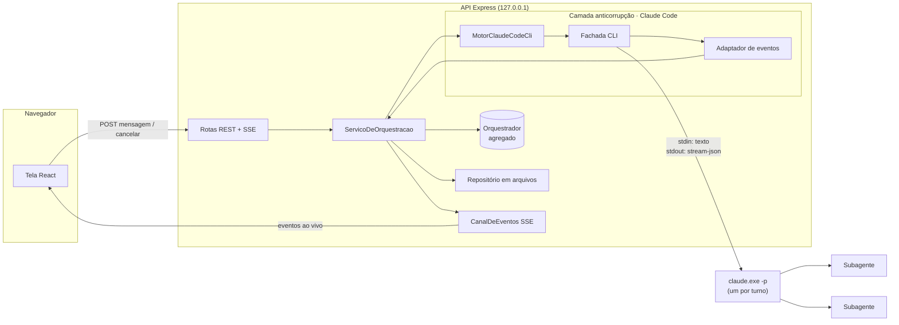

# Orquestrador de Agentes

## Objetivo

Central local para trabalhar com vários agentes do Claude ao mesmo tempo, por uma tela no navegador.

Você cria **Orquestradores** — um por projeto, por exemplo — e conversa com cada um. A cada pedido, o Orquestrador **não executa nada sozinho**: divide o trabalho em subtarefas e lança **Subagentes** em paralelo, que leem, editam ou rodam comandos na pasta do projeto. A tela mostra cada Subagente ao vivo (atividade, ferramentas, tokens, resultado) e, no final, a síntese do Orquestrador.

- Vários Orquestradores rodam ao mesmo tempo, cada um na sua pasta: são terminais espalhados num canvas infinito, que você move, redimensiona e organiza. Cada Subagente aparece como um bixinho animado ligado ao terminal.
- A conversa tem memória: cada Orquestrador lembra dos pedidos anteriores.
- Por Orquestrador você escolhe os modelos, a quantidade de Subagentes (fixa ou automática com máximo) e as permissões.
- Dá para cancelar um pedido no meio, e o histórico fica salvo.

O motor é o próprio **Claude Code em modo headless**, usando o login da sua assinatura — não precisa de API key.

## Como rodar

**Pré-requisitos:** Node 22+ e o Claude Code instalado e logado (`claude` funcionando no terminal).

```bash
npm install
npm --prefix web install
cp .env.example .env   # opcional: os padrões funcionam neste computador
```

| Variável | Padrão | Para quê |
|---|---|---|
| `PORTA` | `3200` | Porta da API (escuta só em `127.0.0.1`) |
| `PASTA_RAIZ_PROJETOS` | pasta acima deste projeto (caminho relativo é resolvido a partir da pasta do app, não de onde o comando roda) | Raiz dentro da qual os Orquestradores podem trabalhar |
| `CLAUDE_CODE_BIN` | `%APPDATA%\npm\node_modules\@anthropic-ai\claude-code\bin\claude.exe` | Executável **nativo** do Claude Code (o `claude.cmd` não serve: o app inicia o processo sem shell) |
| `PASTA_DADOS` | `dados/` dentro da pasta do app | Histórico dos Orquestradores |

**Desenvolvimento** (dois terminais):

```bash
npm run dev       # API em http://localhost:3200 (recarrega ao salvar)
npm run web:dev   # tela em http://localhost:5173 (repassa /api para a 3200)
```

> Evite salvar arquivos do backend com um pedido rodando: no Windows, o `tsx watch` reinicia o servidor sem avisar o processo, e o `claude.exe` em andamento continua até terminar sozinho. O turno aparece como "interrompido" e pode ser reenviado.

**Uso no dia a dia:** dê dois cliques em **`iniciar-orquestrador.cmd`**. Ele abre uma janela própria com o servidor e, depois de alguns segundos, o navegador em http://localhost:3200. Na primeira vez, também instala as dependências e gera o build. Para desligar, feche a janela ou aperte Ctrl+C nela.

O `.cmd` sobe o servidor por um **vigia** (`scripts/manter-no-ar.cjs`, também em `npm run iniciar`):
- **religa sozinho** quando o servidor sai com erro, esperando 2 s, 4 s, 8 s… até 30 s entre as tentativas;
- **não religa** quando você fecha a janela ou aperta Ctrl+C;
- **desiste** se o servidor cair 5 vezes em 2 minutos, para mostrar o erro em vez de entrar em loop.

Ao subir, o servidor encerra os processos do Claude que tenham sobrado da queda anterior. Antes de encerrar, confere a linha de comando de cada um, para nunca derrubar uma sessão do Claude Code sua.

O equivalente manual, num terminal na pasta do app:

```bash
npm run build
npm start         # http://localhost:3200
```

> **Não suba o servidor pedindo a uma sessão do Claude Code.** Lá ele roda em segundo plano, e o Claude Code encerra processos em segundo plano quando a memória do computador fica baixa. Foi o que derrubou três orquestradores ao mesmo tempo em 28/10. Use o `.cmd` ou um terminal próprio. Se o servidor cair mesmo assim, a tela mostra o aviso **Servidor desconectado** e reconecta sozinha quando ele voltar.

**Testes e verificações:**

```bash
npm test            # domínio, adaptador do Claude Code (com saídas reais), repositório
npm run typecheck
npm run web:test    # reducer da conversa, fases, nós e layout do canvas, bixinhos e formatação
npm run web:lint
```

## Tecnologias

- **Node 22+ / TypeScript 6** (estrito, `exactOptionalPropertyTypes`), **Express 5**, **zod 4** (validação da API), **vitest**.
- **Tela:** React 19, Vite 6, Tailwind 4, react-markdown e **React Flow** (`@xyflow/react` 12) para o canvas (ver ADR-8). Tema escuro com a paleta da Anthropic (ver ADR-7). Fontes empacotadas via `@fontsource`, sem CDN: Poppins, Lora e JetBrains Mono.
- **Claude Code 2.1.x** (`claude -p --output-format stream-json`) como motor dos agentes.
- **Tempo real:** Server-Sent Events. **Persistência:** arquivos JSON/JSONL.

## Arquitetura

### Visão geral



Organização por contexto (DDD):

```
src/
  orquestracao/              domínio — linguagem do negócio, sem Express nem Claude Code
    Orquestrador.ts            raiz do agregado (conversa sobre uma pasta)
    Turno.ts, Subagente.ts     internos do agregado
    ConfiguracaoDoOrquestrador, QuantidadeDeSubagentes, PastaDeTrabalho,
    NivelDePermissao, ModeloClaude                objetos de valor
    EventoDeOrquestracao.ts    o que acontece (histórico + tela)
    InstrucoesDoOrquestrador.ts  regras de trabalho do Orquestrador e do Subagente
    ServicoDeOrquestracao.ts   casos de uso (stateless)
    MotorDeAgentes.ts, RepositorioDeOrquestradores.ts, ControleDeExecucoes.ts   portas
  infraestrutura/
    claudecode/                camada anticorrupção: Fachada (processo), Adaptador
                               (stream-json → eventos do domínio), Argumentos, Motor
    arquivos/                  repositório JSON/JSONL e listagem de pastas
    sse/, execucoes/           canal de eventos e controle de cancelamento
  controllers/                 REST + SSE, validação (zod), erros → HTTP
web/src/
  paginas/CanvasDeOrquestradores.tsx   canvas (React Flow): nós, linhas, painéis, layout salvo
  componentes/canvas/                  NoTerminal (terminal do Orquestrador), NoRascunho (configuração),
                                       NoBixinho + Bixinho (Subagente em pixel art), painéis flutuantes
  shared/estado/                       aplicarEvento (reducer da conversa + log), faseDoTurno
  shared/canvas/                       nós e linhas a partir das conversas, layout, aparência e desenhos dos bixinhos
  shared/hooks/useConversas.ts         um EventSource por terminal aberto
```

**Ciclo de um pedido:**
1. `POST /mensagens` → o agregado abre um Turno (recusa se já houver um em andamento).
2. O motor inicia `claude.exe -p` na pasta do projeto. Pelo stdin vai o texto do usuário, precedido do bloco `<configuracao-do-pedido>` (quantidade de subagentes e permissões vigentes). As regras fixas do Orquestrador e a definição do Subagente `executor` vão em arquivos temporários.
3. Cada linha `stream-json` vira evento do domínio (`subagente_iniciado`, `progresso_do_subagente`…), gravado em `eventos.jsonl` e publicado por SSE.
4. No `result` final, o Turno é concluído com a resposta e o consumo.

O primeiro turno usa `--session-id`; os seguintes, `--resume`, o que mantém a memória da conversa.

### Decisões de arquitetura (ADRs)

**ADR-1 — Motor: Claude Code headless, e não Agent SDK ou API.**
- *Contexto:* o usuário tem só a assinatura do Claude (login do Claude Code), sem API key. A política do Agent SDK pede API key para produtos construídos sobre ele.
- *Decisão:* executar o `claude.exe` oficial em modo `-p`, com o login do próprio usuário, na máquina dele. O motor fica atrás da porta `MotorDeAgentes`.
- *Consequências:*
  - funciona sem API key, mas consome a cota da assinatura (exibida na tela);
  - é para uso pessoal e local;
  - para oferecer ao time num servidor, criar um adaptador com o Agent SDK e uma API key, sem mudar o domínio.

**ADR-2 — Um processo por turno, com `--resume`.**
- *Contexto:* a conversa precisa de memória, e o cancelamento precisa ser confiável.
- *Decisão:* cada mensagem inicia um processo novo que retoma a sessão. Cancelar é `taskkill /T /F`, que derruba a árvore inteira, incluindo comandos abertos por Subagentes.
- *Consequências:*
  - não há processo vivo entre turnos para gerenciar;
  - cada turno paga o tempo de partida do Claude Code (poucos segundos);
  - ao retomar uma sessão, o Claude Code mantém o prompt de sistema gravado na criação e ignora um `--append-system-prompt-file` novo (verificado na 2.1.312). Por isso, o que muda entre pedidos (quantidade e permissões) vai no início de cada mensagem, num bloco `<configuracao-do-pedido>` que declara substituir as instruções anteriores. `--model`, `--agents` e as permissões por flag valem a cada processo.

**ADR-3 — Permissões por `dontAsk` + lista explícita.**
- *Contexto:* não há ninguém no terminal para aprovar ações.
- *Decisão:* o que não está liberado é negado. `--tools` e `--allowedTools` vêm do nível escolhido:
  - **leitura:** Read, Glob, Grep, WebSearch, WebFetch;
  - **edição:** o anterior + Edit, Write, NotebookEdit;
  - **comandos:** o anterior + PowerShell e Bash.

  `git commit` e `git push` são negados em todos os níveis. `--strict-mcp-config` deixa de fora os MCPs da conta.
- *Consequências:*
  - as negações aparecem na tela;
  - as regras valem para a sessão inteira, então não dá para proibir ferramentas só para o Orquestrador. A regra "só orquestre" vem das instruções, e a tela avisa quando ele usa uma ferramenta diretamente.

**ADR-4 — SSE em vez de WebSocket.**
- *Contexto:* o fluxo ao vivo é só do servidor para a tela; as ações do usuário são poucas.
- *Decisão:* `EventSource` por Orquestrador; as ações vão por POST.
- *Consequências:* o navegador reconecta sozinho e envia `Last-Event-ID`, e o servidor reenvia só o que faltou. Sem dependência extra.

**ADR-5 — Histórico em arquivos (JSON + JSONL), sem banco.**
- *Contexto:* ferramenta local de uma pessoa.
- *Decisão:* `dados/orquestradores/<id>/orquestrador.json` guarda o estado do agregado, gravado de forma atômica. `eventos.jsonl` é append-only e reproduz a conversa na tela.
- *Consequências:*
  - zero infraestrutura;
  - no boot, turnos que estavam rodando viram `interrompido`;
  - para vários usuários, trocar o repositório (a porta já existe).

**ADR-6 — Saída do Claude Code isolada numa camada anticorrupção.**
- *Contexto:* o formato `stream-json` evolui por versão e usa termos próprios (`task_id`, `tool_use_id`, `parent_tool_use_id`).
- *Decisão:* `AdaptadorDeEventosDoClaudeCode` traduz para eventos do domínio, testado com saídas reais capturadas (`src/infraestrutura/claudecode/fixtures`).
- *Consequências:* quando o Claude Code mudar o formato, só o adaptador muda.

**ADR-7 — Identidade visual do Claude, e não o Design System Vaccinar.**
- *Contexto:* a tela é um console de agentes do Claude, e o usuário pediu um visual mais técnico com as cores da Anthropic.
- *Decisão:* tema escuro com a paleta da identidade da Anthropic:
  - escuro `#141413`, claro `#faf9f5`;
  - cinzas `#b0aea5` e `#e8e6dc`;
  - acentos laranja `#d97757`, azul `#6a9bcc` e verde `#788c5d`.

  Tipografia: Poppins nos títulos, Lora (serifada, como no claude.ai) nas respostas do Claude e JetBrains Mono nos dados técnicos. Os ícones foram desenhados para esta tela; não há logotipo nem marca da Anthropic.
- *Consequências:*
  - diverge do DS Vaccinar, que segue valendo para os outros sistemas;
  - as cores continuam centralizadas em tokens (`web/src/theme/index.css`), com os mesmos nomes semânticos (`--primary`, `--surface`, `--border`…) e as mesmas classes (`.btn`, `.card`, `.field`, `.alert`);
  - os componentes não têm hexadecimal solto.

**ADR-8 — Canvas com React Flow, e não layout fixo nem uma biblioteca de desenho.**
- *Contexto:* o usuário quer trabalhar como no Excalidraw: vários terminais espalhados, que se movem e se redimensionam, e os Subagentes visíveis como bixinhos ligados ao seu Orquestrador.
- *Decisão:* usar `@xyflow/react` (MIT), que já traz canvas infinito, arrasto, redimensionamento (`NodeResizer`), zoom, minimapa e linhas animadas entre nós.
  - **Nós:** terminais, rascunhos e bixinhos são nós próprios em React. Os bixinhos são filhos do terminal (`parentId`) e acompanham quando ele é movido.
  - **Estado ao vivo:** fica num contexto, e os nós guardam só ids. Assim o canvas não é recriado a cada evento do Claude.
  - **Layout:** posições, tamanhos e zoom ficam no `localStorage`, por serem preferência de quem olha. O histórico continua no servidor.
- *Consequências:*
  - o React Flow mostra o crédito "React Flow" no canto, como pede a licença;
  - o pacote da tela ficou maior (~400 kB), irrelevante para um app local;
  - Excalidraw e tldraw foram descartados: são editores de desenho, ruins para hospedar componentes interativos (terminais com prompt), e o tldraw exige licença para uso comercial.

Detalhes observados no Claude Code 2.1.312 e tratados no adaptador:
- no Windows, a ferramenta de terminal é `PowerShell`;
- `modelUsage` acumula a sessão, então o consumo do turno vem de `model_usage_since_last_result`;
- um Subagente lançado em segundo plano devolve um retorno vazio na hora, e o relatório chega depois, no `task_notification`;
- nesse caso, o processo emite mais de um `result`;
- enquanto raciocina, o Claude Code emite `system/thinking_tokens` (a estimativa de tokens). Eles viram o **sinal de vida**, mandado à tela como evento SSE `sinal`: não entra no histórico nem na sequência;
- imagens só entram com `--input-format stream-json`: a mensagem vira uma linha JSON com blocos `text` e `image`;
- a atualização automática do Claude Code troca o `claude.exe`. Durante alguns segundos o arquivo some (`ENOENT`), então o app tenta iniciar de novo até 6 vezes, com 2 s entre as tentativas.

## Manuais e APIs

### Endpoints

Todos sob `/api`. Erros vêm como `{ "erro": "mensagem para o usuário" }`, com os status:
- **400:** dados inválidos;
- **404:** não encontrado;
- **409:** já existe pedido em andamento, ou não há pedido para cancelar;
- **500:** erro inesperado.

| Método | Rota | Entrada | Resposta |
|---|---|---|---|
| GET | `/saude` | — | `{ ok: true, iniciadoEm, memoria: { totalBytes, livreBytes, servidorBytes, agentesBytes, porOrquestrador } }`. A tela consulta a cada 3 s; um `iniciadoEm` diferente indica que o servidor reiniciou. A memória é medida a cada 5 s. |
| GET | `/pastas` | — | `{ raiz, pastas: [{ nome, caminho }] }` |
| GET | `/orquestradores` | — | `[ResumoDoOrquestrador]` |
| POST | `/orquestradores` | `{ nome, pastaDeTrabalho, modeloDoOrquestrador, modeloDosSubagentes, quantidadeDeSubagentes: { modo: "fixa" \| "automatica", limite: 1–10 }, nivelDePermissao }` | 201 + orquestrador com `turnos` |
| GET | `/orquestradores/:id` | — | orquestrador com `turnos` (resumo de cada Turno e seus Subagentes) |
| PATCH | `/orquestradores/:id/configuracao` | qualquer subconjunto dos campos de configuração | 200 + resumo (vale a partir do próximo pedido) |
| POST | `/orquestradores/:id/mensagens` | `{ texto, imagens?: [{ nome, tipoDeMidia: image/png|jpeg|gif|webp, base64 }] }` (até 5 imagens de 5 MB) | 202 `{ turnoId }` |
| GET | `/orquestradores/:id/anexos/:arquivo` | — | a imagem anexada (para as miniaturas) |
| POST | `/orquestradores/:id/cancelar` | — | 202 `{ cancelando: true }` |
| DELETE | `/orquestradores/:id` | — | 204 (409 se houver pedido em andamento) |
| GET | `/orquestradores/:id/eventos` | cabeçalho opcional `Last-Event-ID` ou `?desde=` (última sequência recebida) | `text/event-stream`: histórico desde a sequência informada + eventos novos |

Valores aceitos:
- **Modelos:** `opus`, `sonnet` ou `haiku`. O Claude Code resolve o apelido para a versão vigente.
- **Níveis de permissão:** `leitura`, `edicao` ou `edicao_e_comandos`.

`ResumoDoOrquestrador`:

```json
{
  "id": "…", "nome": "Painel de salas",
  "pastaDeTrabalho": "C:\\Users\\…\\salasdereuniao-painel-app", "nomeDaPasta": "salasdereuniao-painel-app",
  "situacao": "ocioso | trabalhando",
  "configuracao": { "modeloDoOrquestrador": "opus", "modeloDosSubagentes": "sonnet",
                    "quantidadeDeSubagentes": { "modo": "automatica", "limite": 3 }, "nivelDePermissao": "leitura" },
  "criadoEm": "…", "totalDeTurnos": 2,
  "ultimoTurno": { "texto": "…", "situacao": "concluido", "iniciadoEm": "…" }
}
```

**Eventos SSE.** Cada evento é um `data:` com JSON `{ tipo, turnoId, sequencia, em, … }`.

| `tipo` | Campos | Quando |
|---|---|---|
| `turno_iniciado` | `texto`, `configuracao`, `anexos` | o usuário enviou uma mensagem |
| `sessao_iniciada` | — | o Claude Code abriu (ou retomou) a sessão |
| `texto_do_orquestrador` | `texto` | o Orquestrador escreveu algo |
| `ferramenta_do_orquestrador` | `ferramenta`, `detalhe` | o Orquestrador usou uma ferramenta em vez de delegar |
| `subagente_iniciado` | `subagenteId`, `descricao`, `tarefa` | um Subagente foi lançado |
| `progresso_do_subagente` | `subagenteId`, `atividade`, `ultimaFerramenta`, `tokens`, `ferramentasUsadas`, `duracaoMs` | a cada ferramenta usada pelo Subagente |
| `texto_do_subagente` | `subagenteId`, `texto` | o Subagente escreveu algo |
| `subagente_concluido` | `subagenteId`, `situacao` (`concluido` · `falhou` · `cancelado`), `resumo`, `tokens`, `duracaoMs` | o Subagente terminou |
| `resultado_do_subagente` | `subagenteId`, `resultado` | relatório completo do Subagente |
| `permissao_negada` | `ferramenta`, `detalhe` | uma ação foi bloqueada pela permissão |
| `uso_da_cota` | `janelas: [{ nome, utilizacao, renovaEm, situacao }]` | uso dos limites da assinatura |
| `turno_concluido` | `resposta`, `uso: { duracaoMs, tokensDeEntrada, tokensDeSaida, subagentesLancados }` | fim com sucesso |
| `turno_cancelado` · `turno_falhou` (`motivo`) · `turno_interrompido` | — | outros finais |
| `configuracao_alterada` | `configuracao` (sem `turnoId`) | a configuração mudou |

### Guia do usuário

A tela é um **canvas infinito**, como o Excalidraw: cada Orquestrador é uma janela de terminal, e cada Subagente que ele instancia vira um bixinho ligado ao terminal.

**Navegar no canvas:**
- arrastar o fundo move o canvas;
- a roda do mouse rola; **Ctrl + roda** dá zoom;
- os botões no canto inferior esquerdo aproximam, afastam e enquadram tudo;
- o minimapa no canto inferior direito mostra onde cada coisa está.

1. **Criar um Orquestrador:** clique em *+ Novo orquestrador*. Abre um terminal de configuração: escolha a **pasta** do projeto (o nome é sugerido a partir dela). Depois defina:
   - **Modelos:** o do Orquestrador planeja e sintetiza; o dos Subagentes executa. Opus é o mais capaz; Haiku é rápido e gasta menos cota.
   - **Quantidade de subagentes:** *Automática* deixa o Orquestrador decidir, até o máximo. *Fixa* obriga a dividir o pedido nesse número.
   - **Permissões:** *Somente leitura*, *Ler e editar arquivos* ou *Editar e rodar comandos*. Commit e push são sempre bloqueados.

   Em *iniciar orquestrador*, o terminal de configuração vira o terminal do Orquestrador, no mesmo lugar.
2. **Mexer nos terminais:**
   - **mover:** arraste pela barra de título;
   - **redimensionar:** clique no terminal para selecioná-lo e puxe as bordas ou os cantos;
   - **organizar:** o botão *Organizar* coloca todos lado a lado;
   - **fechar:** o *✕* só tira o terminal do canvas; o Orquestrador e o histórico continuam salvos. Para reabrir, clique nele na lista *orquestradores*, no canto superior esquerdo.

   O canvas é lembrado neste navegador: posições, tamanhos e zoom.
3. **Conversar:** digite no prompt `❯` e aperte **Enter** (Shift+Enter quebra linha). O terminal mostra o log de cada pedido: quando o Orquestrador instancia cada agente (`⚡`), o que cada bixinho está fazendo, quando termina (`✓`) e, no fim, a resposta. Para continuar o assunto, mande outra mensagem: ele lembra da conversa.
   - **Imagens:** cole com **Ctrl+V** no prompt, arraste para o terminal ou use o **📎**. São até 5 imagens (PNG, JPEG, GIF ou WebP, até 5 MB cada), com miniaturas antes de enviar e no histórico; clique numa miniatura para abrir em tamanho real. O Orquestrador vê a imagem, e os subagentes podem abri-la pelo caminho em disco, que ele repassa.
   - **Está pensando ou travou?** Enquanto o pedido roda, o terminal mostra a fase e o tempo total. Abaixo, uma linha com **♥**, que pulsa a cada notícia do Claude: *pensando · ~N tokens de raciocínio · último sinal há Xs*. Se o silêncio passar do normal (90 s pensando, 5 min com subagentes executando, já que um build ou teste longo pode demorar), ela vira um **⚠ sem notícias há…** e sugere cancelar (Esc) e reenviar.
4. **Os bixinhos:** cada Subagente nasce abaixo do terminal, com nome (ex.: *Pixel #03eb*), aparência própria e uma linha até o Orquestrador.
   - **Trabalhando:** pula, pisca e mostra num balão a atividade atual (ex.: `Reading src\Periodo.ts`). A linha fica laranja e animada.
   - **Concluído:** comemora com um pulinho, diz *pronto!* e a linha fica verde.
   - **Falhou:** fica tonto e a linha fica vermelha.
   - **Cancelado:** dorme.

   Clique num bixinho para ver a ficha dele: tarefa recebida, cronômetro, tokens e relatório completo. Os bixinhos se movem junto com o terminal, mas também podem ser arrastados. A cada pedido novo, os do pedido anterior saem do canvas; o histórico deles continua no terminal.
5. **Vários projetos ao mesmo tempo:** crie ou abra quantos terminais quiser e espalhe pelo canvas. Cada um trabalha em paralelo com os seus bixinhos.
6. **Cancelar:** com um pedido rodando, aperte **Esc** no prompt ou clique em *cancelar*. O Orquestrador e todos os Subagentes são encerrados.
7. **Reconfigurar ou excluir:** use o *⚙* na barra do terminal. Mudanças valem a partir do próximo pedido. Excluir apaga o histórico daquele Orquestrador.
8. **Cota e memória:** o canto superior direito mostra quantos orquestradores e agentes estão trabalhando, o uso dos limites da assinatura (5 horas / 7 dias) e a **RAM livre** do computador, com quanto os agentes estão usando. Cada terminal com pedido rodando mostra a RAM do seu processo na barra de título.
   - **Memória baixa** (menos de 1,5 GB ou 10% livres): aparece um alerta amarelo.
   - **Memória crítica** (menos de 0,8 GB ou 5%): o alerta fica vermelho. Espere os pedidos terminarem, feche programas ou use Sonnet/Haiku nos subagentes.

   Vários Subagentes Opus em paralelo consomem a cota rapidamente. Se ela acabar, o pedido termina com a mensagem do Claude no terminal.

9. **Se o servidor cair:** aparece no topo a faixa vermelha **Servidor desconectado**, com o tempo fora do ar e como subir de novo.
   - O canvas fica cinza e as animações param.
   - Dá para continuar escrevendo nos terminais, mas o envio fica bloqueado.
   - A aba do navegador mostra "⚠ Desconectado".

   Quando o servidor volta, a tela reconecta sozinha e mostra **Servidor reconectado**. Se ele foi reiniciado, os pedidos que rodavam aparecem como interrompidos; é só reenviar.

**Avisos que podem aparecer:**
- *"usou … sem delegar"* (no log do terminal): o Orquestrador fez parte do trabalho em vez de delegar. O resultado vale, só não foi paralelizado.
- *"bloqueado: …"*: um agente tentou algo fora do nível escolhido (por exemplo, editar em modo leitura, ou fazer `git commit`).
- *"turno interrompido"*: o servidor reiniciou durante o pedido. Envie de novo.
